<div align="center">

# technical-knowledge

**Real defects dissected, papers and good writing deconstructed — engineering knowledge woven into a web.**

[](#validation)
[](#what-is-in-here)
[](#what-every-note-answers)
[](#design-notes)
[](https://www.python.org/)
[](#weekly-auto-update)

[简体中文](README.zh.md) · **English**

[Quick start](#quick-start) · [The site](#the-site) · [Weekly auto-update](#weekly-auto-update) · [Reusable code](#reusable-code) · [Design notes](#design-notes) · [Validation](#validation)

</div>

---

Real defects from upstream open-source projects, papers, blog posts and engineering
blogs of tech companies, deconstructed into **452 structured notes** across six
domains. Every note runs from *what was stuck before this existed* to *when to
leave it alone* — numbers carrying their test conditions, conclusions carrying
their limits.

Defect analysis is the most complete sample here: from individual cases to a
system of patterns, every case traceable to an upstream commit.

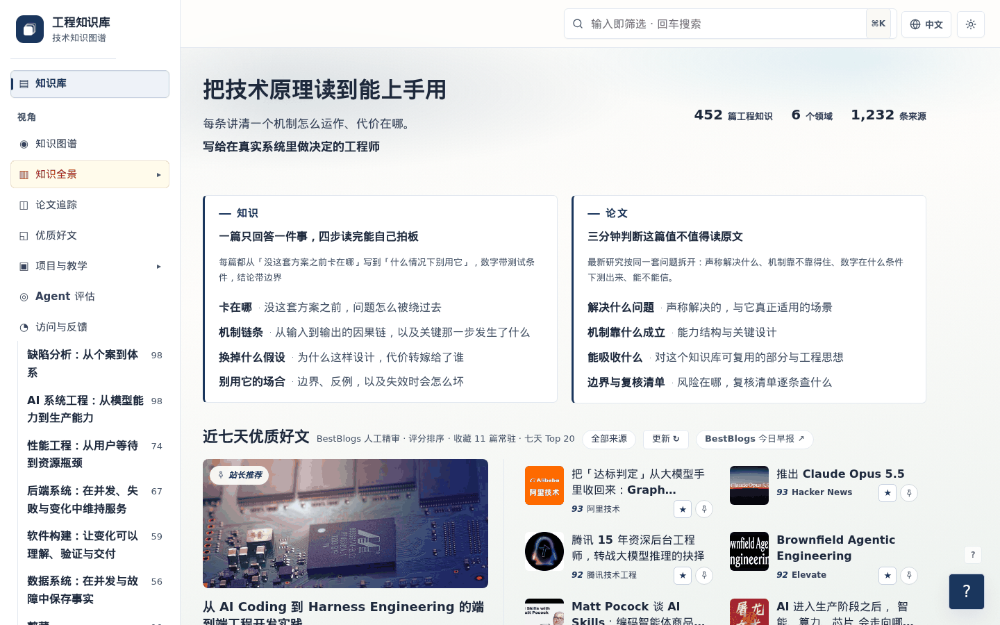

<details>
<summary><b>All screenshots</b> — nine pages, light and dark</summary>

**Knowledge views**

| Home | Note |
|---|---|
|  | 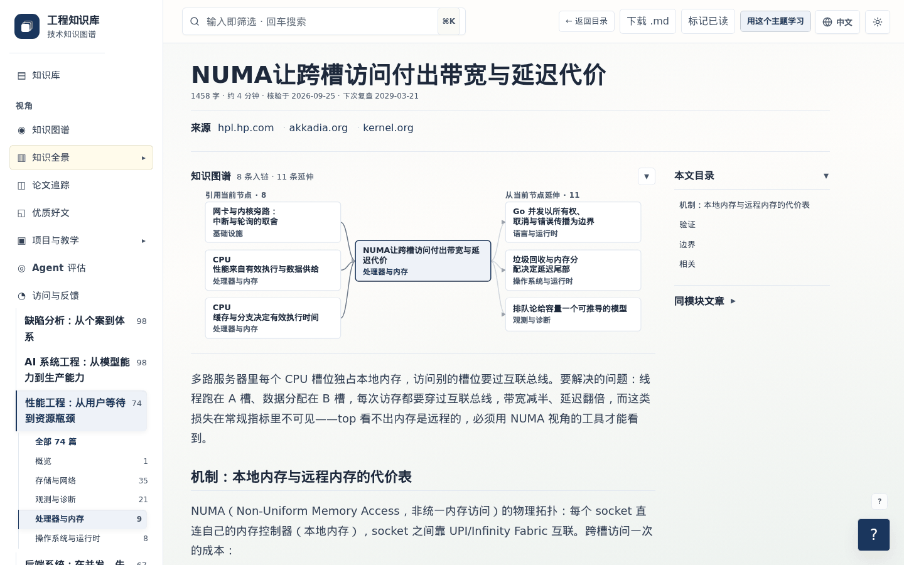 |
| **Knowledge graph** | **Panorama** |
| 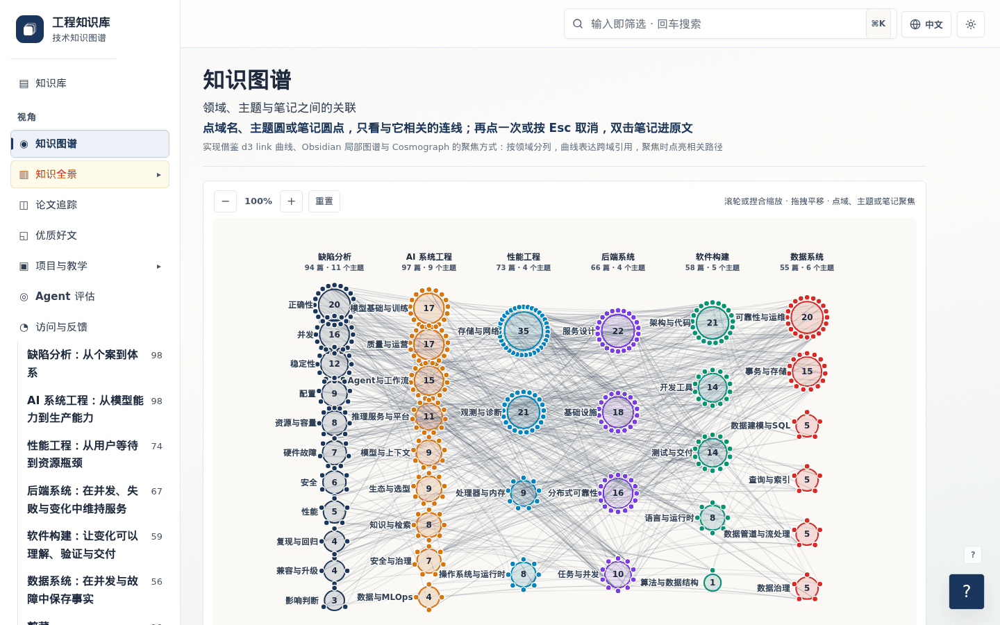 | 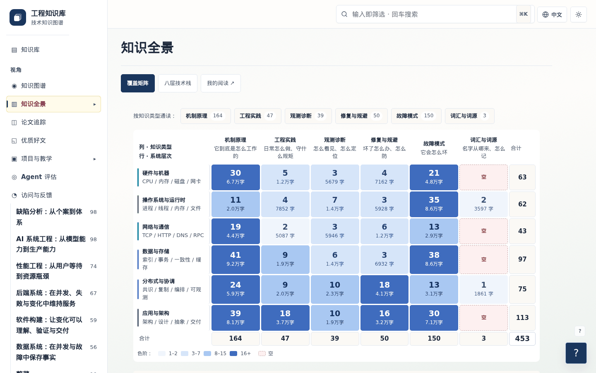 |
| **Learning progress** | |
| 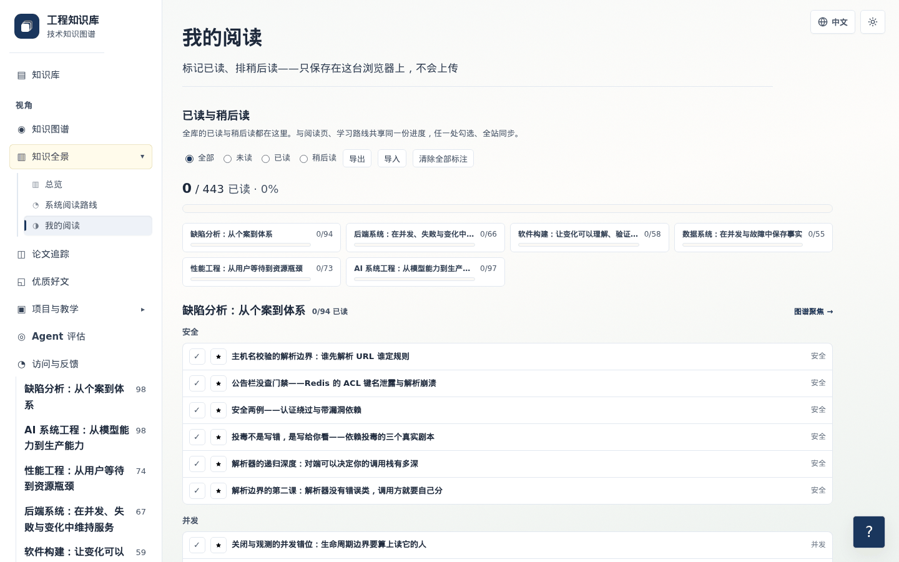 | |

**Libraries**

| Papers | Sources |
|---|---|
| 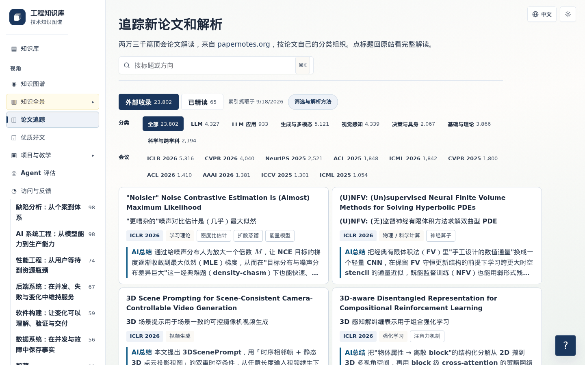 | 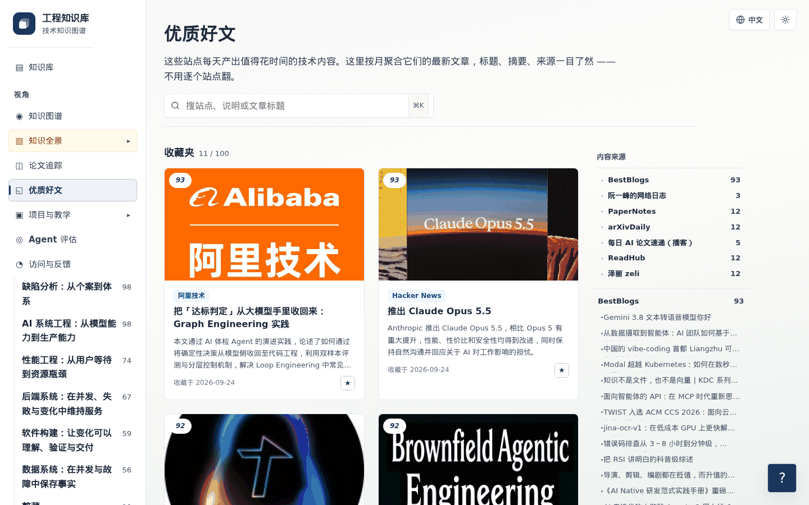 |
| **Learning centre** | **Upstream projects** |
| 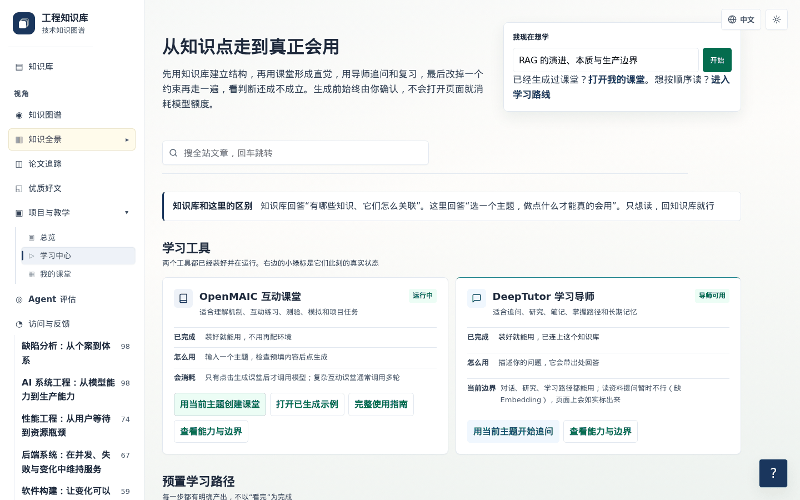 | 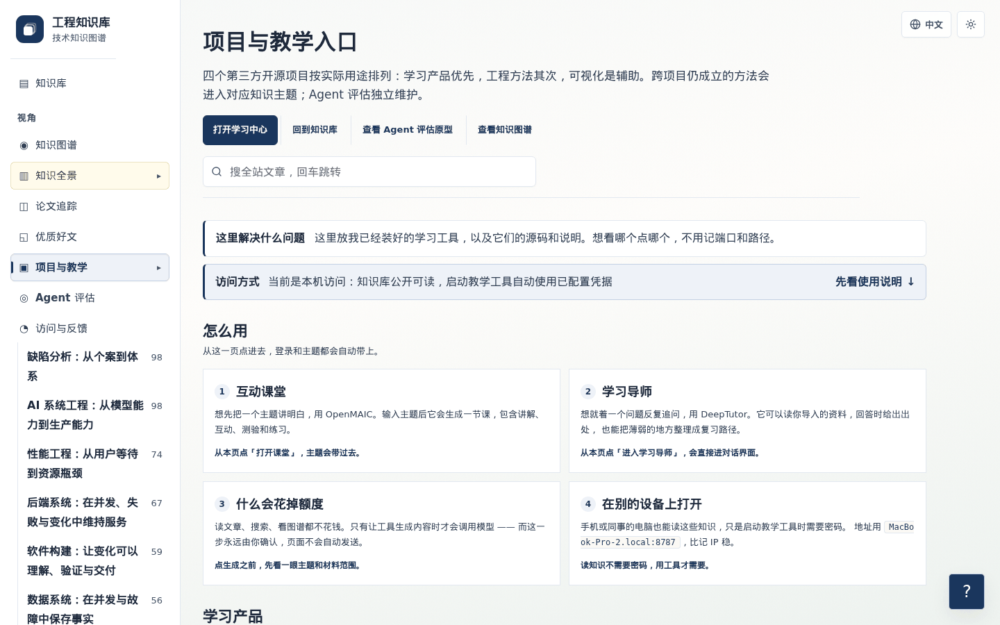 |

**Dark mode**

| Home | Note | Graph |
|---|---|---|
| 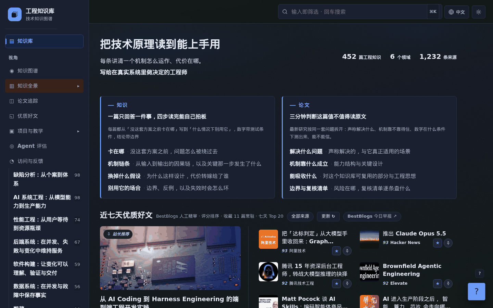 | 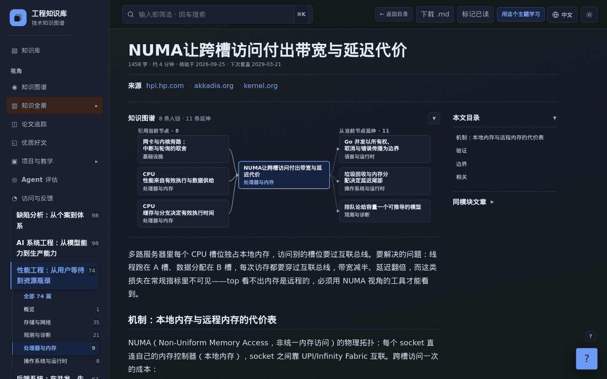 | 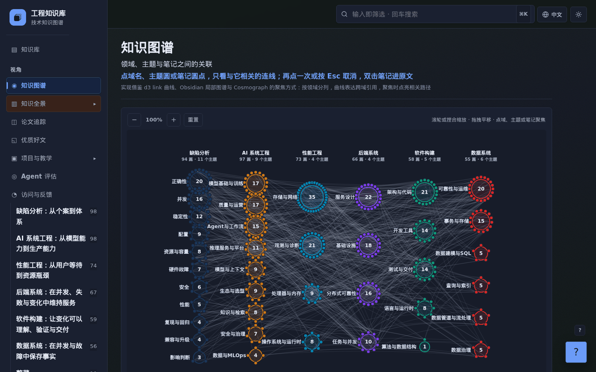 |

</details>

## What every note answers

Not encyclopedia entries about *what a thing is*. Every note is taken apart along
the same questions:

| | |
|---|---|
| **What was stuck** | How the problem was worked around before this existed |
| **The mechanism** | The causal chain from input to output, and what happens at the decisive step |
| **Which assumption it traded** | Why this design, and who pays the cost |
| **When to leave it alone** | Limits, counter-examples, and how it fails |

One test decides it: **delete the product names and the buzzwords — if only a
slogan remains, the reusable mechanism has not been extracted yet.**

A performance number without its test conditions is not a fact. "2x faster" says
nothing until it says on what data size, what version, what hardware. Anything
read online is a lead, not a source — it goes in only after checking the official
documentation, a paper, or a local run.

> **On language.** The notes are written in Chinese, because that is the language
> they were written in, and machine-translating an explanation of a mechanism
> produces something that reads fluently and is wrong. This README and the site
> interface are available in both languages.

## Quick start

```bash
python3 -m venv .venv
. .venv/bin/activate
python3 -m pip install -r requirements.txt
./run-site.sh
```

Use Python 3.10 or newer. Supply `KNOWLEDGE_SITE_PASSWORD` through the environment
on Linux. There is no build step — the site reads the Markdown directly, so save
and refresh.

Open `vault/` in Obsidian to edit.

## The site

| Route | What it does |
|---|---|
| `/` | Home, domain index, knowledge terrain |
| `/?view=graph` | Knowledge graph: relations, system layers, selection quadrant |
| `/?view=panorama` | Panorama: levels and types sliced by MECE |
| `/?view=progress` | Learning progress |
| `/papers` | Paper analyses — decide in three minutes whether the full paper is worth it |
| `/sources` | Source library and update log |
| `/learn` | Learning centre: OpenMAIC classroom, DeepTutor tutor |
| `/projects` | Upstream source snapshots and integration notes |
| `/apps/agent-evaluation` | Agent evaluation prototype |

The interface is available in **Chinese and English**. The notes themselves stay in
the language they were written in — a note with no English version says so rather
than pretending otherwise.

## Weekly auto-update

AI technology news is scanned and updated every Monday at 09:00, producing a
weekly delta summary. Any Agent CLI with web search can run it; system crontab
triggers it:

```
0 9 * * 1 cd <repo> && <agent-cli> -p "$(cat scripts/radar_weekly_prompt.md)" -y >> logs/radar_weekly.log 2>&1
```

Why weekly: protocol revisions arrive monthly, inference engines ship every two or
three weeks, vendor deprecations are announced in quarterly batches. In a given
week only a handful of changes actually affect engineering choices — daily updates
would be noise, monthly would miss deprecation dates. The BestBlogs stream already
covers day-level freshness; the two tiers do not overlap.

Measured over two runs (2026-09-23): given a stale baseline, the agent caught the
full delta including vLLM v0.29.0/v0.30.0 and Evals turning read-only, produced a
per-source verification table, and fabricated nothing. A week with no new facts is
reported as zero change rather than an empty update. About 4 minutes per run.

Full mechanism in `vault/知识库管理/方法/AI技术动态每周更新任务.md`; prompt in
`scripts/radar_weekly_prompt.md`.

## Reusable code

Not just knowledge — there is code here you can take and use.

### `packages/agent-foundation`

Session, context and memory infrastructure independent of any agent framework,
model, CLI implementation, task format or application system. It defines no domain
objects, no application rules, and no protocol for a specific tool or model.

```python
from agent_foundation import Event, recovery, context, memory
```

| Module | Capability |
|---|---|
| `cli_session` | stdout/stderr reading, hard timeout, idle timeout, heartbeat, process-group reaping, JSONL/SSE stream cleanup |
| `Event` | Generic append-only session events; assumes no tool name, model name or output field |
| `recovery` | Atomic save of opaque continuation checkpoints, exponential backoff with caller-defined retry boundaries |
| `TranscriptWriter` | JSONL transcripts, secret redaction, reads tolerant of interrupted trailing lines |
| `context` | RAG chunking, retrieval protocol, RRF fusion, duplicate filtering, context budget |
| `memory` | Short-term session window, long-term records, expiry filtering, time-decay ranking |

Usable directly from a local CLI, a remote agent bridge, a browser-automation
agent, an MCP host, or a long-lived session.

### Skills

Engineering-collaboration agent skills, installed on this machine:
`projects/mattpocock-skills/` (requirement alignment, research, specs, TDD, code
review, architecture improvements — MIT, ⭐ 263.9k).

### Upstream source snapshots

`projects/` holds full git-tracked source of four upstream projects, each with its
own licence:

- `archify/` — architecture, workflow and relation diagrams, ⭐ 65.4k
- `OpenMAIC/` — interactive classroom runtime, ⭐ 37.5k
- `DeepTutor/` — retrieval, memory and study workspace, ⭐ 39.9k
- `mattpocock-skills/` — engineering-collaboration agent skills

## What is in here

```
vault/                         open directly in Obsidian
  工程知识/                     six domains, one note per engineering question
  知识库管理/                   sourcing, updating, quality and maintenance rules
Clippings/                   web clippings
site/                          HTTP server and Markdown rendering
packages/agent-foundation/     sessions, context, memory, recovery, evidence
apps/agent-evaluation/         Agent evaluation: bind judgments to evidence
projects/                      full upstream source snapshots, each with its licence
scripts/                       audit, update and deploy scripts
docs/shots/                    site screenshots
```

## Design notes

Three decisions shaped everything else.

**No frontend build step.** `site/server.py` uses Python's standard-library HTTP
server and `markdown-it-py`. No bundler — edit and refresh.

**One source for one thing.** Navigation is defined once in `site/nav.js` and
rendered once by `site/shell.js`, shared by every page. That was not always true:
the site used to carry two parallel page systems, each with its own navigation and
its own sidebar renderer, and they drifted — an entry existed on one side and not
the other, and following it changed the layout. Merging them removed 63 override
rules that existed only to accommodate the duplicate.

**Evidence over assertion.** Claims in the notes carry their test conditions;
claims about the site carry a script:

| What | How |
|---|---|
| behaviour | `python3 -m pytest tests/ -q` |
| layout | `python3 scripts/layout_audit.py` |
| tokens | `python3 scripts/token_audit.py` |
| readability | `python3 scripts/contrast_audit.py` |
| copy | `python3 scripts/copy_audit.py` |
| translation | `python3 scripts/i18n_audit.py` |

All at once:

```bash
python3 scripts/check_all.py          # five checks, one verdict
python3 scripts/check_all.py --fast   # skip the two that need a browser
```

## Validation

```bash
python3 -m pytest tests/ -q        # 84 passed
```

For anything visual the rendered page is the acceptance surface: confirm it with
full-page screenshots at desktop and mobile widths, not by reading the diff.

## Updating the knowledge

Stable principles and fast-moving product facts are kept apart. A new model, a new
protocol or a new paper is registered as a source first, then judged on which notes
it affects. Facts that change — version numbers, deprecation dates, pricing,
security posture — are checked against the official documentation, not a
second-hand summary.

A paper can show that a mechanism is worth trying. Only a local run with a
before-and-after shows that it works here.

One engineering question gets one note. When two notes answer the same question,
merge the cases, mechanism, costs and validation into the one that stays, then
delete the old entry — do not leave half an answer in each.

See `vault/知识库管理/方法/一篇知识怎么写.md`.

## Deployment

Container deployment is covered by `DEPLOYMENT.md` and `docker-compose.yml`.

On a LAN, prefer `http://<host>.local:8787/`. The knowledge is publicly readable;
only launching a tool that mints a model session needs the site password. The full
trust boundary — which routes are open, which need the password, and why — is
written down in `DEPLOYMENT.md` and enforced by `site/server.py`.

## License

The knowledge text and integration code in this repository are managed through its
commit history. Third-party projects under `projects/` remain governed by their own
LICENSE and THIRD_PARTY_NOTICES.

Do not put credentials, internal addresses, user data or material you are not
authorised to redistribute into the knowledge base, the graph, or a commit.
## 部署约定（对外入口不可改）

- 对外唯一入口：站点 nginx 监听 28788，任何情况下不改端口、不改域名。
- 后端内部进程端口可自由变更，只影响上游地址，访客不可见。
- 需要让改动生效时重启后端实例，不动 nginx、不动对外端口。

## Agent 工程技能已迁移

`agent_foundation`（Agent 工程知识体系与多 agent 编排技能）已合并到
[agent-skills](https://github.com/hub138/agent-skills)，本仓库不再保留副本，
避免两处维护不一致。请到该仓库的 `agent_foundation/` 与 `agent-ops/` 目录获取。
