<div align="center">

# technical-knowledge

**拆真实缺陷、解构论文与好文，把工程知识织成网络。**

[](#验证)
[](#这里有什么)
[](#证据优先于断言)
[](#设计取舍)
[](https://www.python.org/)
[](#每周自动更新)

**简体中文** · [English](README.md)

[快速开始](#快速开始) · [站点](#站点) · [每周自动更新](#每周自动更新) · [可复用代码](#可复用代码) · [设计取舍](#设计取舍) · [验证](#验证)

</div>

---

上游开源项目的真实缺陷、论文、公众号文章和科技公司工程博客，被解构成六大领域的 **452 篇**结构化知识。每篇都从「没这套方案之前卡在哪」写到「什么情况下别用它」——数字带测试条件，结论带边界。

缺陷分析是这个站最完整的样本：从个案到体系，每条案例都有上游 commit 可查。

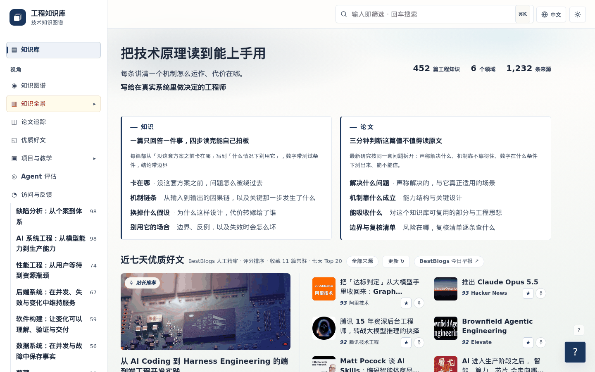

<details>
<summary><b>全部截图</b> —— 九个页面，明暗两套</summary>

**知识视图**

| 首页 | 文章页 |
|---|---|
|  | 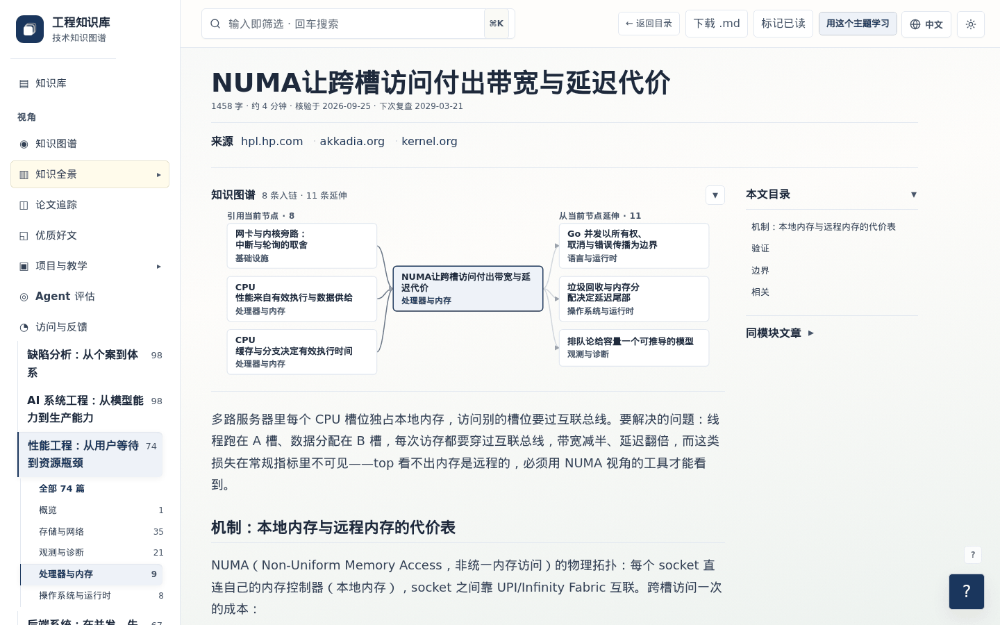 |
| **知识图谱** | **知识全景** |
| 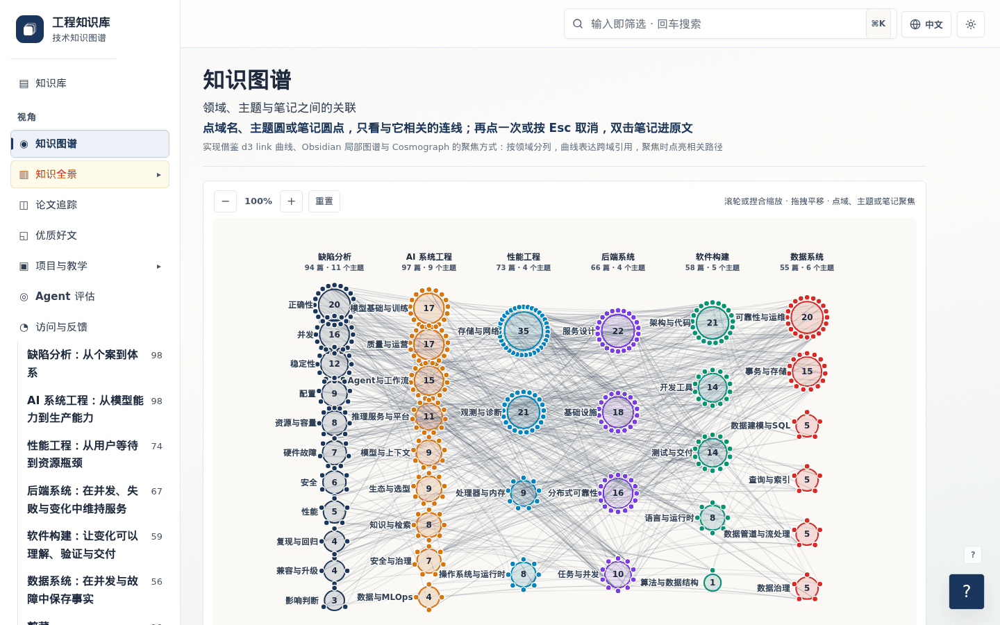 | 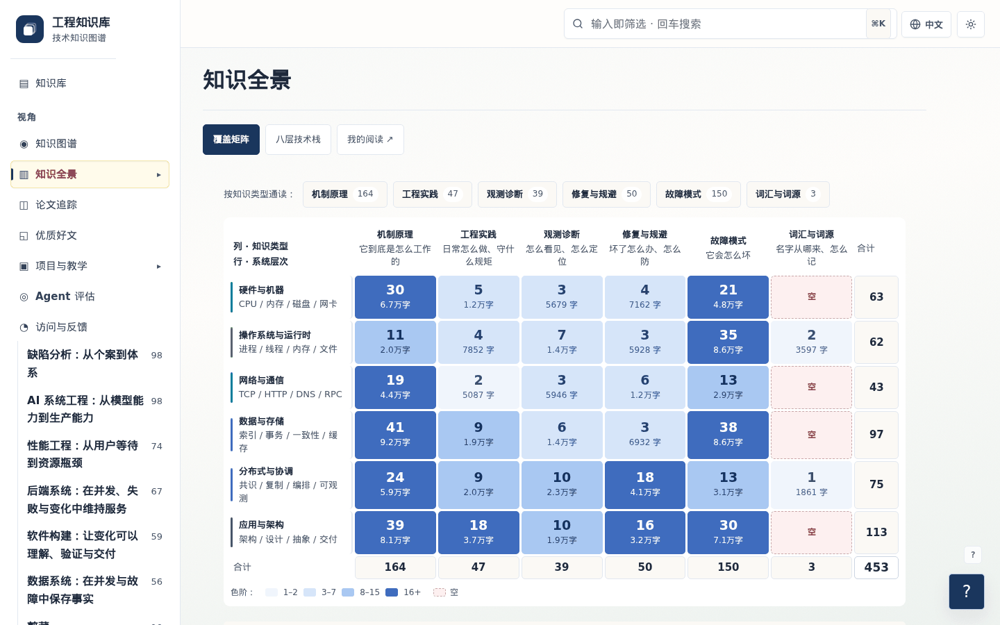 |
| **学习进度** | |
| 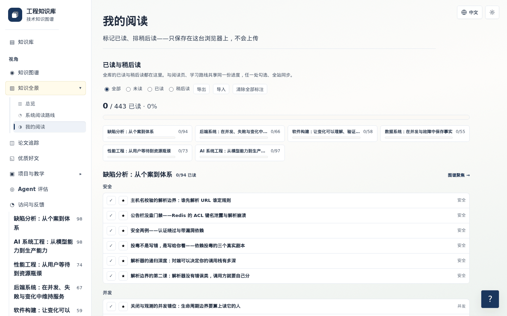 | |

**内容库**

| 论文解析 | 来源库 |
|---|---|
| 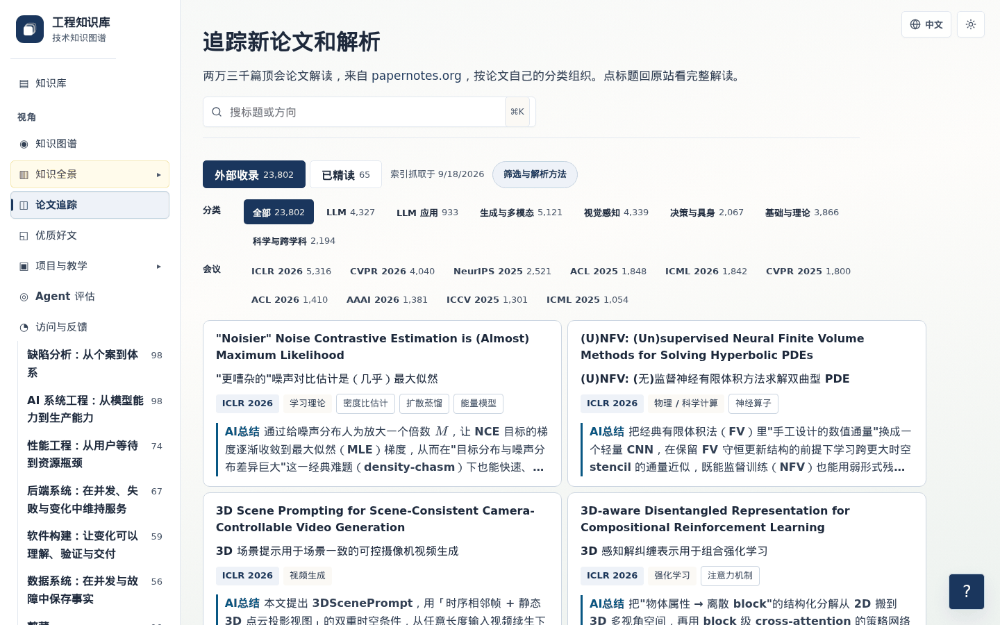 | 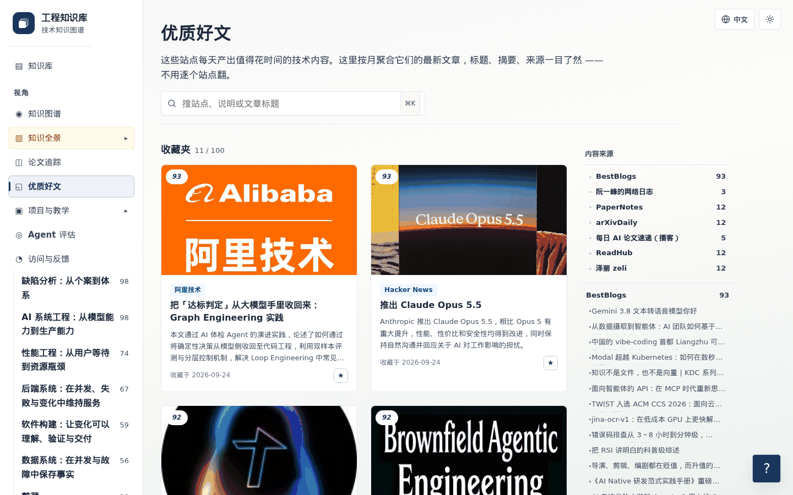 |
| **学习中心** | **上游项目** |
| 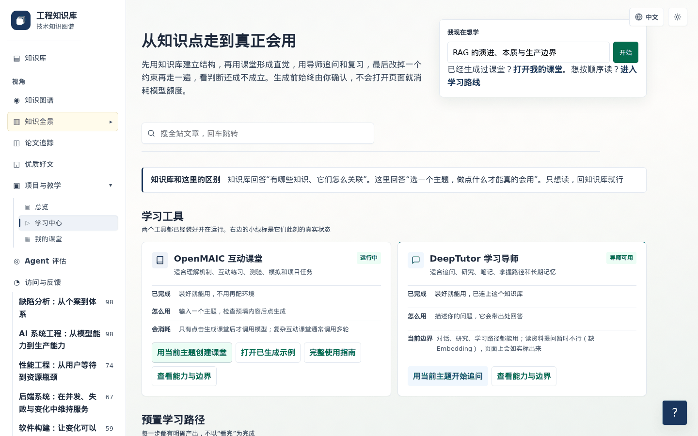 | 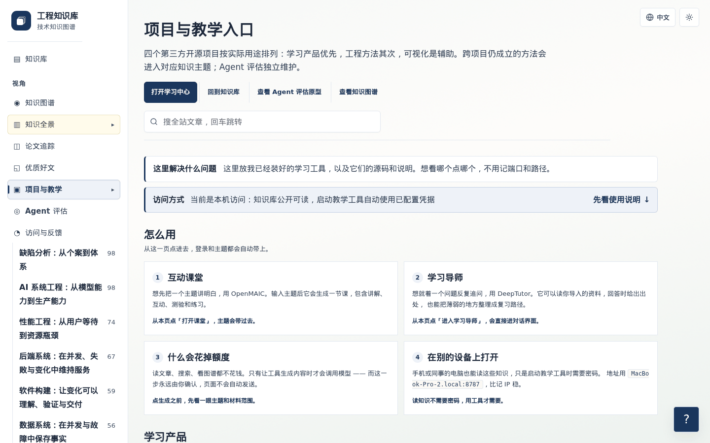 |

**暗色模式**

| 首页 | 文章页 | 知识图谱 |
|---|---|---|
| 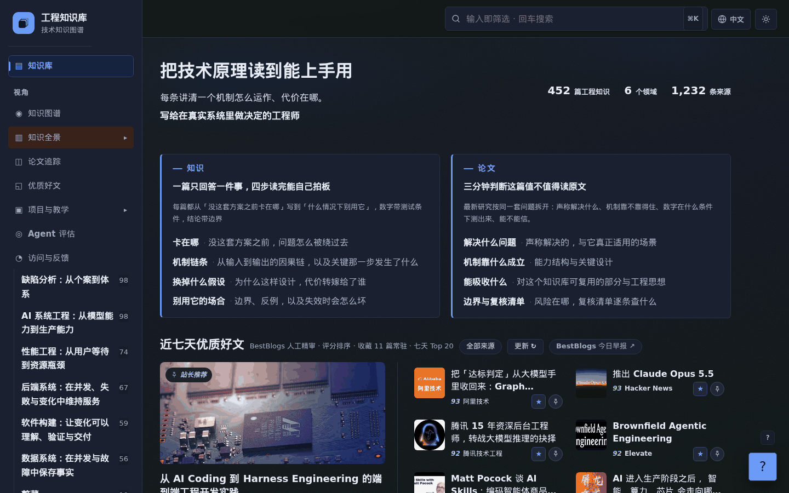 | 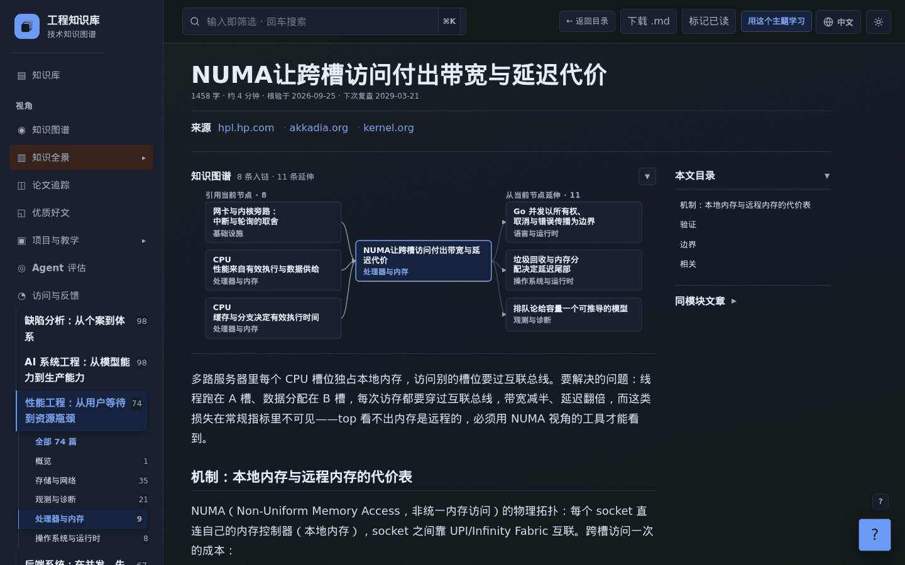 | 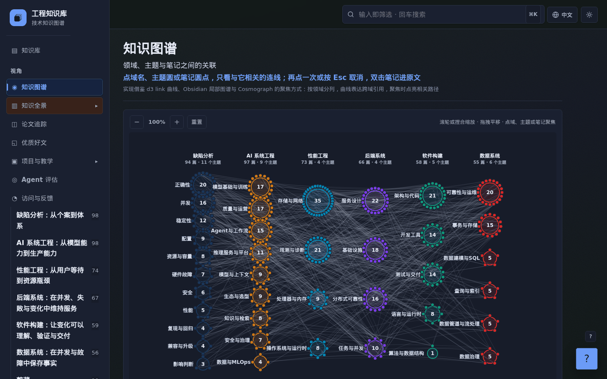 |

</details>

## 每篇回答什么

不写「是什么」的百科条目。每篇按同一套问题拆：

| | |
|---|---|
| **卡在哪** | 没这套方案之前，问题怎么被绕过去 |
| **机制链条** | 从输入到输出的因果链，关键那一步发生了什么 |
| **换掉什么假设** | 为什么这样设计，代价转嫁给了谁 |
| **别用它的场合** | 边界、反例，以及失效时会怎么坏 |

判断标准只有一条：**把产品名和流行术语删掉后，如果只剩口号，那还没抽出来可复用的机制。**

没有测试条件的效果数字不算事实——「快了 2 倍」没有意义，得说清跑在多大数据、什么版本、什么硬件上。网上读到的都是线索不是来源，查过官方文档、论文或本地跑通才写进来。

## 快速开始

```bash
python3 -m venv .venv
. .venv/bin/activate
python3 -m pip install -r requirements.txt
./run-site.sh
```

用 Python 3.10 或更新版本。Linux 上通过环境变量提供 `KNOWLEDGE_SITE_PASSWORD`。没有构建步骤——站点直接读 Markdown，保存后刷新即可。

用 Obsidian 打开 `vault/` 编辑，改完刷新页面就能看到。

## 站点

| 路由 | 作用 |
|---|---|
| `/` | 首页、领域索引、知识地形 |
| `/?view=graph` | 知识图谱：文章间关系、系统分层、选择象限 |
| `/?view=panorama` | 知识全景：按 MECE 切分层次与类型 |
| `/?view=progress` | 学习进度 |
| `/papers` | 论文解析：先扫解析，再决定读不读原文 |
| `/sources` | 来源库与更新记录 |
| `/learn` | 学习中心：OpenMAIC 课堂、DeepTutor 导师 |
| `/projects` | 上游项目源码快照与融合记录 |
| `/apps/agent-evaluation` | Agent 评估原型 |

界面支持中英切换，文章本身保持原语言——没有英文版就明说，不假装有。

## 每周自动更新

AI 技术动态每周一 09:00 自动扫描一手来源并更新，产出一周增量摘要。执行者是任意接了联网搜索的 Agent CLI，由系统 crontab 触发：

```
0 9 * * 1 cd <repo> && <agent-cli> -p "$(cat scripts/radar_weekly_prompt.md)" -y >> logs/radar_weekly.log 2>&1
```

为什么是周更：协议修订以月计，推理引擎每两三周发一版，厂商弃用按季度公布。一周里真正影响工程选择的变化通常只有几条，日更会造成噪声，月更会错过下线日期。已收录的 BestBlogs 好文流负责日级别及时性，两级互不重复。

实测记录（2026-09-23，两轮）：面对过期基线能抓全 vLLM v0.29.0/v0.30.0 与 Evals 转只读等增量，逐源给核验表，无事实编造；无新事实的周直接报告零改动，不产生空更新。单轮约 4 分钟。

完整机制见 `vault/知识库管理/方法/AI技术动态每周更新任务.md`，提示词存 `scripts/radar_weekly_prompt.md`。

## 可复用代码

仓库里不只是知识，还有能直接拿走用的东西。

### `packages/agent-foundation`

与任何 Agent 框架、模型、CLI 实现、任务格式和应用系统无关的会话、上下文和记忆基础设施。不定义领域对象、应用规则或特定工具的协议。

```python
from agent_foundation import Event, recovery, context, memory
```

| 模块 | 能力 |
|---|---|
| `cli_session` | stdout/stderr 读取、硬超时、空闲超时、心跳、进程组回收、JSONL/SSE 流清理 |
| `Event` | 通用 append-only 会话事件，不假定工具名、模型名或输出字段 |
| `recovery` | 不透明 continuation checkpoint 原子保存，调用者定义可重试边界的指数退避 |
| `TranscriptWriter` | JSONL transcript、密钥脱敏、容忍中断尾行 |
| `context` | RAG 文档切块、检索协议、RRF 融合、重复过滤、上下文预算 |
| `memory` | 短期会话窗口、长期记忆记录、过期过滤、时间衰减排序 |

可直接给本地 CLI、远程代理桥接程序、浏览器自动化代理、MCP host 或长连接会话使用。

### Skills

工程协作类 Agent 技能，已安装在本机：`projects/mattpocock-skills/`（需求对齐、研究、规格、TDD、代码审查、架构改进，MIT，⭐ 263.9k）。

### 上游项目源码快照

`projects/` 存四个上游项目的完整 git 跟踪源码，各自带 LICENSE：

- `archify/` — 架构、工作流与关系图，⭐ 65.4k
- `OpenMAIC/` — 互动课堂运行时，⭐ 37.5k
- `DeepTutor/` — 检索、记忆与学习工作台，⭐ 39.9k
- `mattpocock-skills/` — 工程协作 Agent 技能

## 这里有什么

```
vault/                         直接用 Obsidian 打开
  工程知识/                     六个领域，一个工程问题一篇
  知识库管理/                   来源、更新、质量与维护规则
Clippings/                    网页剪藏
site/                         HTTP 服务与 Markdown 渲染
packages/agent-foundation/     会话、上下文、记忆、恢复、证据
apps/agent-evaluation/         Agent 评估：把判断绑到证据
projects/                      上游源码快照，各带许可证
scripts/                       审计、更新、部署脚本
docs/shots/                    站点截图
```

## 设计取舍

三个决定塑造了其余一切。

**不设前端构建步骤。** `site/server.py` 用 Python 标准库 HTTP server 加 `markdown-it-py` 渲染。没有打包器，改完刷新就能看到。

**一件事一个来源。** 导航只在 `site/nav.js` 定义一次，由 `site/shell.js` 渲染一次，所有页面共用。以前不是这样：站点曾有两套并行页面系统，各有各的导航和侧栏渲染器，然后就漂移了——一边有这个入口另一边没有，点进去布局还不一样。合并后删掉了 63 条只为迁就重复而存在的覆盖规则。

**证据优先于断言。** 文章里的主张带测试条件，关于站点的主张带脚本：

| 查什么 | 怎么查 |
|---|---|
| 行为 | `python3 -m pytest tests/ -q` |
| 布局 | `python3 scripts/layout_audit.py` |
| 设计令牌 | `python3 scripts/token_audit.py` |
| 可读性 | `python3 scripts/contrast_audit.py` |
| 文案 | `python3 scripts/copy_audit.py` |
| 翻译 | `python3 scripts/i18n_audit.py` |

一次全跑：

```bash
python3 scripts/check_all.py          # 五项检查，一个结论
python3 scripts/check_all.py --fast   # 跳过两个需要浏览器的
```

## 验证

```bash
python3 -m pytest tests/ -q        # 84 passed
```

凡是视觉上的东西，渲染出来的页面才是验收面：用桌面和移动宽度的整页截图确认，不要靠读 diff。

## 怎么更新知识

稳定原理和快变事实分开存。新模型、新协议、新论文先登记为来源，再判断它影响哪些文章。会变的事实——版本号、弃用日期、定价、安全态势——查官方文档，不查二手摘要。

论文能说明一个机制值得试。只有本地跑出前后对比，才能说明它在这里也成立。

一个工程问题一篇知识。两篇回答同一个问题时，把案例、机制、代价和验证并进留下的那篇，然后删掉旧条目——不要各留半个回答。

见 `vault/知识库管理/方法/一篇知识怎么写.md`。

## 部署

容器部署见 `DEPLOYMENT.md` 和 `docker-compose.yml`。

局域网内推荐 `http://<host>.local:8787/`。知识公开可读，只有启动会签发模型会话的工具需要站点密码。完整信任边界——哪些路由开放、哪些要密码、为什么——写在 `DEPLOYMENT.md`，由 `site/server.py` 强制执行。

## 许可证

本仓库的知识文本与集成代码通过提交历史管理。`projects/` 下的第三方项目仍受各自 LICENSE 和 THIRD_PARTY_NOTICES 约束。

不要把凭据、内网地址、用户数据或你无权再分发的内容放进知识库、图谱或提交里。

## 部署约定

对外入口统一由 nginx 反代到一个固定端口，后端是只绑回环地址的 Python 进程：

- 对外端口与域名一经使用就不再变更（已对外宣传过，改地址等于断别人的书签）。
- 后端内部进程端口可自由变更，只影响 nginx 的转发目标，访客不可见、无感知。
- 改完代码需要生效时重启后端实例，不动 nginx、不动对外端口。
- 同一时间只保留一个后端进程；清理重复实例只动内部端口，对外端口不受影响。
- 公网地址由部署环境自行配置（环境变量 `KNOWLEDGE_SITE_PUBLIC_URL`，仓库不写死主机名）。
