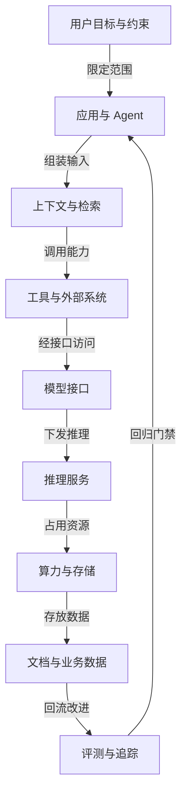
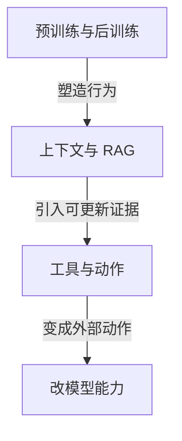
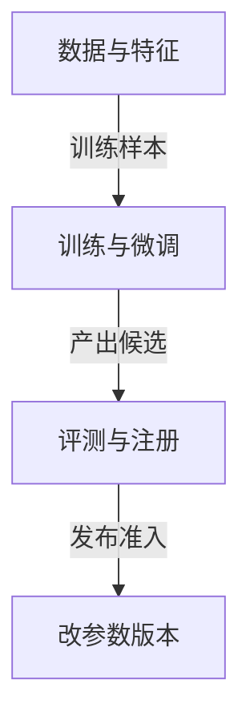
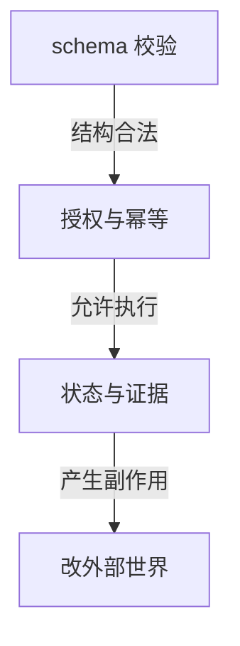
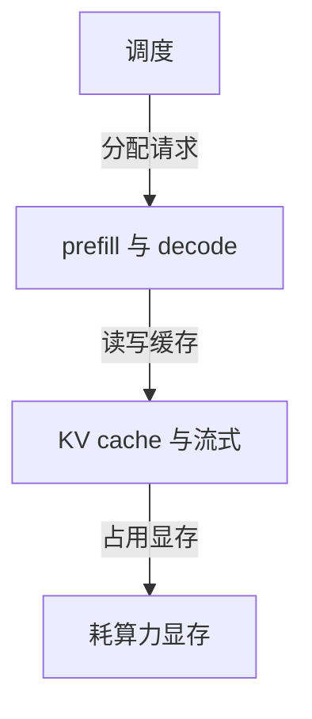
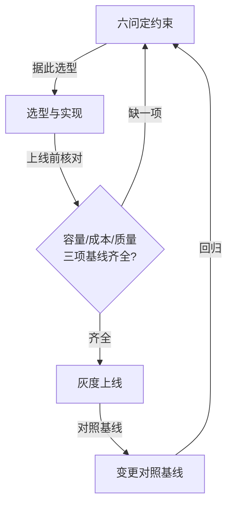

# AI 系统工程：把模型能力变成生产能力

**AI 系统工程（把大模型装进真实软件系统并让它持续可靠服务的工程方法）不是把模型接到界面上**。**读完这篇你能分清哪些事该交给模型、哪些必须系统兜住，也能说清一个 AI 功能上线前要补哪些工程**。

**打个比方：把一个能言善辩的人请进公司很容易（把模型接到界面上），让他成为一个能按时交付、出错有人兜的正式员工则完全是另一件事（建系统）——要定他的职责范围、给他配协作工具、考核产出质量、准备他请假时的顶班方案**。**这个比喻只用来区分能力来源，到此为止——人的能力来自个人，AI 的能力来自模型，系统只负责把能力稳定送达用户，不会抬高能力上限本身**。

**它要把概率性的（同样的输入每次生成可能得到不同结果）生成能力，放进有数据边界、执行语义、容量约束和质量反馈的软件系统**。**模型决定能力上限（取决于可训练参数的总量，通常以十亿计）、训练数据与算法，系统做得再多也抬不高它，系统决定这份能力有多少能真正稳定地落到用户手里**。

## 接上界面之后为什么还不够用：要解决的问题

**接上界面之后，为什么立刻出现三件失控的事？模型能够生成内容，但质量随输入波动（没有人记录和回看每次生成的好坏）、单位成本不可预测（没有对每次调用记账）、故障无法定位（请求链路上没有留痕）**。**根因是模型自身只做概率生成，既没有状态、配额（可调用次数或并发的上限），也没有反馈闭环（把每次生成的好坏回收再用来纠偏的机制），状态、配额与反馈这三样只能由模型外围的系统补齐，所以三件失控的事都归系统层解决**。**本篇回答：这项能力在系统里怎样组织、模型与系统各自决定什么，以及一个 AI 应用从可用到可服务要补齐哪几层**。

## 系统分成哪几层、每层必须管住什么？

| 层 | 核心问题 | 不能向下一层转嫁的责任 |
| --- | --- | --- |
| 模型 | 能理解、推理和生成什么 | 模型不能证明外部事实，也不拥有业务权限 |
| 上下文与知识 | 本次决策应该看到什么 | 上下文越长，无关信息越多，关键信息反而被淹没，所以长上下文不能替代筛选、来源、ACL（访问控制列表：限定谁有权读哪些数据的规则）和更新 |
| 应用与 Agent | 何时调用模型、检索和工具 | 框架不能替代业务状态、幂等（同一操作执行多次与执行一次效果相同）和完成条件（判断这次运行该停下来的标准） |
| 推理服务 | 如何用有限算力交付 token（模型处理文本的最小单位，一段话被切成若干个） | GPU（图形处理器，承担推理计算的芯片）利用率不能替代端到端延迟（用户从发出请求到收到完整响应的总时长）与质量 SLO（服务级别目标：对延迟、吞吐、可用性定下并承诺达成的可测量指标） |
| 平台 | 如何版本化、发布、回滚和治理 | 部署平台只负责发版，没有对照新旧行为差异的评测证据，所以不能自动证明模型升级没有回归 |
| 质量系统 | 如何知道结果更好且风险可控 | 单一 benchmark（在固定标准数据集上测得的离线分数，离线分数高不等于真实场景好用）不能替代真实任务和线上证据 |

**这张表里只有一层是肉眼可见的：推理服务（把模型包装成可调用的在线服务）与平台最终运行在成排的服务器上**。**下图是一个装满 1U（服务器高度单位，约 4.5 厘米，一个机架能竖插几十台）服务器的机架——上面五层讨论的并发、缓存、版本化与治理，最终都压进这些风扇嗡嗡作响的金属盒子**。

> 图：装满 1U 服务器与交换机的机架，来自 [Wikimedia Commons](https://commons.wikimedia.org/wiki/File:Servers_in_a_Rack.jpg)，CC BY-SA 3.0，摄影 Abigor。

## Agent 站在系统的哪一层

**把模型能力接入真实任务时出现的一组工程问题，就是 Agent（在任务里自主调用工具、维护状态的模型应用形态）的归位依据**。**按问题归位，才能在设计时同时看见它依赖的上下文、数据、权限和运营约束**：

| 子类 | 回答的问题 | Agent 相关内容 |
| --- | --- | --- |
| Agent 与工作流 | 如何让一次运行有状态、边界和停止条件 | 工作流取舍、任务分解、反思、工具调用、多智能体与人工接管 |
| 模型与上下文 | 模型这一步应当看见什么 | 上下文选择、多轮状态、记忆、提示与缓存 |
| 知识与检索 | 如何取得可引用且有权限的事实 | RAG（检索增强生成，先从外部资料取证据再交给模型引用）数据管道、召回（把相关资料从索引里取出来）、重排（对召回结果按相关性再排序）、版本和 GraphRAG（把知识组织成图后检索） |
| 质量与运营 | 如何证明运行可靠且持续改进 | 评测集、轨迹、失败分类、成本、提示版本和回归门禁 |
| 安全与治理 | 模型可以提出什么、系统必须拦住什么 | 注入、授权、沙箱、审批、审计和供应链 |

**例如，设计一个「读取工单并创建退款草稿」的 Agent，控制流放在「Agent 与工作流」，客户历史如何选择放在「模型与上下文」，政策证据放在「知识与检索」，草稿质量与成本放在「质量与运营」，而订单权限与提交审批必须由「安全与治理」强制执行**。**任何一个环节单独看起来能运行，都不能代替另一环节的责任——订单权限没被安全与治理拦住，Agent 就可能越权（访问了权限范围之外的资源）退款，其他环节做得再好也堵不住这一处失效**。

**Agent 的最小骨架，Anthropic 官方工程指南画成一张增强型 LLM（大语言模型，Large Language Model）图：模型居中，检索、工具、记忆三个外部件各走一条虚线通路——查询与结果、调用与响应、读写各自独立，模型能力通过这三条通路放大成系统能力**：

*图源：[Anthropic《Building Effective Agents》](https://www.anthropic.com/engineering/building-effective-agents)，Anthropic 版权，文档引用。*

## 四条链路为什么不能混为一谈

**Agent 这一层的运行形态，本质是推理与行动的交错：模型提出下一步，环境返回结果，再决定后续**。**ReAct（推理与行动交替进行的智能体范式）论文在同一任务上对照了 Standard（直接给答案）、CoT（思维链：先推理数步再行动）、Act-Only、ReAct 四种组织方式，只有 ReAct 这条交错路径能同时利用外部信息与推理链**：

*图示：ReAct 中推理与工具调用交替进行的流程。图源：[ReAct 论文 arXiv:2210.03629](https://arxiv.org/abs/2210.03629)，Figure 1。*

**四条链路改变的对象各不相同：提示与上下文链路改变「能力」（模型这一轮看到什么），训练链路改变「权重」（模型内部可训练的参数，决定模型每次生成的行为），工具与检索链路改变「外部世界」（模型能查到、能操作什么），推理服务链路改变「算力」（同一模型怎么跑得更快更省）**。**四者互不替代，混在一起治理只会让本该分开决策的事情相互干扰**：

**能力链路改变的是模型能做什么——从预训练（用海量文本先训练出通用语言能力、之后再适配下游任务）、上下文、RAG 到工具，能力逐级放大**：

**学习链路改变的是上面说的权重与模型版本——从数据、训练到评测发布，产出一个新参数版本**：

**执行链路改变的是外部世界——从校验、授权到状态记录，副作用（操作对外部状态产生的额外影响）真正发生才算执行**：

**资源链路消耗的是算力与显存（显卡上的专用内存）——从调度、推理到缓存，成本在链路上累积**：

### 能力链路管哪一段

**能力链路里每一段各自改变的是什么？预训练形成通用模式和世界知识，后训练塑造任务行为，推理时上下文提供当前信息，RAG 引入可更新证据，工具把输出变成外部动作**。**它们改变的是不同对象**：

| 想改变什么 | 首选机制 |
| --- | --- |
| 临时任务条件、输出格式 | 指令、示例、结构化输出 |
| 经常变化且必须引用的事实 | RAG 或权威数据工具 |
| 稳定重复的行为和领域表达 | 微调或蒸馏，并用评测证明收益 |
| 实时状态和业务动作 | API、数据库或受控工具 |
| 多步骤动态决策 | 工作流中的局部 Agent |

完整关系见 [[工程知识/AI 系统工程：从模型能力到生产能力/模型与上下文/预训练、后训练、RAG与工具改变不同层次]]。

### 学习链路管哪一段

**想弄懂模型本身，可以先看模型基础页：token、表示（把文字变成数字向量）、Transformer（基于自注意力的神经网络结构；自注意力让序列中每个位置按相关性互相加权关注），以及预训练、后训练、解码和多模态**。**想弄懂数据怎么管，再看数据与 MLOps（机器学习系统的开发运维：数据、训练、评测与发布的版本化管理）页：数据、特征、模型、评测和发布如何形成可追溯版本**。**没有这两层，应用层的「换模型/微调（在预训练模型上用少量数据继续训练、让模型适配具体任务）/RAG」无法说明改变了什么——模型基础层定义「能力单位」（一次改动动了哪种能力），MLOps 层提供版本与证据（新旧两版的差异能对账——把两版的指标、配置、数据逐项核对是否对得上），缺一层，比较就失去参照**。

- [[工程知识/AI 系统工程：从模型能力到生产能力/模型基础与训练/Transformer如何把序列建模成可扩展计算]]
- [[工程知识/AI 系统工程：从模型能力到生产能力/模型基础与训练/Token、Embedding与表示学习连接数据和模型]]
- [[工程知识/AI 系统工程：从模型能力到生产能力/模型基础与训练/预训练数据决定模型能力上限]]
- [[工程知识/AI 系统工程：从模型能力到生产能力/模型基础与训练/Scaling Law把训练预算分配成可测量假设]]
- [[工程知识/AI 系统工程：从模型能力到生产能力/模型基础与训练/MoE用稀疏激活换取参数容量和通信复杂度]]
- [[工程知识/AI 系统工程：从模型能力到生产能力/模型基础与训练/后训练对齐与微调改变行为边界]]
- [[工程知识/AI 系统工程：从模型能力到生产能力/模型基础与训练/位置编码和长上下文限制有效利用]]
- [[工程知识/AI 系统工程：从模型能力到生产能力/模型基础与训练/解码采样决定生成行为而不是知识本身]]
- [[工程知识/AI 系统工程：从模型能力到生产能力/模型基础与训练/多模态模型把不同输入映射到共同推理接口]]

### 执行链路管哪一段

**模型只提出候选输出或动作**。**真正的执行需要 schema 校验（按预先定义的数据结构检查模型输出是否合法）、授权、超时、幂等、状态持久化（把运行中间状态存入可恢复的存储，重启后不丢）、取消和证据采集**。**参见** [[工程知识/AI 系统工程：从模型能力到生产能力/Agent与工作流/构建可靠Agent应用]] **与** [[工程知识/AI 系统工程：从模型能力到生产能力/安全与治理/AI可以做语义决策，系统必须守住事实边界]]。

### 资源链路管哪一段

**请求先做 tokenization（把文本切成 token 的过程）和调度，随后进入推理的两个阶段：prefill 一次性处理整段输入，decode 再逐个 token 生成输出**。**中间 KV（Key-Value，键值对：按键取值的最简数据模型） cache（注意力中间结果的键值缓存，读写在显存里完成）反复读写，最后结果流式传输给用户**。**延迟、吞吐、显存和质量互相制约，参见** [[工程知识/AI 系统工程：从模型能力到生产能力/推理服务与平台/推理服务的核心矛盾是延迟、吞吐、显存与质量]]。

## 设计前要写清哪六件事

**设计前先写清六件事，每件事都对应一类上线后才发现缺了会返工的约束**：

1. **任务**：输出是答案、结构化数据、代码、决策建议，还是有副作用的动作？
2. **正确性**：哪些结果可由程序验证，哪些需要人工或语义评价？
3. **知识**：事实来自模型参数、当前上下文、企业数据还是实时系统？
4. **风险**：错误答案、越权动作、数据泄露和不可逆操作分别如何控制？
5. **服务目标**：首 token、完整响应、吞吐、可用性、成本和质量目标是什么？
6. **演进**：模型、提示词（发给模型的输入指令与背景信息）、索引、工具和代码变化后，如何比较、灰度（新版本先放一小部分流量验证，逐步放大到全量）和回滚（把系统状态退回到改动之前的版本）？

**没有这些约束，选模型、向量库或 Agent 框架只是把不确定性推迟到上线后：例如没先写清正确性由谁验证——不先定下谁来判定对错，就没有衡量质量的尺子，只能等上线后暴露问题，那时才发现要重做评测集与数据管道，代价从选型阶段转移到线上**。

**图中每条回退边都指向六问本身：如果回归测试（改动后重跑旧用例、确认没有破坏既有功能）未通过或缺少基线（正常状态下的指标水平、用来对比异常），说明没有基准可比、无从判断某次变更是否达标——也就是当初那一条约束没写清，应退回补约束，再不行退回选型**。

## 想解决什么问题从哪读起

- 理解能力来源：[[工程知识/AI 系统工程：从模型能力到生产能力/模型与上下文/预训练、后训练、RAG与工具改变不同层次]]
- 构造输入：[[工程知识/AI 系统工程：从模型能力到生产能力/模型与上下文/上下文工程是在有限预算内构造决策现场]]
- 管理长对话：[[工程知识/AI 系统工程：从模型能力到生产能力/模型与上下文/多轮对话要管理上下文而不是累积]]
- 设计 Agent：[[工程知识/AI 系统工程：从模型能力到生产能力/Agent与工作流/先用工作流，只有路径无法预先枚举时才使用Agent]]
- 把大任务变成可验收步骤：[[工程知识/AI 系统工程：从模型能力到生产能力/Agent与工作流/任务分解的质量决定Agent的上限]]
- 让修正建立在运行证据上：[[工程知识/AI 系统工程：从模型能力到生产能力/Agent与工作流/反思要有外部锚点]]
- 建设知识链路：[[工程知识/AI 系统工程：从模型能力到生产能力/知识与检索/RAG的核心是选择可引用证据]]
- 构建 RAG 管道：[[工程知识/AI 系统工程：从模型能力到生产能力/知识与检索/RAG数据管道从文档到可引用证据]]
- 诊断检索：[[工程知识/AI 系统工程：从模型能力到生产能力/知识与检索/混合检索、重排与查询改写各自解决什么问题]]
- 选择 RAG 升级路径：[[工程知识/AI 系统工程：从模型能力到生产能力/知识与检索/检索从一次查询演进为有状态的证据获取]]
- 处理关系与全局问题：[[工程知识/AI 系统工程：从模型能力到生产能力/知识与检索/GraphRAG适合关系与全局问题但成本更高]]
- 评估检索是否带来真实收益：[[工程知识/AI 系统工程：从模型能力到生产能力/质量与运营/RAG评测要分离检索质量与生成质量]]
- 版本与发布：[[工程知识/AI 系统工程：从模型能力到生产能力/数据与MLOps/数据集、特征与模型版本必须可追溯]]
- 设计推理后端：[[工程知识/AI 系统工程：从模型能力到生产能力/推理服务与平台/Prefill与Decode决定LLM服务如何调度]]
- 用评测与回归守住质量：[[工程知识/AI 系统工程：从模型能力到生产能力/质量与运营/Agent评测必须覆盖轨迹而不只看最终答案]]
- 控制重复输入与中间结果：[[工程知识/AI 系统工程：从模型能力到生产能力/质量与运营/Agent的缓存与结果复用]]
- 让失败走向正确恢复：[[工程知识/AI 系统工程：从模型能力到生产能力/质量与运营/失败要分类才能对症下药]]
- 划清模型不该单独被信任的场景：[[工程知识/AI 系统工程：从模型能力到生产能力/质量与运营/幻觉的工程边界——哪些场景模型不该被单独信任]]
- 把提示变化纳入发布门禁：[[工程知识/AI 系统工程：从模型能力到生产能力/质量与运营/提示词是代码要版本化和回归测试]]
- 跟踪当前实现：[[工程知识/AI 系统工程：从模型能力到生产能力/生态与选型/AI技术动态]]

## 想自己动手验证一遍该怎么操作？

1. **端到端分层：对一个具体需求，从数据准备、检索、提示、推理后端到评测逐层标出它依赖了哪一层，改动一层时确认另外几层的表现是否随之变化**。
2. **失效定位：事先写下每层失效后各级错误应指向哪一层，再人为让某一层失效（检索返回空、模型超时、工具报错），确认给出的错误提示能指回真正失效的那一层；指向对不上，说明该层的错误语义没有建立**。
3. **上线判据：容量、成本、质量三项各有基线，且有可以对照变更前后的记录，缺一项就退回补齐再上线**。

