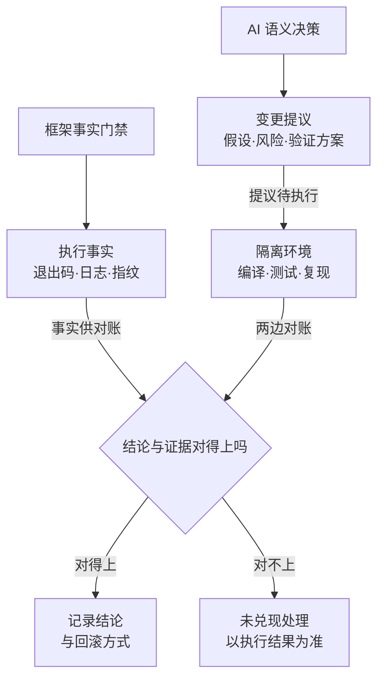
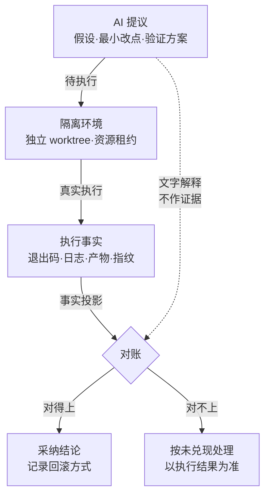

# AI 辅助研发必须形成证据闭环

**AI 辅助研发为什么必须让真实执行结果去证明 AI（人工智能）的结论？本篇给出可复用的对账流程（把 AI 的结论与命令退出码、日志等执行证据逐条核对是否对得上）**。本页采用 [[工程知识/AI 系统工程：从模型能力到生产能力/安全与治理/执行证据必须独立于AI结论]] 的职责边界：**AI 负责理解项目、选择工具、适配测试和解释失败；执行框架负责隔离、真实执行、证据采集、状态一致性和报告门禁（不达标就拦下、不放行结论的检查关口）。因为 AI 的文字结论本身不是真实执行产生的，所以替换不了命令退出码、进程记录、日志和产物**。

面对大型仓库时，代码理解还需要确定性结构——符号索引（能被工具精确跳转的函数、类型清单）、自上而下的任务探索，和增量失效机制（改一处只让相关测试重跑，未改部分不重跑）；完整架构见 [[工程知识/AI 系统工程：从模型能力到生产能力/Agent与工作流/代码智能体需要结构索引、任务探索与运行证据]]。

**AI 在研发中承担的是四段工作，验证仍然由执行侧完成：理解范围——先确认要改哪个模块、影响哪些接口；生成假设——列出可能的失败原因；比较证据——把日志和调用记录对照假设逐条核实；整理结果——输出结论和回滚（把系统状态退回到改动之前的版本）方式**。**真实项目中最容易失败的方式，是让模型直接修改大量代码，却没有清晰的任务约定和可执行的验证路径——任务约定缺失时，AI 改了什么、改完能否验证都无人核对，错误就悄悄合进主干**。

## AI 在研发里到底负责哪一段工作

**AI 给出"已修复""测试通过"这类结论时，无法判断它真的执行过哪些动作、结果是否来自真实环境**。本篇回答：AI 负责哪一段工作、执行侧负责哪一段、一次研发动作要留下哪些可独立核对的记录，以及结论与证据不一致时以哪一侧为准。

## AI 辅助研发怎么才能变成可复用的排障流程


图：生成与评估分成两摊，评估侧不复用生成侧的理由，只拿可核对的标准判断——这正是本篇要的「结论与证据分开」：AI 出假设，执行侧出结果，两边互不代劳。来源：Anthropic《Building Effective Agents》。

```text
定义现象 -> 固定环境 -> 收集证据 -> 提出少量假设
       -> 定位最小改点 -> 生成最小变更 -> 编译/测试/复现
       -> 对比基线 -> 人工审查 -> 记录结论与回滚方式
```

### 要解决的到底是什么

研发协作的现场形态：人和 AI 在同一工作台前协作、任务摆在明面上、每一步改动都可回溯——AI 辅助研发的证据闭环要求的正是这种把过程摆在桌面上：


*图源：Wikimedia Commons，Liridon，CC BY-SA 4.0，https://commons.wikimedia.org/wiki/File:Wikimania_Hackathon_2019_-_Pre-Conference_Day_2.jpg。*

写清楚输入、期望、实际结果、版本、环境、复现概率和不可改变的约束。不要把「修一下」「看起来不对」直接当作任务规格。

### 为什么证据要排在 AI 结论之前

- 行为证据：日志、Trace（调用链追踪记录）、测试结果、时间线、输入数据。
- 代码证据：调用链、条件分支、生命周期、锁和错误传播（错误沿调用链从内层向外层传递的过程）。
- 环境证据：编译选项、依赖版本、配置、数据规模和机器资源。

「自动化环境」的成熟形态长什么样，GitHub Actions 官方概览图是最常见的参照——代码推送（push，把本地提交上传到远端仓库）触发事件进入工作流，job 在 runner（跑任务的机器或容器）上按步执行，每一步留退出码与日志：


图源：[GitHub Actions 官方文档](https://docs.github.com/zh/actions/about-github-actions/understanding-github-actions)。图中 workflow → job → runner → step 的分层，让每一步执行的退出码和日志都被固定留存——证据闭环里的执行侧，工业界最普及的实现就是这一套。

**每个假设都记录「支持证据、反证、下一步实验」。没有实验区分的多个猜测，会造成迭代振荡（修复在几个方案之间来回摇摆、始终收敛不到一个）——这轮按假设 A 调超时，下轮又按假设 B 改回默认值，两轮改动互相抵消，问题原地打转**。

### 为什么改动要越小越好

**AI 输出应优先是结构化的变更计划或小 patch（补丁，只改几行的小块修改），而不是整文件重写——小改动，改动面小，退出码和日志能对应到具体几行，证据才好和结论对账；整文件重写时很难说清哪一处真正解决了问题**。修改和执行分离：

| 阶段 | 角色 | 输出 | 是否修改磁盘 |
| --- | --- | --- | --- |
| 分析/提议 | AI 或工程师 | 假设、操作、风险、验证方案 | 否 |
| 应用 | 工具或工程师 | 经过审查的 patch | 是 |
| 验证 | 自动化环境 | 编译、测试、复现和指标 | 产生结果，不替代审查 |

**修复结论要与证据对账——事先写下预期：这次改动会让哪条断言（代码里校验结果的语句）从失败转为通过**。**所谓「原始复现的前后转变」，指修复前能稳定复现缺陷、修复后同一操作不再出现；只有一句「测试通过」却拿不出这个前后对比，就说明没有真正验证过，与预期对不上，按未兑现处理**。**验证路径至少包括语法/编译、单元或回归测试（改动后重跑旧用例、确认没有破坏既有功能）、原始 Bug（软件缺陷）复现、边界用例、性能影响和回滚验证；一次「测试通过」只证明你写好的预期路径跑通了，不等于导致缺陷的真正原因已经被证明消除**。

## AI 适配与框架事实门禁各自拦住哪些事？

### AI 该负责哪类决策

给 AI 完整的项目、分支、环境、目标和已有证据，让它动态完成：

- 识别语言、构建系统和版本要求；
- 探测本地工具、缓存、仓库和网络条件；
- 选择构建入口与回退方案（Java 用 Maven 或 Gradle，JS 用 npm（Node 的包管理器），Rust 用 Cargo，Go 自带工具链）；
- 寻找上游测试、判断是否适用于当前 revision（代码版本标识，对应仓库某次提交），并改写 API 或 fixture（测试前置的数据与环境准备）；
- 判断目标代码是否真正被执行，区分编译、依赖、网络、权限和产品逻辑失败；
- 根据新证据决定重试、切换路径、请求人工确认，或确认是环境问题挡住了去路后停止重试并上报。

**不要提前为每个项目写「测试适用性」规则。框架提供能力目录和受限执行接口，AI 根据真实环境动态生成构建画像、测试入口、依赖准备和回退方案**。

### 框架必须亲手守住哪些事实

框架必须保证七件不可委托的事实——**这七件都涉及资源隔离与真实执行**。打个比方，商店收银时 AI 说的对应账面数，执行结果对应货架上的实物，两边对不上就以实物为准。这个比方只说明「谁说了不算、以实物为准」，不涉及事实怎么采集的细节；**执行事实必须交给不参与决策的一方确认——让 AI 既下结论又自报执行结果，就没有隔离的第三方去独立核对，结论等于自己给自己背书**：

1. 每个案例使用独立 worktree（同一仓库的独立工作副本）、运行目录、进程树和资源租约（给每个案例设定 CPU、内存的使用上限，超出就被限制，避免多个案例互相抢资源）；
2. 旧任务不能清理仍被使用的 Git 元数据、缓存或临时资源；
3. AI 声称执行的命令确实存在，且保存 argv（命令参数）、cwd（工作目录）、退出码、stdout、stderr、信号、超时和产物；
4. 结果绑定正确的项目、commit/revision、attempt、代际和环境指纹；
5. 结构化结果通过 schema（规定好的字段名和类型）校验，报告只能读取事实投影（从原始执行记录里提取出来、可直接核对的事实清单）；
6. 后一次失败不能覆盖已确认的成功事实，主进程异常终止时，由外部 observer（监督进程，独立于被测程序观察其生死）做最后把关；
7. 重试次数、资源范围、网络出口和凭据访问有上限。

两侧分工的交汇在对账点：AI 的提议在隔离环境中真实执行，框架在执行过程中采集事实，两边在对账点汇合——对账点像两人结账时把账单和货架实物摆到一起核对，两边对得上才签字；这个比方只说明「摆到一起核对」这一步，不涉及证据怎么采集的细节。结论是**否采纳由对账结果决定：**



**框架在这里只做一件事：防止 AI 的文字解释冒充执行事实；AI 负责语义决策，业务语义判断仍归 AI**。典型反例和推荐事件模型见 [[工程知识/AI 系统工程：从模型能力到生产能力/安全与治理/执行证据必须独立于AI结论]]。

把这条对账结构画成证据流，左边是 AI 的提议与隔离环境，右边是执行事实，两边在对账节点汇合：



## 数据库和性能问题的排障模板长什么样

排障模板分四步走：先记现象（什么环境、期望与实际差在哪、复现概率），再收证据（日志指标、输入分布、调用链位置），然后列假设（每条假设配支持证据、反证与最小实验），最后修复验证（最小改点、测试、性能对照）。直接套用下面的模板：

```markdown
## 现象怎么记：版本、负载与期望的差距
- 版本/环境/负载：
- 期望与实际：
- 复现概率：

## 证据要收齐哪几样
- 日志/指标/Trace：
- 输入和数据分布：
- 调用链和源码位置：

## 假设怎么用最小实验证实或证伪
| 假设 | 支持证据 | 反证 | 最小实验 | 结论 |
| --- | --- | --- | --- | --- |

## 修复为什么从最小改点开始
- 最小改点：
- 编译/测试：
- 性能对照：
- 回滚方式：
```

## 项目证据如何归位

**项目过程不是长期知识的一级分类。能抽象为跨项目方法的内容进入本页或对应主题；具体 case、补丁和运行日志只在来源层保存，并且必须标明环境、证据和复核状态**。

- 去重后的实践证据合集（跨项目去重后按迭代框架、代码修复、用例复现归类）：实践证据档案（已脱敏）

**这些来源记录不直接作为结论；可复用的流程已经在本页、[[工程知识/软件构建：让变化可以理解、验证与交付/测试与交付/测试策略从风险选择证据]] 和 知识演化机制（方法层文档）中表达**。

## 怎么自己动手验证

1. **证据完整性：逐条核对结论附带的命令退出码、进程记录、日志与产物，确认自然语言结论之外有可独立复核的凭据**。
2. **结论与执行不符：构造一次模型判定通过而实际测试失败的场景，确认门禁以执行结果为准拦下结论**。
3. **隔离执行：确认改动在隔离环境中真实执行，验证失败时系统退回原状态而不是把半成品留下**。

