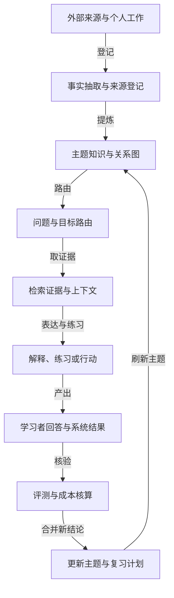
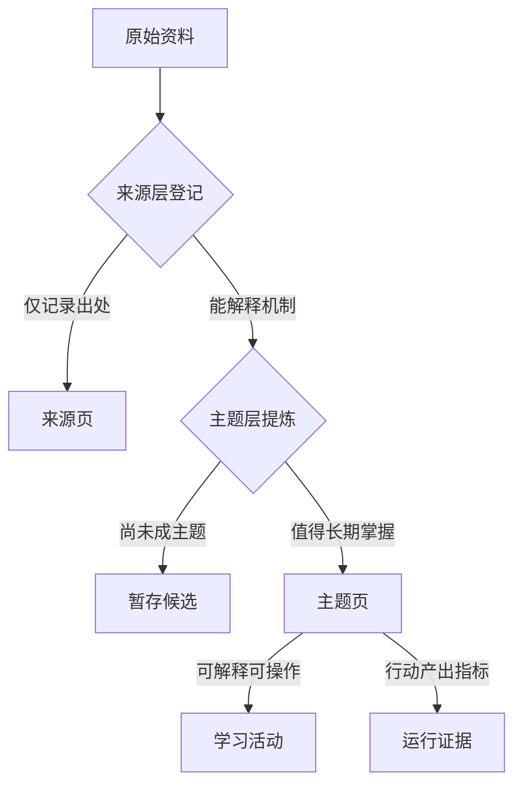
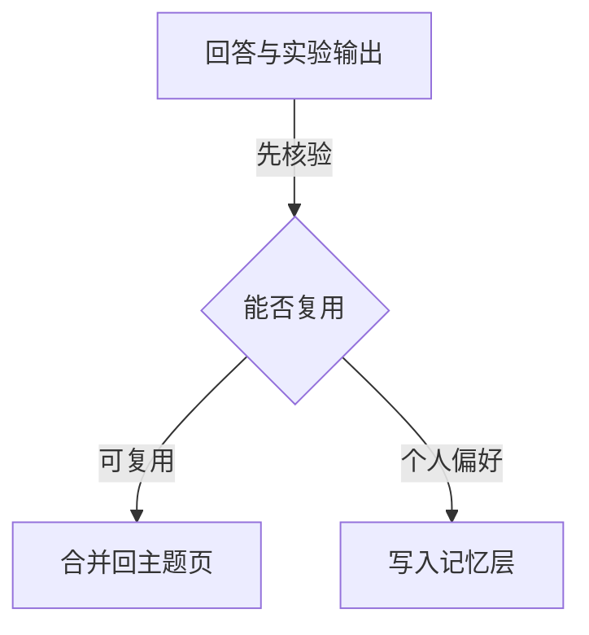

# 知识库的学习闭环：从来源到迁移

**知识库的价值不看存了多少资料，看这条链通不通：人或 Agent 能不能从真实问题出发，找到带证据的解释，做完能检查的练习，再把学到的东西用到新问题上**。**这条链有一环断掉，下游就得不到上游带证据、可检查的输出，资料进得来却用不上，只能堆在仓库里**。**图（结构关系图）、课程（概念课程）、检索与记忆三类表达方式（检索与记忆同属一路）分别承担这条路径上的一段，合起来才构成完整闭环——之所以叫闭环，是因为走到最后会把通过评测的结论写回起点，下一轮又从更新过的主题重新走一遍，像一条首尾相接的跑道**。
读完这篇你能判断一份资料缺在链的哪一环，也知道该补图、补练习还是补检索。

## 要解决的问题：一个从真实问题出发的学习循环包含哪几个环节

**资料被收集、被索引、被存进知识库之后，能回答的问题数量并没有随之增加，检索到的内容也无法判断是否被真正掌握**。本篇回答：一个从真实问题出发的学习循环包含哪几个环节，图、课程、检索与记忆各自承担什么，练习结果怎样算通过，以及学到的内容怎样迁移到新问题上。

## 资料在系统里怎么流转、各环节在哪一步合并？

**把资料变成可用的知识，走的是一条先发散再收敛的路径：第一轮发散找对问题、收敛定下要解决什么，第二轮发散汇集解释与练法、收敛成可检查的输出——做产品或工程设计时常用的双钻模型（先发散再收敛做两轮：第一轮找对问题，第二轮做对方案）画的就是这个形状**：

来源：[阿里云开发者社区](https://developer.aliyun.com/article/1639780)（署名）

资料从来源登记起步，经过提炼（把来源中能解释机制的内容抽出来写成主题页）、检索、练习与评测，最终以新结论的形式回到主题知识。下面这张图给出各环节的先后与合并位置：

主线从「外部来源与个人工作」走到「问题与目标路由」，经检索、表达与练习，最后由「评测与成本核算」（衡量这次检索或生成花费的 token、时间与资源，并检验学到没有）决定是否「更新主题与复习计划」。**关键在最后那条回边：评测没过的新结论一律不合并，只有通过评测的才写回主题知识——这好比一道门禁：只放行通过评测的结论写回主题知识，未过评测的错误结论被挡在主干之外，避免污染主干；这道门禁只管合并这一关，不判断内容对错**。图、课程、检索与记忆三类表达方式如何挂到这条主线上，下文单独展开。

## 有哪四个对象必须分开？

**先打个比方：知识库像一家仓库，来源是进货单（记清每件货哪天从哪个供应商进的），主题知识是货架上的定型商品（能直接解释机制），学习活动是导购演练（练给你看、也让你上手），运行证据是监控录像（回放这次服务到底有没有效）**。四样东西混着堆，仓库就乱：进货单当商品卖、演练记录当事实用，都是错位。这个比方只说明四样东西各是什么、放在哪，下面看每类内容进入知识库前要过的关：

| 对象 | 解决的问题 | 典型产物 | 不能替代 |
| --- | --- | --- | --- |
| 来源 | 这条信息从哪里来、何时变化 | URL、仓库 commit、论文、工作证据 | 主题理解 |
| 主题知识 | 哪个机制值得长期掌握 | 原理、边界、反例、验证方法 | 学习活动 |
| 学习活动 | 学习者能否解释、操作和迁移 | 图、练习、问题、项目、反馈 | 事实核验 |
| 运行证据 | 这次检索、生成或行动是否真的有效 | 引用、轨迹、指标、产物、回归 | 语义理解 |

**混乱通常来自把这四类内容塞进同一页：来源变成流水账，知识变成产品清单，学习活动变成模型长文，运行证据则被「看起来合理」的回答覆盖**。

四类对象进入知识库前各自要过的关，用下面这张图回答「什么内容走到哪一层为止」：原始资料先过来源层（只登记出处的来源页）登记，能解释机制的再过主题层（沉淀机制的主题页）提炼。

**来源页只存出处，主题页存机制，学习活动与运行证据都从主题页派生；能解释机制但尚未沉淀成主题的资料先留在「暂存候选」，不进主干**。

## 本知识库要遵守哪些规矩？

### 为什么来源只能进候选、不能直接进主干

**GitHub 项目、论文、版本发布、工作复盘和剪藏先登记到来源层。只把能够解释机制、支持决策或可复现实验的内容提炼成主题页；项目名称留在来源页和引用里，不成为领域分类**。期刊投稿是同一道门：来稿先进收稿登记（来源层），通过审稿的正文与结论才进期刊正文（主题页），作者单位与基金项目留在脚注（引用）里——没有哪本期刊会把投稿人公司的组织架构当成学科分类印进目录。

### 主题页为什么按问题与机制组织

**每个主题回答：解决什么问题、核心机制、适用边界、常见失败、如何验证、与什么相连**。**模型、框架或产品只能出现在「当前实现」段落（记录模型、框架或产品等快速变化的名称及其版本，与长期机制分开存放），避免把快速变化的名称误当作知识主轴**——主轴指值得长期掌握的机制主线，项目名与产品名只是挂在这条线上的实例，本身不算主轴。**若反过来把项目名当主轴，名称每月一变，主题页就得跟着改名重写，机制主线反而被淹没**。

### 学习活动怎么由目标驱动

- **要理解结构：先画关系图，再用点击、追踪和反例检查因果**。
- **要掌握机制：要求先预测或解释，再给反馈和最小修复**。
- **要形成工程能力：把概念绑定到一个可运行任务、指标和失败复盘**。
- **要跟上前沿：先做主张溯源（claim-to-source，把每个结论对应到可打开的来源链接），再比较新方法相对基线（正常状态下的指标水平、用来对比异常）改善了什么**。

**学习循环「任务—轨迹（Agent 执行任务时的动作与观察记录）—评测—反思（针对评测暴露的错误写一段语言反馈，带入下一轮尝试）—下一轮」的形态在 Reflexion 论文的实验设置里有标准参照：决策、编程、问答三类任务走同一条五步链路，差别只在评测信号——决策任务用规则或模型启发式判定幻觉（模型生成看似合理、实际与事实不符的内容），编程任务用自生成的单元测试，问答任务用环境的二元奖励**。**规则、单元测试、二元奖励这三类评测信号都能给出 yes/no 或分数，使「学会没有」可被客观判定，而非靠感觉，因此提供了可验证性；反思只对评测暴露出的错误写语言反馈并带进下一轮**：

*图源：Reflexion 论文（arXiv:2303.11366）Figure 1，https://arxiv.org/abs/2303.11366，论文插图。*

### 为什么结果必须回写证据

**学习者的回答、实验输出、引用覆盖、检索轨迹和错误类型都可以成为下一次复习的依据，但不能未经筛选直接写入长期记忆**。**可复用结论要回到主题页，个人偏好和待办才进入记忆层（存放个人偏好与待办的可更新存储，与主题页分开）**。**两者这样分工：主题页存可共享、需长期稳定的机制，记忆层存个人化、随使用变化的内容；混放会让个人临时信息污染知识主干**。医院病历分册是同一条：检验数值与影像结论（可复核的机制性事实）进病历正文（主题页），"患者晕针、抽血选左手"（个人化、随情况变）进护理备注（记忆层）——晕针写进诊断依据，下一位医生就会误读成病情。

学习产物的回写分流用下面这张图回答「什么结果进主题页、什么进记忆层」：

**两条路都要过筛选这一关，未通过核验的结果不进入任何长期存储**。

## 最小可行的一轮学习长什么样？

**一轮完整学习分七步，任何一步缺失都会让循环退回成普通阅读，七步依次是**：

1. 选定主题；
2. 读主题页与近期变更；
3. 把问题提炼成可验证的形式；
4. 检索带来源的证据；
5. 用证据支撑图、解释或练习；
6. 核验正确性与成本；
7. 通过才把新结论合并回主题页。

**没有「回答后评测」就无从判断回答是否真被掌握，没有「评测后合并」新结论就不会进入知识库，两者都缺，学习循环就退成只留下无法复核的聊天记录；没有来源和版本绑定，就只是不可复核的总结；没有练习或行动，就无法判断是否真的学会——阅读只产生「看懂了」的错觉，只有让学习者预测、操作或在新约束下迁移，才能看到他是否真能独立用出来**。学做菜是这套循环的日常版：看菜谱（读主题页）、列出要弄清的难点（提炼问题）、挑新鲜食材并记下产地（检索带来源的证据）、照着做一道（表达与练习）、家人尝了打分（核验）、确认好吃才写进自家菜谱（合并回主题页）——**只看菜谱不动手，看一百遍也不算会做这道菜**。

## 表达与执行该怎么做

### 课堂角色怎么映射成页面结构

**参考 OpenMAIC（清华大学 MAIC 团队开源的多智能体互动课堂平台）互动课堂中教师、助教、学生分工方案的做法，知识页不再只给并列的定义，而是把同一内容拆成三个视角：教师段落解释「为什么」，助教段落暴露成本、边界和验证方式，学生段落要求先预测并在新约束下迁移——一页同时支持查阅与学习活动**。**这样同一主题既能被快速查阅，也能直接进入一轮可观察的学习活动**。OpenMAIC 官网的学习入口长这样——左侧对话输入承担「学生提问」，右侧多人协作区承担「同伴讨论」，下方 Discover 区陈列可动手的交互式学习模块（实时模拟、可调参数的透镜成像实验）：

*图源：OpenMAIC 官网（https://open.maic.chat/）首页实拍（playwright 截图，2026-09-28）。OpenMAIC 是清华大学 MAIC 团队开源的多智能体（能感知环境、调用工具、自主完成多步任务的 AI 程序）互动课堂平台（MIT 许可），教师、助教、学生由不同 Agent 扮演；图中 Discover 区的「实时模拟」面板（物距/焦距/像距与放大率联动）与「Photosynthesis Inputs」可调参数实验，正是「学习活动怎么由目标驱动」一节说的可观察学习活动的产品形态。图注中的交互式模块随版本演进，截图日期已标明。*

| 需要 | 使用方式 | 产物位置 |
| --- | --- | --- |
| 关系、架构、流通和状态图 | 类型化图描述（给节点和边规定固定类型与字段，图先以结构化数据存在再渲染）+ 确定性校验（按固定规则自动检查合法性） | 网站图谱、Markdown Mermaid、可点击节点 |
| 概念课程、交互演示、练习和编辑 | 目标驱动的教学活动 | 解释、预测、练习、反馈和迁移任务 |
| 多引擎 RAG、研究、记忆与笔记 | 按问题类型（找事实、理结构、比方法）选择检索与记忆 | 来源候选、引用回答、复习记录和可复用材料 |

**这三类工具各自能做什么、用到什么程度为止：工具负责帮你发现、表达和练习，但工具给出的结果只是中间产物，写回长期事实仍需回到主题页并附出处，长期事实以 Markdown 主题页和来源页为准**——Markdown 是一种用纯文本标记写结构的轻量级格式。网站只是动态投影，指按当前数据实时生成的展示层：**投影坏了可以重建，底稿才是事实**。表中「多引擎 RAG（检索增强生成，先从外部资料里检索再让模型据此回答）」指同时接入多路检索（关键词、向量、图谱）再合并证据的检索架构。

三类表达方式的产物都要能回到来源页核验，这是它们共同的检查点（定期保存进度、故障后从最近一次保存处恢复）。

## 外部工具的方法为什么只当证据、不当内容来吸收？

**外部工具只作为方法证据，不进入知识库主分类**。可复用的抽象有三条：**图谱先把节点、边、属性存成结构化数据（结构化中间表示：图在渲染成画面之前，先以数据表形式存在、可被程序校验的形态）再渲染并校验；教学先定义目标和已有水平，再安排交互、反馈和迁移；检索按问题选择关键词匹配（词法）、向量（按语义相似度找相近内容）、整页正文（页面）或图谱关系（顺着实体之间的关系连线查找），并让索引版本、记忆生命周期和引用一起可追踪**。对应的仓库证据保留在 Archify、OpenMAIC、DeepTutor（可验证技术图谱、互动课堂、多智能体学习伴侣三个项目）的来源层档案中，均已脱敏（遮盖敏感字段的部分内容、保留可辨识形态）。

## 什么内容才算过了质量门槛？

- **事实：关键断言有来源或可复现实验**。
- **结构：每个新页面能连接至少一个已有主题，并说明连接原因**。
- **学习：至少有一个解释、预测、练习或迁移任务，而不是只读摘要**。
- **可视化：图节点可点击，图边有语义，图中的结论能回到来源或主题页**。
- **更新：页面的 `review_after` 与变化速率匹配；项目版本变化只更新来源页和当前实现段落**。
- **安全：API key、个人数据、内部地址和未授权材料不进入来源页、图谱或模型上下文**。

## 这套循环和知识库治理怎么衔接

- Archify、OpenMAIC、DeepTutor：三个项目的来源层档案，均已脱敏
- [[工程知识/AI 系统工程：从模型能力到生产能力/Agent与工作流/构建可靠Agent应用]]
- [[工程知识/AI 系统工程：从模型能力到生产能力/知识与检索/检索从一次查询演进为有状态的证据获取]]
- [[工程知识/AI 系统工程：从模型能力到生产能力/质量与运营/Agent评测必须覆盖轨迹而不只看最终答案]]

## 效果从哪儿来，要付什么代价

**把来源、主题知识、学习活动与运行证据分开存放，每类产物各自带出处与版本：来源页只记出处、主题页只存机制，回查任一条结论都能顺着登记链退到原始来源——这样资料进入知识库之后仍能被追溯到具体来源，学习活动的效果由可观察的练习结果判断而不是由阅读量判断**。代价是**来源登记、主题维护与评测反馈各需要持续投入**，把项目与产品名留在来源层也意味着**知识主轴需要人工判断**。

## 怎么自己动手验证

**学习循环闭合与否要与既定门槛对账：事先写下预期——这份资料该连到哪个已有主题、该产出什么练习。闭合要求这些预期都兑现，产出与预期对不上，说明来源、练习或评测中有一环没有真正发生，循环就没闭合，链路退回普通阅读**。装修验收先列单子是同一个动作：开工前写下"这几个插座在哪面墙、热水几秒出"的清单，完工逐条对——对不上的那条，说明中间某道工序没做，不能凭"看起来装好了"签字。具体核对三项：

1. **质量门槛逐项核对：关键断言有来源、新页面至少连接一个已有主题并写明原因、至少含一个练习或迁移任务、图节点可点击且结论可回到来源**。
2. **安全核对：来源页、图谱与模型上下文中不含 API key、个人数据与内部地址**。
3. **更新核对：页面的 review_after 与变化速率匹配，项目版本变化只更新来源页与当前实现段落**。

