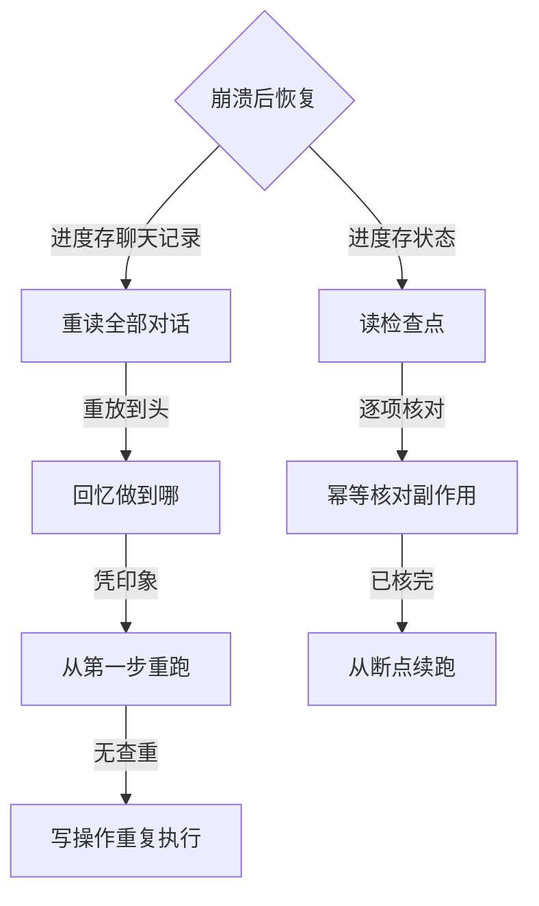

# Agent状态机与任务恢复：进度是状态不是聊天记录

**Agent 崩在第七步，重启后从第一步重跑，前面三个写操作全部重复了**。读完这篇你能把任务进度建模成显式状态机（一组有限状态，由事件触发在状态之间转移的执行模型），让崩溃**恢复到最近一次检查点记录的状态，而不是重放一切**。

本篇要解决的是**对话记录证明不了进度**的问题：记录只能证明「说过什么」，证明不了「做到哪一步」，为什么会把聊天记录当成进度账本，是崩溃恢复失真的起点。本篇给出**把进度、副作用（对外部系统的写操作）与检查点（任务状态及其已完成副作用的定期快照）分开管理**的做法——进度与副作用各有独立检查点，恢复时只补未完成的步骤，已登记的副作用靠幂等键跳过，所以**每次崩溃只重做最少的一步**。

为什么进度不能存在聊天记录里？本质是**执行语义**（运行时实际完成的步骤与产生的副作用）与对话语义（模型与用户之间交流的内容）的分离。**对话上下文是给人看的、可压缩、可丢弃的；任务状态是给运行时用的、结构化、必须持久**。两者混在一起，恢复时就分不清"哪些步骤已执行、哪些副作用已发生、哪些结论已验证"——**对话文本里没有结构化标记哪句话对应哪一步状态，恢复时无法定位进度边界**。

## 状态、事件与检查点凭什么能支撑崩溃恢复？


*图源：Wikimedia Commons《[Automata theory](https://commons.wikimedia.org/wiki/File:Automata_theory.svg)》，CC BY-SA 3.0。*

把这张图的形式搬到 Agent 任务上：它像工厂里随工件流转的工序进度卡，卡上只记「做到哪一步、哪几步已确认」，不记工人说过什么——这个类比到「进度要写成独立记录」为止：检查点怎么存、幂等键怎么去重，看正文。先分开看状态与事件。

状态是 **pending/running/waiting_approval 等枚举，边是 tool_result、timeout、user_input 等事件——进度存在节点上，不堆积在聊天记录里**。任务有显式状态——pending、running、waiting_approval、cancelled、completed、failed，转移由事件触发：tool_result、timeout、user_input。

副作用与恢复机制接着看。副作用在状态转移时通过幂等（同一个操作执行一次和执行多次的结果相同，重复执行不会产生额外副作用）键（每个副作用操作的唯一标识，重启后凭它判断这个操作是否已经执行过）登记。崩溃恢复读的是**最近一次写入的检查点加上其后的事件日志**（按时间顺序追加记录每次 tool_call 与结果的清单，只增不改）；两者配合：**检查点存某时刻的完整快照，事件日志只补快照之后的增量**。重放指恢复时照着事件日志再走一遍当时的决策轨迹，**但外部写操作靠幂等键去重，不再真正触发第二次**。

| 要素 | 建模方式 | 恢复时的角色 |
| --- | --- | --- |
| 任务状态 | 枚举 + 版本号 | 恢复起点：从检查点状态继续 |
| 事件日志 | 只追加（append-only：新记录只能加到末尾，之前的记录不改不删，保证历史可追溯），含 tool_call 与结果 | 重放决策、核对已执行副作用 |
| 幂等键 | 每个副作用操作唯一 key | 判断该操作是否已生效，避免重复 |
| 检查点 | 定期快照状态 + 已完成步骤 | 缩短重放距离 |
| 补偿动作 | 失败或取消时登记的反操作（例如已扣款则退款，把系统拉回一致状态） | 部分完成后回滚（把系统恢复到上一个可用版本）到一致边界 |

这套状态枚举已经进了协议层——这里指智能体（能感知环境、调用工具、自主完成多步任务的 AI 程序）之间通信的行业标准规范，是抽象说法，不绑定具体某一份规格，也不是某家产品的私有接口：A2A（Agent2Agent 协议，Google 主推的 Agent 间协作协议）——Agent2Agent，Google 发起、Linux 基金会托管的智能体间协作协议**把任务生命周期定义成九个显式状态，终态（完成/失败/取消/拒绝）与中断态（等输入/等认证）分开标注**——「进度是状态不是聊天记录」在协议层就是这张表：


*图源：A2A Protocol Specification v1.0.1 第 4.1.3 节页面实拍（2026-09-28），https://a2a-protocol.org/v1.0.1/specification/。跨厂商的智能体协作要恢复任务，不同厂商的对话格式不互通，双方对「做到哪一步」的唯一共识只能是显式状态枚举——双方都能解析的通用表达：中断态可续跑、终态不可重启，恢复语义直接由状态值决定。*

这套"事件日志 + 重放"不是 Agent 独创，工作流引擎 Temporal 把它做成了产品形态，官方文档把机制写得很直白：**工作流代码不直接执行动作，SDK（软件开发工具包）记录命令（Command，一次待执行的意图），服务端执行后把对应事件（Event，已发生的事实）追加进 Event History（有序事件日志）**；崩溃恢复时**新 Worker（执行工作流的进程）取回完整有序的 Event History，对着它重放工作流代码重建本地状态，从失败点继续，仿佛失败从未发生**：


*图源：Temporal 官方文档《Understanding Temporal》Event History 节，https://docs.temporal.io/evaluate/understanding-temporal，页面截图。「重放决策不重放副作用」在图上就是那段 durable log 描述：重放的对象是代码执行轨迹（决策），副作用由服务端按已记录的 Event 兑现，Worker 不重复触发。*

## 不建模状态，崩溃后会出现哪些失败

打个比方：把任务进度想成工厂流水线上的工单——上面写着"第几道工序、哪几个零件已经装好、哪几步已经对外发过货"，工人换班时看单就知道从哪接着干；如果只留着工人之间的聊天记录，换个人来就得把整段对话重听一遍，还可能把已经发过的货再发一次。这个比喻到"为什么要单独记进度"为止：它说明进度得是写下来的状态而不是对话，但检查点怎么存、副作用怎么保证只做一次、状态机有哪些状态，要看正文，比喻管不到。

状态要被运行时持续读写并持久化，队列或存储正是承担这种读写的常见载体，所以队列是状态最常见的容身之处。这个类比取自 Linux 内核提供的一种高速异步读写接口 io_uring（Linux 的高性能异步 IO 接口，用两个共享环递请求收结果），它用两个共享环在用户态（普通程序运行的低权限受限状态）与内核间递请求收结果。

队列之所以能表示进度，是因为**请求从一条进、结果从另一条出，两边各有头尾指针（标记读写位置的游标），元素顺序对应步骤顺序**；当每个入队请求对应一个任务步骤时，**头尾指针标出已完成的部分，崩溃之后指针停在哪，进度就落在哪**。io_uring 的内核排队机制与 Agent 恢复无关，这里只借用它头尾指针标边界的结构。**队列以此提供了最朴素的状态持久化——但仅靠队列位置不足以记录副作用是否已生效，下面的失败模式正是队列方案覆盖不到的**。

| 失败 | 场景 | 对策 |
| --- | --- | --- |
| 重复副作用 | 恢复后重跑已执行的外部写操作 | 幂等键 + 执行前查重 |
| 双重计费/双重发送 | 长任务中段崩溃，重启后从头调用付费 API | 检查点记录已完成调用清单 |
| 部分成功不可见 | 三步完成两步后取消，用户不知道发生了什么 | 状态机要求部分完成也是显式状态 |
| 旧版本恢复 | 检查点由旧代码版本写入，新版本读不懂 | 检查点带 schema 版本（检查点数据结构的格式编号，字段增减时递增，用于判断是否兼容），不兼容时降级为人工 |
| 僵尸等待 | waiting_approval 后用户永远不回来 | 超时自动取消 + 到期提醒 |

## 这套说法在哪儿会失效

- **不是所有任务都需要完整状态机**：单轮问答这类无后续动作的任务，重启重跑无害，用简单重试即可；只读任务、可整体重跑的幂等任务同样不需要，**状态机的复杂度要用在有不可逆副作用的长任务上**——不可逆指操作执行后无法自动撤销，例如已发出的付款、已写入数据库的记录。
- **状态机不能消除与外部系统的竞态（结果取决于执行时序、因而不可重现的并发缺陷）**：外部操作"发出请求但未确认"的窗口依然存在，**幂等键依赖外部系统支持幂等语义（同一操作重复提交也只生效一次的性质），不支持时要退化为补偿**。
- **检查点频率是延迟与恢复成本的权衡**：每步写入磁盘最安全——任意时刻崩溃最多丢失正在写入的那一步，不会回退已完成的步骤——但拖慢执行，间隔太长则重放距离大。因为不可逆动作重做的代价最高，所以**默认建议至少在每个不可逆副作用前写一次检查点**：若崩溃发生在该动作之后、下一个检查点之前，因检查点已记录此动作完成，恢复时不会重做它，故**最坏只重做一步**；大语言模型即 LLM（Large Language Model，用海量文本训练、按上下文预测下一个词生成回复的模型）任务单步成本高，通常直接每步一存（见下文检查点频率的账怎么算一节）。

## 崩溃后从检查点续跑，代码长什么样

一个多步任务（检索→生成→写入→通知），在第 3 步崩溃，状态与聊天记录的差别当场可见：装修队中途收工是同一个场景——墙上贴着的进度单（状态存档）写着「水电完工、瓦工进行到厨房」，第二天工人看进度单直接接着贴砖；要是只留下工人群里的聊天记录（聊天记录方案），新来的工头得把几百条消息翻完再猜做到哪，猜错了还会把贴好的砖再贴一遍（写操作重复执行）——比喻到「进度单贴在墙上」为止：进度单是工人手写的、格式随意，状态存档是结构化的 JSON 且每步带 hash 校验，比手写单可靠一个量级。

```python
# 状态存档（写入磁盘的 JSON 检查点文件，每步完成后写一份）：
state = {
    "task": "weekly-report",
    "steps": {
        "search":  {"status": "done",   "output_hash": "a1b2"},
        "draft":   {"status": "done",   "output_hash": "c3d4"},
        "write":   {"status": "running"},        # ← 崩在这里
        "notify":  {"status": "pending"},
    },
    "ctx": {"draft_id": "d-77"},          # 只存句柄，不存全文
}

# 恢复逻辑：从状态机读，不是从聊天记录猜
next_step = next(s for s, v in state["steps"].items() if v["status"] != "done")
# → "write"：草稿已有（d-77），重跑写入库 + 幂等键防重复写入 → notify
# 聊天记录方案：LLM 要重新读完全部对话"回忆"做到哪了，且可能回忆错
```

同一次崩溃，两条恢复路径的分岔见下面这张图：聊天记录方案要重读全部对话、靠模型回忆做到哪，再从第一步重跑，写操作随之重复执行；状态机方案读检查点、用幂等键核对副作用后从断点续跑。



跑一遍的收获：**恢复的正确性来自两件事——每步的输出有 hash 锚点**——hash 把任意输出压成固定长度指纹，同样输入永远得到同样输出，**done 的判断是校验、不是信任**，**外部动作有幂等键（重跑不产生第二次副作用）**。聊天记录作为恢复源的两个缺陷（**上下文窗口装不下、回忆不可靠**）都由状态机绕开——**状态机只保存结构化进度，不重放整段对话，因此不占用上下文窗口（模型一次能读入的最大文本长度），也不依赖模型回忆**。

## 引入状态机要付出什么代价

显式状态机不是白拿的。这里的「环」指状态、事件、副作用三个环节：**状态机要求每一环都能被单独推进、单独恢复，于是每一环都要设计、要测试**；这意味着**每新增一个副作用或修改一条转移规则，都要重新验证全部环节，状态定义要随每个新副作用、每次转移修订，每次修订都要迁移已有检查点，改动面比业务逻辑更宽**。

给仓库上库位管理系统是同一个代价：每个货架、每条通道都要编码（每环要设计要测试），仓库扩区要重新编号（每次修订要迁移），管编码规则的人比管搬货的人还忙，也就是维护状态定义的人超过了维护业务逻辑的人。比喻到「编码的维护成本」为止：仓库编码错一次纠正一版就完，状态机改定义还要照顾存量检查点的迁移，尾巴更长。

任务形态变化频繁时，**维护状态定义的人会超过维护业务逻辑的人**，此时退化为「每次崩溃都从第一步重新执行全部步骤，靠幂等键消除重复副作用」的方式往往更划算。判断投入是否值得，看三个信号：**任务是否包含不可逆副作用、单步成本是否高到不能随意重做、是否需要向监管或合规人员交代某一步为什么发生。三个都答是，状态机的复杂度才收得回来；只答上一个，用简单重试加幂等键就够**。

## 检查点频率的账怎么算

检查点每步一存 vs 每 N 步一存，是**恢复成本与存储成本的交换**：每步一存，崩溃重做 0 步（恢复秒级），代价是**每步一次持久化写**（对 LLM 任务，单步耗时秒到分钟级，写入开销占比 <1%）；每 10 步一存，存储省 90%，**崩溃平均重做 5 步（每步含一次模型调用，重做成本 = 5 次调用的钱与时间）**。游戏存档是同一笔账：打完每个 Boss 就存档（每步一存），挂了从 Boss 前重来（重做一步）；半小时才存一次，挂了就得重打半小时（重做 5 步的账）——比喻到「存档点密度」为止：**游戏存档占不了多少空间，状态检查点要占真实存储，但 LLM 单步贵，两者算下来答案都倒向「存勤一点」**。

**LLM 任务单步贵，检查点频率的答案几乎总是「每步一存」**；传统批处理（把多个请求合并成一批同时计算、提高硬件利用率）单步成本低、重做代价小，倾向少存以省存储。**同样是算存储与恢复的账，LLM 与传统批处理得出的结论相反**。

## 怎么自己动手验证

**恢复结果要与写操作计数对账，对不上就回到状态机查幂等键与补偿记录**。最小验证：跑一个含三个写操作的任务，在第二步后 kill 进程，重启恢复，断言三个条件：**写操作总数恰好为三（幂等键生效）、任务最终状态为 completed、事件日志无重复 tool_call**。再测取消路径：在 waiting_approval 状态触发取消，断言**已执行的两个写操作有补偿记录或明确的部分完成标记**。

关系：[[工程知识/AI 系统工程：从模型能力到生产能力/Agent与工作流/模型负责判断，运行时负责执行语义]] · [[工程知识/AI 系统工程：从模型能力到生产能力/Agent与工作流/先用工作流，只有路径无法预先枚举时才使用Agent]] · [[工程知识/AI 系统工程：从模型能力到生产能力/模型与上下文/跨会话状态的一致性先于记忆的长度]]