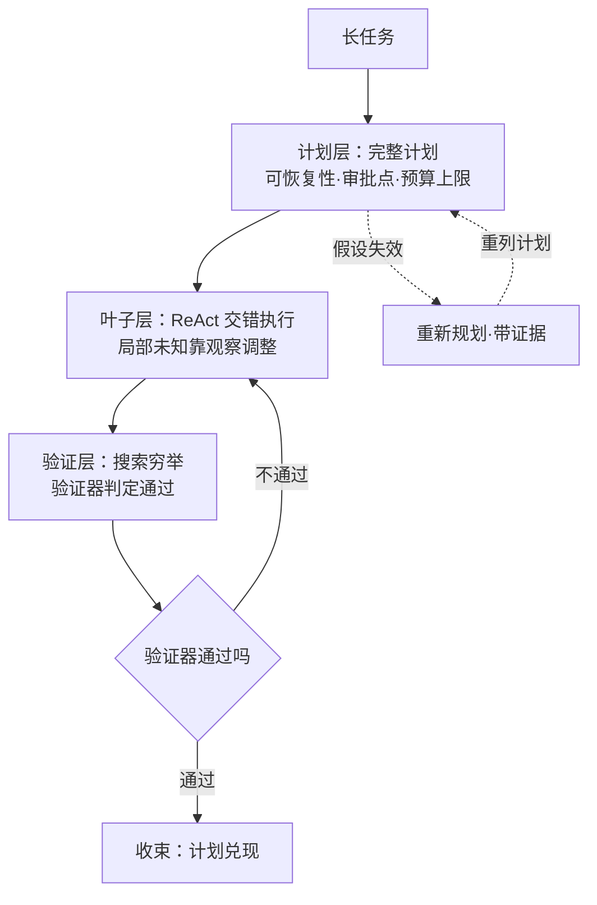
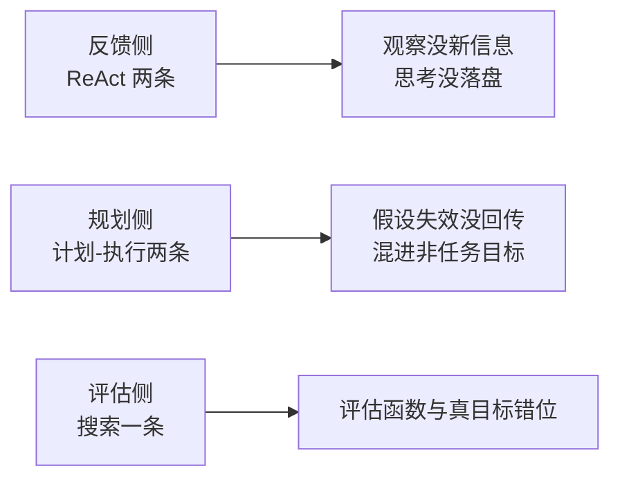

# ReAct计划执行搜索：三种行动范式的适用边界

**这篇文章讲 ReAct、计划-执行、搜索三种行动范式怎么选：读完你能按任务挑范式（边想边做、先写计划还是先搜索），并知道每种会在哪失效。范式怎么编排，决定了 Agent**（能自主调用工具、维护状态的模型应用）**的成本、可恢复性（中途出错能否带着已完成进度重来）和证据质量（结论能否拿出工具真实返回的记录来支撑）。**

三种范式都把模型的思考与动作组织起来，差别在编排顺序。
直接边想边做的 Agent 因为没有总体计划，走两步遇到分叉就只顾眼前观察、忘了整体目标，在原地打转；先写完整计划的 Agent 因为计划建立在过时假设上，假设一失效后续步骤全部走偏；只会搜索的 Agent 因为评估函数（判断哪个候选分支更接近目标的打分函数）失真，正确分支照样被剪掉，**找到答案与用错答案同样危险**。

本篇要解决的问题是把三种范式各自弄懂：ReAct（推理与行动交替的提示范式，想一步做一步看一步）、计划-执行、搜索，理解它们的机制差异与适用条件，按任务的可逆性、分支密度（每一步可能分出的岔路数量）和反馈延迟选范式，并把不可重放与私有推理泄露纳入验证。

**三种范式的本质区别，是探索与承诺的先后顺序：ReAct 边摸情况边动手，计划-执行先把方案定完整再动手，搜索两头都沾。**对应到探索与承诺这两个词：ReAct 每一步都在探索、几乎不做承诺；计划-执行先一次性承诺完整路径再执行；搜索先探索候选，再用评估函数做取舍承诺。

可以用出门找路来区分：ReAct 是走到路口再问人，计划-执行是先定好完整路线再出门，搜索是挨条路试、走不通就退回来。这个比喻只到「岔路能一条条数清」为止——地图上路是有限的，把每条岔路都试完，总能找到对的那条，所以试错一定能走到头；真实任务的岔路可能数不清，数不清就没法保证试得完，所以搜索范式只能用在有明确判断标准的封闭任务上。

**ReAct 把推理与行动交错，探索性强但循环成本高；计划-执行先承诺路径再执行（先画图再走），可审计可恢复，但计划用的是规划那一刻的信息，执行中环境一变、后面几步依据的假设就可能已经过期；搜索范式在状态空间（所有可能的中间局面集合）里探索，靠试错和回溯（一条路走不通就退回上一个分叉换别的路）推进，适合有可验证目标的封闭任务，但依赖状态可枚举与评估函数可靠。三种范式不互斥：长任务常见"计划骨架 + ReAct 执行 + 局部搜索"的混合结构。**

读完这一篇，你能按任务的可逆性、分支密度和反馈延迟决定该选哪一种，以及为什么选错会让成本失控。

## 三种范式的机制差在哪里


来源：[ReAct 论文项目页](https://react-lm.github.io/) 收录的 HotpotQA（跨多个文档推理的问答数据集）多跳问答（答案需拼接多处信息才能得出）示例（arXiv 论文默认许可）

这张图把「推理」和「行动」两个能力拆开再组合：只看左侧，Reason Only 的模型自己在内部转，没有环境输入；只看右侧，Act Only 有动作与观察，却没有显式的推理轨迹；ReAct 是把两者接起来的形态。Reason Only 与 Act Only 只是两端的极端，ReAct、计划-执行、搜索是把这两条通路按时序重新编排的三种接法，差异见下表。

| 范式 | 机制 | 适用条件 | 固有代价 |
| --- | --- | --- | --- |
| ReAct | 思考→行动→观察循环，每步可根据观察调整 | 环境反馈快、步骤不可逆性低 | 循环成本、不可重放（事后无法重演当时的决策过程）、私有推理进日志 |
| 计划-执行 | 先生成完整计划，再逐项执行，可挂起恢复 | 步骤多、依赖复杂、需人工审批 | 计划基于旧信息、重规划成本、计划过拟合（计划锁在规划时刻的假设上，环境变了也不改） |
| 搜索 | 状态空间探索，评估函数剪枝回溯 | 状态可枚举、目标可验证（代码/数学） | 评估函数质量决定一切、指数爆炸 |

选范式的判据有三条：
- **反馈延迟短、单步代价低、试错空间大 → ReAct，走一步看一步亏得起；**
- **步骤间有硬依赖、需要审批或断点续跑 → 计划-执行，计划层留好检查点**（定期保存进度、故障后从最近一次保存处恢复）**；**
- **有客观验证器（测试通过/证明成立）且状态能数得清 → 搜索。**之所以要求状态数得清，是因为每步可选动作一多、盲走分支会成倍膨胀，数不清就试不完；搜索靠剪枝（用评估分数淘汰明显不行的分支，不再往下试）与回溯把分支压到可以逐个检查的范围，这是搜索能走完的前提。
**多数真实任务采用混合形态：顶层计划保证可恢复性，叶子步骤用 ReAct 处理局部未知，验证环节用搜索穷举边界。**



计划层与叶子层各按判据选范式：可恢复与审批挂在计划层，交错循环只花在局部未知上，验证环节交给有客观验证器的搜索——三层各取所长，重规划发生在计划层，叶子轨迹保持简单可审计；计划全部兑现时走收束（计划执行完毕、汇总结果的结束状态），假设失效时带证据重新规划。

论文 Figure 1 把这条判据的前半段画成了对照实验：同一个问题，只回答的 Standard 和只行动的 Act-Only 都失败，思考-行动-观察交错的 ReAct 成功：


来源：[ReAct 论文项目页](https://react-lm.github.io/) 收录的 HotpotQA 多跳问答对照示例（arXiv 论文默认许可）


图里四个格子是四种提示法：Standard（不拆步骤、直接作答）只给答案；CoT（思维链，只推理不行动）幻觉（模型生成看似合理、实际与事实不符的内容）链条一路错下去；Act-Only 有搜索动作却没有观察整理，搜到 Front Row（ALFWorld 模拟环境里 Agent 要找的目标物件，任务要求就是找到它并停下）也停不下来；ReAct 每步按 Thought（思考）定位差距、用 Act（行动）补信息、凭 Obs（观察）修正方向，第四步收束到正确答案。环境反馈快、单步代价低时这种交错的成本才划算，与上表 ReAct 行的适用条件对应。图取自 [ReAct 论文的 HTML 版](https://arxiv.org/abs/2210.03629)（ICLR 2023，Yao 等），arXiv 论文默认许可。

## 五种失效各自是怎么发生的


来源：[稀土掘金 @智泊AI](https://juejin.cn/post/7615229750572269577) 中三种范式对比一节（CC 4.0 BY-SA）

三种范式的差别，在处理顺序上体现得最明显。优先级队列是按优先级取任务、不按到达先后取任务的结构；这个类比只对应「先处理谁」这一个维度，不覆盖并行与依赖关系：ReAct 是来一个观察处理一个，计划-执行是按计划序号依次执行，搜索是按评估分数从高到低试探。


| 失效 | 机制 | 信号 |
| --- | --- | --- |
| ReAct 循环空转 | 反馈信息量不足，思考-行动对重复 | 同一观察触发同一动作，步数超预算 |
| ReAct 不可重放 | 中间思考未持久化，执行轨迹无法审计 | 事后无法回答"当时为什么这么做" |
| 计划过时执行 | 执行中发现假设失效，但计划仍继续走 | 后续步骤引用已失效的前置状态 |
| 讨好式计划 | 计划阶段就预测用户想听什么 | 计划包含"用户会满意"这类非任务目标 |
| 搜索评估失真 | 评估函数与真实目标错位，剪掉正确分支 | 候选分数与最终结果不相关 |

五条失效看起来各不相同，责任各自落在反馈侧（观察与思考环节）、规划侧（计划生成环节）、评估侧（打分函数环节）这三层之一：ReAct 的两条都出在反馈侧——循环空转是观察里没有新信息，不可重放是中间思考没落盘；计划-执行的两条都出在规划侧——计划过时是执行中的假设失效没回传，讨好式计划是规划阶段混进了非任务目标；搜索那条出在评估侧，评估函数与真实目标错位时，剪枝剪掉的是正确分支。



分层的用处是止损（发现走错时及时停下、阻止错误继续扩散）的位置不同：反馈侧的问题加观察与落盘，规划侧的问题加回传与目标校验，评估侧的问题修的是评估函数本身——三层问题的修法各不相同，修错了层等于没修。

「循环空转」在真实轨迹里长下面的样子，左右两条轨迹对比出空转长什么样：


来源：[ReAct 论文项目页](https://react-lm.github.io/) 收录的 ALFWorld 钥匙链任务两条轨迹对比（arXiv 论文默认许可）

左右两条轨迹的行动序列几乎相同，差别只在 Act 23（轨迹里第 23 步行动的编号，ReAct 轨迹里每一步行动都记作 Act 加序号）那一句思考里列了几个候选位置。左边那条的观察已经在说「抽屉里只有手表」，Agent 却不改判据，于是 Act 26（第 26 步行动）又去抽屉拿。循环空转的原因在观察没有反向修正思考，模型的推理能力没有问题——这正是上表「同一观察触发同一动作」这个信号的来源，也是步数上限必须存在的理由——观察不修正思考，模型就会对同一个观察重复同一个动作，没有上限就永远停不下来。

## 同一个任务在三种范式下分别怎么走


再一处来源：[稀土掘金 @智泊AI](https://juejin.cn/post/7615229750572269577) 中计划-执行范式示例一节（CC 4.0 BY-SA）

比价这个例子里，规划阶段一次性把三步列全，执行阶段不再回头问模型，这正是计划-执行省 token（模型计量与计费的基本单位，模型按处理了多少 token 计费）的地方；代价是**第二步拿到的价格如果变了**，计划本身不会自己知道。


再一处来源：[稀土掘金 @智泊AI](https://juejin.cn/post/7615229750572269577) 中搜索范式适用边界一节（CC 4.0 BY-SA）

再往上加一层分工，就是多智能体（能感知环境、调用工具、自主完成多步任务的 AI 程序）：Manager 不自己做，只负责把任务派给 Coder、转给 Reviewer、再把 bug 送回 Coder。注意闭环发生在 Coder 与 Reviewer 之间，Manager 只做中转——审查意见回到写代码的人手里，这轮循环才有意义。

```python
# 任务："找出最近三个版本里错误率上升的接口，并给出修复补丁"

# 范式 1 ReAct——用在调查段：
#   思考：错误率在监控里 → 调监控接口 → 观察：返回 50 个接口
#   思考：要对比三个版本 → 调版本接口 → 观察：v2.1/v2.2/v2.3
#   思考：逐个对比 → 循环 ...
#   路径未知、每步取决于上步观察，每步一次模型调用

# 范式 2 计划-执行（先全规划再执行）——用在骨架：
#   规划：[拉监控、拉版本、合并对比、定位接口、生成补丁、跑测试] 一次性给出
#   执行：逐步跑，某步失败带着已完成的证据回到规划
#   步骤可预见、要人审计划、要能断点续跑

# 范式 3 搜索（试错 + 回溯）——用在有验证器的修复段：
#   候选补丁 A → 跑测试 → 失败 → 回溯换候选 B → 跑测试 → 通过
#   目标可客观判定（测试通过），评估函数就是测试结果
```

范式错配的代价可以直接从结构推出来。一跳任务（"查 X 的当前值"）用 ReAct，每一步都要走思考→行动→观察一轮，即便只查一个值也会被拆成三次模型调用，三轮就是三倍的调用与 token，产出与单次调用相同；复杂多步调查压成单次调用，没有观察环节兜住——失去观察就失去判定答案对错的标尺；模型为填满结论，只能凭空生成工具返回，于是编造"已经调过工具"的执行结果，幻觉直接进结论。两种错配是两种不同的失败面：前者成本白付，后者答案无证据。范式的成本差与 [[工程知识/AI 系统工程：从模型能力到生产能力/Agent与工作流/先用工作流，只有路径无法预先枚举时才使用Agent]] 的选型判据是同一个道理，那篇讲的是「什么时候不该用 Agent、该用固定流程」：确定性路径用流程固化，探索性路径才用循环，循环的每一轮都要有观察证据撑住，循环里的判断要拿什么外部证据见 [[工程知识/AI 系统工程：从模型能力到生产能力/Agent与工作流/反思要有外部锚点]]。这套「路径可枚举用工作流、探索性才上 Agent」的判断与 Anthropic 的工程总结一致（[Building Effective Agents](https://www.anthropic.com/engineering/building-effective-agents)），对应的就是那条「只有当路径无法预先枚举时才值得用 Agent」的建议。

## 这套说法在哪儿会失效


再一处来源：[稀土掘金 @智泊AI](https://juejin.cn/post/7615229750572269577) 中范式选择结论一节（CC 4.0 BY-SA）

- 范式不修复模型能力：推理质量弱时 ReAct 的每步思考照样出错，搜索的评估函数照样失真；范式决定的是"已有能力怎么组织"——采样（只采集一部分数据以控制记录开销）参数（决定模型从预测概率里怎么挑下一个词的设置）只控制怎么取词、改不了模型会不会推理，范式同理只决定已有能力怎么排布、改不了能力本身，两者是同一条边界（见 [[工程知识/AI 系统工程：从模型能力到生产能力/模型基础与训练/解码与采样参数：概率分布到生成文本的控制面]]）。
- 私有推理泄露是 ReAct 的固有风险：交错范式的思考链会进运行日志，含内部数据或客户信息时，日志本身就是泄露面；要么思考不写入磁盘，要么思考链写入磁盘前脱敏（遮盖敏感字段的部分内容、保留可辨识形态）。
- 不可重放与审计要求冲突：审计要求完整轨迹，重放性要求确定性行为——完整轨迹要求记下每一步随机决策，确定性行为要求同样输入必得同样输出，记下来的随机决策无法被确定性地重演，两者天然打架；实际系统把"思考"与"行动+观察"分层保存，行动可重放、思考可审计但不可重放。
- 混合结构中计划层是治理（管控预算、审批、挂起这些约束的执行，也是所有检查与控制的集中施力点）：预算上限、审批点、挂起条件都挂在这一层，叶子层保持简单；反过来（叶子层自带重逻辑），这些检查就被拆散到各个叶子，没有一个统一位置能看全，自然难审计。

## 怎么自己动手验证


再一处来源：[稀土掘金 @智泊AI](https://juejin.cn/post/7615229750572269577) 中失效形态归类一节（CC 4.0 BY-SA）

事先写下预期：各范式在目标任务上的完成率与成本排序，实测排序与预期对不上，说明对任务复杂度的判断错了，先改判断再改范式。

最小验证：同一个中等复杂度任务（如"修复一个依赖描述模糊的构建失败"），分别用三种范式各跑 10 次，对比四组指标——完成率、总 token 成本、失败时的可恢复点数量、轨迹可审计性（能否回答"第 N 步为什么做动作 M"）。断言：ReAct 完成率高但成本方差大；计划-执行在假设失效注入下（中途改一个依赖）的重规划成本可测；搜索范式只对有验证器的子任务开跑。另做一次隐私抽检：ReAct 日志里 grep（文本搜索工具）内部标识符，应当为零。

## 想继续深入还能看哪些材料


再一处来源：[稀土掘金 @智泊AI](https://juejin.cn/post/7615229750572269577) 中责任层划分一节（CC 4.0 BY-SA）

- [[工程知识/AI 系统工程：从模型能力到生产能力/Agent与工作流/反思要有外部锚点]] —— 每一轮循环的观察证据从哪来
- [[工程知识/AI 系统工程：从模型能力到生产能力/Agent与工作流/任务分解的质量决定Agent的上限]] —— 计划层的骨架怎么切
- [[工程知识/AI 系统工程：从模型能力到生产能力/Agent与工作流/多智能体只在能并行或需要独立上下文时才值得]] —— 范式之上再加一层分工时的判据
