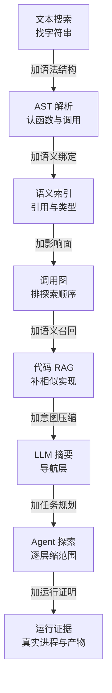
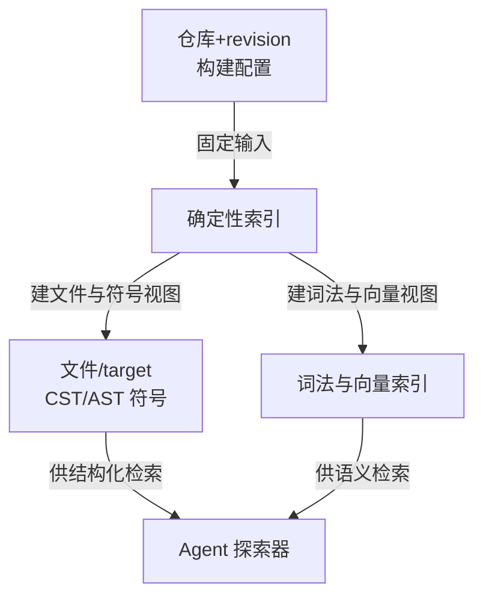
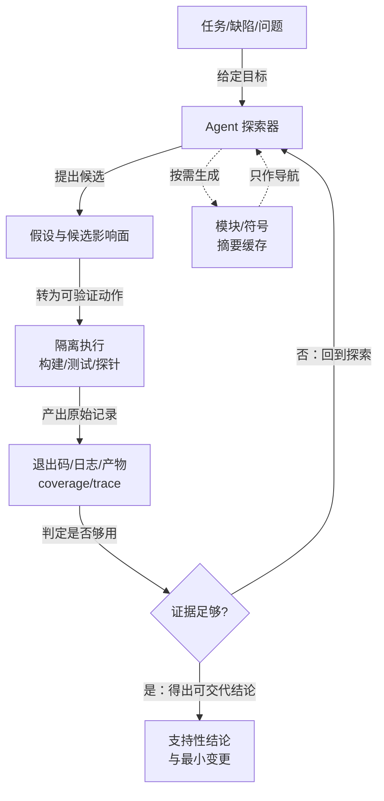
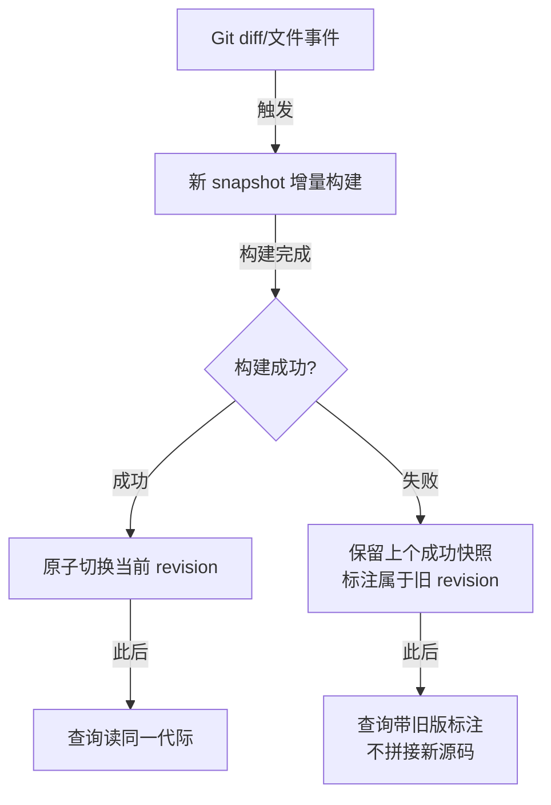

# 代码智能体为什么会漏改：结构索引、任务探索与运行证据分别缺什么

**Agent（能自主决定下一步做什么的智能程序）用来自动读码、改码并跑测试时，为什么会漏改？**读完你能**对照这三条链路检查自己的代码智能体缺哪一条，并按最小实施顺序补齐**。**本篇回答三套链路分别解决什么：结构索引是按语法与符号关系建立的代码地图；任务探索是 Agent 围绕问题逐层缩小范围的检索过程；运行证据是测试与执行产生的可核实记录**。三者的数据流是：**结构索引输出代码地图，供任务探索查询；任务探索输出假设，供运行验证核实；执行结果再反馈回探索**。**缺一环结论就断在半路——少了结构索引，探索只能靠文本猜位置；少了运行证据，假设无法被证伪。**

**最小例子是一个跨模块缺陷：文本搜索找到报错字符串，符号索引找到调用链，运行 trace 才能证明目标分支实际被触发。三套链路缺了哪套，这个例子当场就能看出来。**
这三条链路共同依赖一个底层能力——**代码知识库：按代码的结构（语法树、符号关系、调用图）建立索引，让智能体能精确找到需要的代码片段和相关上下文**。**可靠方案需要同时具备三条链路**：

1. **自下而上的确定性索引**：从仓库、构建、语法和符号事实建立可定位的代码地图；
2. **自上而下的 Agent 探索**：从当前任务出发，按证据逐步缩小需要阅读和执行的范围；
3. **事实门禁**（用可核实的执行结果来判定结论是否成立）：用 revision（仓库的版本号，指某次提交）、**真实命令、测试、coverage/trace（覆盖率/执行轨迹，记录测试执行时实际经过了哪些代码行与函数）和产物验证模型结论**。

其中，**AI（人工智能）负责理解需求、形成假设、选择搜索和验证路径；框架（承载 Agent 运行的外围程序）负责索引版本、执行隔离、事实采集和一致性**。**LLM（大语言模型）摘要可以帮助导航，但不能成为「这个符号存在」「调用一定发生」或「测试已覆盖目标代码」的唯一证据**。

## 要解决的问题：漏改的三件事各卡在哪

**漏改总落在三件事上：在正确的仓库版本里找到相关结构、形成可证伪假设、证明改动真的经过构建和测试。源码读得多不等于这三件事成立。**下文按结构索引、文本搜索与运行记录三条线展开：各自能回答什么问题、假设怎样被证伪、改动通过什么证据才算被验证，以及仓库版本不一致时结论为什么失效。

## 普通检索增强为什么不够用

自然语言文档主要是段落之间的语义关系；代码的边界多得多。一类是代码结构本身的边界：编译单元（一次编译所依据的单个源文件单位）、作用域（一个名字在哪些代码行内有效）、类型。另一类是代码之间的关系边界：定义/引用（函数在哪里定义、在哪里被调用）、依赖方向（谁依赖谁）、生成条件，以及运行时派发（程序要跑到那一行才决定调用哪个函数）。这些边界里最难被文本捕捉的是运行时派发——程序跑到那一行才决定调用哪个函数，纯文本里看不到，文本切块自然也留不住它。仅按固定 token（模型处理文本的最小单位，约相当于一个词或半个词） 切块会丢失这些边界：

- 同名函数可能属于不同包、类型、重载或构建 target；
- 调用点与定义可能跨文件、跨仓库或由生成代码产生；
- 配置、宏、反射、依赖注入和动态派发会改变实际路径；
- 「静态可达」不等于**「这次运行真的执行」**；
- 仓库持续变化，旧 revision 的正确摘要可能成为新 revision 的错误上下文。

**静态可达关系在仓库里并不等于运行时的真实路径**，所以代码 RAG（检索增强生成）的**检索单元应优先是文件、符号、定义、引用、构建 target、测试和变更集**，自然语言 chunk（把文本按固定长度切出的片段，是通用文本检索的最小单位，在代码检索里仅作补充）。与普通文档检索的差别，像看城市地图与看地铁运行图的差别：**地图告诉你两条路在图上相交，运行图才告诉你这班车今天实际怎么走、在哪一站临时折返**——查代码要的是"这次运行真的经过哪里"，光有"图上相交"不够。


为什么拿数据库索引图来类比代码索引？来源：[腾讯云开发者社区《一篇文章讲透MySQL为什么要用B+树实现索引》](https://cloud.tencent.com/developer/article/1543335)（CC 4.0 BY-SA）。这张图只是数据库索引的类比，依据是代码的结构（函数、类、调用关系）本身就是树状或图状的：检索单元优先选文件、符号这类结构化对象，能保留这些关系，文本切块会把关系切碎；**这个类比不表示代码索引要用 B+ 树存储**（B+ 树：一种多叉有序树索引，数据全在叶子层，范围查询沿叶子链表走）。

## 能力怎么演进

| 阶段 | 解决的问题 | 仍然缺少什么 | 现在的正确位置 |
| --- | --- | --- | --- |
| 文本搜索/正则 | 快速找到字符串、错误码、配置和精确标识符 | 不理解作用域、类型和同名符号 | 永远保留的低成本第一跳 |
| CST/AST（Abstract Syntax Tree，抽象语法树：把代码按语法结构拆成的树） 解析（把代码按语法结构拆成树：CST 具体语法树保留全部语法细节，AST 抽象语法树只留关键结构） | 识别函数、类、调用、导入和语法结构 | 单靠语法树无法完成跨文件类型解析 | 结构查询、切分、重写和局部依赖 |
| LSP（Language Server Protocol，语言服务器协议：编辑器与语言工具的通信标准）/语义索引（基于前述 LSP，靠它拿到定义、引用与类型） | 定义、引用、实现、类型和诊断 | 依赖构建环境与语言支持；动态行为仍不确定 | 精确代码导航和符号级上下文 |
| 依赖图/调用图（描述模块与函数间调用、被调用关系的图结构） | 展开影响面与候选调用路径 | 静态边通常包含误报，也可能漏掉反射/动态派发 | 规划探索顺序，不直接证明运行行为 |
| Embedding（把代码或文本转成数字向量，用于计算语义相似度）/代码 RAG | 找到语义相近的实现、测试和文档 | 数字、否定、罕见符号和版本边界不稳定 | 与词法、结构和符号检索混合召回 |
| LLM 摘要/Wiki（自动生成的整仓模块说明页） | 压缩模块意图、协议和复杂函数 | 摘要会过期、遗漏条件或产生幻觉 | 按需生成的导航层，不是事实层 |
| Agent 探索 | 围绕任务多轮检索、读码、实验和修正 | 路径非确定、成本和错误会累积 | 由预算、停止条件和证据门禁约束 |
| 运行证据 | 证明真实进程、分支、测试和产物 | 单次运行只覆盖特定输入和环境 | 最终结论与回归验证的事实底座 |



这些能力是怎么叠加的？这套能力从"找文本"起步，逐步增加结构、语义、任务规划和运行证明；叠加的机制是每层解决前一层没有的问题，高层不替换低层。比如 Agent 规划出一百步计划，其中第 37 步引用的函数签名可能已经过期，必须由符号索引核实才能继续，规划层自己发现不了这类过期。越靠后越贴近问题语义，也越需要前面的确定性事实约束——高层靠语义规划缩小范围，但规划本身可能出错，必须由低层的确定性事实（语法、符号、执行记录）兜住验证。

能力层数增加了，解决率就同步提升吗？并非如此。下图来自 CodeAct 论文的零样本实验（不给任何演示示例，让模型直接作答）：只给模型任务描述与三种动作形式（文本、JSON、可执行代码），不同模型的解决率差异很大，且图中各模型解决率普遍低于一半。「层数堆叠」指一层层往上加能力，让人以为解决率会随之提高，事实并非如此。

**层数堆叠不等于解决率提升：层数只解决检索与规划，不验证真实执行——层数再多也只能提高找到正确代码的概率，无法保证找到的代码在当前环境下真的能解决问题**。**运行证据是在当前环境真实执行并观测目标分支是否真的被触发，只有它能在「找到代码」和「代码确实解决问题」之间补齐最后一段不确定性**——它能证明目标分支真的被触发。因此**加了结构索引、语义索引和 Agent 规划之后，仍然需要运行证据这一层来收敛**：


*图示：论文原图：以可执行代码作为动作的智能体流程。图源：Wang 等《Executable Code Actions Elicit Better LLM Agents》（arXiv:2402.01030）Figure 4。*

这张图同时给出了本篇主张的边界：**即便动作形式升级到可执行代码，模型间解决率的巨大差距仍然存在，缺了"测试真的经过目标代码"这一层，结论仍收不敛**——**没有覆盖证据，就无法区分「改动恰好通过」与「目标代码从未执行」，结论便无法被证伪，这不是能力层数能弥补的**。

## 一套完整架构由哪些部分组成：分层



索引分出文件、符号、向量三条检索路径，探索器并行取证据，探索结果与执行结果一起进入判定环节。


图：运行时闭环与上面的静态索引结构有什么不同？区别在于**闭环——探索器取到的证据最终要走到"跑测试"这一步才有意义**，跑不过就回到检索重来。来源：Anthropic《Building Effective Agents》。



### 仓库与构建画像长什么样

先用一个比喻建立整体印象：代码智能体查仓库像图书管理员整理一栋楼——先要拿到楼层的钥匙与平面图（构建画像：哪些门能开、每层什么布局），再给书架编号立索引（结构索引），读者提问时先看索引再下楼（探索），最后要在借书单上留读者签名（运行证据）。跳过平面图直接开始编号的，遇到「这扇门通地下二层」就全乱了——生成代码、条件编译就是那些隐藏的门。比喻到此为止——下文四节分别说明构建画像、结构索引、探索和运行证据在现实中如何搭建。

**先固定 `repository + commit/revision + submodule + build configuration`**。**识别 workspace、包管理器、模块、生成代码、条件编译、测试 target 和依赖锁文件**。**没有构建画像，符号索引可能只覆盖默认模块，所谓「全仓调用链」会从一开始就不完整**。

把构建画像的最小输出形态写成配置，是这样：

```yaml
repository: example/service
revision: <commit-sha>
languages: [java, kotlin]
build_systems: [gradle]
targets: [service, integration-tests]
generated_sources: [build/generated]
index_status:
  syntax: complete
  semantic: partial
  reason: "integration-tests 缺少私有依赖"
```

**`partial` 是合法事实；不能因为一部分索引成功就投影成全仓完备。**

### 结构索引怎么按成本顺序分层、每层拦住哪些问题

索引按成本从低到高分为六层，每层拦住不同问题：

- 文件树、语言、大小、hash、owner 和最近变更；
- manifest、lockfile、workspace、build target 和模块依赖；
- Tree-sitter 等解析器生成的 CST（具体语法树：保留全部语法细节的解析树）、节点范围和结构查询；
- 编译器或语言服务器产生的 symbol、definition、reference、implementation、type 和 diagnostic；
- 可静态推导的 import、继承、调用和测试归属关系；
- README、ADR（架构决策记录）、API schema、配置、迁移和测试夹具。

[Tree-sitter](https://tree-sitter.github.io/tree-sitter/) 的准确定位是增量解析器和 CST 生成工具：它能在编辑和部分语法错误下持续提供结构，但不会自动提供完整类型系统或跨文件语义。[LSP](https://microsoft.github.io/language-server-protocol/) 标准化编辑器与语言服务器之间的定义、引用、补全等交互；离线/远程导航可以使用语义索引格式。

当前代码导航生态中常见的是 [SCIP（Sourcegraph 的代码索引格式） 索引](https://sourcegraph.com/docs/code-navigation/writing-an-indexer)（Sourcegraph 的代码语义索引格式，描述符号定义与引用关系），历史资料里的 LSIF（SCIP 之前、现已多被取代的代码导航索引格式）不应被当成唯一或固定实现。「定义、引用、实现、类型」这层能力交给语言服务器时，交互长这样——打开文档、编辑、发布诊断、跳定义、关文档，全部走 JSON-RPC（一种基于 JSON 的远程调用协议）标准消息：


*图源：Microsoft Language Server Protocol 官方 overview，MIT，https://microsoft.github.io/language-server-protocol/overviews/lsp/。*

索引分层的第四层（symbol、definition、reference、type）就是靠上图的 definition 请求响应拿到的：语言服务器维护语义信息，索引方只需要按标准协议发请求——这层能力精确但依赖构建环境与语言支持，正是分层表里它排在 Tree-sitter 之后的原因。

### 为什么要混合检索而不是单路向量召回

| 查询意图 | 首选通道 | 补充通道 |
| --- | --- | --- |
| 错误码、配置键、SQL、API 名 | 精确/正则/BM25（结合词频与文档长度的经典文本相关性评分算法）| 符号和邻近调用点 |
| 某符号的定义、引用、实现 | LSP/SCIP/编译器索引 | 文本回退和构建 target |
| 「谁会影响这个接口」 | 反向引用、依赖图、变更图 | 测试映射和代码所有者 |
| 「仓库里是否有相似重试逻辑」 | 词法 + embedding | AST pattern（按语法树结构匹配的搜索模式）和符号过滤 |
| 某次请求实际走了哪里 | trace/coverage/profile（性能采样，统计各函数耗时与调用频次） | 静态调用图用于解释遗漏 |
| 模块为什么这样设计 | ADR、README、历史 diff、摘要 | 关键符号和接口约定测试 |

**检索结果必须携带稳定定位：仓库、revision、文件、range、symbol ID、构建 target 和索引版本。没有版本绑定的代码引用，只能视为提示，不能用于自动修改**。多路检索的分工像医院挂号分诊：**报错码是外伤直接进急诊（精确匹配），查病因是内科问诊（语义检索），两路都指向同一位医生时诊断才可靠**——只挂一路号，另一类病因就漏了。

### Agent 探索为什么该自上而下？

Agent 不需要一次读完整仓库，而应围绕问题建立逐层扩展的证据包：

```text
任务约定
  -> 精确词/符号入口
  -> 定义、引用、调用者、被调用者
  -> 构建与测试边界
  -> 形成少量可证伪假设
  -> 运行最小实验
  -> 根据新证据扩展或停止
```

  每一步记录 `query -> candidates -> selection_reason -> evidence -> next_question`。AI 可以决定下一步查什么，但框架要验证它读取的是哪个 revision、执行了什么，以及结果是否真实存在。查案的路径：先立一条可证伪的假设，再取证支持或推翻它，而不是把全城卷宗读完再下结论——取证过程的每一步都要留笔录（来源与理由），否则后面无法复核。比喻到"假设加取证"为止：停止条件、预算约束这些工程细节，还是看下面的清单。

**停止条件不应写成「Agent 觉得已经理解」**。至少满足：

- **所有关键声明都有文件/符号或运行事实定位**；
- **候选根因存在能区分彼此的实验**；
- **目标变更有编译、测试和原始问题复现**；
- **未覆盖范围、索引缺口和环境阻断被显式列出**；
- **达到 token、工具调用、时间或费用预算时返回部分结论而非伪装完成**。

### LLM 摘要为什么随时会失效？

**目录、模块、类型和复杂函数摘要可以明显降低阅读成本，但应按需、分层生成，而不是无条件重写整仓 Wiki**：

```text
仓库摘要
  -> 模块摘要
     -> 包/目录摘要
        -> 类型/符号摘要
           -> 原始代码与定义引用
```

摘要失效的判定要靠缓存键，键里至少要包含这些字段：

```text
repository + revision/content_hash + symbol_id
+ parser/indexer_version + model + prompt_version
```

  依赖符号改变时，直接摘要失效；上层摘要按依赖方向重新聚合。摘要应保存来源 ranges 和生成元数据，并允许从当前源码重建。若摘要与源码或符号索引冲突，以绑定当前 revision 的确定性事实为准。摘要的性质同手抄讲义：教材改版后，讲义不能直接当新教材用——要么标注"依据第几版"，要么按新教材重抄；上课时讲义与教材冲突，以教材为准，讲义是降低阅读成本的派生物，教材（源码）才是原文。

## 增量更新为什么决定了系统能不能扩展？

全仓重新解析、重新 embedding（把文字、图片等内容转成一串数字向量，机器靠向量距离算相似度）、重新生成摘要既昂贵又容易把版本混在一起。推荐的更新链是：

```text
Git diff/文件事件
  -> 内容 hash 去重
  -> 增量 parse
  -> 更新符号与定义引用
  -> 找到受影响的反向依赖
  -> 失效相关 embedding/摘要/测试映射
  -> 生成新索引快照
  -> 原子切换当前 revision
```

  **snapshot 的更新受几条关键约束：**

道路施工的"新修辅路、建成通车、旧路封闭"是同一套约束：施工在辅路上进行（新 snapshot），不能在通车的旧路面上原地开槽（不在查询中的旧 snapshot 上混写）；辅路验收合格才把车流切过去（原子切换），切过去之后旧路才封（旧快照标注退役）；新路修一半不封旧路（失败保留旧快照），司机永远行驶在完整的一条路上（查询读单一一致代际）。

- **更新通过新 snapshot 构建，不能在查询中的旧 snapshot 上原地混写**；
- **删除要传播 tombstone**（墓碑标记：显式记录符号已删除，检索时据此过滤），**防止被删除的符号继续召回**；
- **语义索引失败时保留上个成功快照，但必须标注它属于旧 revision**；
- **同一查询只读取一个一致的索引代际，不能拼接新源码与旧摘要**；
- **大仓库按模块、语言和变更影响面并行，失败分区可重试但不可冒充成功**。



**更新只在新建 snapshot 上进行：构建成功才原子切换，失败保留上个快照但明确标注旧 revision——查询侧永远读单一一致代际，读旧代际时带旧版标注，不出现新源码配旧摘要的拼接**。

### AI 和框架各自负责什么

| AI 负责的语义决策 | 框架负责的事实约束 |
| --- | --- |
| 判断任务意图、相关模块和可能根因 | 固定仓库、revision、worktree（同一仓库检出的独立工作目录，供 Agent 在隔离副本上改动）和索引代际 |
| 选择文本、AST、符号、向量或历史检索 | 返回真实候选、定位和索引完备度 |
| 判断应读哪些文件、展开哪条调用链 | 限制权限、上下文、步数、时间和费用 |
| 选择构建系统、测试入口、探针和回退 | 隔离执行并保存 argv（命令行参数）、cwd（当前工作目录）、退出码和产物 |
| 解释编译、网络、权限或产品逻辑失败 | 区分未执行、执行失败、超时、环境阻断和无证据 |
| 判断补丁是否符合需求并决定下一步 | 验证 patch、compile/test、coverage/trace 与 revision 绑定 |

语义索引、测试和运行证据都可能不完整，因此系统还需要表达 known（已核实）/ partial（部分可知）/ stale（曾核实但已过期）/ unavailable（当前不可得）四种状态，而不是把「不知道」压成 `false`。完整事件和投影模型见 [[工程知识/AI 系统工程：从模型能力到生产能力/安全与治理/执行证据必须独立于AI结论]]。

## 如何证明测试真的经过目标代码

证明的强度是递增的，下面五种证据从弱到强排开，每一种都有适用边界：

1. 测试文件引用目标符号：只能说明静态相关；
2. 静态调用图能到达目标：只能说明候选路径；
3. coverage 命中目标行/分支：说明该次运行经过相应位置；
4. trace 或定向探针（向系统注入的检测点或检测请求）记录目标函数及关键参数：能证明一次具体路径；
5. 删除/反转修复后测试失败，再恢复修复后通过：增强测试与行为之间的因果证据。

**这些证据都要绑定相同 commit、构建产物、测试命令和环境**。**不能用 Maven（Java 的构建与依赖管理工具） `validate` 成功、测试进程启动或模型声称「已覆盖」替代目标行为验证**。证据强度的递进像医生下诊断：**化验单指标异常（静态引用）只是线索，影像看到病灶（coverage）进了一步，病理切片（trace）才算确诊依据——挂号成功（进程启动）和病人自述没病（模型声称）都不构成诊断**。

## 评测体系怎么搭

评测要分层测量，"答案看起来合理"不构成任何一层的证据：

| 层 | 指标/样本 | 主要回答 |
| --- | --- | --- |
| 索引完整性 | 文件/target 覆盖、解析失败率、符号解析率、索引新鲜度 | 数据是否真的进入系统 |
| 检索 | Recall@K（前 K 个结果中命中的比例）、MRR（首个正确结果排名倒数的均值）、定义/引用命中、正确 revision 比例 | 所需证据能否被找到 |
| 探索 | 首个有效证据步数、无效展开率、重复读取率、停止正确率 | Agent 是否高效缩小范围 |
| 理解 | 幻觉符号率、调用关系准确率、未证实声明率 | 结论是否忠于代码事实 |
| 修改 | patch apply、编译、目标测试、回归测试、影响面遗漏 | 变更是否正确且最小 |
| 运行证明 | 目标 branch/函数 coverage、trace、原始缺陷复现 | 测试是否真的验证目标行为 |
| 工程 | p50/p95（50%/95% 的请求所对应的耗时水平）、token、索引时间、缓存命中、每成功任务成本 | 系统能否持续运营 |

评测集应包含：同名符号、多模块、生成代码、动态派发、依赖缺失、旧索引、重命名、删除传播、网络失败和「没有足够证据」的样本。每次 parser、indexer、embedding、模型、Prompt（提示词）或工具协议升级都重跑对应层级，而不是**只看一个总分**。分科考试的道理：驾照分开考科目一到四，倒库不合格就是不合格，不能拿路考的高分把倒库的失误平均掉——引擎升级后重跑的也不该是"总分"，是对应科目的单项成绩。

## 有哪些常见失败模式

- **把 CST 当完整语义图**：**语法结构存在，不代表类型、重载和跨文件绑定已解析**。
- **把静态调用图当运行事实**：**动态语言、反射、接口派发和配置会改变真实路径**。
- **全仓预生成摘要**：**成本高、更新慢，且摘要会在代码变化后悄悄失真**。
- **只做向量检索**：**精确符号、版本号、错误码和否定条件容易丢失**。
- **把更多上下文当更好**：**无关文件会稀释关键约束；应按任务逐层展开**。
- **索引与代码跨 revision**：**Agent 的检索、假设与改动都建立在索引内容上，索引若停留在旧 revision，给出的符号定义与调用关系便与当前分支不符——于是看到了正确的旧代码，却对当前分支生成错误补丁**。
- **Agent 自证成功**：**模型输出、命令文本或测试名称都不能替代真实执行与覆盖证据**。
- **用图数据库解决一切**：**图存储只是表示和查询手段；边的来源、完备度和更新一致性才决定价值**。

## 最小实施顺序怎么排

1. 先提供 `rg`（ripgrep，基于正则的高性能命令行搜索工具）`/全文搜索 + 文件读取 + Git diff + 构建/测试`，建立真实执行和 revision 门禁；
2. 增加 Tree-sitter 结构切分和查询，改善跨语言实体定位；
3. 对核心语言接入 LSP/SCIP 或编译器索引，获得精确定义/引用；
4. 用 embedding 补充「概念相似」查询，并与词法和符号结果融合；
5. 只为高频模块按需生成带引用的分层摘要；
6. 用失败样本决定是否增加调用图、历史变更图或更复杂的 Agent 规划；
7. 最后才考虑自动发布全仓 Wiki 或可视化图谱。

**这套系统成熟了吗？只看它能否直接回答四个问题：当前结论来自哪个 revision、依据哪条结构或语义事实、经过哪次真实执行、还有什么无法证明**。四问分别对应结构索引的版本管理、探索的检索依据、运行证据，以及未证伪项的如实标注。**图谱的可视化程度与这个能力没有对应关系——可视化只反映结构表示画得好不好，而成熟度取决于能否回答版本、事实、执行与未证伪项这四件事**，把图画得好看一件也回答不了。

## 与其他主题有哪些关系

- 通用检索、hybrid（混合检索，关键词与向量两路并用）、rerank（对候选结果重新排序）、freshness（索引内容的新鲜程度）和评测：[[工程知识/AI 系统工程：从模型能力到生产能力/知识与检索/RAG的核心是选择可引用证据]]。
- AST/CST、代码改写与结构边界：[[工程知识/软件构建：让变化可以理解、验证与交付/架构与代码/AST提供语法结构，语义仍需符号与运行证据]]。
- AI 改代码后如何用复现和测试验证：[[工程知识/AI 系统工程：从模型能力到生产能力/Agent与工作流/AI辅助研发必须形成证据闭环]]。
- 命令、产物、任务代际和证据投影：[[工程知识/AI 系统工程：从模型能力到生产能力/安全与治理/执行证据必须独立于AI结论]]。
- 模型、应用框架和编排运行时分层：[[工程知识/AI 系统工程：从模型能力到生产能力/生态与选型/模型、框架、运行时与协议解决不同问题]]。
- 测试分层与回归资产：[[工程知识/软件构建：让变化可以理解、验证与交付/测试与交付/测试策略从风险选择证据]]。

## 来源说明看哪些

本页从一次技术分享提炼「自下而上索引 + 自上而下探索 + 增量更新」，并用当前官方资料纠正术语和事实边界。Tree-sitter 官方将自身定义为增量解析库和 CST 生成工具；Microsoft 的 LSP页面说明 LSP、LSIF 的原始职责；SCIP 的结构和测试方式以 Sourcegraph（一家做代码搜索与代码索引工具的公司）当前索引文档为准。直播中的产品效果、规模和成本数字缺少可复现实验，因此没有升级为本页结论。

## 怎么自己动手验证

1. 三链路对照：取一个跨模块缺陷，分别用文本搜索、符号索引与运行 trace 定位，三路合起来应同时给出相关结构、调用链与实际触发的分支；任一路单独完整定位时，先检查样本是否真的跨模块，确认后把该样本从跨模块缺陷集移除。
2. 版本一致：事先写下预期——索引失效时系统应明确报错或重建；让索引与工作区版本产生差异后核对，实际行为与预期对不上就说明版本绑定有缺口。
3. 增量失效：修改一个被多处引用的符号，确认受影响的索引条目按依赖更新，未涉及的条目不被重建。

