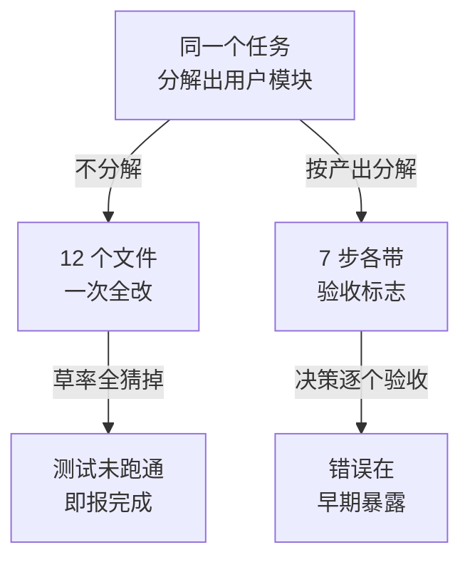
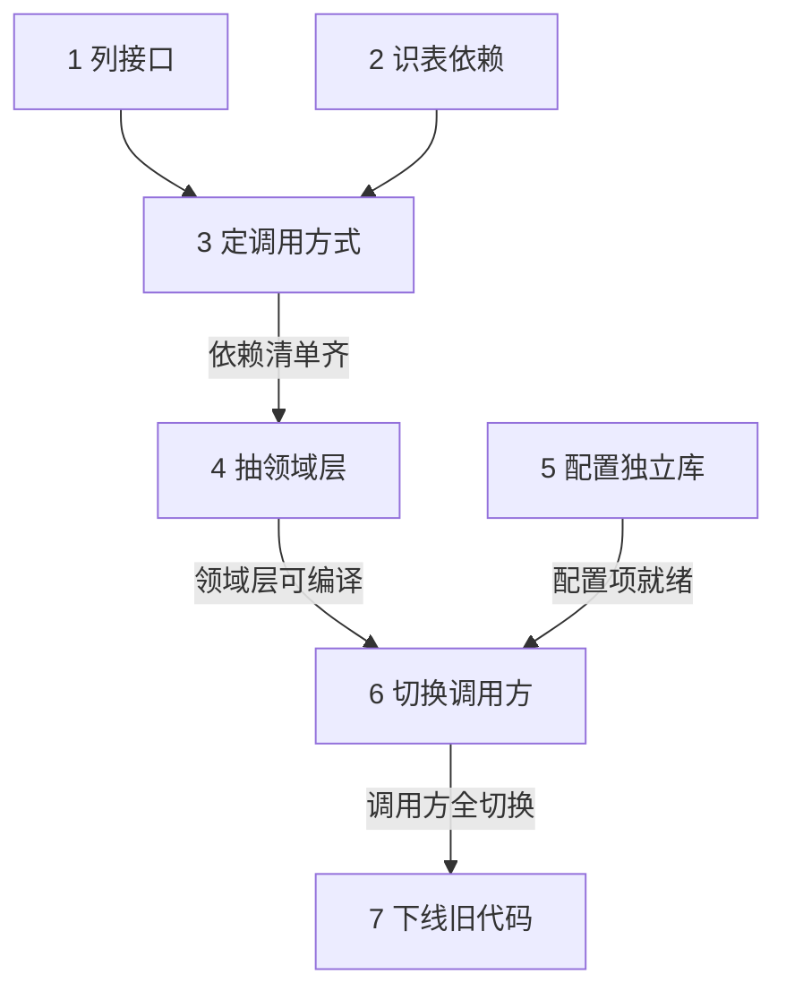

# 任务分解的质量决定 Agent 的上限

一个复杂目标一次做不完、容易中途跑偏，任务分解怎么能帮上忙？本篇讲怎么用它把大目标切成能单独验收的小步骤。读完这篇，你能写出带产出与验收的七步计划，并判断执行中何时该推翻重排（布局或尺寸变化触发重新计算排版）。

任务分解解决的问题，是**一个目标同时包含太多未知步骤时，模型会边猜边执行、直到很晚才发现方向错误**。做法是把目标划分成有产物、依赖和验收条件的步骤，再在新证据出现时允许重排；效果有三点：**可检查**——每步带验收命令，验收命令提供客观对照；**可恢复**——每步的产出与验收记录都在，状态留存可读取，中断后能从断点续做；**可并行**——依赖关系明确了同时开工的条件，无依赖的步骤可以一起跑。

规划还要占用 token 预算（token 是模型计量与计费的基本单位，处理多少 token 收多少费），另有两点代价——计划可能一开始就错（方向定错等于图纸画反了还按图施工）、过于刻板的计划会限制探索——见下文《效果从哪儿来，要付什么代价》。

## 何时必须显式分解任务：为什么模型自己扛不动

**一个目标包含的未知步骤超出单次推理能容纳的数量时，模型会一边猜测一边执行，直到很晚才发现方向错了**——这正是要解决的问题的核心。本篇回答：什么样的目标必须显式分解、每个子任务做到什么粒度、依赖与验收条件怎么写进计划，以及计划在什么条件下允许推翻重排。

打个比方：一个人同时被托付一堆买菜、接人、缴费的事，也是这种过载——脑子能同时攥住的待办就那么几件，硬撑着全接下来，回家发现漏了两样还买错了三样，超出上限的部分只能猜。比喻到此为止：人的待办是并列事项，记住即可；任务的未决决策之间有先后依赖，一项错会传导到后续，所以记不住就得写清单，而且任务分解还要求每项带验收与依赖，比清单更严一层。

## 不分解任务会出什么乱子：那个"一步都做不对"的大任务怎么来的

打个比方：任务分解像把一次搬家拆成"打包、叫车、搬运、还原"——每步都要能说出"做完长什么样"（验收）、"要先做完哪一步"（依赖）。拆开之后才知道车叫小了是哪一步卡住。这个比喻只说明为什么要拆、拆完的好处；验收命令、重排信号、规划预算见下文《怎样把大任务拆成可验收的小步》与《效果从哪儿来，要付什么代价》。

给 Agent（能自主调用工具完成目标的模型程序）一个任务："把用户模块从单体里独立出来，做成独立服务。"

它的输出：直接开始改代码，改了 12 个文件，然后报告"完成"。实际上：

- 没考虑数据库表怎么划分
- 没处理跨模块的事务
- 没设计服务间调用方式
- 测试没跑通就报告完成

**失败原因在任务太大。** 一个需要 20 步、每步都有分支的任务，让模型"一次想清楚"，**等于让它同时持有 20 个未决决策**（还没确定、需要后续选择的方案点）。模型在一次输出中通常顺着往下写，已经写出的内容难以在后续被整体推翻重写，一次能同时保持的未决决策数量受上下文窗口限制；20 个超出这个上限，**超出的部分只能猜测，一处猜错便沿后续步骤一路错下去**。



图：任务大小怎么决定结果——不分解时 12 个文件一次全改、测试未跑通即报完成，一次性持有的未决决策数量决定草率程度；分解把 20 个未决决策分摊到 7 个带验收的小步上，每步当场核对。

## 怎样把大任务拆成可验收的小步

### 分解到哪一层才算够细

**层次一：怎样算把任务分出了明确产出？**

**按时间或阶段切是坏分解的典型样子**：

```
1. 分析代码
2. 设计方案
3. 实施
4. 测试
```

**按产出切才是好分解，每步都能验收**：

| 步骤 | 动作 | 产出 |
| --- | --- | --- |
| 1 | 列出 user 模块对外暴露的所有接口和调用方 | 接口清单 |
| 2 | 识别跨模块的数据库表和外键 | 表依赖图 |
| 3 | 确定服务间调用方式（同步/消息/共享库） | 方案 + 理由 |
| 4 | 抽出领域层代码，保持接口兼容 | 可编译的代码 |
| 5 | 配置独立数据库，写数据迁移脚本 | 迁移脚本 |
| 6 | 切换调用方到新服务（灰度：先放少量流量验证再逐步全量） | 灰度开关 |
| 7 | 下线单体里的旧代码 | 删除的提交 |

**判断标准：每个子任务能明确说出"做完的标志是什么"。** **说不出就是分解得不够**。


图：编排者只负责拆与合，具体活由各 worker 并行做——对应上文「按产出分解」：每个子任务有独立产出，才能放心分派出去。来源：Anthropic《Building Effective Agents》。

**层次二：步骤之间的依赖关系怎么标？**



可以并行的：`1` 和 `2`（都是调研）。必须串行的：`3` 在 `1`、`2` 之后。

**层次三：每步的验收标准怎么写？**

```
4. 抽出领域层代码
   验收：go build ./... 通过 && 现有测试全绿 && 无新增外部依赖
```

**没有验收标准的任务，Agent 会自己判断"做完了"** —— **模型用自己生成的内容自评完成度**，倾向于把看起来像完成的输出当成完成，除非有验收命令提供实际运行的对照，否则**会把没跑通的输出当成已完成，从而高估进度**。

### 三种分解模式该怎么选？

三种模式的差别看两点——计划是一次定完还是逐步细化、任务之间要不要传递中间结果（见下面表格前两列）。**探索性强、中途冒新信息的选增量，结构清晰一次看得到底的选一次性，任务大到一层装不下的选分层**。

装修是三种模式的实物对照：图纸齐全的自建公寓按图施工（一次性规划）；老房改造边拆边发现暗管，拆一段改一次图纸（增量规划）；整栋楼翻新先定各楼层计划、进场一层细化一层（分层规划）——三种都成立，选哪种取决于你开工前能看清多少。比喻到「按可见度选模式」为止：装修改图纸要找设计师、花时间花钱；Agent 重规划同样要吃 token 预算，所以计划不能随便推翻重来；每次重规划后要像初始计划一样检查依赖与验收是否仍然成立。三种模式各自的适用条件见下面表格。


| 模式 | 计划怎么定 | 要不要传中间结果 | 适用 |
| --- | --- | --- | --- |
| 一次性规划 | 一次定完，之后只执行 | 不传递 | 任务结构清晰，Agent 能看到全貌 |
| 增量规划 | 每步完成后重新规划剩余 | 每步都传递 | 探索性强，信息逐步获得 |
| 分层规划 | 先粗计划，进入子任务再细化 | 只在层间传递 | **推荐**：大任务 |

**分层规划最实用**：先 7 步粗计划，执行到第 4 步（抽出领域层代码）时再把它分解成若干子步骤。**细化发生在拿到前几步真实产出之后，细节有据可依**，模型不必在一开始就凭空猜测细节。这套「计划、执行、再计划」的循环在 LangGraph 官方教程里有现成的实现图：planner 先出计划，execute 子图每次只执行计划里的第一步，replan 拿到执行结果后更新剩余计划——「一次性规划」在图里就是去掉这条回边的情况（replan 环指图中从 replan 连回 agent 的那条边，代表执行完一步后回到规划节点重新打算），「增量规划」就是让 replan 每步都跑：


*图源：LangGraph 官方教程 Plan-and-Execute（LangChain OpenTutorial），MIT，https://langchain-opentutorial.gitbook.io/langchain-opentutorial/17-langgraph/03-use-cases/05-langgraph-plan-and-execute。*

表格里三种模式的差别，在这张图上就是 replan 节点的三种接法：计划一次定完就把 replan 到 agent 的回边（指连回上游节点的那条边）去掉；每步重新规划就保留回边；分层规划则是把 execute 子图换成会自我调用的 planner 加 executor——planner 把大任务拆成若干子任务，每个子任务内部又有自己的 planner 和 executor，一层套一层；层内细节在子 planner 处消化，只把本层结果传给下一层，对应表格中的「只在层间传递」。三种接法的差别就在 replan 那条回边。

### 执行中发现计划错了该怎么办

执行中发现计划错了是**正常情况**，**机制要在三处支持这种回退**：

- 执行第 4 步时发现：user 模块和 order 模块共享一张表
- 回到计划层，插入新步骤："划分共享表"
- 重新排序后续步骤
- 继续执行

**关键：允许回退到计划层，不勉强继续往下做。**

树搜索是在多个候选路径中尝试、按评估结果保留较优分支、放弃其余分支的搜索方式，**让模型在多条推理路径上做选择**。因为被放弃的分支可以不再走，模型等于获得了退回上一个节点重选的能力，这就是把「允许修改」落到机制上。

ToT（Tree of Thoughts，思维树）推理时在每一步生成多个候选想法，由模型自己当裁判打分，只保留高分的分支，这样方向错了就能退回上一个节点重选。**本篇的 replan 信号（执行中发回计划层、重新生成剩余步骤的信号）是同一个动作在执行层的形态：发现当前路径不对就退回上层重选**。

**ToT 评估的是候选想法是否更接近正确答案，由模型自己判断；replan 评估的是已执行步骤的产出是否通过验收命令，由实际运行结果决定**。二者都在发现方向错了就退回上一步：ToT 回到思维树的上一个节点另选解题思路，replan 回到计划列表的上一步另选待执行工序。

下图对比四种推理方式：ToT 因为每步都评估，所以能在中途发现方向错并换路；其他三种要么一条路走到底、要么靠多数投票事后选定，都没有按中间评估结果回退换路的机制。


*图源：Tree of Thoughts 论文《Tree of Thoughts: Deliberate Problem Solving with Large Language Models》Figure 1（arXiv 2305.10601），https://arxiv.org/abs/2305.10601。*

## 效果从哪儿来，要付什么代价

**收益**

- **每步可验证**：每步有产出和验收，错误在早期暴露而不是积累到最后
- **可恢复**：知道完成了哪些步骤，中断后能从断点继续
  - **可并行**：依赖关系明确后，独立子任务可以并行（见 [[工程知识/AI 系统工程：从模型能力到生产能力/Agent与工作流/多智能体只在能并行或需要独立上下文时才值得]]）
- **人类可读**：计划本身就是给协作者看的进度说明

手术团队用手术核对单是同一路收益：每一步做完在单上打勾（每步可验证）、中途换人或意外中断照单续做（可恢复）、器械护士与巡回护士按单并行备物（可并行）、单子本身就是给全团队看的进度（人类可读）——这是收益侧。比喻到「清单让分工可核对」为止：Agent 计划是机器可读的结构化状态，并非人工纸质清单，因此它能被程序直接读取和校验，无需人工逐项核对。**代价**

- **规划本身消耗 token**：一次完整规划会花掉总预算的 5-10%（经验估计，随任务复杂度浮动）
- **计划可能一开始就错**：基于错误理解做的分解，执行再好也是错方向。**所以要在执行前让人工或自动检查计划**
- **过于刻板的计划会限制探索**：提前定下的步骤会在探出新模式时挡住调整，反而拖慢进度，所以有些任务需要先探索才能规划。**探索阶段和规划阶段要分开**

## 具体从哪一步开始执行计划？

开工前先把工序与验收写清楚，道理和包工头接活先签施工单一致：单价、工期、每道工序的验收标准写在单上（plan_only 模式：只生成计划、不实际执行的运行开关，先出计划），房主签字才开工（确认后再执行），中途加项要补单（允许回退到计划层）——比喻到「先签单后开工」为止：施工单签了还允许按实结算调整，Agent 计划批准后改动要走 replan 并留痕，不是口头上说改就改。

**第一步：先让 Agent 输出计划，不要直接执行**

最简单的改进：**加一个 `plan_only` 模式**，先生成计划，确认后再执行。

**第二步：要求每个子任务写明"完成标志"**

提示词（发给模型的输入指令与背景信息）里**要让每个步骤明确写**下面两件事：

```
每个步骤必须包含：
- 这一步要产出什么（具体的文件/数据/结论）
- 怎么判断这一步做完了（可执行的检查）
```

**第三步：让计划显式标注依赖**

```json
{
  "steps": [
    {"id": 1, "desc": "...", "depends_on": []},
    {"id": 2, "desc": "...", "depends_on": []},
    {"id": 3, "desc": "...", "depends_on": [1, 2]}
  ]
}
```

**第四步：执行中允许回退**

实现"回到计划层"的能力：Agent 可以发出 `replan` 信号，重新生成剩余计划。

**第五步：把计划存进工作记忆**

见 [[工程知识/AI 系统工程：从模型能力到生产能力/模型与上下文/记忆是受治理的状态，不是更长的聊天记录]]。计划以**结构化状态**（以可机器读取的字段保存的计划进度，而非聊天文字）的形式存在，与对话历史分开存放。

## 分解时最容易犯哪些错

**错误 1：让 Agent 边想边做**

没有计划直接执行，导致它在第 15 步才发现第 3 步的方向就错了。**先规划，即使计划会变。**

**错误 2：分解粒度不对**

太粗略："实施服务独立"（等于没有分解）。太琐碎："打开文件"、"写一行"——**步骤多到上下文装不下**。

合理粒度：**每步 3-15 分钟能完成，产出可验证。**

——这里指单人或单 Agent 不查资料情况下的净执行时间，含调研或外部依赖的步骤应另计。

**错误 3：计划生成后不检查**

完全信任 Agent 的计划。**计划生成后应该有一次校验**：步骤完整吗？依赖对吗？验收标准可执行吗？

**错误 4：不允许修改计划**

执行器面对障碍时没有任何回退动作，只能照着初始计划一路推进到失败。replan 能力必须内建，执行器随时可以回到计划层。

**错误 5：把"探索"和"执行"混在一个计划里**

"调研代码库并重构"——**调研的结果会改变重构方案，不该预先规划到不可调整**。**先探索，再基于探索结果规划执行。**

最后一步收尾：分解产物要与预期对照检查——先写明每个子任务的完成判据、输入输出的格式，跑完后拿结果与预期逐条核对，对不上的子任务返回重做，**把误差挡在把各步结果合起来用之前**。

## 怎么自己动手验证

怎么判断这套分解方法在自己手上真的有效？最小验证：给 Agent 一个需要七步以上、中途会出现新信息的任务（例如把某个模块从单体中独立出来），先让它输出完整计划，断言每个步骤都写明了产出物与完成标志；执行到第三步时注入一条与已有计划冲突的事实（例如发现两个模块共用一张表），断言系统回到计划层插入新步骤并重排后续，已验收的步骤不被重跑。

对照验证：同一任务跑两组，一组允许中途重新规划，一组锁定初始计划，记录完成率与方向性错误首次出现的步数。

关系：[[工程知识/AI 系统工程：从模型能力到生产能力/Agent与工作流/多智能体只在能并行或需要独立上下文时才值得]] · [[工程知识/AI 系统工程：从模型能力到生产能力/Agent与工作流/模型负责判断，运行时负责执行语义]]

## 这套说法在哪儿会失效

- 分解只在步骤可以事先列举时有效：目标本身带有探索性质（设计一个还没想清楚的协议），**提前分解会把探索范围锁定在错误假设上**。这类目标适合先做限时探索，再基于探索结果规划。
- 分解的粒度受限于对问题的理解：**理解出现偏差时，分解越详细，错误被固化得越彻底**，后续步骤全部建立在错误前提上。计划生成之后先校验再执行，把偏差挡在开工之前。
- **分解不提高单步的推理水平**：某一步所需的推理超出模型能力时，分成三个步骤仍是同样的失败。
- **并行空间取决于真实的依赖关系**：多数工程任务的依赖呈链式——前一步的产出常作为后一步的输入，**能同时开工的步骤比图上看到的少**；本文的用户模块示例里，前两步可并行、其余多为串行，就是链式依赖的典型情况。

## 接着读哪几篇：同在AI 系统工程里的相邻问题

- [[工程知识/AI 系统工程：从模型能力到生产能力/Agent与工作流/模型负责判断，运行时负责执行语义]] · [[工程知识/AI 系统工程：从模型能力到生产能力/质量与运营/Agent评测必须覆盖轨迹而不只看最终答案]]
