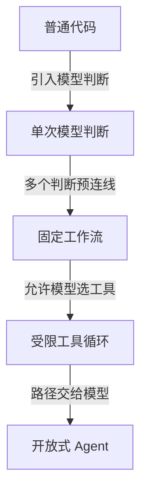

# 先用工作流，只有路径无法预先枚举时才使用 Agent

## 为什么不能把固定流程直接交给模型自治？

这题问的是：**什么任务该用固定流程、什么任务该交给模型自治**——读完你能用**路径能否枚举、错误能否撤销、有无外部判据**这三项，判断手头任务该用工作流还是 Agent（模型自己决定下一步、选什么工具、何时停止的执行方式）。一条在设计时就可以写定的流程被交给自治循环（让模型在运行中自行决定下一步的执行方式）执行之后，**成本上升、执行路径每次不同、审计时说不清当时做过哪些动作**——这三项后果提示了三个判据。

执行路径每次不同，说明需要**判断路径能否在设计阶段枚举**。审计说不清，说明需要**结果有外部可验证的判据，即拿执行证据说话**。

成本上升，说明需要**预算限制花费**。错误难撤销，说明需要**判断错误动作能否恢复**：动作不可撤销时损失已发生，只能靠预算限制后续花费兜底。

之所以有这些后果，是因为**路径在运行时由模型逐段选择、步数没有预设上限**，花费随每次实际轨迹（模型一轮运行走出的完整动作记录）波动，事后也只能靠翻日志还原。

## 工作流与 Agent 的本质区别是什么

工作流与 Agent 的根本区别在于：**控制权放在程序里还是放在模型里，决定了路径在设计阶段还是运行阶段确定**。可以打个比方，把它想成走迷宫的两种方式：一种是照着图纸上画好的路线走，拐弯写在纸上，走错了照图纸改；另一种是站在迷宫里，每到一个岔口才抬头看路牌决定往哪拐。

图纸方式能在开工前把每条岔路的走法都设计好，现场方式做不到——但它能应付图纸上没画出来的岔口。这个比方到「什么时候做决定」为止，迷宫里走错顶多绕回来，**模型选错动作可能已经发出去一封邮件或删掉一张表**——这一点迷宫比喻没有覆盖，能不能撤得回来要单独判。

程序控制的路径可以枚举、可以覆盖测试、成本有上界；当中途得到的新信息（比如搜索结果、工具返回）会改变下一步时，模型控制路径更合适，代价是**路径不可预先枚举**，正因如此**成本必须由预算限制**，就像打车要设里程上限（对应费用）、也要防堵车（对应时间），模型每一步都要消耗 token（模型处理文本的计费单位，token 用量直接计入费用），也要调用工具（工具同时消耗费用和时间），两者都会累积成费用与时间成本，不设上限可能让费用或时间都超出承受范围。打车类比到这里为止——它只说明费用和时间的封顶逻辑；步数封顶是另一套思路，下面分开说。

封顶有三种口径，按任务特点选：**按步数封顶适合每步花费相近的任务，按费用封顶适合单次调用贵的任务，按时间封顶适合对延迟敏感的场景**。单步耗时与 token 量共同决定单步花费。

先跑十次取单步平均 token 量和耗时，乘以单价得到单步花费，波动幅度大就按费用封顶、波动小就按步数封顶。失败恢复还有另一条要求：**要把模型决策时的上下文一并带回来**，恢复后才能接着当时的判断继续跑。

这条选择规则针对的是固定流程被交给模型的情况——这会导致**成本、不可预测性和审计难度同时上升**。判断分三步：路径能否在设计时枚举？

错误动作是否可逆？是否存在外部验证？

可逆且有外部验证意味着**失败能恢复、完成能判定**——动作可逆就能回退到出错前，外部验证能在花钱前判定成败，两者合起来，可逆使单次失败损失有限，外部验证使失败能及时停止不再投入，失败能被控制在不扩大的范围内，成本因此有上界；路径无法预先枚举意味着**固定流程写不出**，而预算与可恢复又兜住了花费与风险；**省下的人工成本减去新增失败与事故成本后为正，自治循环才比人工或固定流程更划算**，即产生净收益——前面「成本因此有上界」说的就是这个：花费被预算封住、风险被可恢复兜住。
「使用大模型」和「构建 Agent」是两个决定。

一次结构化抽取、固定步骤的文档处理和带模型节点的审批流都可以使用大模型，这些场景不需要让模型决定下一步。**路径无法合理预先枚举、预算能限制花费、失败动作可恢复，这三条同时满足时，自治循环有净收益**，即前文所说的「省下的人工成本减去新增失败与事故成本后为正」。

## 怎样判断一个系统算不算 Agent

```text
单次调用：程序决定输入和后续动作，模型返回一个结果
工作流：程序预先定义节点与边，模型在指定节点完成判断
Agent：模型自己决定下一步、选什么工具、何时停止
```

决定是不是 Agent 的关键是**控制权归属，不是调用次数**。上面工作流一行的「判断」指模型的语义判断（理解内容后作出的决定），不是程序里的 if 分支。一个十步固定流程仍然是工作流；而一个模型根据搜索结果决定继续搜索、改写问题还是结束，即使只有两个工具，也已经具备 Agent 的特征——**下一步由模型自己决定**。

| 维度 | 确定性工作流 | Agent 循环 |
| --- | --- | --- |
| 路径 | 设计时确定 | 运行时由模型选择 |
| 可预测性 | 高 | 依赖模型与上下文 |
| 测试方式 | 分支和状态转移覆盖 | 轨迹分布（多次运行所得各步动作与观察记录的统计形态，用来看哪些步骤高频出现）、停止条件和任务结果 |
| 成本上界 | 容易估计 | 必须用步数、时间和费用预算限制 |
| 恢复难度 | 已知节点恢复 | 还要恢复当时模型看到的提示（发给模型的指令文本）、已选动作和各工具返回的结果 |
| 适用任务 | 规则明确、风险高、流程稳定 | 开放环境、多步探索、路径依赖发现 |


图：每一步的输入输出与先后顺序都由代码写定，模型只填空——这就是上表「路径在设计时确定」的那一列。把这条链固定下来，每个分支与状态转移都能设计用例逐一触发，测试才能按分支与状态转移覆盖。来源：Anthropic《Building Effective Agents》。

## 怎样按任务风险逐级选择自治程度

控制权可以按五级逐级升级，每级交出去的东西不同：



每升一级都意味着**把更多控制权交给模型、风险随之升高**。档位越低，路径越固定，能提前写好用例覆盖所有分支，所以低自治档位更可控、更易测试；因此**应先证明当前所在档位无法完成任务，再考虑升级到风险更高的下一级**。

- **普通代码**：精确规则、数据库查询、权限判断、金额计算和状态迁移（数据从一个状态变到另一个状态，例如订单从待付款变为已付款）。
- **单次模型判断**：分类、抽取、改写、候选生成；输出经过 schema（对输出数据结构的约束，如字段类型与必填项）和业务校验。
- **固定工作流**：步骤已知，但某些节点需要语义判断；例如检索、生成、证据校验、人工审批。
- **受限工具循环**：模型可在一个预先允许的工具清单（白名单）内选择工具和顺序，有明确最大步数与停止条件。
- **开放式 Agent**：环境和路径高度不确定，例如调查陌生代码库；必须运行在隔离环境并保留完整轨迹。

## 选型时该问哪五个问题？

### 中间结果是否会改变下一步？

下一步始终相同时，使用工作流。**模型控制循环的适用场景是「观察结果决定新的动作」**。

### 正确路径能否枚举？

客服路由、表单审核、文档流水线通常可以枚举。代码修复、开放式研究和复杂故障调查往往不能，因为**可采取的动作范围由目标仓库、依赖和运行结果动态决定**。

### 错误动作是否可逆？

读取文档和生成草稿容易回滚（把系统状态退回到改动之前的版本）；付款、删库、发布和外部消息不可轻易回滚。**风险越高，越应把模型限制在提出候选，由确定性流程审批和执行**。

### 是否存在可验证反馈？

代码可编译、测试可运行、查询可核对，这类环境能给 Agent 外部反馈。**缺乏验证器的开放任务容易形成「模型觉得已经完成」的假成功**。

### 自治是否真的降低总成本？

要计算模型调用、工具调用、失败重试、人工复核和事故成本。**减少人工点击但增加大量不可解释失败，不是自动化收益**。

## 有哪些常用的控制模式可以选用

| 模式 | 何时使用 | 完成条件 |
| --- | --- | --- |
| 路由 | 输入属于少量已知类型 | 路由置信度足够高，或保底分类（分类器拿不准时采用的默认归类）成立 |
| 并行分析 | 子问题相互独立 | 所需分支已完成并通过聚合规则 |
| 编排者—执行者 | 子任务数量由输入决定 | 子任务覆盖目标，聚合结果通过检查 |
| 评审—改进 | 存在明确评价标准 | 达到阈值、无新增改进或预算耗尽 |
| 工具循环 | 下一步取决于工具观察 | 目标验证通过、明确阻断或预算耗尽 |
| 人工接管 | 风险、歧义或权限超出自动边界 | 人工批准、修改或终止 |


不要把「多 Agent」当作一种默认模式。划分成多个 Agent 只有在**上下文隔离（各 Agent 不共享对话与记忆）、权限隔离（各自只有完成本职所需的最小权限）、并行执行或独立评价确实有价值**时才合理；否则它只是增加 Agent 之间的信息传递开销、状态一致性维护成本和评测归因难度。

## 自治系统常见的失败模式有哪些

- **过早规划**：还没有观察环境就生成长计划，后续步骤建立在错误假设上。
- **无界循环**：没有最大步数、无新信息判定和墙钟预算（真实流逝的时间上限，区别于只统计模型调用次数的预算），反复搜索或自我反思。
- **伪评审**：同一个模型在没有外部标准时评价自己的输出，只产生更自信的文本。
- **路径漂移**：工具结果带来新线索，模型逐渐偏离原始目标和验收标准。
- **多 Agent 剧场**：角色名很多，但共享同一上下文、同一模型和同一评价标准，没有真正的独立性。

自治收益要与总成本对账（把省下的人工成本和新增的失败、事故成本逐项核对）——**自动化收益等于省下的人工成本减去新增的失败重试与事故成本**，不把两头核算清楚，就容易把增加了大量不可解释失败的情况误判为正收益。事先写下预期：减少的人工点击折成多少成本、新增的失败重试行多少，**两头对不上就是负收益**。

## 怎么自己动手验证

评测时至少保存：**选择了哪条路径、每步为什么发生、工具是否必要、是否错过停止、失败后是否能恢复**。同一任务分别用固定工作流和 Agent 实现，比较任务成功率、P95 延迟（百分之九十五请求的耗时上限，代表多数情况下的体验）、费用、人工介入和不可恢复错误。**Agent 在真实任务分布上提供稳定净收益，才提高自治程度；收益不稳定就停在低自治档位**。

## 还有哪些相邻问题值得接着读？

- [[工程知识/AI 系统工程：从模型能力到生产能力/Agent与工作流/模型负责判断，运行时负责执行语义]] · [[工程知识/AI 系统工程：从模型能力到生产能力/质量与运营/Agent评测必须覆盖轨迹而不只看最终答案]]
