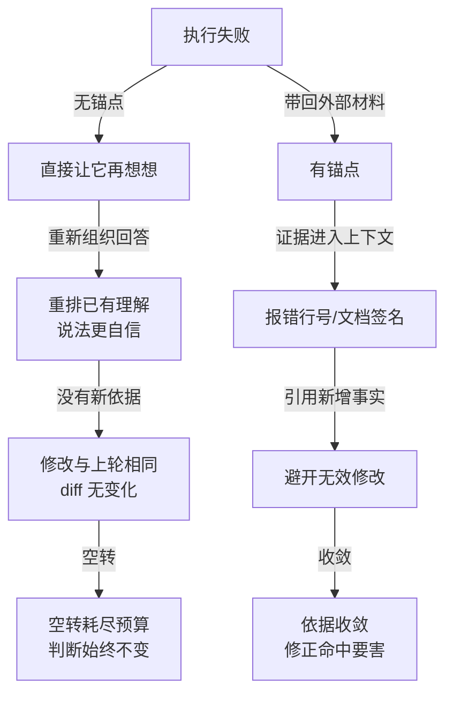
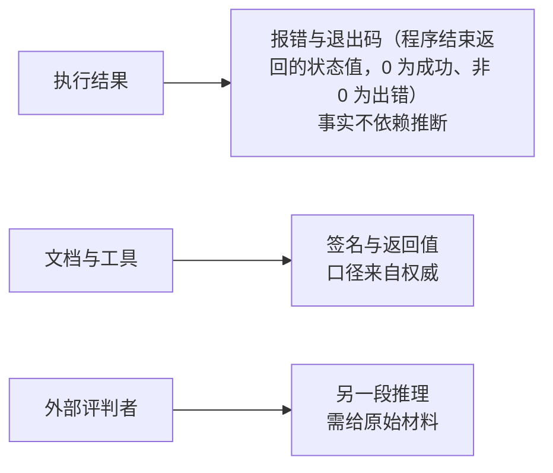

# 反思要有外部锚点，否则只是自我说服

> **要点**：反思解决的是执行失败后怎样改变下一步。把测试报错、工具结果、权威文档或独立评审的原始证据带回决策，并限制无新证据的重复尝试，空转（指模型反复尝试、修改却始终不改变判断、只消耗预算的状态）与成本才会降下来；前提是反馈完整且可追溯，模型的自评不能当作验证。

## 要解决的问题：反思要引用哪些外部材料才算有效

读完你能判断一次反思有没有用，并给系统加上空转检测与轮次上限。执行失败之后，**模型把原方案换一种说法再试一次，连续几轮都没有引入新的信息，成本与时间持续增加**。本篇回答：反思要引用哪些外部材料才算有效、重复尝试的上限怎样确定，以及**模型自评为什么不能当作验证结果**。

## 反思到底靠什么生效，本质是什么机制？

模型只能依据上下文（它这一轮能看到的全部内容：系统提示、之前的对话、工具返回的结果）中的材料重新组织回答。**没有新增外部材料时，反思是在已有理解上重新排列，表述更完整而判断不变**；引入测试报错、工具结果或权威文档之后，下一轮决策才有新的依据。**重复的无新证据尝试只消耗预算，不改变结论**。

「外部锚点」指的是测试报错、工具结果、权威文档、独立评审这些**来自模型自身之外的证据**；没有它们，反思就像没下锚的船，风往哪吹就往哪飘，只在原地打转——这个比方只帮你记住「证据要从外面来」，具体哪些材料算数，看下文三种锚点。把这次失败之后的循环拆开看，环上每个箭头都对应一套工程机制：执行产生轨迹（一次尝试从头到尾的完整过程记录：做了什么、得到什么）、评估给出成败证据、反思依据证据写下教训、记忆把教训带回下一次尝试。

Reflexion（字面意思是「反射」，这里指一套让模型靠语言反思自我改进的方法）是一篇论文，核心做法是让 agent（能自主调用工具、自己决定步骤的模型应用）把失败后用文字写下的反思存入记忆，下一轮据此调整，而不改模型参数。它的原图把这条环与三个领域（决策、编程、推理）的实例并排画在一起，环上写的是「评估」「反思」「下一步」这些动作本身：


*图源：Reflexion: Language Agents with Verbal Reinforcement Learning（arXiv:2303.11366）Figure 2，arXiv 论文默认许可，https://arxiv.org/abs/2303.11366。图上执行者（Actor，实际去调用工具、产出结果的一方）产生轨迹，评估器（Evaluator，负责判定这次尝试成功还是失败并给出证据）是环里唯一能给出新证据的位置——它拿不到原始材料时，反思就退化成重排（布局或尺寸变化触发重新计算排版）已有理解；记忆（Memory，跨轮保存历次教训的存储，供后续尝试读取）把教训带回下一轮。*

两条链从同一次失败出发，分岔点在模型这一轮能看到的全部内容里，有没有新加进来的外部材料：



常见误解是以为反思写得诚恳就有用，实际上**模型反思的语气是否诚恳与结局无关**——语气再诚恳也不向上下文引入新证据，因此不改变下一轮的判断。空转一侧出口是轮次上限与重复修改检测（后文"抑制反思但不改"），下一轮修改与上一轮相同、判断始终不变；收敛一侧前提是反馈完整（后文"把失败信息完整回传"），新增事实帮助避开无效修改，修正命中要害。

## 什么场景下它会越反思越确信自己是对的？

一个 agent写了个函数，测试失败。让它"反思一下哪里错了"，它输出：

```text
我认为问题在于边界条件处理不当。让我重新审视：
1. 首先，函数需要处理空输入
2. 其次，循环变量可能有 off-by-one（边界差一位）错误
3. 综合来看，我认为应该修改第 15 行的判断条件

修改后再次运行测试... 仍然失败

反思：这说明我的修改方向不对。可能是第 8 行的初始化有问题...
```

循环 5 次，每次都有**条理清晰的反思**，每次都错。

  **问题在于：它的反思没有外部信息输入。** 它只是在重新排列自己已有的（错误的）理解，然后用更自信的语气说出来。这个形态日常叫闭门造车：棋手蒙着眼复盘自己的棋局，每一步都"想通了"，可对手的应对、盘面的实况他一眼都没看——复盘得再勤，翻的都是同一份错的记忆。这个比方只到"没看外部实况"为止，为什么必须看外部实况，就是上文外部锚点要回答的问题。

  **没有新信息的反思 = 自我说服。**

## 让反思真正有效的方案是什么？

外部锚点的关键是**判定者在被测对象之外**——判定者不在被测对象内部，才能给出执行方看不到、也无法篡改的证据。这一点和身份与访问架构（系统先确认你是谁、再决定你能进哪里）是同一思路——访问请求先经过身份判定、判定通过才到达资源，**判定与执行分离使结论独立**；外部锚点同样让判定者（如测试、文档）与被判定的模型输出分离，**结论才不被自我说服污染**。


*图源：Microsoft Learn 中文文档，CC BY 4.0，https://learn.microsoft.com/zh-cn/azure/architecture/framework/security/design-identity。*


### 有效的反思应该长什么样？

| 无效的反思 | 有效的反思 |
| --- | --- |
| "我觉得可能是边界问题" | "测试报错：`expected 5, got 3`，发生在 `test_empty_input` 第 22 行" |
| "让我重新思考" | "上次改了 A 没用，说明原因不在 A；这次检查 B" |
| "我认为应该这样做" | "文档说这个 API 返回 `[]byte`，我按 `string` 处理了" |

**区别：后者引入了新的外部信息**（报错、测试结果、文档）。

Reflexion 论文的 Figure 1 把有效反思的完整循环画成了三个领域的对照。图从上到下的横行依次是：任务描述、行动轨迹、评估、反思、下一轮轨迹，其中评估一行直接标注了 internal（内部评判）与 external（外部评判）的分野：


图按行读：评估行里，编程任务用自生成的单元测试失败作评估（进入上下文的材料含文档签名），推理任务用环境奖励，这些是外部锚点；决策任务只用规则或语言模型启发式评估，判出"幻觉（模型生成看似合理、实际与事实不符的内容）"（指模型编造不存在的事实）却没有事实支撑，内部评判兜不住——这就是评估行 internal/external 分野的含义。反思行里有效的反思逐条引用具体失败原因——"错在只检查了括号总数是否相等"，与"我觉得方向不对"是两种东西。

下一轮轨迹行据此修正，测试通过，答案缩小到正确的职业选项。图取自 [Reflexion 论文的 HTML 版](https://arxiv.org/abs/2303.11366)（NeurIPS 2023，Shinn 等），arXiv 论文默认许可。

### 外部锚点有哪三种，分别靠什么生效？

**1. 执行结果（最强）**

真实跑出来的结果当锚点，一条链从触发到修正读下来：

```text
运行测试 → 得到具体的失败信息 → 基于失败信息修正
```

**这是最可靠的锚点，因为它是事实**，不是推断。这类证据在生产系统里自带判定符号。持续集成平台（每次代码提交后自动跑测试和打包的工具）每次执行都留下独立的成败记录，失败运行页上红叉、状态行与错误注解同屏，退出码即程序结束返回的状态值，0 为成功、非 0 为出错。Apache BookKeeper 仓库的 Windows Daily Build 失败页就是一次现成的执行结果：`Process completed with exit code 1` 一行把退出码摆在了注解区，失败 job、触发时间与耗时都可直接引用，不用任何人复述"大概哪里错了"：


*图源：GitHub apache/BookKeeper（Apache 的分布式日志存储，Pulsar 的底层存储） 仓库 Actions 运行页实拍，https://github.com/apache/bookkeeper/actions/runs/36363582874（GitHub 服务条款允许公开页面引用）。反思要带回的正是这类原始记录：失败 job 名、退出码、触发上下文，而不是一段转述。*

完整的错误信息包括失败行号、期望值与实际值、调用链三部分，**三者缺一，反思就只能靠猜**。给模型看时一项都不能省：

- 失败在哪一行
- 期望值 vs 实际值
- 调用链（出错时从入口函数到报错位置的逐级调用路径）

**2. 工具/文档的权威信息**

拿文档与类型定义当锚点，猜测在权威出处面前当场被换掉：

```text
不确定 API 签名 → 查文档/类型定义 → 基于实际的签名修正
```

模型对 API 的记忆可能过时或错误。**查一下比猜好**。

**3. 外部评判者**

拿一个看不见当前推理过程的旁观者当锚点，评估意见来自独立视角：

```text
让一个独立的模型（与当前不是同一个、看不到当前推理过程）或人来评估这个方案
```

**但要注意**：评判者也需要锚点。让另一个模型"看看这段分析对不对"，它同样会自我说服。**评判者必须能看到原始材料**（代码、报错、需求），而不只是被评判者的结论。

  三种锚点不是并列的：执行结果返回的是事实，文档返回的是权威口径，外部评判者返回的是另一段推理。前两者带回的东西不依赖评判者的水平，第三者是另一段模型推理，若只拿到结论、没拿到原始材料，它和原模型一样只是重排自身理解，因此仍然可能被自我说服污染——**它是三者里唯一需要额外条件的**。三者的差别像看病：化验单上的读数是"实测结果"，药典里的标准剂量是"权威口径"，另一位医生的复诊意见是"独立评判"——前两样不随别人的说法变，第三位医生若只听你转述自己的判断，他也只能跟着错。这里的权威口径指来自文档或类型定义的信息，比方只到"评价信息从哪来"为止，三种来源的可信度差别，以本段开头的三种锚点为准。



评判者那一支要生效，前提是它看得到代码与报错；只把结论递过去，它输出的是第二个自我说服。三种锚点带回的东西不同：执行结果带回报错与退出码这样的事实，文档带回签名（用私钥对数据生成可验证的防篡改标记）与返回值这样的权威口径；**无锚点的反思耗尽预算也拿不到这些**——这正是它只有产出消耗、没有产出进展的原因。

### 失败信息该怎么完整回传？

```python
result = run_tests()
if result.failed:
    # 完整信息，不只是"失败了"
    feedback = f"""
测试失败：{result.failed_count}/{result.total_count}

失败用例：
{format_failures(result.failures)}   # 包含期望值、实际值、行号、调用链

你之前的修改：{last_change}
当前状态：{current_state}
    """
    return feedback
```

### 怎样抑制空转式的重复反思？

现象：模型反复说"我明白了，问题是 X"，然后做**同样的修改**。转圈的驴拉磨是它的样子：一直在用力，每一步都像在前进，绳子拴着——走出去十步又回到原地。这个比方只到"重复劳动没有进展"为止，怎么检测重复，就是后面的脚印哈希（把任意长度数据压成固定长度指纹、不可逆）；发现空转的办法是看地上的脚印有没有踩出新地方（对每次改动算一个规范化哈希值，内容相同则哈希相同）。

**检测方法**：记录每次修改的 diff（两次修改之间的代码差异），对每次改动算一个规范化哈希值，改动内容相同时哈希也相同，据此判断是不是重复修改；连续两次相同（或语义相同），就是空转。

```python
if diff_hash(current_change) == diff_hash(last_change):
    return "你刚才已经做过完全相同的修改，但没有解决问题。请换一个方向。"
```

这句话把"自己在空转"这个事实明确告诉模型，**比再喊一次"仔细想想"更能改变下一步**。

### 反思最多几轮，超出后怎么办？

```text
最多反思 3 轮，之后必须：
- 换策略（比如从头重写，放弃继续修补）
- 或者停止并报告
```

3 轮是常用上限：可见证据的总量有限，每轮反思若不引入新证据，能依据的材料就不会新增，几轮之后剩下的只有对已有理解的重排，继续同方向反思也就只剩把同样几句话换一种说法，因此**超过 3 轮还在反思，多半是方向错了，再想也没用**。问路问三遍是同一个限额：同一句话问第三遍还绕回原地，问题多半不在记性，在问错了方向——换个地标重新问（换策略），比原地再问一遍有用。

## 外部锚点带来哪些收益，又要付什么代价？

**收益**

- **修正方向更准**：基于事实而不是猜测
- **减少空转**：检测重复修改能打破循环
- **成本可控**：限制轮次避免无限反思

**代价**

- **需要工具提供足够信息**：测试报错不完整时，反思也无从下手
- **增加 token（模型按量计费的文本基本单位）消耗**：每轮反思都要带上完整上下文
- **可能过度依赖外部反馈**：有些问题需要推理而非试错；空转检测靠比对两次修改是否相同，而合理的多次试错也可能产生相近的修改差异，因此会被一并拦下，**空转检测会误伤"合理的多次尝试"**

## 按什么顺序把外部锚点接进系统？

1. 检查工具返回的错误信息够不够：模型收到的错误信息里有行号、期望值、调用链吗？没有就先改进工具。
2. 在提示词（发给模型的输入指令与背景信息）里要求"基于证据"：

   ```text
   反思时必须引用具体的报错信息或测试结果。
   不要写"我认为"、"可能是"这类没有依据的推测。
   ```

3. 实现重复修改检测：记录 diff 哈希，检测到相同时明确告诉模型。
4. 限制反思轮次：3 轮为上限，超了就换策略或停止。
5. 区分「试错」与「空转」：同一个方向的不同参数是试错（合理）；完全相同的修改重复是空转（要阻止）。

## 实施时最容易踩哪些坑？

- **让模型在没有新信息的情况下反思。** "再想想哪里错了"——它只能重新排列已有理解。先跑测试、先看报错。
- **错误信息被截断或简化。** 只告诉模型"测试失败"，没有具体信息，反思只能靠猜。完整传递失败详情。体检只拿到"有异常"三个字（信息被截断），医生给不出任何处理建议——指标数值、参考区间、异常项目全给到（完整失败详情），诊断才可能对。
- **用另一个模型做评判却不给原始材料。** 评判者只看到结论，没有看到代码和报错，它也是自我说服。评判者必须能访问原始信息。
- **无限反思。** 反思 10 轮，成本暴涨，问题没解决。设上限。
- **把反思当成验证。** "我反思过了，应该没问题"——验证要跑测试、看结果，反思代替不了。
- **忽略反思中暴露的信息缺失。** 模型反复说"我不确定这个 API 的行为"，说明它缺查询文档的工具。加工具，让它停止猜。

## 怎么自己动手验证？

1. 无新证据对照：同一任务分别跑一次不引入外部材料的反思与一次引入测试报错或文档查询的反思。**预期只有后者改变结论，前者只是表述更完整**；两次都变或都不变，与预期对不上，先查反馈有没有真的进上下文。
2. 停止判据：为反思设定最大轮数与无新信息判定，**预期轮次超出预算或连续两轮没有新增依据时停止，实测继续跑就是空转检测没生效**。
3. 锚点追踪：每次反思的结论都要能追回报错、工具输出或权威文档；**追不回的结论按未引入新证据处理**。

## 接着该读哪几篇？

- [[工程知识/AI 系统工程：从模型能力到生产能力/Agent与工作流/模型负责判断，运行时负责执行语义]] —— 空转检测与轮次上限该由运行时执行，模型只负责判断
- [[工程知识/AI 系统工程：从模型能力到生产能力/质量与运营/Agent评测必须覆盖轨迹而不只看最终答案]] —— 反思有没有引用新证据，只有看轨迹才看得出
- [[工程知识/AI 系统工程：从模型能力到生产能力/质量与运营/Agent评估系统的设计约定]] —— 反思结论要追溯到可复核的证据链，约定层的写法
