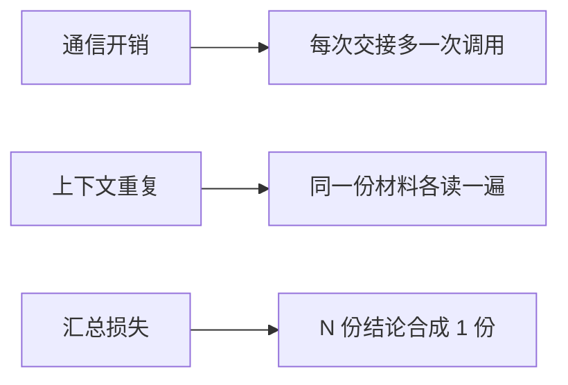
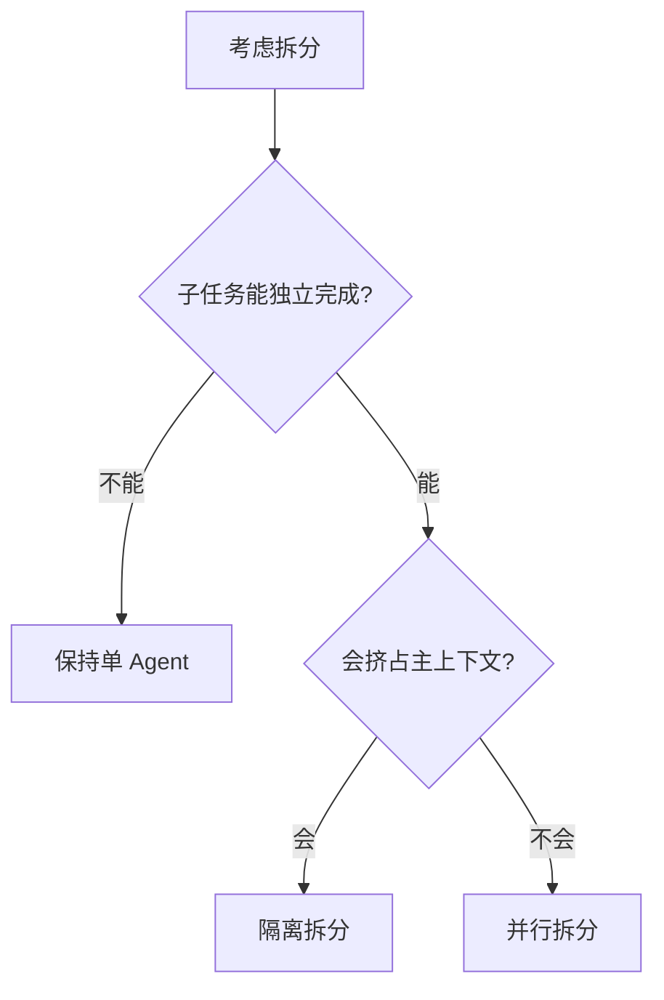

# 多智能体只在能并行或需要独立上下文时才值得

多智能体只在两种情况下值得：**子任务能同时做，或者中间过程会挤占主任务上下文**（模型一次对话里能看到的全部信息）。**它不提升推理质量**——拆分只改变任务的组织方式，单个 Agent（能自主调用工具、维护状态的模型应用）的推理能力没有变化。读完这篇你能判断手上的任务该不该拆成多个 Agent，也知道拆开后要多付哪些代价。

## 要解决的问题：什么样的子任务值得独立分工

多智能体值得的前提是任务之间真的可以并行——**但很多任务的并行只是形式上的，拆开之后实际仍是串行，这就是下一节那个失败案例的来源**。怎么判断多个消费者会不会互相拖累？竞争消费者（指多个处理程序争抢同一个任务队列里的消息，谁抢到谁处理）给出了判断标准：多个消费者从同一队列取消息，一条只被其中一个处理——吞吐确实靠加消费者提升，但前提是没有共享状态。**没有共享状态，消费者之间就不用协调，加多少都不会互相拖累**；这正是「子任务能并行」的技术原型。

## 什么时候才算真能拆开

子任务资料和状态能隔离、结果可结构化合并，**这两条同时成立才分开**。收益是降低等待时间或保护主上下文，代价是重复输入、汇总丢失和跨 Agent调试复杂度。最小验证是以同一任务对照单 Agent 与分开方案的完成率、总 token（模型处理文本的计量单位，约等于一个字或半个词）、端到端耗时和关键证据保留率。


一个任务被分成多个 Agent 之后，**耗时上升、成本成倍上涨而质量没有变化**，这类结果在团队里反复出现。本篇回答：什么样的子任务值得独立分工、什么条件下分开只会增加重复读取与汇总损失，以及分开之后汇总层怎样避免把子结论当成已验证事实。

## 这件事发生在什么场景：三个 Agent 比一个还慢

打个比方：多智能体像把一份报告分给几个人分头写，每个 Agent 对应一个写手——只有各写各的章节（能并行）、或者某个人需要单独查一堆资料不想占满会议室桌面——独立上下文的意思是桌面空间有限，资料堆多了其他文件就放不下，主 Agent 的上下文同样如此——时才划算；如果只是让几个人轮流改同一段话，除了多花几遍沟通时间，写出来的还是那段话。这个比喻到"什么时候该拆"为止：结果怎么合并、重复输入要付多少代价、跨 Agent 的汇总会丢什么，要看正文里的代价清单，比喻不替你算这笔账。

一个团队把代码审查 Agent 分成了三个：一个看安全、一个看性能、一个看可读性，然后一个"汇总 Agent"负责合并结论。结果：

- **耗时从 45 秒涨到 2 分 10 秒**（三次模型调用串行 + 一次汇总）
- **成本上升**：模型调用次数从 1 次变 4 次，每个 Agent 还要各自读一遍代码
- **质量没提升**——三个 Agent 各自发现的都是单个 Agent 也能发现的问题
- 汇总 Agent 还经常**丢失细节**："安全 Agent 提到 SQL 注入（把恶意 SQL 拼进查询语句、诱使数据库当作指令执行的攻击手法）风险"变成"存在安全风险"

多智能体引入通信开销（每次交接多一次调用）、上下文重复（同一份材料每个 Agent 各读一遍）、结论汇总损失（N 份结论合成 1 份时丢细节）三项固定成本。**它换来的收益超过这三项时才值得**——把三项成本折算成额外的调用次数与耗时，与并行节省的时间相减，**净值为正才值得分开**：



三项里只有通信开销随并行被摊进总时长（交接同时在跑，不叠加等待），**上下文重复与汇总损失是纯支出**：读几遍就付几遍成本，合成一次就丢一次细节，**并行省不掉这两项**。这些成本发生在技术栈的哪几层？从基础设施、模型能力到多智能体协作，协作带来的开销（通信、上下文重复、汇总损失）只发生在多智能体协作的两层；底层的基础设施与模型调用是固定单价，所以每多一个 Agent 就按单价多付一份，额外叠加成本只来自协作层：


来源：[CSDN Agent 技术全景图](https://opc.csdn.net/6a80164810ee7a33f29b410d.html)（CC 4.0 BY-SA）

把任务分给多个 Agent 的整体形状，A2A（Agent-to-Agent，让不同智能体互相发现、通信与分派任务的开放协议）官方主页画过一张全景。图上从左到右是这样一条链：终端用户的请求进客户端，Client Agent 作为统一入口把任务分发给远程 Agent 网格（Remote Agent Mesh，一组可被统一调度的远程智能体集合）里的各个成员，成员之间也可互通。「编排者-工作者」拓扑里主 Agent 与子 Agent 的连接关系，在这张图上是 Client Agent 到 Remote Agent Mesh 的扇出（一个节点把请求或消息分发给多个下游），即一个节点把任务同时分发给多个下游节点的连接形态：


*图源：A2A 协议官方文档角色图，https://a2a-protocol.org/（a2a-actors），Apache 2.0 同类开放许可。图上 Client Agent 与各远程 Agent 之间的连接就是正文说的「交接」——每次交接都引入一次通信开销与上下文重复，网格越大交接次数越多，通信开销按交接次数累加，并行也摊不掉这部分，这两项固定成本随之越高。*


## 方案是什么：只在两种情况下分开

任务考虑拆给多个 Agent 时，拆分与否收拢成两个判定问题，判定路径见下图：



两种情况都先要求子任务能独立完成，在此基础上再分：**子任务能并行且不产生大量中间上下文的，走情况 1 的并行拆分；会挤占主上下文的，走情况 2 的隔离拆分**。两个问题都过不了关（既不能并行、也不会挤占上下文但拆不干净），就停在单 Agent。

### 情况 1：怎样判断任务能并行、且各自要读的资料不同

值得分开的任务长这样：

```
任务：调研 5 个 SaaS 产品的定价和功能

✅ 分成 5 个 Agent，每个负责一个产品
   - 各自只读自己产品的文档（上下文不重叠）
   - 完全并行，总耗时 ≈ 单个产品的耗时
   - 各自主导自己的结论，无需汇总损失
```

不值得分开的任务长这样：

```
任务：审查一个 PR（Pull Request，代码合并请求）

❌ 分成安全/性能/可读性三个 Agent
   - 三个都要读同一份 diff（上下文重复 3 倍）
   - 串行执行，总耗时 = 3 倍
   - 汇总结论时信息有损
```

判断标准有两条：分出来的子任务能否独立完成、各自要读的资料是否不同。**如果都要读同一批材料，分开只是重复劳动**。

### 情况 2：哪些情况下子任务需要隔离上下文

值得分开的任务长这样：

```
主 Agent 需要调用一个"研究"子任务，会产生 20 万 token 的中间过程。
如果放在主 Agent 上下文里，会挤掉其他信息。

✅ 分成子 Agent：它自己处理 20 万 token，只返回 2 千 token 的结论。
```

这叫上下文隔离，**是多智能体最有价值的用途之一**：**主 Agent 的上下文是稀缺资源，子 Agent 是它的"压缩器"**——但**压缩必然丢细节**，子结论携带的信息越接近原文，压缩收益越小。这个比喻只覆盖「用短结论换长上下文」这一步；压缩掉的就是细节本身，所以压完的东西不等于原文，能不能用要看下文「这套说法在哪儿会失效」一节的失效条件。

### 有哪些可行的多智能体拓扑（多个 Agent 之间如何连接和分工的结构）

| 拓扑 | 结构 | 适用 |
| --- | --- | --- |
| 编排者-工作者 | 主 Agent 分解任务，分给工作者，汇总结果 | 可并行 + 需要隔离 |
| 流水线 | A 的输出给 B，B 给 C | 阶段明确，每步需要完整上下文 |
| 对等协作 | 多个 Agent 共享状态，互相通信 | **很少值得**：通信开销大，容易互相锁定 |

对等协作只在研究性场景偶尔值得尝试。这类场景的结论对错一时无法判定，单个 Agent 自己也无法确认对错，于是需要多个 Agent 相互检验彼此的结论（互验）。**互验成立的条件是错误至少能被其中一方识破；失效情形是多方同时漏掉同一处错误**。生产系统里前两种编排就够了。

编排者-工作者同时用到了并行拆分和隔离拆分：编排者分解任务后各子任务并行执行（并行拆分），末端再由汇总器合并结论（涉及隔离与汇总）。Anthropic 在其工程博客文章《Building effective agents》（https://www.anthropic.com/engineering/building-effective-agents）中把这一模式列为标准编排模式并给出了流程图。


*图示：Anthropic 文中的智能体编排模式。图源：[Anthropic · Building effective agents](https://www.anthropic.com/engineering/building-effective-agents)。*

图中三个子任务各自独立执行，最后汇总——这正是上文三项固定成本的来源：每个子任务都要各自读一遍上下文，汇总时又可能丢细节。

## 效果从哪儿来，要付什么代价

**收益**

- **并行场景下总耗时下降**：5 个独立产品的调研，串行要等 5 份耗时相加，并行只要等最慢的一份
- **上下文隔离**：子 Agent 吃掉大量 token，主 Agent 上下文保持干净
- **职责清晰**：每个 Agent 的失败可以独立诊断

**代价**

- **成本通常上升**：并行能压低耗时，但每个子任务各付一遍调用费用，总调用次数反而更多；只有省下的时间比多付的调用成本更重要时才划算
- **汇总有损**：把 N 个结论合并成 1 个，必然丢信息。**结构化输出能缓解，但不能消除**
- **调试复杂度陡增**：一次失败要跨 N 个 Agent 的轨迹排查
- **错误会放大**：一个 Agent 的错误结论被汇总 Agent 当成事实，会污染最终结果

## 动手时从哪一步做起

**第一步：先用单 Agent 跑通，观察瓶颈**

**不要一开始就设计多 Agent**。先用 ReAct（推理与行动交错的单个循环，模型先说下一步、拿到结果再决定后续）跑，记录：耗时分布、上下文占用、失败模式。这一步同时给出净值的算法：同一任务分别用单 Agent 与多 Agent 各跑几遍，记下调用次数与端到端耗时，多 Agent 的额外调用次数与额外耗时就是三项固定成本的实际值，与并行省下的时间相减即为净值。

**第二步：问两个问题**

1. 子任务能并行吗？（不能 → 别分开）
2. 子任务会产生大量中间上下文吗？（不会 → 别分开）

两个都是"否"（即既不能并行、也不会挤占主上下文），就不要分开。

**第三步：分开的时候，让子 Agent 返回结构化结果**

```json
{
  "summary": "一句话结论",
  "findings": [{"claim": "...", "evidence": "...", "confidence": "high"}],
  "artifacts": ["artifact://research/1"]
}
```

不要返回自由文本——汇总 Agent 解析结构化结果更可靠，也更不容易丢信息。

**第四步：保留子 Agent 的完整轨迹**

汇总层只看结论，但排查问题时要能下钻到子 Agent 的轨迹。把 `trace_id` 串起来——它是贯穿主 Agent 与各子 Agent 的唯一请求标识，凭它在日志里把一次任务的全程串起来。

**第五步：给汇总层加验证**

汇总 Agent 不应该无条件信任子 Agent 的结论。对关键结论要求**引用原始证据**，无法引用的标记为待验证。

## 多智能体系统容易犯哪些错

**错误 1：为了"看起来更专业"而分开**

三个 Agent 听起来比一个 Agent 高级，但实际更慢、更贵、更难调试。架构复杂度（要维护和排查的部件更多、关系更绕）必须换来明确收益——检验就用上文那两个判定问题，两个都过不了就别分开。

**错误 2：子 Agent 之间需要频繁通信**

如果 A 要问 B、B 要问 C、C 又要问 A，**说明任务划分错了**。这种情况应该重新划分，**加通信机制解决不了**。

**错误 3：汇总层自己产生幻觉（幻觉指模型生成了与原始证据不符的内容）**

"安全 Agent 说没问题" → 汇总写"已通过安全审查"。汇总层必须引用原始证据，不能自行推断（指模型在没有证据支撑时生成看似合理的结论）。

**错误 4：忽略共享状态的并发问题**

多个 Agent 同时写同一份状态 → 互相覆盖。共享状态要么只读，要么加锁/版本控制。

**错误 5：每个子 Agent 都读全部上下文**

分开之后每个 Agent 还是拿到完整历史——那隔离的目的就没达到，成本还翻倍。子 Agent 只该拿到它需要的那部分。

多智能体的分工要与预期对账，对账指把实际产出与设计时写明的职责、接口逐条核对。设计前先写明每个成员的职责范围、输出格式、与其他成员的接口。汇总层拿到的输入全部来自各成员的接口产出，若接口定义本身有重叠或缺口，汇总再仔细也合不出正确结果——所以按此方案汇总不出正确结果时，问题出在职责或接口的重叠或遗漏上，应收窄边界重新划分，加协调层解决不了。

## 这套说法在哪儿会失效

- 并行只在子任务之间没有依赖时成立：**多数任务的下一步依赖上一步的结论，这类任务分开之后仍然是串行，只是多付出几次上下文重复的代价**。
- 上下文隔离的收益有上限：子 Agent 交回的结论若本身携带大量细节才可判断，说明被隔离掉的中间过程里多数信息最终还要用到；汇总时为了补全这些细节，得把被隔离的长过程重新拉回主上下文，于是原本想省掉的上下文又回来了，等于没省上下文；**子结论与原文信息量接近（压缩比接近 1）时，分开没有意义**。
- **分开不提高单个 Agent 的水平**：某个子任务所需的推理超出模型能力时，单独的 Agent 同样做不出来，**分得更细只会把同一处错误复制多份**。
- **汇总是固定损失**：结论从多个来源合成一份必然丢信息，任何结构化输出只能减少损失。
- 共享状态写入需要额外交互手段：多个 Agent 同时改写同一份状态时，**缺少版本或加锁机制会出现互相覆盖**。

## 接着读哪几篇：同在AI 系统工程里的相邻问题

- [[工程知识/AI 系统工程：从模型能力到生产能力/Agent与工作流/构建可靠Agent应用]] · [[工程知识/AI 系统工程：从模型能力到生产能力/模型与上下文/上下文工程是在有限预算内构造决策现场]]
