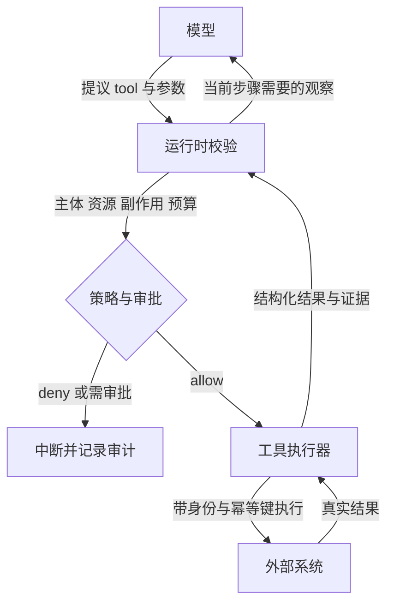

# 工具是受约束的能力，不是提示词里的函数名

**工具描述写得再清楚也不能当权限用，工具使用要靠运行时约束来管。读完这篇你能说清工具系统该定义哪几件事，以及为什么描述不能当权限用。**

模型调用工具只是提出动作请求，真正执行前得由运行时——负责校验权限与身份、接管工具副作用的执行环境——把这三样管起来，模型只提议、它负责放行或拦截。本文的 Agent（在任务里自主调用工具、维护状态的模型应用形态）靠这套运行时约束使用工具。

**工具调用解决的是模型无法直接访问外部状态或执行副作用的问题，但工具描述不是权限系统。**一个退款工具的参数即使符合 JSON schema（一种描述数据该长什么样：有哪些字段、什么类型、哪些必填的格式规范），也必须由运行时验证主体、订单、金额、幂等（同一操作执行多次与执行一次效果相同）键和审批状态，再记录真实结果。幂等键是防止同一请求重复执行产生多次副作用的唯一标识；幂等指同一个操作执行一次和执行多次的结果相同，重复执行不会产生额外副作用。

**真正的工具系统必须定义六件事：能力**（这个工具能做什么）、身份（谁在发起调用）、资源（工具要触碰的具体对象，如某笔订单、某个文件）、参数、副作用（执行会给外部世界带来的改变）和证据（执行后回写的记录）。比如身份写成 delegated_user（代表发起用户行事的身份），证据是执行后回写的 result_ref（结果引用）与 timestamps（时间戳），光写清 description 不等于**定义了证据**。**工具描述写得再清楚，也不能替代执行端鉴权（验证「谁有权做这件事」的环节）；模型参数再符合 schema，也不能证明业务允许执行。**

## 要解决的问题是什么：工具调用走什么路径，能力边界在哪

完整机制从模型提议开始：运行时先做 schema 与业务校验，再把主体、资源、副作用与预算（这一步给工具设定的用量与花费上限）送策略与审批（按预设规则判断放行还是拒绝、要不要人确认的环节）；allow（放行）才继续，deny（拒绝）或需审批就中断并记录审计（记下谁、按什么规则、用了什么参数、结果如何，供事后追溯）；通过后运行时带身份、幂等键和超时调用工具执行器（真正去调用外部系统、拿回真实结果的那段代码），执行器调用外部系统拿真实结果，结构化结果与证据引用沿原路逐层返回（执行器先交回运行时），运行时从中挑出当前这一步模型需要的信息（观察）交给模型，其余细节留在运行时：



**任何一步缺失，模型自己产出的意图就会绕过运行时验证——缺的正是校验那一步，执行器在没拿到放行结论的情况下直接接到动作请求——于是未经授权的动作被当作已授权真正执行——也就是把自然语言意图错误地升级为真实权限。**

## 好工具怎样减少模型需要猜测的空间

打个比方：工具调用像服务员递到厨房的单子——单子上写着"3 号桌要退 88 元"，但能不能退、退给谁、退几次，得由收银台（运行时）查权限、查订单、查这笔有没有退过，单子写得再工整也不能自己生效。这个比喻到"谁说了算"为止：它让你记住描述不是权限，但运行时具体验证哪几项、幂等怎么做、身份怎么传，要看正文。


工具为什么要围绕用户意图设计？因为底层 API（程序内部直接调用的操作接口）粒度过细，模型要靠猜才能填对参数，所以不适合原样暴露给模型。`update_customer_address(customer_id, address)` 比 `patch(path, json)` 更容易授权、验证和评测。输入字段不要设 address 与 addr 这类同义字段，否则模型不知道该填哪个。工具的错误返回要给出错误类型和可恢复方式，而不是一段调用链或模糊的 `failed`。对照示例：`{"error_type": "order_not_found", "recoverable": true, "hint": "确认 order_id 后重试"}` 让模型知道下一步怎么办；只回一句 `failed` 模型只能凭空猜测原因。

工具约定至少包含六项：subject 标明以谁的身份行事，resource_scope 限定能触碰哪个具体对象，side_effect 标明执行会带来什么改变，approval 写明是否需要人工确认，idempotency_key（幂等键：同一请求重发时凭它识别为同一次操作）与 retry 规定防重复执行的办法，audit 列出事后要追溯的记录项：

```yaml
name: create_refund
version: 3
subject: delegated_user
input_schema: RefundRequest
resource_scope: order:{order_id}
side_effect: financial
approval: required_above_threshold
idempotency_key: required
timeout_ms: 5000
retry: query_before_retry
result_schema: RefundResult
audit: [actor, policy, arguments_hash, result_ref, timestamps]
```

**`description` 只帮助模型选择；其余字段决定系统能否安全执行。**

## 读、写和不可逆动作分别该用什么策略

| 等级 | 例子 | 默认策略 |
| --- | --- | --- |
| 只读、低敏感 | 查公开文档、读允许范围内的状态 | 自动执行，仍记录来源和时间 |
| 可逆写入 | 创建草稿、开临时分支 | 受限执行，提供撤销和过期清理 |
| 高影响写入 | 修改生产配置、发送外部消息 | 参数预览、明确确认、审计与幂等 |
| 不可逆或高损失 | 删除数据、付款、发布安全策略 | 确定性审批，通常不允许模型直接触发 |

审批不能只显示「Agent 想调用工具」。用户或审批系统必须看到目标资源、关键参数、预期影响和有效期；批准内容要绑定参数摘要，参数变化后重新批准。

约束的另一种写法是把计划与执行分开：先让模型在计划期——arXiv:2506.08837 论文把它编号为 Step 0，指真正执行前的规划步——定出固定计划（允许调哪些工具、按什么顺序），执行期只能从计划里的工具挑，计划外的工具（图上的 tool4）直接禁止——权限判定从「运行时逐次校验」前移成「计划期一次圈定」，运行时照单执行：


图：计划先行模式——工具清单在计划期圈定，执行期不给计划外调用留路径。图源：Design Patterns for Securing LLM Agents 论文（arXiv:2506.08837，大语言模型安全设计模式综述）。


图：约束写在动作列表上，不写在提示词里——模型只能从列表里挑，挑完才触碰 Tools；网页与邮件这类不可信内容走红色路径进来，够不到动作选择本身。图取自 arXiv:2506.08837 论文的 Figure 6（大语言模型 Agent 安全设计模式）。

## 为什么工具返回的结果也不可信

网页、工单、代码注释和第三方 MCP server（MCP 即模型上下文协议，让不同应用共享同一套工具接入方式的标准，此处指上一节说的能力提供方）可能返回诱导模型执行其他动作的文本。因为模型会把返回文本当作可执行的下一步指令，所以运行时要先把工具结果降级为纯数据——取消其可被当作指令执行的地位，只当不可信数据看待。这样一来，结果只是数据、不带任何授权效力，工具 A 的输出就不能自动授予调用工具 B 的权限。之后运行时再限制结果大小和类型，过滤密钥与敏感字段，并在传回模型前保留来源边界。


图：模型产出代码、代码在隔离侧执行，执行结果作为数据回流，不给它反向决定调哪个工具的权力——对应「工具 A 的输出不自动授予调用工具 B 的权限」。图源：arXiv:2506.08837 论文（LLM Agent 安全模式综述）。

## MCP 为什么解决互操作、管不了业务信任

MCP（模型上下文协议）把三个角色连起来：Host（宿主应用，用户直接使用的那个程序）、Client（连接器，替应用去对接协议的一端）、Server（能力提供方，把工具与资源挂出来的那一侧）。三者之间的能力发现（客户端列出服务端提供哪些工具、资源的过程）和调用都走同一套规范，使工具、资源与提示可跨应用复用。

它不决定某个用户能否读取某条记录，也不证明 server 的工具描述可信。MCP 官方的连接图把这套标准化画成中间一个协议块：左侧是 Claude Desktop、IDE（集成开发环境）等应用，右侧是数据文件、开发工具与生产力工具，双向数据流都走同一个标准协议；接入 MCP 仍需：

- 固定或审核 server 身份与版本；
- 按用户与租户过滤可见工具；
- 对远程 HTTP 认证验证 token audience（token 的受众声明，标明这个凭证只对哪类服务有效），禁止 token passthrough（把上游拿到的 token 不经校验原样转给下游服务）；
- 对本地 stdio 限制工作目录、环境变量、文件和网络；
- 记录协议版本、工具 schema 哈希（把任意长度数据压成固定长度指纹、不可逆）和实际执行证据；
- 对工具列表变化、同名替换和权限扩大做重新审批。


*图源：MCP 官方文档《Getting started》，https://modelcontextprotocol.io/docs/getting-started/intro，官方文档配图。*

当任务需要另一个独立运行的 Agent 来完成时，跨应用的委托才考虑 A2A（Agent 间任务委托协议，解决的是应用之间如何把任务托付给另一个 Agent，与 MCP 管工具接入形成分工）；同一进程内的函数调用（模型按约定参数格式请求执行外部工具的机制）无需为「看起来 Agent 化」而套协议。协议选择见 [[工程知识/AI 系统工程：从模型能力到生产能力/生态与选型/MCP连接能力，A2A委托任务]]。

## 工具设计合格不合格，怎么评？

为每个工具建立 contract test（校验工具输入输出是否符合约定边界的测试）和策略测试（验证运行时在每种情况下是否按预期放行或拒绝），用例按几类分组：输入合法性（合法输入、缺失字段）、权限与租户（越权主体、错误租户）、防重复与限时（重复幂等键、超时）、异常与丢失（部分成功、响应丢失）、变化与攻击（schema 版本变化、恶意结果）。Agent 评测还要测工具选择是否必要、参数是否来自证据、失败后是否采取正确恢复动作。

## 接着该读哪几篇？

- [[工程知识/AI 系统工程：从模型能力到生产能力/Agent与工作流/模型负责判断，运行时负责执行语义]] · [[工程知识/AI 系统工程：从模型能力到生产能力/安全与治理/沙箱限制能力，策略限制行为]] · [[工程知识/AI 系统工程：从模型能力到生产能力/Agent与工作流/浏览器与Computer Use Agent：高噪声观察下的受控操作]] · [[工程知识/AI 系统工程：从模型能力到生产能力/生态与选型/MCP与A2A的分工：工具协议与Agent协议不互相替代]]
