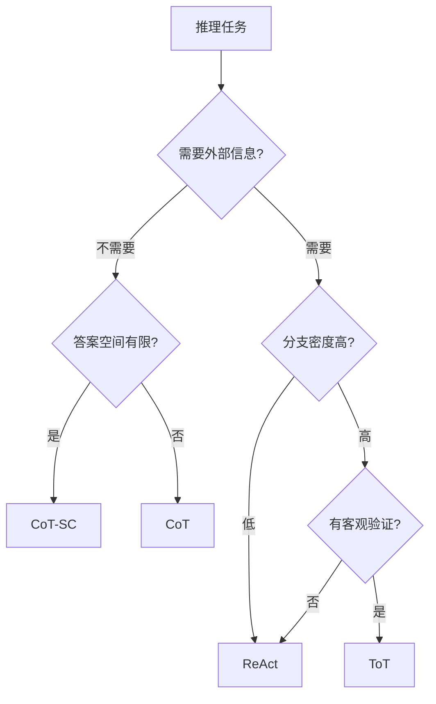

# 思维链与推理范式的工程实现——从CoT到ReAct的适用边界

思维链（Chain of Thought, CoT）让模型在输出答案前先生成中间推理步骤。Wei 等人在 2022 年的论文里报告：给足够大的模型加上示例推理步骤，GSM8K 数学题准确率从约 18% 升到约 57%（PaLM 540B，标准提示与思维链提示对照）。但CoT、CoT-SC（自一致性采样）、ReAct、ToT（思维树）四种范式各有适用条件，选错反而降低效果。本文要解决的问题就是这个选型：给出一个判定框架，读完你能根据任务类型选出合适的推理范式，并知道每种范式在什么条件下会失效。

## 四种推理范式一句话概括

| 范式 | 核心思想 | 适用场景 | 代价 |
| --- | --- | --- | --- |
| CoT | 输出答案前先生成推理步骤 | 需要显式推理的任务 | 步骤可能出错，错误传导到答案 |
| CoT-SC | 多次采样取多数答案 | 答案空间有限、可投票的任务 | 推理成本×N |
| ReAct | 推理与行动交错，每步可查外部信息 | 需要与环境交互的任务 | 循环成本、不可重放 |
| ToT | 树搜索多路径，评估后剪枝保留 | 分支多、有明确评估标准的任务 | 评估函数质量决定一切 |

四种范式在"推理深度"和"探索广度"两个维度上的不同选择，而不是**替代关系**。CoT是线性推理，CoT-SC是并行采样，ReAct是推理+行动循环，ToT是树搜索。


## 维度一：任务是否需要外部信息

这是最关键的区分维度。按任务是否需要与环境交互，分为两类：

### 不需要外部信息：CoT与CoT-SC

任务的所有信息都在输入中，不需要查文档、调API、搜数据库。典型场景：

- 数学题：所有条件已在题目中
- 逻辑推理：前提已给出
- 代码理解：代码已给出

**CoT**让模型在输出答案前先写出推理步骤。效果提升来自：把隐式的推理过程显式化，中间步骤写出来之后才有被检查和修正的机会。显式化只提供可能，不保证自查成功——模型不会自动发现自己推理里的错误，这正是局限一节的结论。

**CoT-SC**在CoT基础上多次采样（temperature > 0，temperature 是控制采样随机程度的参数：值越低输出越确定，越高越发散），取多数答案。效果提升来自：不同采样路径可能犯不同错误，多数投票能抵消随机错误。

**CoT-SC的适用条件**：答案空间有限（如选择题、判断题）。对于开放式问题（如"写一段代码"），多次采样结果难以投票。

### 需要外部信息：ReAct与ToT

任务需要查文档、调API、搜数据库。典型场景：

- 问答需要查知识库
- 编程需要查API文档
- 数据分析需要查数据库

**ReAct**让推理与行动交错：思考→行动→观察→思考。每步可以查外部信息，观察结果修正下一步推理。

**ToT**在ReAct基础上增加树搜索：每步生成多个候选行动，用评估函数打分，保留高分分支继续探索。

## 维度二：任务的分支密度

分支密度指每一步可能的选择数量。**低分支密度（1-3个选择）适合ReAct，高分支密度（>5个选择）适合ToT**。

| 任务类型 | 分支密度 | 推荐范式 |
| --- | --- | --- |
| 简单问答 | 低 | CoT |
| 代码调试 | 中 | ReAct |
| 复杂规划 | 高 | ToT |
| 开放探索 | 极高 | 都不适合 |

## 维度三：中间步骤的可验证性

如果中间步骤**有明确的验证标准**（如"测试通过"、"公式成立"），ToT的评估函数才有效。如果中间步骤没有客观验证标准（如"写得更好"），ToT的剪枝可能剪掉正确分支。

| 验证标准 | 推荐范式 | 原因 |
| --- | --- | --- |
| 有客观验证（测试、公式） | ToT | 评估函数可靠 |
| 有人工验证 | ReAct | 每步可查可改 |
| 无验证 | CoT | 树搜索的评估函数不可靠 |

## 四种范式的工程实现要点

### CoT的实现

```text
提示词结构：
问题：{问题}
请逐步推理，最后给出答案。
推理过程：
```

CoT 的关键参数有两个：temperature（采样温度参数：越低越确定，越高越发散） = 0（确定性推理）、max_tokens（单次回答最多生成的 token 数上限参数）要足够容纳推理步骤。

### CoT-SC的实现

```text
提示词结构：同CoT
采样次数：N = 5-10
答案提取：从每次输出中提取最终答案
投票：取出现次数最多的答案
```

CoT-SC 的关键参数：temperature = 0.3-0.7（需要多样性）、采样次数 5-10 次（太少多样性不够，太多成本高）、答案格式要求模型用固定格式输出最终答案（如"最终答案：X"）。

### ReAct的实现

```text
循环结构：
1. 思考（Thought）：基于当前信息决定下一步
2. 行动（Action）：调用工具或查询信息
3. 观察（Observation）：工具返回的结果
4. 重复直到可以给出最终答案
```

ReAct的常见失效模式已在[[工程知识/AI 系统工程：从模型能力到生产能力/Agent与工作流/ReAct计划执行搜索：三种行动范式的适用边界]]中详细讨论。这里补充一点：CoT到ReAct的切换点在于"是否需要外部信息"。如果推理过程中不需要查任何外部信息，用CoT就够了，ReAct的每步行动-观察循环只会增加成本和延迟。

### ToT的实现

```text
树搜索结构：
1. 从当前状态生成K个候选行动
2. 对每个候选行动进行评估（打分）
3. 保留Top-B个高分候选
4. 对每个保留候选执行行动，进入下一状态
5. 重复直到找到答案或达到深度限制
```

ToT 的关键参数：K（每步候选数）3-5、B（保留分支数）2-3、评估函数必须与任务目标一致。

## 选型决策树



## 四种范式的局限与边界

### CoT的局限

- 错误传导：中间步骤出错，答案必然出错
- 无法自查：模型不会自动发现推理步骤中的错误
- 不适合需要外部信息的任务

### CoT-SC的局限

- 成本线性增长：N次采样，N倍成本
- 答案格式要求严格：需要从输出中可靠提取答案
- 不适合开放式答案

### ReAct的局限

- 循环空转：没有新信息时反复尝试
- 不可重放：中间思考未持久化
- 工具依赖：工具返回的信息质量决定推理质量

### ToT的局限

- 评估函数敏感：评估函数与目标错位时，剪枝剪掉正确分支
- 状态空间爆炸：分支密度高时，树搜索成本指数增长
- 不适合开放探索：没有明确验证标准时，评估不可靠

选型后的验证方法：按决策树选定一种范式上线，再用次优范式对同一任务跑一组小规模对照，预期是选定范式在任务成功率与成本两项上同时占优；对照的意义在于确认决策树的四个判定节点（是否需要外部信息、答案空间是否有限、分支密度高低、有无客观验证）没有判错。实测与预期对不上时先核对中间步骤的可验证性（维度三的判定表），再怀疑选型本身。

## 案例回流：中间产物不核验的两种代价

[[工程知识/缺陷分析：从个案到体系/正确性/案例三十三：估算不等于算术——按大小推条目的错算]] 是思维链失效的系统侧同构：CoT 的推理链由一串中间结论连接，靠模型自己「觉得对」往下走；该案例里的条目数也是中间推算值，执行方未经校验就直接采用，错值顺着链条传到最终结果。两者的失效结构相同：一个未经校验的中间值被下游直接信任。中间结论没有锚点时，一步偏离会污染后续全部推理，这就是维度三「中间步骤可验证」存在的理由。静默失败在 AI 侧的对应形态见 [[工程知识/缺陷分析：从个案到体系/正确性/案例三十：中间缺了一块——跨地域复制的 ack 空洞]]：ack 空洞不报错，数据悄悄少一段；推理链的中间结论错了也不报错，答案悄悄歪一点。两案共同判据：长链路里每个中间产物要么有外部校验（工具结果、断言），要么在最终输出前被复核一次，裸信任中间步骤等于把正确性押在每一步都不出错上。

## 与相邻概念的关系

- [[工程知识/AI 系统工程：从模型能力到生产能力/Agent与工作流/ReAct计划执行搜索：三种行动范式的适用边界]]：ReAct的详细机制与失效模式
- [[工程知识/AI 系统工程：从模型能力到生产能力/Agent与工作流/任务分解的质量决定Agent的上限]]：任务分解与推理范式的配合
- [[工程知识/AI 系统工程：从模型能力到生产能力/Agent与工作流/反思要有外部锚点]]：推理过程中的外部信息获取
- [[工程知识/AI 系统工程：从模型能力到生产能力/模型基础与训练/解码与采样参数：概率分布到生成文本的控制面]]：采样参数对推理的影响
- [[工程知识/AI 系统工程：从模型能力到生产能力/模型基础与训练/投机采样与推测解码：小模型带路大模型确认]]：推理加速与范式选择的关系
