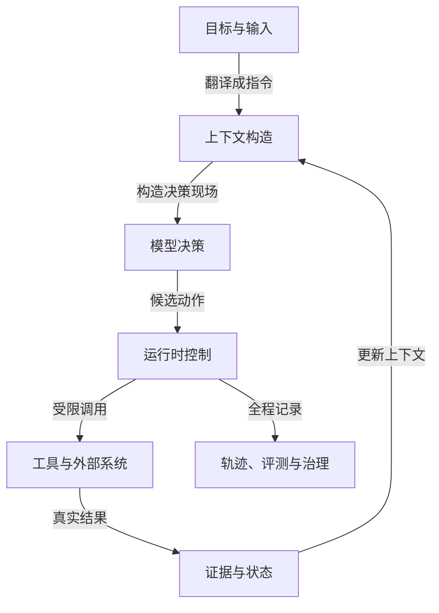
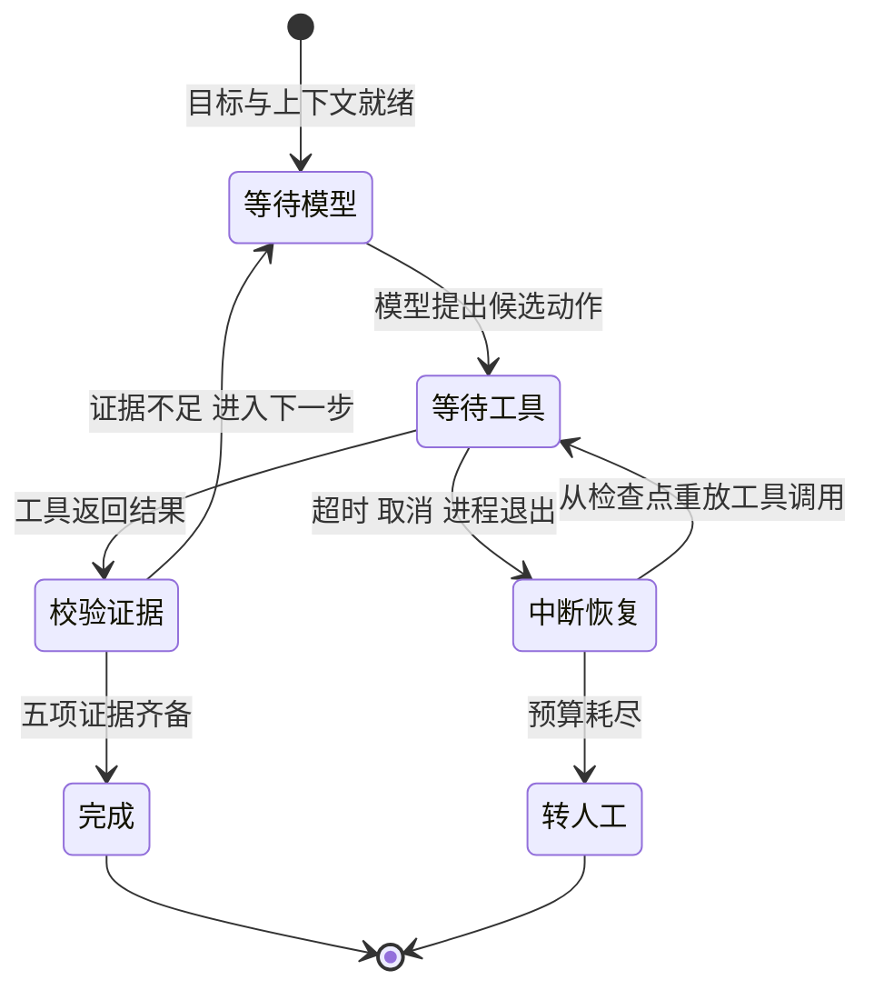

# 构建可靠 Agent 应用：从模型调用到可运营系统

Agent（能自主调用工具完成任务的程序）应用工程研究的是：**怎么让一个会犯错的模型，在真实权限和数据里持续完成可验证任务**（完成与否能由命令、退出码、文件改动对比——diff）等真实证据核对，而不是**模型自己说完成**。读完这篇你能分清模型该负责什么、运行时该兜住什么，也能说清一个 Agent 功能做到哪一步才算真的完成。这里的关键权衡是：**模型换来灵活性，代价是每次输出都不保证一致**。

这件事的核心做法是：**把模型的能力装进一个可约束、可恢复、可验证的系统**。分工上，**模型负责提出候选理解和动作，运行时负责状态、工具、隔离和证据**；模型只给候选，把候选变成可信结论的全过程都要工程来填。副作用（会改动外部状态、产生真实后果的动作，如写入数据库、发送消息）也归运行时看管。会调用大模型 API、熟悉几个 Agent 框架，都只是这项工作的零星技能——调 API 只是接入模型的动作，**约束、恢复、验证这些系统工程需要另外搭建**。

## Agent 应用要解决的难题是什么

模型在演示用例上表现良好，接入真实数据、真实权限和真实写入操作之后就不一样了：**真实环境的数据组合、权限组合和写入副作用千变万化，每次失败的触发条件都不同，开发者无法复现这些失败，完成与否也缺乏统一的核对标准**——这就是要解决的问题。驾校教练场与真实道路是同一道分水岭：**教练场里速度、路线、障碍都是安排好的（演示用例），学员开得再顺也算不上会开车**；上真实道路（真实数据与权限）才有加塞、鬼探头、临时封路这些无法复现的失败形态。

比喻到「环境换了考法也换了」为止：驾照考试还有固定科目，真实系统的失败每次都不一样，所以完成状态要靠证据核对而不是靠感觉。本篇回答：模型侧负责提出什么、运行时侧负责保证什么、一次任务的完成状态由哪些记录共同判定，以及副作用与重试怎样协同。

## 它是怎么做到的，本质是什么

打个比方：做可靠的 Agent 像给一个新员工配齐东西——要说清他有哪些权限（工具边界）、做错了从哪一步重来（恢复）、干到哪一步了要能查（可观测）。少一样，他就会在某个时刻自行虚构缺失的信息。这个比喻到"要配齐哪几样"为止：每一样具体怎么实现、有哪些坑，要看正文。

从分工看：模型输出的是候选理解与动作，这些候选是否被允许执行、以什么状态执行、执行后如何证明完成，取决于**运行时持有的状态、权限与证据**。**把模型的能力放在可约束、可恢复、可验证的系统里，任务完成的判定才能脱离模型自述**——因为系统用工具返回的真实结果与留档记录来判定完成，而不是**采纳模型的自我陈述**。

## 一个 Agent 应用至少包含哪六类对象

一个 Agent 应用至少包含六类对象。把 Agent 应用想成一家小公司：模型是出主意的员工，上下文是他桌上的资料，控制流是流程制度，运行时是后勤，外部能力是对外的窗口，评测与运营是审计。这个比喻只帮你记住六个角色各管一摊，各自的具体机制要看下面表格：

| 对象 | 它真正负责什么 | 最危险的误解 |
| --- | --- | --- |
| 模型 | 根据当前上下文提出文本、结构化结果或下一步动作 | 模型理解了目标，所以它的结论就是事实 |
| 上下文 | 为本次决策选择指令、状态、证据和可用工具 | 上下文越长，模型知道得越多 |
| 控制流 | 决定步骤、分支、循环、停止和人工接管 | 多 Agent 天然比单 Agent 更强 |
| 运行时 | 保存状态，执行工具，处理并发、超时、重试和恢复 | Agent 框架已经替应用解决可靠性 |
| 外部能力 | 提供数据、检索和有副作用的动作 | 接入 MCP（连接外部工具的统一接口协议）就自动获得权限与安全 |
| 评测与运营 | 判断任务是否完成、证据是否支持、系统是否值得运行 | 最终回答看起来不错就代表系统成功 |

这六个误解的共同根源都是：**把概率性的模型输出当成了确定性事实**。模型理解目标不等于**结论为真**，上下文更长不等于**知道得更多**，接入协议不等于**拿到权限**，回答看起来不错不等于**系统可靠**。**这六类对象必须分别设计**。换更强模型主要改变「候选决策质量」；**权限、数据新鲜度、任务恢复和结果证明由系统的状态管理、权限校验和证据留档机制决定，不会因为换了更强的模型就自动改善**。

把六类对象中直接围绕模型的部分抽出来看，最小的构建块就是 Anthropic 官方画的「增强型 LLM（大语言模型）」：一个模型调用，通过检索拿外部事实、通过工具产生真实动作、通过记忆跨步骤保持状态——Agent 应用的其余对象都是围着这个构建块补上的约束与证据：

*图源：[Anthropic《Building Effective Agents》](https://www.anthropic.com/engineering/building-effective-agents)，Anthropic。*

## 运行时要从哪四条主线守住可靠性

Agent 的权限最小化有一条具体做法：**让处理不可信内容的模型与能调用工具的模型分开，中间只传经过筛选的结构化结果**。这样即使有人往前者里塞进恶意指令（这类攻击叫提示注入：攻击者把指令藏进数据内容、诱骗模型当作指令执行），**它也拿不到工具**。

*图示：双模型隔离结构（来源：arXiv 2506.08837 的 dual_llm）。注入够不到工具，受攻击时最坏的波及范围（俗称爆炸半径）就被限制住了。这个比喻到「受攻击波及的模块范围」为止，说的是波及的空间范围，不涉及故障发生的概率。*

### 模型与上下文：要让模型做出正确判断，它需要看见什么？

考官出题前把题干、图表、答题纸一次给齐，考生才有得答（上下文构造决策现场）；题干漏一页，考生只能猜（模型在残缺上下文里自行脑补）。比喻到「给齐材料」为止：考题是静态的，上下文还要按预算挑重点、随任务动态换，这是下一门功夫。先读 [[工程知识/AI 系统工程：从模型能力到生产能力/模型与上下文/模型提出候选，系统定义正确性]]（讲模型只提候选、对错由系统判定），再读 [[工程知识/AI 系统工程：从模型能力到生产能力/模型与上下文/上下文工程是在有限预算内构造决策现场]]。前者建立模型能力的正确边界，后者讲的上下文工程就是把任务需要的信息按预算挑出来、组织成一次可执行决策。

### 控制与执行：怎么让概率决策进入确定性系统

乐谱与指挥是同一组角色：指挥临场怎么处理乐句是艺术判断（概率决策），但每个声部几点进、几拍停写在谱上（确定性系统），错半拍乐队能立刻听出来。比喻到「判断有谱约束」为止：乐队错音有耳朵听着，系统的概率决策要靠 schema（规定数据字段名、类型与必填项的结构约定）校验、权限闸门与退出码来把关——这些机制就是系统的耳朵，专门听出错音。先用 [[工程知识/AI 系统工程：从模型能力到生产能力/Agent与工作流/先用工作流，只有路径无法预先枚举时才使用Agent]]——该篇讲工作流即路径可以预先写死的固定步骤编排，判断路径能否预先枚举，能枚举就用固定工作流，不能才用 Agent决定是否真的需要 Agent。需要动态决策时，再用 [[工程知识/AI 系统工程：从模型能力到生产能力/Agent与工作流/模型负责判断，运行时负责执行语义]] 和 [[工程知识/AI 系统工程：从模型能力到生产能力/Agent与工作流/工具是受约束的能力，不是提示词里的函数名]] 设计状态、工具与副作用边界。

### 知识与记忆：怎么让模型获得任务真正需要的事实

开卷考试允许带资料，但考场规则是「只带老师划的重点那几页」（检索挑出可引用证据），抱一整箱书进考场（堆文本进上下文）翻都没处翻，反而误事。比喻到「带重点不带全书」为止：考试重点开考前就划好了，系统的证据要按当前任务现挑现排，这是 RAG（Retrieval-Augmented Generation，检索增强生成：先检索资料再让模型基于资料回答） 与记忆两门课要解决的。[[工程知识/AI 系统工程：从模型能力到生产能力/知识与检索/RAG的核心是选择可引用证据]]——RAG 即检索增强（先从资料库找出相关内容、再交给模型作答的方法）生成，从外部资料里挑出能直接支撑结论的段落，而不是把整篇塞进上下文处理外部知识，[[工程知识/AI 系统工程：从模型能力到生产能力/模型与上下文/记忆是受治理的状态，不是更长的聊天记录]] 处理跨步骤和跨会话状态。两者都靠筛选和组织信息起作用，**堆文本只会稀释关键约束**——无关文本把关键约束淹没，模型的注意力（模型为每个词分配权重、聚焦上下文中最相关部分的机制）被分散，**执行时就容易漏掉真正要紧的规则**。

### 可靠性与运营：怎么证明系统做过什么、为什么可信？

飞机黑匣子是这一条的实物对应：飞行动作、通话、仪表读数全程记录（轨迹留档），坠机后靠它还原每一步（重建一次决策）；没有黑匣子，事故调查只能听幸存者转述（只靠模型自述）。比喻到「全程留档可还原」为止：黑匣子只在出事后才读，系统的轨迹还要支撑日常评测与回归，是持续在用的账本。[[工程知识/AI 系统工程：从模型能力到生产能力/安全与治理/AI可以做语义决策，系统必须守住事实边界]] 定义 AI 与确定性框架的职责；[[工程知识/AI 系统工程：从模型能力到生产能力/质量与运营/Agent评测必须覆盖轨迹而不只看最终答案]] 定义质量；[[工程知识/AI 系统工程：从模型能力到生产能力/质量与运营/可观测性必须能重建一次决策]]（每次决策的输入、工具调用、输出与结果都留档，出问题能按时间顺序重放）让失败可以定位、回放和修复。

## 按什么顺序交付才最小但完整

**框架是可替换的外层，真正决定能不能上线的是证据、权限和回滚**（把系统恢复到上一个可用版本）这几层（回滚指把系统状态退回到改动之前的版本）。先定框架的问题在于：**框架可替换、切换成本低，先选框架容易让人误以为有了进展，反而把证据、权限、回滚这些不可替换层的设计往后拖，等上线时才发现没兜住**。打个比方：这像盖楼先打地基再砌墙——**先搭好证据、权限这些地基，再往上加模型自治的楼层**；比喻到「先打不可替换的地基」为止，具体每层怎么建，按下面七步走。**按风险逐层增加系统能力**：

1. **定义任务**：输入、输出、成功标准、不可接受结果和人工责任分别是什么？
2. **建立基线（正常状态下的指标水平、用来对比异常）**：先用普通代码或一次模型调用完成最窄路径，收集真实失败样本。
3. **结构化边界**：为模型输出、工具参数和工具结果定义 schema；区分语法合法、业务合法和事实成立。
4. **引入外部能力**：只暴露任务需要的最小工具；读操作与写操作采用不同权限和审批策略。
5. **显式化状态**：定义运行状态、检查点（定期保存进度、故障后从最近一次保存处恢复）、超时、取消、重试、幂等（同一操作重复执行效果相同）和停止条件。
6. **建立评测集**：同时覆盖正常任务、边界任务、攻击输入、依赖失败和恢复场景。
7. **再决定自治程度**：固定流程无法覆盖的决策交给模型；每增加一次自主循环（Agent 自己规划、选工具、执行、看结果再决定的反复过程），都增加预算和观测。

**这个顺序的意义是让复杂度由证据驱动**。没有失败样本时增加规划器、多 Agent 或长期记忆，反而扩大未知空间——**没有样本就不知道边界在哪，组件越多出问题时越难定位**，每次故障要在更多组件之间来回排查。

## 怎样判断一个 Agent 能不能上线

**上线判断看下面这些问题能否得到明确答案，任何一问只能靠模型自述回答，就说明系统还没兜住**：

- 同一个目标如何被转换成可检查的完成条件？
- 模型每次决策看到了哪些指令、状态、证据和工具？
- 工具参数由谁验证，权限由谁决定，副作用如何去重？
- 进程中断、工具超时或模型输出无效时，从哪里恢复？
- 哪些结论来自真实工具结果，哪些只是模型推断？
- 失败是任务失败、模型失败、检索失败、工具失败还是环境阻断？
- 新模型、新提示词（发给模型的输入指令与背景信息）或新框架上线前，哪组回归样本必须通过？
- 一次运行的质量、延迟、token（模型计费的最小文本单位）、工具成本和人工成本如何共同衡量？

图：循环由环境反馈决定转几圈，人只在开头和结尾出现——所以上一条「进程中断、工具超时或模型输出无效时从哪里恢复」必须能在图里找到对应位置，否则这个循环一断就没人接得上。图取自 Anthropic 官方工程博客《Building Effective Agents》。

上线判断里「进程中断、工具超时或模型输出无效时从哪里恢复」这一问，可以摊成一张状态图：任务在等待模型、等待工具、校验证据之间循环，等待工具那条边上还挂着通往中断恢复的分支。

**中断恢复与完成这两条出边是否都画得出来，就是那一问的答案**；画不出恢复边的系统，中断一次只能从头再来。

**任一关键问题只能用「模型一般会处理」回答，说明完成判定还悬在模型自述上、没交给工具结果与记录兜底——这样的系统离了演示环境接不住真实失败，仍停留在演示阶段**。

## 不同目标按什么顺序读

| 目标 | 阅读顺序 |
| --- | --- |
| 第一次系统学习 | 本页 → 工作流与 Agent → 模型与正确性 → 上下文工程 → 运行时 → 工具 → 评测 |
| 正在做企业知识助手 | RAG → 记忆 → 证据支持评测 → 权限与提示注入 |
| 正在做代码 Agent | 运行时 → 工具 → 沙箱与副作用 → 代码结构 → 轨迹评测 |
| 正在做跨系统自动化 | 工具约定 → MCP 与 A2A（Agent 之间的任务委托协议）→ 幂等与补偿（失败后回滚或撤销）→ 人工审批 → 审计 |
| 正在做系统选型 | [[工程知识/AI 系统工程：从模型能力到生产能力/生态与选型/Agent系统选型不是框架排名]] → [[工程知识/AI 系统工程：从模型能力到生产能力/生态与选型/AI技术动态]] |

## 本知识库的边界在哪

这里保存的是**能跨模型和框架复用的工程判断，以及支撑这些判断的一手来源**。某个产品的价格、模型别名、预览功能和版本状态会快速变化，只进入技术雷达；通用数据库、网络、并发和性能知识进入 `工程基础`，并从 Agent 主题按问题链接过去。课程目录、新闻流水和工具清单不作为知识结构。

回到本文的核心判据：**完成判定要与证据对账——事先写下五件证据：命令、退出码、diff、测试报告与原问题复现，齐备才算完成，缺项与预期对不上即判定未完成**。

## 怎么自己动手验证

1. 完成判定：以自动修复测试为例，确认命令、退出码、diff、测试报告与原问题复现五项都齐备，缺一项即判定未完成。
2. 六类对象核对：逐个确认任务状态、工具约定、权限、隔离、证据与观测都有归属，没有留在模型自行记忆里。
3. 越权（访问了权限范围之外的资源）与副作用：确认模型提出的动作受运行时权限与隔离约束，未授权动作在执行前被拦下。

- [[工程知识/AI 系统工程：从模型能力到生产能力/Agent与工作流/工具调用失败的处理模式：重试、回退与人工介入]] —— 失败处理模式与重试策略