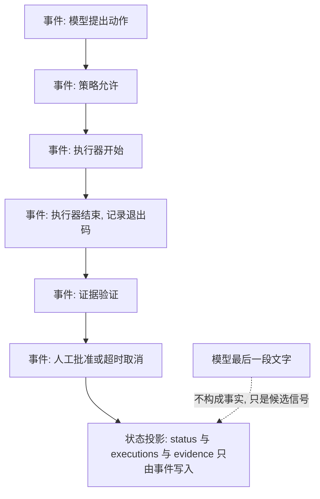
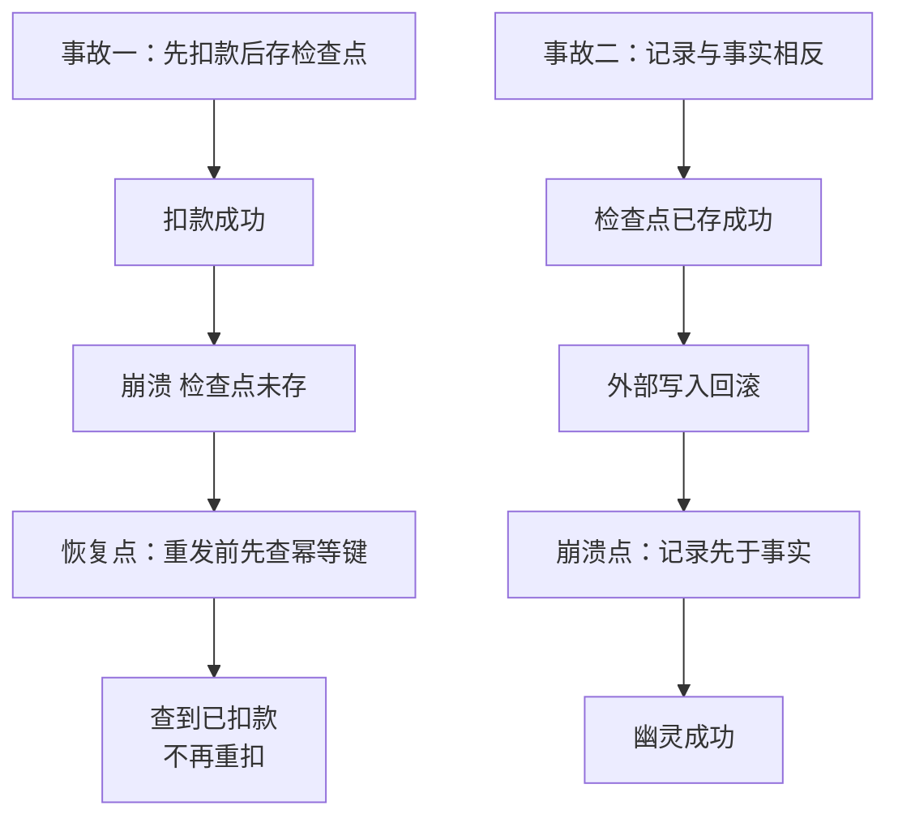

# 模型负责判断，运行时负责执行语义

这篇讲模型负责判断、运行时负责执行语义；读完你能分清自己系统里哪些事实必须由运行时记录、哪些决策可以放心交给模型。Agent（能自主调用工具、维护状态的模型应用）运行时把模型提出的动作放进一个具有状态、并发、失败和副作用（操作对外部状态产生的额外影响）的真实世界。**模型可以决定尝试什么；只有运行时知道动作是否真正执行、执行在哪个环境、产生了什么结果，以及失败后能否安全重试**。

## 要解决的问题：运行时的职责边界在哪里

模型提出一个动作之后，**没有运行时记录就无法确认它是否真的发生过**：动作是否真的执行、在哪个环境执行、产生了什么结果，全都无从确认，失败重试也可能重复写入。本篇回答：**运行时的职责边界在哪里，状态、并发、失败、副作用分别由谁处理，模型判断与执行事实不一致时以哪一侧为准**。

这类问题可以参照 Saga（把长事务拆成多步、失败时用反向补偿动作逆序撤销的分布式事务模式）补偿执行的模式：Saga 把长事务拆成多步，失败时用反向补偿动作逆序撤销已完成步骤，但中间状态对外可见。可以借它理解「失败要能逆序撤销、中间状态对外可见」这一点；本篇聚焦的是另一个问题——**事实由谁记录、成功由谁判定，运行时的职责边界**，这个比喻只到此为止。长事务的每一步都可能执行到一半，恢复时靠补偿动作收场：


来源：[CSDN @bjmayor《图解分布式事务模式》](https://bjmayor.blog.csdn.net/article/details/154004146)（CC 4.0 BY-SA）

## 它是怎么做到的，本质是什么

打个比方：模型像出主意的顾问，运行时像真正动手的施工队——顾问说"把这面墙改了"，改之前要报批、改的时候要盯结构、改完要验收，这些是施工队的活。**顾问说得再清楚，也不能替施工队办手续**。这个比喻到"两件事分开"为止：它让你记住判断与执行是两层，但运行时具体要管哪几件事、权限怎么接、失败怎么兜，要看正文。

## 运行时在机制层做什么

**它做的是观察与记录：模型只能依据当前上下文提出候选动作，动作是否真正执行、在哪个环境执行、外部状态是否已改变，只有运行时能观察**。法庭书记员是同一个分工：**当事人怎么说只是陈述，书记员记下的笔录才算案卷事实**——判决依据笔录，不依据当事人「我刚才说清楚了吧」这类自我确认。

**比喻到「谁有记录权」为止**：书记员只管记，运行时还要按记录驱动恢复与重试，这是书记员没有的职责。状态由事件驱动并由事件投影（用已发生事件推算出的当前状态）得出，**模型自述的结论不构成事实**。

**如果把两者混在一起，事件流里就分不清哪条是运行时真正观察到的、哪条只是模型的说法**。恢复时一旦错把模型说法当已发生事件，就无法确认哪些动作真执行过，下一步也就无从决定，**恢复与重试因此失去可判定的依据**。

## 为什么判断与执行两种权力必须分开

分开的形态可以参照网关（站在客户端与后端服务之间的入口层，集中处理路由、鉴权与协议转换）卸载（把鉴权、加解密这类通用处理集中到一个入口、后端只管自身业务逻辑的做法）。**运行时承担执行语义，正如网关在网络入口处完成加密握手、验证对方身份（即 TLS 传输层安全协议做的事）**。

这个比方只说明执行语义应集中到运行时这一层；网关还承担路由（把请求转到正确的后端服务）和负载均衡（把请求分给多台机器），这些不属于运行时的职责。银行里柜员与客户经理的分工是另一个日常版本：**客户经理替你判断该买什么产品（模型负责判断），但签章、转账、记账必须由柜员按流程执行（运行时负责执行）**，客户经理拍胸脯说「钱已经转了」不算数，**以柜员盖了章的回单为准**——比喻到「权力分岗」为止，银行还有监控与审计岗，对应运行时里的证据与验收，是第三个角色。


| 模型适合决定 | 运行时必须强制保证 |
| --- | --- |
| 如何理解目标和当前观察 | 当前任务绑定哪个用户、项目和版本 |
| 下一步最值得尝试什么 | 命令是否实际启动以及退出码（程序结束运行时返回的数字，0 通常表示成功、非 0 表示出错）是什么 |
| 选择哪个工具和候选参数 | 参数是否合法、权限是否满足 |
| 如何解释错误并调整方案 | 超时、取消、子进程和日志如何收束 |
| 何时认为证据足够 | 成功条件是否被独立验证 |

**如果模型能直接写入「已执行」「已成功」或「环境阻断」等事实字段，下游会把它当成系统已确认的事实，语言结论就冒充了系统事实**。相反，如果运行时替模型硬编码每种项目和问题的处理逻辑，系统又失去模型处理未知环境的价值。

## Agent 为什么是事件驱动的状态机

状态机（每收到一个事件就按规则切到下一状态的程序模型）的含义先说清。状态机像快递每经一站就扫码更新物流状态，最终状态由这些扫码记录累加得出。这个比喻只说明状态由事件累加，具体字段看下面的 yaml。

下面这份 yaml 列的就是运行一次至少要记下的字段。**一次运行不应只保存聊天记录——聊天记录只记了模型说了什么，没记动作是否真启动、退出码是多少，恢复和对账都无从核对**：

```yaml
run_id: run_...
subject:
  user_id: ...
  tenant_id: ...
target:
  resource_id: ...
  revision: ...
workflow_version: ...
status: running
goal: ...
checkpoint: cp_...
observations: []
proposed_actions: []
executions: []
evidence: []
budget:
  deadline: ...
  max_steps: 12
  max_tokens: 30000
  max_cost: 0.30
```

**状态变化应由事件驱动：模型提出动作、策略允许动作、执行器开始、执行器结束、证据验证、人工批准、超时、取消**。**最终状态是这些事件的投影，不是模型最后一段文字**。事件链图给出从动作提出到事实记入状态的过程：



**事件逐个写入状态，模型的自述只能作为候选信号进入事件流**；`status`、`executions`、`evidence` 三个字段的每次变化都能对应到一条事件。

## 检查点（进度存档）和业务事务分别解决哪些问题

检查点指把运行进度存下来、失败后能从上一步而非开头重来的机制。Anthropic 官方的提示链模式图里，LLM Call 1（大语言模型的第一次调用）的输出先过一道程序化 Gate：Pass 才进 LLM Call 2，Fail 直接 Exit 短路。这道 Gate 与运行时的检查点在「步骤之间的验证与放行不交给模型自觉，由确定性代码把住」这一点上重合；不同的是，Gate 只管这一步放行不放行，检查点还额外负责把状态存下来，保证 Fail 之后能从上一步重来而不是**从头再跑**：


*图源：[Anthropic《Building Effective Agents》](https://www.anthropic.com/engineering/building-effective-agents)，Anthropic。*

检查点解决「运行过程从哪里恢复」，业务事务解决「外部状态如何保持一致」。打个比方：检查点像游戏存档点，退出游戏再进来从存档点继续；业务事务像银行转账，要么转成要么没转，不会只转一半。

比喻只说明「从哪里恢复」与「外部状态何时一致」这两点，具体事故分类看下面的图。**如果工具先扣款后存检查点，恢复后可能再次扣款；如果检查点记录成功，但外部写入回滚（把系统状态退回到改动之前的版本），系统又会产生幽灵成功**。

「扣款与检查点两类事故」图标出了崩溃点、恢复点与幂等（同一个操作执行一次和执行多次的结果相同，重复执行不会产生额外副作用）键查重时机，这是文字难以同时呈现的三处位置：



图中两条链的结局不同：事故一在恢复点「重发前先查幂等键」，**查到已扣款就不再重扣，重复副作用被拦下**；事故二的崩溃点出现在「记录先于事实」的位置，检查点已存而外部写入回滚，**留下幽灵成功**。两类事故共同的原因是**扣款与检查点属于两个无法原子提交的存储**，所以退而求其次：**用幂等键拦住重复扣款，用结果引用证明外部真实结果，用事件重建恢复时的状态，这样两个存储即使暂时不同步，也不会产生重复副作用或幽灵成功**，而不是**追求单一事务**。「无法原子提交」正是分布式事务的经典难题，2PC（两阶段提交）阶段二的困境就是一例：协调者通知提交、事务完成；协调者一挂，谁都不知道该提交还是回滚：


图源：上文同一篇 [CSDN @bjmayor《图解分布式事务模式》](https://bjmayor.blog.csdn.net/article/details/154004146)，CC 4.0 BY-SA 许可。

常见控制方法包括：

- **每个有副作用动作携带稳定的幂等键**（idempotency key，同一操作重复提交只生效一次的标识）；
- **执行前保存意图，执行后保存不可伪造的结果引用**；
- 对支持查询状态的外部系统，重试前先读取现状；
- 无法原子提交时使用 outbox（先把事件写入本地待发区，与业务写入同事务保存，再异步投递）；或 saga（把长事务划分成带补偿动作的子事务序列）；或显式补偿；
- **恢复时按事件与外部事实重建状态，不重复相信旧的自然语言总结**。

## 为什么重试是语义，不是循环语句

**重试只对临时故障有意义**，具体分类见下面表格。

只有临时故障适合自动重试——非临时故障是确定性失败，重试次数再多结果也不会变。参数非法、权限不足、业务拒绝和目标版本不匹配都不会因为重试变好。**错误必须先分类，一共六类**：transient 指限流（控制单位时间放进来的请求数量，超过配额就拒绝）、网络抖动（性能指标不稳定的起伏）这类临时故障，invalid 指参数非法，其余四类分别是 forbidden（权限拒绝）、conflict（版本冲突）、ambiguous（结果不明）、blocked（依赖缺失）。下面这张表给出六类错误的例子和默认动作：

| 错误 | 例子 | 默认动作 |
| --- | --- | --- |
| transient | 限流、网络抖动、服务暂时不可用 | 指数退避、抖动、次数上限 |
| invalid | schema 错误、参数越界 | 让模型修正一次或直接失败 |
| forbidden | 权限不足、策略拒绝 | 不重试，返回明确边界 |
| conflict | revision 已变化、资源被占用 | 重新读取状态，再决定合并或终止 |
| ambiguous | 请求可能已成功但响应丢失 | 用幂等键或状态查询消歧 |
| blocked | 必需依赖、凭据或环境不可用 | 保存证据，等待外部条件变化 |

错误按类处置。此外，**后一次失败不能覆盖之前已经确认的成功事实**：运行状态应支持「步骤 A 已完成、步骤 B 环境阻断」，而不是**只保留一个全局字符串**。

## 并发与资源所有权归谁管

**并发与资源所有权归运行时管，办法是按所有者隔离资源，否则不同用途会互相挤占**。具体形态是池的划分：连接池（预先建好连接反复取用、省去反复握手建连的开销）按用途分开，某个用途占满时其他用途仍可用，位子的租期与回收由池统一管理。


仅有隔离还不够：多个 Agent 或多轮重试（每次重试视为新一代）可能同时操作同一资源，旧任务越权（访问了权限范围之外的资源）写入要另加防备。光靠文件锁也不够：**进程暂停或网络断开后，文件锁会留下卡住的状态且不会自动释放，锁的持有者失联，其他任务就一直等不到资源**。对长任务改用租约（lease），即带过期时间的使用权：**持有者失联后到期自动归还，资源不会一直卡住**；再加 fencing token（随租约递增的编号，用来让外部系统识别并拒绝旧一代的写入请求），**网络分区后旧任务的写入也会被编号挡下，正好覆盖锁失效与分区两种故障**；对 worktree（Git 的并行工作区副本，用于隔离不同任务的改动）、临时目录、端口和子进程建立明确所有者，**清理动作只能回收本任务确认不再使用的资源**。

## 停止条件为什么必须由运行时独立计算

Agent 循环的形状，Anthropic 官方画成三方的 Action-Feedback 环：模型向环境发出动作、环境回给反馈，循环转多少圈由环境证据决定；Stop 节点从 LLM Call 单独引出——停止发生在哪里、由谁判定，是循环能否收束的关键：


*图源：Anthropic《Building effective agents》，CC BY 4.0，https://www.anthropic.com/research/building-effective-agents。*

**停止条件必须是运行时能独立计算的表达式，模型的自述只能触发验收**。健身教练的例子的道理一致：学员喊「我练够了」（模型自述）不构成下课条件，课程是否结束看计划表上的硬指标——组数做完、心率区间达标、时间到，这些教练拿秒表和计划表自己能算（运行时独立计算）。比喻到「验收谁说了算」为止：教练还能临时给学员加练，**运行时的停止条件一旦写定就不能被模型临时放宽**，这是比健身更严的地方。Agent 循环至少在以下任一条件成立时停止：

- **可执行验收证明目标完成**；
- **权限或策略明确拒绝**；
- **缺少不可替代的外部条件**；
- **连续步骤没有产生新证据**；
- **步数、时间、token、工具调用或费用预算耗尽**；
- **风险达到人工审批阈值**；
- **用户取消或目标版本已失效**。

「模型说完成了」不是停止条件，只能是触发验收的候选信号。

## 恢复测试怎么设计

**对每个关键节点做崩溃注入：工具执行前、执行中、执行成功但结果未保存、检查点保存后、人工审批等待中**。消防演习是同一套思路：不挑时间、不挑环节，断电断梯（崩溃注入）真演，**看每个岗位按预案动作、人员一条不丢（不重复副作用、不丢失已确认事实）**——比喻到「演习强度」为止：演习演砸了可以重来，生产系统恢复错了会产生重复扣款这类真实副作用，所以测试要在预发环境做足，不能拿生产当演习场。重启后验证**不会重复副作用，不会丢失已确认事实，不会把旧 revision 的结果绑定到新任务**。**无法通过这些测试的系统，不具备长任务自治能力**。

## 怎么自己动手验证

**执行结果要与运行时记录对账：预先写下的预期结论不依赖模型的陈述，若只能靠自述支撑，与预期对不上，说明运行时没有记下真实退出码**。报销对账是同一个动作：出差人自己说「打车花了八十」（模型自述）不能直接入账，要把发票（运行时记录的退出码与结果引用）贴上逐张核对，对不上的退回重查——比喻到「凭票入账」为止：报销只要发票齐就行，**对账还要求每条记录能对应到一次真实执行，验证标准更严**。具体核对三项：
1. **职责分离：核对一次任务里模型只提出动作、运行时记录动作是否真正启动与退出码，确认执行结果不依赖模型的陈述**。
2. **绑定核对：确认当前任务绑定的用户、项目与版本由运行时维护，模型上下文中被篡改的绑定值不会改变实际执行身份**。
3. **重试安全：构造一次副作用动作失败重试，确认幂等键与结果引用让重试不产生重复副作用**。

## 效果从哪儿来，要付什么代价

**把判断与执行分开带来的收益是完成状态有独立证据支持：动作是否启动、退出码是多少、结果引用是什么，都由运行时记录，模型的语言结论不再直接充当系统事实**。装修公司把设计师与施工队分开的道理一致：设计师的效果图再好看不算交付，验收单上每个项目签字才算完工——比喻到「验收有据」为止：装修分一次工就完事，Agent 系统的运行时还要持续处理并发、恢复与预算，是长期养一个岗位。**代价是状态机、幂等键、恢复流程与并发所有权都需要显式实现**，长任务的取消、重启与错误分类也要逐条覆盖。

## 还想继续深入，该接着读哪几篇？

- [[工程知识/AI 系统工程：从模型能力到生产能力/安全与治理/AI可以做语义决策，系统必须守住事实边界]] · [[工程知识/后端系统：在并发、失败与变化中维持服务/分布式可靠性/超时、重试与幂等共同定义调用语义]]
