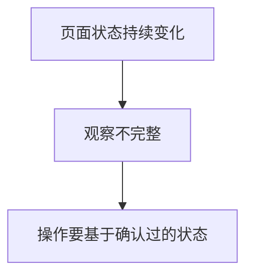
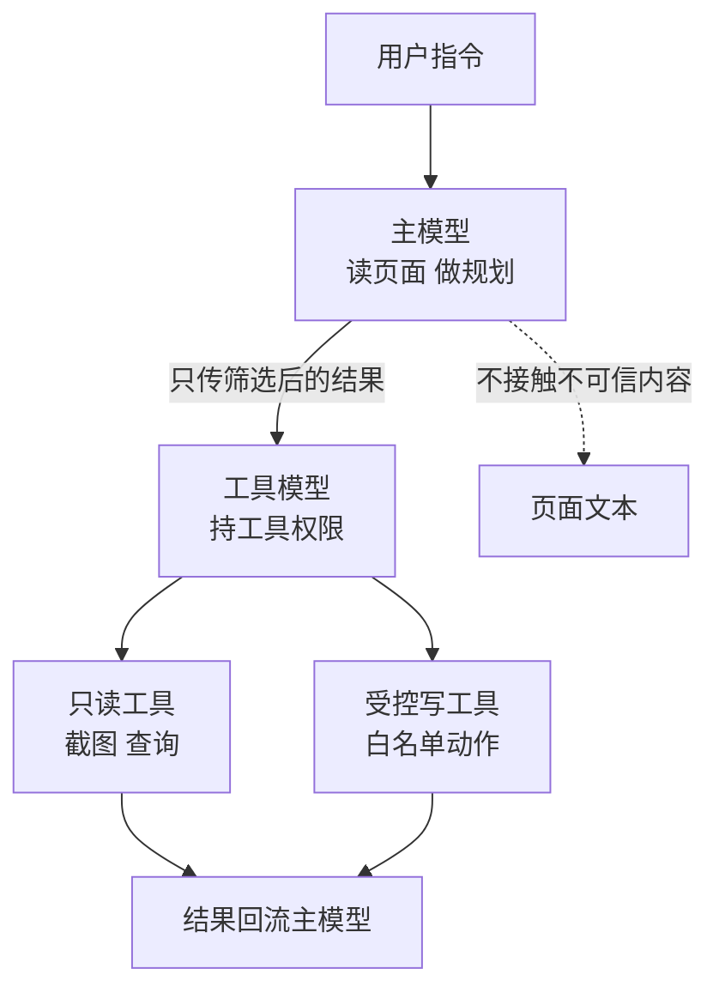
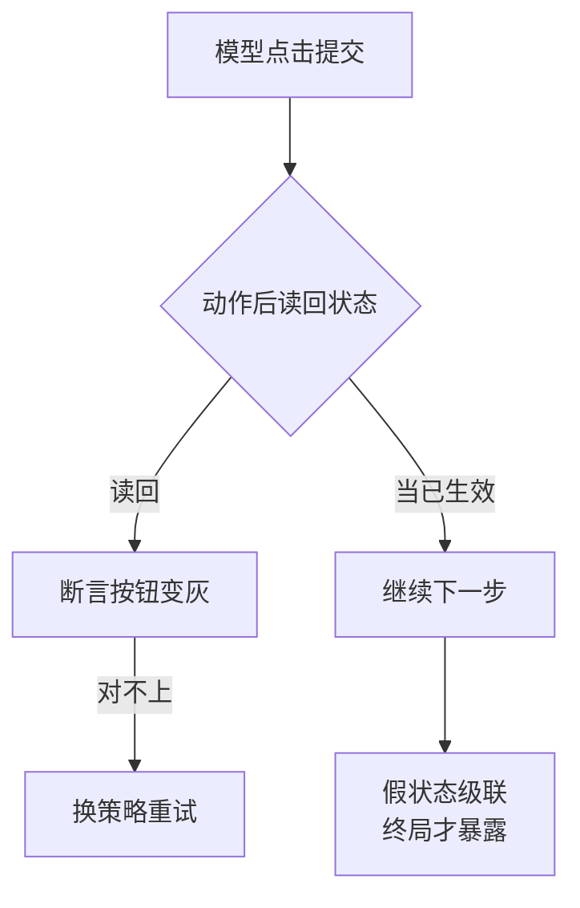

# 浏览器与Computer Use Agent：高噪声观察下的受控操作

这篇讲如何在高噪声观察下安全运行浏览器与 Computer Use Agent（通过操作图形界面来使用电脑的 Agent）；读完后你能搭出可验证、可回滚（把系统状态退回到改动之前的版本）、有权限边界的浏览器操作运行时（负责实际执行并管控浏览器操作的组件）。让 Agent 操作浏览器，听上去只是多接一个工具，**实际观察（读到的信息里有效内容少、干扰多，即高噪声）、动作和页面内容三样都不可靠**。

观察不可靠，需要验证层读回状态；动作不可靠，需要前置断言与白名单；页面不可信，需要权限边界与回滚。这类 Agent能碰到文件系统和进程，而纯浏览器 Agent 只在网页里活动。两者的风险差异有多大，在下文失效一节集中说。

**三类新问题具体是：观察是截图或无障碍树（页面元素的程序化结构描述，供精确定位），读到的信息里有效内容少、干扰多，同一页面每次读到的元素数量、顺序都可能不同，还可能混入广告等无关元素；动作空间是像素坐标或 DOM（文档对象模型，页面结构的程序化表示）选择器，脆弱且可被页面改版打断；页面内容本身不可信，提示注入（页面文本夹带指令、诱导 Agent 偏离用户意图）可借页面文字劫持 Agent**。在此基础上，本篇回答的问题是：**在承认观察、动作与页面内容都不可靠的前提下，为什么必须构造能验证、可回滚、有权限边界的浏览器操作运行时**。

本质是**把浏览器从"工具"重新定义为"不可信环境"**。这个比喻只在输入需过滤、动作需约束这两点上成立。超出这点就不适用：同一按钮在相同 URL 下每次加载的 DOM 路径一致，改版才会变；页面加载慢也只是需要显式等待——这些都不等于不可信。普通工具的输入输出是结构化的、约定明确的；浏览器环境的输入是渲染后的页面，其内容可含对抗性指令，其结构随加载时序漂移。朴素的运行时只做"转发调用"（不校验地把模型指令直接下发给浏览器），在这两种不可靠之下，未校验的指令会直接变成错误操作。运行时的职责因此从"转发调用"升级为"过滤观察、约束动作、验证结果"。

这套防御不是从零发明：Chromium 把渲染进程（跑网页代码的那一侧）与浏览器进程（管地址栏、网络与文件访问的那一侧）拆成不同进程，渲染进程被操作系统级沙箱（隔离运行环境，限制其能访问的文件与进程范围）剥掉了文件访问等权限——Agent 运行时的白名单动作（只允许导航、点击、输入、等待等限定操作）、只读与受控写工具的分层，正是沿用这个结构思路，把权限边界画在进程与工具层：


*图源：Chrome for Developers《深入了解现代网络浏览器（第 1 部分）》（作者 Mariko Kosaka），https://developer.chrome.com/blog/inside-browser-part1?hl=zh-cn。渲染进程多层叠放表示每个标签页独立进程——这正是「一个标签页崩溃不拖垮整个浏览器」的来源。*

## 观察、动作与验证三层怎么配合



| 层 | 机制 | 工程要点 |
| --- | --- | --- |
| 观察层 | 截图 + 无障碍树/DOM 快照（某一时刻的完整只读副本）组合 | 截图给视觉模型、结构树给精确选择器（结构树用于看清页面，选择器用于定位并点击具体元素，两者用途不同）；两者互校如同肉眼看外形、尺子量尺寸，只用于定位阶段互相校验，不代表内容可信度核对，对不上就复核 |
| 动作层 | 白名单动作（导航、点击、输入、等待） | 禁自由 JS 执行；每个动作带前置断言（断言指对动作前提或结果的可程序化检查，此处为目标元素存在） |
| 验证层 | 动作后状态断言 + 关键操作截图存证 | 提交类动作前后双截图；**失败即停而非重试蒙对** |

观察过滤针对提示注入：页面文本进入上下文前，**标记来源为不可信内容（与系统提示、用户指令区分）**，对"忽略之前指令""点击此处"类页面内指令一律不执行——**这类文字是页面写给 Agent 看的指令，执行它等于让页面内容代替用户发号施令**；除非用户已显式授权该域名的此类操作。

动作约束的硬度分级——分级依据是操作能否撤销、影响范围多大，越难撤销越硬。举例：查询余额这类只读最易撤销，保存草稿这类可逆居中，付款、删除这类不可逆最难撤销：只读操作（浏览、查询）影响限于本次读取，失败可自动重试；可逆写操作（保存草稿）影响单条记录，重试前检查目标状态；不可逆操作（支付、删除、发送）影响资金或对外状态，必须人工确认或在预授权（提前一次性批准某类操作在限定范围内自动执行）范围内执行。


图：感知、规划、执行三段的边界与实例，对应上文三层机制。来源：WebAgents 综述论文 Figure 2（arXiv:2503.23350）。

## 哪些失败形态最常出现

| 失败 | 场景 | 对策 |
| --- | --- | --- |
| 选择器漂移 | 页面改版，选择器失效点击到错误元素 | 前置断言 + 动作前截图确认目标 |
| 加载时序竞态 | 元素可见但未可交互，过早点击 | 显式等待元素可交互（而非仅出现在页面上）再操作，不用 sleep 这类固定等待 |
| 提示注入劫持 | 页面文字含指令，Agent 执行了页面说的而非用户要的 | 观察内容标记不可信 + 域名动作白名单 |
| 多标签状态丢失 | 操作中途开新标签，Agent 跟丢上下文 | 标签页句柄（标签页的引用标识）显式管理，动作绑定标签 ID |
| 静默错误 | 点击成功但后端拒绝，页面只是刷新（重新加载） | 动作后必须断言结果状态而非仅断言动作完成 |

## 这套说法在哪儿会失效

- 截图视觉模型读到的"按钮"可能是广告或伪造元素：视觉确认要结合 DOM 结构与位置一致性，纯视觉判断在高风险操作上不够。
- 不可逆操作的人工确认粒度是产品权衡：每次确认打断自动化收益，批量预授权积累风险；默认建议单次任务内单次确认、跨任务不预授权支付类动作。
- Computer Use（操作系统级）比浏览器级风险高一档：操作系统级的文件删除、进程终止往往不可撤销，一旦误操作，波及范围（数据与进程层面受损的范围）大于网页，白名单与沙箱（隔离运行环境，限制文件与进程的访问范围）要求更严，能不用就不用。
- 录制回放不是 Agent：固定脚本处理不了页面变化，Agent 的价值恰在处理漂移，但漂移处理本身要靠断言而非模型"觉得对"——模型对"点对了没有"的判断本身也来自高噪声观察，无法被自己校验，所以必须落到可程序化断言。

## 风险高一档怎么应对？

把风险高一档的影响降到可接受范围，一个做法是**把语义判断与工具权限分给两个模型**，像把「看合同」和「盖章」分给两个人：即使看合同的人被页面文字欺骗，也碰不到印章。主模型读页面但只输出筛选后的结果，写工具权限全部收在工具模型一侧——**权限小的模型即使被页面指令劫持，能碰到的也只有只读工具**。它是在动作层之外增加的一道权限隔离，不替代验证层的动作后断言。代价是**多付一次模型调用、隔离层引入额外延迟**。这种拆分有一个前提：**语义判断与工具执行能分开，上下文强耦合的任务拆不出干净的工具模型**：



## 动手跑一遍会看到什么？

Computer Use 的单个动作（"点击提交按钮"）从观察到生效，每层各有一道闸：

```python
# 观察层：坐标只信一个源
obs = capture(screenshot=True, dom=True)
element = locate(obs.dom, selector="button#submit")
#   截图缩放 2 倍 → 像素坐标失真 → 点错位置
#   纪律：坐标只从 DOM 取，截图供多模态模型（能同时处理图像与文本输入的模型）读语义与人工审计

# 动作层：结构化引用优先，坐标兜底
if element:
    act(Click(ref=element.ref))      # 按元素引用（元素在 DOM 中的唯一标识）点，布局微动不失效
else:
    act(Click(pixel=element.xy))     # 纯坐标是最后手段

# 验证层：动作后必须读回状态，而非假设成功
after = capture(dom=True)
assert after.dom.find("button#submit").disabled     # 提交后按钮变灰
assert "订单已创建" in after.dom.text               # 确认文案出现
#   界面没变化 → 判定失败 → 重试换策略（滚动、换选择器），不是原样再点
```

验证层的断言结果在主流运行时里有标准归档形态：Playwright 的 HTML Report 按用例列出 passed（通过）、failed（失败）、flaky（不稳定：同一用例多次运行结果不一致，时而通过时而失败）状态与耗时，浏览器内核（chromium/firefox/webkit）逐条标注。「读回状态」是每个动作后的断言记录，失败定位直接回放到出错的那一步：


*图源：Playwright 官方文档《Getting started》HTML Report 配图，https://playwright.dev/docs/intro，Apache-2.0，文档引用。*

跑一遍的收获：**高噪声观察下可靠性的来源是"结构化锚点（把「该点哪里」固定到唯一、可程序化校验的 DOM 元素引用上） + 动作后验证"**——模型负责从截图读出"该点什么"，运行时负责把"点"对应到可验证的 DOM 引用上。**职责分开后，在这套三层护栏之下，噪声主要降低效率，不直接变成错误动作**——因为验证层在每个动作后读回状态、对不上就换策略，**误读在下一步之前就被拦下**。

三层护栏中，验证层决定错误在哪一步被发现。同一个点击，动作之后读不读回状态，走出两条路：



读回状态让错误在发生的那一步被拦下——断言按钮变灰对得上就继续，也顺带覆盖了单次观察截不全画面的盲区；当已生效则把假状态带进下一步，到终局才暴露，发现时已经远离出错点。**单帧观察可能不完整，只有读回状态才能补齐盲区，所以操作要基于确认过的状态**。

## 这些数字和案例凭什么可信？

先看两组要论证的数字：单屏可交互元素几十到上百个、动态布局下纯坐标失效率以两位数百分比计。两组数字都来自可查的经验区间，下面分别过账。

噪声的账：**现代页面单屏可交互元素几十到上百个，原始截图的 token（模型处理文本的基本单位，可粗略理解为词或字）开销以千计——观察是 Agent 域最贵的输入之一**，DOM 过滤只留可交互元素与锚点。可交互节点通常只占整页节点的很小比例（常见后台页面几百个节点里可交互的只有几十个）；每个节点都带着标签、样式、事件等一堆属性。压缩发生在两个层面（以下比例均来自作者对若干后台页面的抽样观察，属经验量级，非精确测量）：节点数层面，可交互节点只占整页节点的很小比例；字段层面，每个节点只留 href、文本、角色等定位所需字段，单节点字段数大幅减少。

成功率的账：**结构化引用的点击比纯坐标更可靠**。原因在纯坐标的失效率：动态布局下，按点击所在页面类型分开看，纯坐标失效率——带动画的页面明显更容易失手，频繁改版的页面更高，静态后台页面失误少得多——这些定性估计来自作者的工程经验，不是公开基准，**依据是页面动画与改版会移动元素位置、使缓存的坐标失准**。**坐标越容易失效，固定到 DOM 元素引用的结构化点击就越可靠**。

动作后验证把"静默失败"变成"显式重试"：所谓级联，指错误结果被当成事实传给后续步骤，像疾病扩散，一步不拦就一路传下去——这个比喻只指错误沿执行顺序一步步传递，不指错误会自我繁殖或感染无关模块；**显式重试正是拦住它的那道闸**。

**带着假状态走完全程的错误，往往到终局才暴露。那时已远离出错点，难以定位**。相比不做动作后验证、只断言动作完成的方案，**早期拦下错误可避免假状态级联到后续步骤，使更多任务走到终点**；在没有动作后验证的方案里，**静默失败是任务中断的主要原因之一**，因此端到端任务完成率的提升主要来自这一项。

案例回流有一条现成参照：不读回执就当成功的实录见 [[工程知识/缺陷分析：从个案到体系/稳定性/案例八：承诺没有兑现——Pulsar 里六个永不返回的请求.md]]，发出请求即认定生效、不验证回执，Agent 的"点了就当生效"是同一形态；重试策略的外部锚点见 [[工程知识/AI 系统工程：从模型能力到生产能力/Agent与工作流/反思要有外部锚点.md]]，动作后的状态读回就是反思的锚点本身。

## 怎么自己跑一遍验证这套机制？

**动作断言要与前置条件对账**——预写每个动作前目标元素存在、提交前后双截图存证，**断言失败与预期对不上时立即停止，不再重试蒙对**。

最小验证：在测试站点跑一个含表单提交的任务，人为注入三类扰动——改一处选择器、延迟一处加载、页面内植入一句注入指令；断言：**选择器漂移被前置断言拦下、时序竞态（多个执行流争抢资源、结果取决于时序）被显式等待化解、注入指令未被采纳且被日志标记**。再跑不可逆操作路径，断言**人工确认门触发且确认前后双截图入证据链（按时间顺序串联、可回溯核查的操作记录与截图）**。

关系：[[工程知识/AI 系统工程：从模型能力到生产能力/Agent与工作流/工具是受约束的能力，不是提示词里的函数名]] · [[工程知识/AI 系统工程：从模型能力到生产能力/安全与治理/提示注入和工具越权是不同威胁]] · [[工程知识/AI 系统工程：从模型能力到生产能力/安全与治理/沙箱限制能力，策略限制行为]]