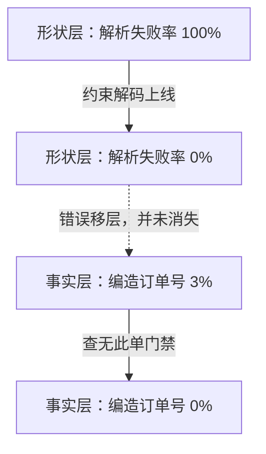

# 结构化输出与约束解码：schema约束形状，事实另需验证

这题要解决的问题："**格式对了不等于输出对了**"——**用约束解码管住 JSON 的形状，用独立验证层管住事实**。**读完你能分清形状错误与事实错误，知道哪一层该加什么门禁（门禁指在某一层设的硬性检查点，不通过就拦截结果）、必填字段怎样避免逼模型编造**。**让模型输出 JSON 时，第一次拿到 `{` 后面接了作文、第二次数组少逗号、第三次字段名对了但日期是编的——把"格式对了"当成"输出对了"，是结构化输出投入生产时最贵的错觉；形状由约束解码保证，事实由独立验证层保证，两层职责分开，都不可省略**。

这套方案的核心是什么？本质是**形状约束与事实保证的分离**。

JSON Schema 是一种描述 JSON 数据应当长什么样、字段有什么约束的标准；oneOf 是 JSON Schema 里的分支约束，表示多个备选子结构中恰好满足一个；CFG（上下文无关文法）用文法规则描述合法结构，适合表达递归与 oneOf 这类 JSON Schema 难写的形状。**约束解码（constrained decoding，在模型每步生成时按 schema 规定的结构只放行合法 token、从源头保证输出格式）把 JSON Schema 或 CFG 编译成状态机（一种按规则在有限个状态之间跳转的装置，用来决定每一步允许什么），在每步解码时屏蔽不合法 token（模型处理文本的最小单位，约相当于一个词或半个词），保证输出语法上必然合法**；**但 schema 只知道"date 字段必须是字符串"，不知道"这个日期是否真实、这个价格是否符合业务规则"**。**语法合法性是解码层的事，事实正确性是验证层的事**。

状态机屏蔽在每一步长什么样，引导生成论文的机制图最直观：


正则 `([0-9]*)?\.?[0-9]*` 编译成四状态自动机；当前状态允许的 token 在 logits（模型对下一步每个候选词的打分）里保留，其余涂黑屏蔽。采样（只采集一部分数据以控制记录开销） `.2` 与采样 `1` 各自推进到不同状态，下一步的合法集合随之变化。图取自 [Efficient Guided Generation for Large Language Models（arXiv:2307.09702）](https://arxiv.org/abs/2307.09702) 论文 Figure 1。

## 约束解码怎么保证形状、又为什么管不了事实

打个比方：约束解码像给填空题的答题卡——它保证你填的每一格都是数字（形状对），但填的是不是正确答案（事实对）它管不了。这个比喻到"校验形状不校验事实"为止：解码时怎么掩码、schema 怎么设计、事实该用什么办法验，要看正文。


| 层 | 保证什么 | 怎么实现 | 失效时表现 |
| --- | --- | --- | --- |
| 约束解码 | 语法合法（可解析、类型对） | schema → 自动机，逐 token 屏蔽 | 实现层 bug 时输出非法 JSON |
| 语义验证 | 值在业务上有效 | 独立验证器：范围、引用、枚举（一组预先列好的允许值，输出只能从中选）、跨字段规则 | 解析通过但值荒谬 |
| 修复重试 | 一次失败不终止 | 验证失败带错误信息重新生成 | 重试成本与无限循环风险 |

**约束解码的实现强度分档：正则截断（弱，只兜底）、logit 屏蔽（强，逐 token 保证——logit 是模型对下一步每个候选词的原始打分，数值越大越倾向选择）、预编译自动机（最强，复杂 schema 有性能成本）**。**对照例子：嵌套订单含数组时，正则截断会漏掉内层字段的检查，只有 logit 屏蔽才逐层保住；递归菜单结构要预编译自动机，否则逐 token 现算状态会拖慢解码**。

**弱实现对嵌套 schema、oneOf、递归结构的覆盖有限——oneOf 要在多个子 schema 之间切换状态，弱实现同样容易漏检分支，所以一并归入需要实测的范围**。怎么知道哪种实现够用？

拿自己的 schema 复杂度实测：构造几条含嵌套、oneOf、递归结构的样例输入，分别用候选实现跑一遍，比较延迟与解析成功率，实测后再选。

语义验证层（独立于模型的一段应用代码，负责检查字段的值在业务上是否真实、合理）的标准形态，JSON Schema 官方文档的流程图最直接：schema 与 JSON 实例是两份独立输入，一起送进验证器，输出只有通过与不通过两种——这个「独立验证器」正是表格第二行的实现方式：


*图源：[json-schema.org 官方文档](https://json-schema.org/learn/getting-started-step-by-step)（CC BY-SA 4.0）。schema 管形状、实例供事实、验证器给结论，三者各司其职；模型生成的是中间那份 instance，事实校验由验证器与应用代码完成。*

语义验证层要独立于模型实现：**日期真实性、ID 存在性、数值范围、跨字段一致性（endDate > startDate）都在应用代码里做，模型只负责填值**。**验证失败的重试要把错误信息注入重新生成，而不是盲目重跑——盲目重跑等于赌运气，注入错误让模型知道错在哪**。

## 形状合法了，还会在哪些地方出错

形状合法不等于**内容真实**，这一点跟「连上了不等于**能通」是同一类。UDP（用户数据报协议，只管发、不保证到达与顺序）发出去就算完，TCP（传输控制协议，负责把数据完整、有序地送达）要先握手确认对方在——**多了确认这一步，才知道对面真的接着**。**约束解码做的是前半段（形状），后半段（事实）靠独立验证层**。这个类比到「多一次确认才知道对面真接着」为止：网络协议的细节与解码无关，只借它分清两层职责。


| 失效 | 机制 | 信号 |
| --- | --- | --- |
| 形状对事实错 | 约束解码只管语法，字段值是幻觉 | 日期不存在、ID 编造、金额违反业务规则 |
| schema 漂移 | 消费方 schema 升级，旧输出解析失败 | 版本切换后错误率跳变 |
| 约束性能税（每步都要额外付出的固定开销） | 复杂自动机每 token 都做状态转移，吞吐下降 | p99（百分之九十九分位的）延迟上升，吞吐与自由生成差距大 |
| 强制字段幻觉 | schema 要求的字段模型没有证据支撑 | 可选字段被填上编造值 |
| 重试风暴（重试流量层层放大、让故障雪上加霜） | 验证失败 → 重试 → 又失败循环 | token 成本翻倍，延迟不可控 |

「约束性能税」借「税」比喻每步都要额外付出的固定开销——这个比喻只到「每步都有固定额外开销」为止：没有收取方、不能议价减免，具体数值看后文的实测曲线。vLLM 团队官方博客给出过实测曲线：同一模型在无约束、正则、JSON Schema、CFG 四种模式下逐 token 解码耗时的对比——约束越复杂，状态转移开销越显著。XGrammar 把复杂约束压缩成上下文文法（可以理解为比 CFG 更灵活、更适合工程实现的紧凑规则集），压成紧凑文法后，每步只需查一张小表就能决定合法 token，省掉现算大状态机的开销，所以每 token 成本回落、把它压回可接受区间：


图源：[vLLM 官方博客 Structured Outputs](https://blog.vllm.ai/2025/09/10/structured-outputs/)。横轴为生成 token 序号，纵轴为每 token 解码开销；CFG 等复杂约束在朴素实现下每 token 开销随生成位置增长，XGrammar 曲线明显更低。vLLM 是常用的开源推理引擎，博客为其团队发布。

同一个团队在切换 xgrammar 后端的前后版本对比里给出了端到端数字：vLLM 0.6.5（xgrammar）与 0.6.4（outlines）在同一 JSON 模式评测下，QPS（每秒请求数）1 时首 token 平均延迟从 10.5 秒降到 75 毫秒，QPS 25 时差距拉大到两个数量级以上——首 token 延迟过高时生产环境会请求超时、请求堆积，服务等于不可用；「约束性能税」在实现选型层面就能差出量级，只有把延迟压回可接受区间，约束解码才真正可用于生产：


*图取自 vLLM 团队 2025 年 1 月发布的解码性能对比文章（https://vllm-project.github.io/2025/01/14/struct-decode-intro.html，CC BY 4.0）。测试条件：Llama-3.1-8B、H100、json-mode-eval、50% guided decoding；outlines 的 TTFT（首 token 延迟，Time To First Token）随 QPS 急剧恶化（QPS 25 时接近 245 秒），xgrammar 保持在数百毫秒内。*

## 动手跑一遍，约束解码会暴露哪些问题？

```python
# 同一抽取任务，两种输出控制的差别（通用示例）

# 无约束：自由文本生成
answer = llm("提取订单号和金额: " + text)
#   "订单号是 A-123，金额 88 元（含税）" → 解析靠正则碰运气
#   "金额（单位：元）88" 单位歧义 → 下游把 88 当成分，错 100 倍

# 约束解码：每 token 只允许符合 schema 的候选
schema = {"order_id": "string", "amount_cents": "integer"}
answer = llm(prompt, response_format=schema, constrained=True)
#   解码器维护语法状态机：该出字段名时只允许出字段名的 token，
#   该出数字时屏蔽字母 → 100% 可解析，形状永远合法
#   但"形状合法 ≠ 内容真实"：order_id 可能被编造（schema 管不了事实）
#   → 事实层校验：order_id 反查订单系统，查无此单 → 判定幻觉，走人工
```

只验形状不验事实的实录——**抽取管道上线后解析失败率清零，业务校验发现 3% 的订单号是编造的（模型在信息缺失时"配平"了 schema 要求的必填字段），加"查无此单即拒绝"的业务门禁后错误才真正归零**；这正是 [[工程知识/AI 系统工程：从模型能力到生产能力/模型与上下文/模型提出候选，系统定义正确性.md]] 的分工实录——**模型出候选，应用代码用判据决定对错，形状门禁只是第一道**。约束的代价实录：**强约束在开放域会逼出低质量填充（必填但信息不足时模型硬编），比解析失败更难发现——必填字段要配"信息不足时允许显式输出 unknown"的逃生门**。

第一道门禁清零后错误只是换了一层存在，下图把这条转移画出来：



**形状层指标归零的时刻，正是事实层指标开始暴露问题的时刻；两层指标必须一起看，单层达标会制造已经修好的错觉**。

## 效果从哪儿来，要付什么代价

把语法约束与事实校验分成两层，换来的是**输出的形状由解码过程保证，字段值的真实性由应用侧独立验证，两者的失效互不掩盖——形状层出问题不会让事实层错误被隐藏，反过来也一样**。代价是**复杂 schema 的自动机带来每 token 的状态转移开销，验证失败的重试需要注入具体错误信息，字段过多且全部必填时模型会在缺少依据的字段上编造值**。

## 这套说法在哪儿会失效

- **schema 不是越严越好：required 意味着模型即便没有证据也要填满该字段**，把所有字段设 required，**信息不足时模型只能拿猜测值配平 schema，等于强迫它编造**；**可选字段 + 空值语义（显式 null 与缺失字段分开定义）让模型能表达"不知道"**。
- **约束解码与采样参数有交互**：模型原本按概率分布（每个候选词各有多大概率被选中）挑选下一个词，temperature（控制生成随机性的采样参数，调节这个分布的陡峭程度）控制挑词的随机程度；token 被屏蔽后候选集合变了，分布随之改变。**同样的 temperature 值在缩小后的候选集上产生的实际随机程度与自由生成时不同，所以受约束 token 集上的抽样行为要单独测，不能直接套用自由生成时的经验**。
- **函数调用（function calling）是结构化输出的特化形态：参数 schema 即约束，但工具执行结果回填后的整体语义仍需应用层验证——函数调用协议只保证参数格式符合 schema，工具返回的结果是否真实、是否符合业务，协议不做判断，要调用方代码自己验**。
- **严格 schema 下模型可能"被逼说谎"：要求枚举值但真实答案不在枚举里时，模型会选最接近的错值——模型被训练成每步必须输出合法 token，枚举里没有正解时它无法表达「答不出」，只能挑最接近的项填空；枚举设计要留出口（unknown/other + 自由文本）**。

## 怎样确认这套两层方案真的生效

**schema 结论要与三层验证对账——预写约束解码层全部语法合法、语义层非法值全部被拦，任一层与预期对不上就回到该层补约束**。

最小验证：**构造 20 个含边界情况的 schema 实例（嵌套、oneOf、可选字段、空值），分别测三层：约束解码层断言 100% 语法合法；语义层故意注入 5 个业务非法值，断言验证器全部拦下；重试层测一次注入错误的失败-修复循环成本（token 数与延迟），对比盲重试**。**最后跑 schema 版本兼容：旧输出喂给新验证器，断言有明确的版本错误而非静默错误**。

关系：[[工程知识/AI 系统工程：从模型能力到生产能力/Agent与工作流/结构化输出的约束解码：让模型输出可解析]] · [[工程知识/AI 系统工程：从模型能力到生产能力/模型基础与训练/解码与采样参数：概率分布到生成文本的控制面]] · [[工程知识/AI 系统工程：从模型能力到生产能力/Agent与工作流/工具是受约束的能力，不是提示词里的函数名]] · [[工程知识/AI 系统工程：从模型能力到生产能力/质量与运营/评测集的构建与维护决定所有评测的地基]]