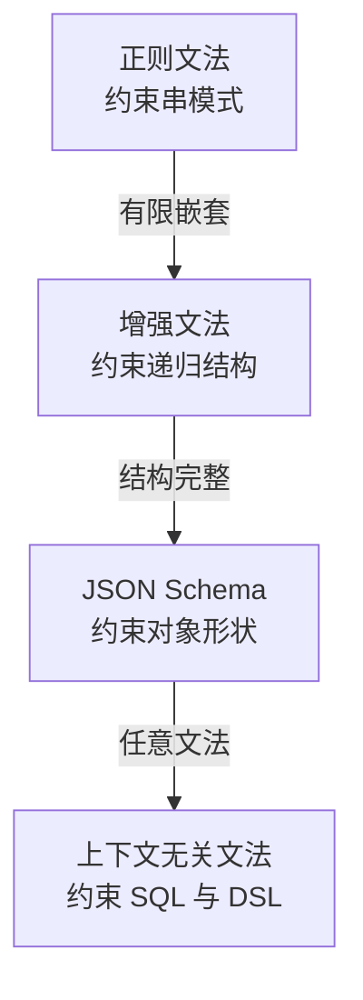

# 结构化输出的约束解码：让模型输出可解析

## 为什么要给模型输出加格式约束？

这篇讲约束解码：**怎么让模型只输出机器能直接解析的格式**。读完你能判断什么场景该上约束解码、三层约束怎么组合、压不压得住复杂 schema 的质量代价。

Agent 系统里模型的输出要被程序消费（调工具、写状态机、填表单），**自由文本不能直接解析，常因格式漂移而解析失败**。传统解法是提示词（发给模型的输入指令与背景信息）里写「请输出 JSON」+ 输出后解析失败重试，**两层都软**：模型未必听（格式漂移、多余开场白、markdown 围栏），解析后未必对（字段缺、类型错、枚举越界）。

结构化输出要解决的问题是**把输出格式从「提示期望」变成「生成约束」**——提示期望是告诉模型应该输出什么格式，生成约束是直接限制模型只能输出合法格式。做法是**每生成一步只保留语法允许的候选词，其余候选的分数直接清零**（token 是模型生成文本的最小单元），非法 token（模型处理文本的最小单位，约相当于一个词或半个词） 在采样时根本不会被抽到。

**Agent 系统里一次任务要连续调多次工具，任何一步格式解析失败都会中断任务，所以格式保证是稳定运行的前提**。这与词汇即接口（见 [[工程知识/软件构建：让变化可以理解、验证与交付/开发工具/词汇即接口：Linux与容器命令的词源与设计.md]]）的「接口约定」思想同源：**接口的形状固定，输出才能被机器消费**。这样约束下来，**整段输出必然合法、必然可被解析**。

## 约束解码是怎么做到的？

打个比方：约束解码像在答题卡上把每一格预先印好边框——考生只能往格子里填，填错了形状机器立刻看出来，比让他自由发挥一整页再去找哪里写歪了要省事得多。这个比喻只解释「为什么要提前约束」，掩码怎么生成、schema 怎么设计、事后校验怎么配合，要看正文。

**三层机制是什么？**
- **Prompt 约束（软约束）**：提示词描述格式 + few-shot 示例——在提示里放两三个格式正确的样例供模型模仿。不增加计算开销，也不提供格式保证，**模型的格式遵循率随模型能力与提示质量波动**。
- **约束解码是强约束**：在采样（只采集一部分数据以控制记录开销）前按语法/结构描述（schema，规定输出有哪些字段、各自什么类型的格式说明书）构造合法 token 前缀树（把共享同一前缀的合法 token 序列合并成一条路径，用来快速查出下一步允许哪些 token 的检索结构）。**每步把非法分支的 logit 置负无穷**（logit 是模型给每个候选 token 打的原始分数），使其归一化后概率为零、采样时不可能被选中。这一层有四个实现：GUIDANCE 与 Outlines 是开源约束解码库，GBNF 是 llama.cpp 使用的文法格式，OpenAI 的 structured outputs 是官方 API 的同名功能。**数学上保证输出合法**（合法 token 集合内采样）。
- **校验与修复是兜底**：JSON Schema 校验（JSON Schema 是描述 JSON 形状的标准，ajv 是常用的校验库）+ 失败重试即带错误信息重生成，或修复即局部修补。**兜底层处理约束解码覆盖不了的字段间约束——数值范围与跨字段关系**。

**状态机是核心抽象**。状态机（按规则在有限个状态之间转移的计算模型）像路口红绿灯：**每一步只看当前的灯允许走哪条路，走错方向的 token 当场被拦下**。JSON 的语法可以编译成状态机：开头必是 `{` 或 `[`，进入对象后期待 key（字符串）或 `}`，value 的类型由 schema 决定分支。约束解码每步查询状态机当前允许的 token 集合，mask 掉非法项。Schema 越复杂状态机越大，但状态数有限（schema 结构决定）；**每步 mask 只查当前状态的转移边，与状态总数无关，所以单步查询代价恒定**，开销通常占单次解码时间的很小比例，后文有引擎实测数据。**这个抽象把「格式正确性」从概率问题变成确定性问题**。

约束解码的实物原型是 Hollerith 打孔卡：卡片上 80 列 × 12 行的孔位是硬件定死的合法位置，读卡机的探针只认「有孔/无孔」，位置错了就拒读——机器可读的输出从来靠的都是形状约束，格式合法性在读取阶段就由卡面决定。

*图源：Wikimedia Commons，Herman Hollerith（1890 年打孔卡），公有领域，https://commons.wikimedia.org/wiki/File:Hollerith_punched_card.jpg。*

约束解码与打孔卡同构：Schema 编译成的状态机就是那张卡面的孔位图，每步采样时非法 token 的位置被 mask 掉，模型只能在合法位置「落孔」——「提示期望」是口头叮嘱操作员「别打错孔」，**模型未必听**；约束解码是把卡面以外的孔位直接封死，**错孔打不出来**。代价也在同一处：**卡面孔位越密即 schema 越复杂，每列可表达的内容被挤得越窄**。孔位比喻只到形状约束为止；这里说的「质量挤压」是模型侧的概率分布被压缩、选择空间变小，卡面解释不了这一层，**输出的内容合法但未必自然**。

约束解码在逐 token 层面到底发生了什么？正则（描述字符串匹配模式的规则）被编译成状态机后，每一步只允许当前状态出边上的 token 通过（下图上半部），其余 token 的 logits 被置为不可选，解码状态随已生成文本逐格推进（下半部的 通过/不通过 序列）——格式正确性由状态机的转移边保证，不靠模型自觉：

*图源：vLLM 官方博客《Structured Decoding in vLLM》机制讲解一节（FSM 掩码原理图）；下文耗时对比曲线出自同一篇的基准测试一节：https://blog.vllm.ai/2025/01/14/struct-decode-intro.html。*

**正则与 CFG 的谱系**。CFG（上下文无关文法，一种能描述嵌套结构的文法，比正则表达力强）的谱系从弱到强：**正则（无嵌套）→ 增强（有限嵌套/递归）→ JSON Schema（结构完整）→ 上下文无关文法**（SQL、DSL（Domain-Specific Language，为特定领域设计的小语言））。**约束力与表达力同涨**：正则约束下模型只能输出匹配模式串，CFG 下能输出合法 SQL。当约束强到上下文无关文法级别时，约束编译的开销与模型能力发生冲突：**约束太强（复杂 schema）会把模型「挤」到低质量输出（合法但语义差）——强约束把可选 token 压到很小的集合，概率质量重新归一化后，模型被迫放弃更自然的 token，于是输出合法但语义变差**。

**与工具调用的关系**。函数调用（function calling）是结构化输出在工具场景的产品化：**schema 即函数签名**。比如模型要调天气工具时，约束解码强制它只输出 {tool: weather, args: {city: 北京}} 这种形状，**字段名和类型错不了**。工具调用的可靠性依赖约束解码层的实现质量：**schema 字段越多越深，模型越难靠提示词记住并遵循所有格式规则**，所以无约束解码的函数调用（靠提示词加解析重试）在复杂 schema（多参数、嵌套对象）下失败率显著上升，有约束的（OpenAI structured outputs、vLLM guided decoding）接近 100% 合法。Agent 的轨迹可靠性（见 [[工程知识/AI 系统工程：从模型能力到生产能力/质量与运营/Agent评测必须覆盖轨迹而不只看最终答案.md]]）把工具调用格式失败算作轨迹失败，**约束解码是消掉这类失败的手段**。

## 约束解码从哪儿来，要付什么代价？

约束解码与形式语言理论的编译器实践同源——LR 解析（从左到右扫描、按最右推导的逆序归约出句子结构的机械语法分析方法）与自动机理论（研究什么样的机器能识别什么样的规则的数学分支）早在 1970 年代就把「合法性在解析阶段判定」做成了成熟方法；约束解码把同一思想搬到了模型生成的每一步。GUIDANCE（2023）与 Outlines（2023）把 schema 编译成状态机再 mask logits 做成工程库。Willard 与 Louf（2023）的论文《Efficient Guided Generation》给出状态机 mask 的高效实现。OpenAI 2024 年的结构化输出功能（100% schema 合法承诺）把这个技术推向主流 API。

这一系列做法的核心，是**让概率与约束各管一件事**：概率部分管内容（选什么值），约束部分管形式（值的形状必须合法）。上一节说过，**格式正确性在这里从「模型学出来的概率倾向」变成「数学上不可能违反」——机制不再是模型的自觉，而是采样空间的形状本身**。

这个过程在 Outlines 论文（Willard 与 Louf《Efficient Guided Generation》）的 Figure 1 上是完整一轮：正则 `([0-9]*)?\.?[0-9]*` 编译成四个状态的状态机，词表的 logits 行里合法 token 保留颜色、非法 token 涂黑，采到 `.2` 或 `1` 后状态机各自推进到新状态、掩码随之刷新——

![Outlines 论文 Figure 1：正则 ([0-9]*)?\.?[0-9]* 编译成的四状态的状态机（节点 0/1/2/3，转移边标注 [0-9] 与 [.]），下方 Logits 行显示词表采样结果——采到 .2 或 1 等合法 token 后状态机推进到新状态、掩码随之刷新，四组子图对应解码逐步推进](/static/figures/outlines-fsm-logits-mask.png)

*图源：Willard, Louf《Efficient Guided Generation for Large Language Models》（arXiv:2307.09702）Figure 1，https://arxiv.org/abs/2307.09702，论文插图。*

图上黑色格子就是「概率清零」的实物：模型对 `A`、`42` 这些会破坏数字格式的候选照常打了分，掩码把它们涂掉后采样只剩合法项，两个子图的掩码差异就是状态推进的效果。

约束解码不是免费的——每步 mask 有开销（状态机查询），复杂 schema 的编译与缓存管理要工程化；更深的代价是**「合法性挤压质量」：模型被强制选合法 token 时**，可能被迫偏离它的自然分布（合法但差的输出），复杂 schema下输出质量可测下降。三层的组合策略：**简单格式用提示词约束（零成本），关键接口用约束解码（强保证），字段语义用校验层（数值范围、业务规则）**。**全链路强约束只在必要时上**，见 Agent 轨迹可靠性（上文链接）的成本段。

## 这套说法在哪儿会失效

约束能保证形状，保证不了事实：schema 合法与语义正确是两层，后者要靠校验与评测补上。约束本身的代价也可以实测——guided decoding 的每 token 开销随并发上升而放大，引擎实现的差距直接写进延迟账单：

*图源：XGrammar 与 Outlines 的耗时对比曲线，vLLM 官方博客《Structured Decoding in vLLM》基准测试一节，与上文机制图同出一篇。*

- **约束解码保证语法，不保证语义**。Schema 校验字段类型与结构，不校验内容正确性（数值合理性、枚举选择符合业务）。**语义层靠校验层断言 + 评测集覆盖**，见评测集构建（见 [[工程知识/AI 系统工程：从模型能力到生产能力/质量与运营/评测集的构建与维护：从场景采样到难度分层.md]]）。
- **复杂 schema 的质量挤压要实测**。深嵌套 + 长枚举的 schema 在约束解码下的输出质量（人工或自动评测）可能低于自由输出后解析。**若实测质量下降显著，改 schema 设计（扁平化、分成多次调用）比强约束更划算**。
- **流式场景的约束部分失效**。流式输出（SSE，Server-Sent Events：服务器把生成内容逐条推给客户端的单向推送协议）下，约束解码在每个 chunk 边界仍有效（每个 token 都 mask），但**消费方拿到的部分 JSON 无法校验**（schema 校验要完整文档）。流式 + 结构化的组合因此有两条路：消费方做增量解析器（部分 JSON parser），或者牺牲流式。Gemini 的 partial JSON mode 是折中方案：**允许输出写到一半的合法 JSON，客户端边收边解析，不必等整段结束**。
- **约束解码与采样温度的交互**。温度 0（贪心）下约束解码质量最稳（无采样噪声），温度 > 0 时**约束 mask 改变分布形状**（被 mask 的概率质量重新归一化到合法集），**输出的多样性下降**。**创意生成任务慎用强约束**。

## 怎么自己动手验证

- **格式失败率对照**：同一任务（如按 schema 生成配置）在仅提示词、提示词加重试、约束解码三种模式下跑 1000 次，统计非法率。预期：**仅提示词 5-30%（随模型与 schema 复杂度），加重试可压到 1-5%，约束解码 0%（数学保证）**。**失败率曲线随 schema 复杂度的增长是三层约束的证据**：复杂度越高，纯提示词失败率涨得越快，约束解码仍保持 0%，**两层差距随复杂度拉大，分层才显出必要**。
- **质量挤压实验**：同一模型同一任务，自由输出（后解析成功的样本）vs 约束解码输出，人工或 LLM（大语言模型）评审打分。预期：**简单 schema 无显著差异，复杂 schema 约束输出质量分下降**。**挤压效应的量化是 schema 设计决策的依据**。
- **开销实测**：约束解码开与关的同负载吞吐对比。预期：**简单 schema 开销 <5%，复杂 schema（深嵌套）可测上升（状态机查询与缓存 miss）**。**开销曲线是容量规划输入**。

## 接着读哪几篇？

- [[工程知识/软件构建：让变化可以理解、验证与交付/开发工具/词汇即接口：Linux与容器命令的词源与设计.md]] —— 接口形状固定才能被机器消费
- [[工程知识/AI 系统工程：从模型能力到生产能力/质量与运营/Agent评测必须覆盖轨迹而不只看最终答案.md]] —— 工具调用格式失败的轨迹代价
- [[工程知识/AI 系统工程：从模型能力到生产能力/质量与运营/评测集的构建与维护：从场景采样到难度分层.md]] —— 语义层校验的评测依据
- [[工程知识/AI 系统工程：从模型能力到生产能力/Agent与工作流/结构化输出与约束解码：schema约束形状，事实另需验证]] —— 姊妹篇：形状约束与事实验证分层的完整机制
