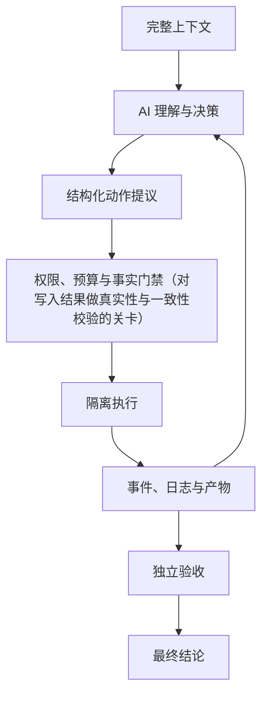
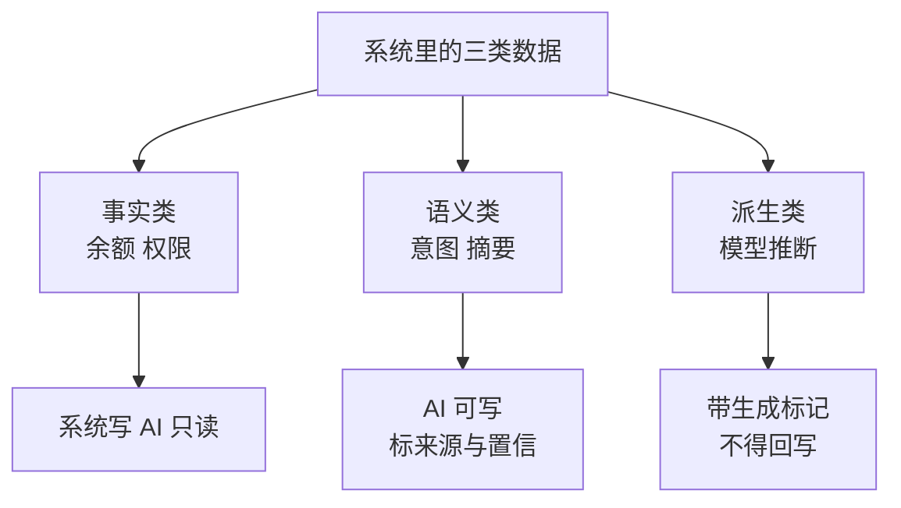

# AI 可以做语义决策，系统必须守住事实边界

这篇讲 AI 与系统如何分工：模型做语义判断，系统守事实边界；读完你能判断哪些事该交给模型、哪些事实必须由系统记录。语义判断指理解意图、权衡取舍，对开放问题下结论；事实边界指命令是否真实执行、结果是否真实发生这类只能由系统记录、不容模型改写的客观事实。最能发挥模型能力的设计，既不应把规则全部固定写下，也不应让模型同时担任执行者和裁判（对结果做最终判定的角色）。合理边界是：**AI 负责理解未知环境、提出方案和解释证据；确定性系统负责隔离、执行、记录和维护事实一致性。**

## 要解决的问题：语义判断与事实边界为什么必须分层

语义判断的输入空间巨大，而且会随项目、语言和环境变化。**为每个仓库硬编码「应该用 Maven（Java 的构建与依赖管理工具）还是 Gradle（同为 Java 的构建工具）」「哪条测试适用」既脆弱又昂贵，模型更适合根据上下文判断**。

**执行事实则相反：命令是否存在、退出码是什么、写入绑定哪个 revision（代码版本号），这些必须有唯一、不可伪造的答案，不能由语言模型自由生成**。**因为这类答案必须由不写事实的一方核验，所以职责链要从「AI 理解与决策」走到「独立验收」**：事件、日志与产物一方面回流给 AI 支撑下一步提议，一方面进入独立验收（由不写事实的一方按既定条件判定任务结果是否达成）作为最终结论的依据。



## 哪些开放语义应该交给 AI 判断？

打个比方：模型和系统的分工像设计师与监理——**设计师负责"这里该做成什么样"（语义判断，即理解意图、权衡取舍），监理负责"这根梁的承重数据对不对"（事实校验，即核对可测量的客观结果），设计师不能自己签验收单**。这个比喻只说明两件事要分开。**因为语义判断处理的是开放问题、事实边界处理的是唯一答案，所以分开后自然按「开放 vs 客观」来分配：判断该交给谁，看它是开放问题还是客观记录——开放问题交给模型，客观记录交给系统**。


**AI 可以动态完成：识别语言和构建系统、探测本地工具和缓存、选择依赖策略、寻找测试与迁移测试、判断 API（应用程序接口，程序之间互相调用的约定）差异、提出最小复现、分析编译和运行失败、决定下一步试验，以及判断当前证据最支持哪个假设**。

**这些决定应输出成结构化提议，并附带理由、不确定点和预期观察**。结构化提议指机器可解析的固定格式动作申请；预期观察指执行后应当看到的现象，用于事后核对。**AI 可以不断修改提议，但不能回写执行事实——执行事实须有唯一、不可伪造的答案，不能由模型自由生成**。


来源：[阿里云开发者社区《图文详解 RAG 技术和流程》](https://developer.aliyun.com/article/1670698)（CC 4.0 BY-SA）


## 哪些事实必须交给系统守住、不能委托给模型？

系统要守住的事实边界至少包括以下强制保证，每项都不允许模型自由生成：

- **每个任务绑定明确的主体、目标资源、revision、工作目录和任务代际**；
- **命令、子进程、超时、退出码、stdout、stderr 和产物真实保存**；
- **写操作经过 schema（写入数据的结构定义与校验）、业务、权限、副作用（操作对外部状态产生的额外影响）和预算检查**；
- **旧任务不能清理或覆盖仍被新任务使用的资源（任务代际即同一资源上先后任务批次的序号，旧代际的写入一律拒绝）**；
- **后一次失败不能抹掉已经确认的成功步骤**；
- **报告只能读取事件投影（从事件日志推导出的只读视图），不能接受模型自报的执行记录**；
- **任务结果由独立验收条件判定，而不是由回答措辞判定**；
- **凭据、网络、文件和进程权限限制在任务所需范围内**。

**这些约束不替 AI 做业务判断，只防止模型的文字结论冒充现实——因为约束读取的是执行记录而非对话文本，模型的文字结论进不了事实层**。

## 为什么三类数据不可混写

**系统里的三类数据写入权限各不相同：事实类如余额、权限，由系统写、AI 只读；语义类如意图、摘要，AI 可写并标来源与置信；派生类如模型推断，带生成标记、不得回写**。**混写会让派生结果伪装成事实：派生类带生成标记且不得回写，一旦与事实类共用写入通道，带标记的推断就会被当成系统记录的事实采信**。



落到具体记录上，这三类分别对应下面的提议、事实与判定，三者各自的示例与写入者如下表所示。

| 数据 | 示例 | 写入者 |
| --- | --- | --- |
| 提议 | 「应运行集成测试，因为事务边界改变」 | AI |
| 事实 | 命令、环境、退出码、日志引用、文件哈希 | 执行器（实际运行命令、把真实执行记录写入系统的组件） |
| 判定 | 验收是否满足、风险是否可接受、是否可发布 | 验证器或授权人（按既定验收条件做最终判定的角色，且与提议方分离） |

**提议可以被事实否定，事实可以被重新解释，判定可以因新证据而更新；但三者必须保留来源和时间**——压扁成一个 `status: success` 后，**判断与事实混在一起，无法追溯谁在何时判定，假成功便无从发现**。

**事实层与判断层分开留痕，等价于把 AI 的文字结论挡在事件存储之外：让每次执行作为事件按序追加、状态由事件回放推导，是事件溯源的核心承诺**。 Azure AI Content Safety 的架构沿同一条思路对提示与回复做双向过滤，输入侧与输出侧各设一道内容安全检查，任一侧越过阈值**直接拒绝**，**绕过模型的自报全无通路**：


*图源：Microsoft Learn 培训模块《Understand Azure AI content safety architecture》配图（Microsoft 官方培训材料，可自由引用并注明来源），https://learn.microsoft.com/en-us/training/modules/secure-azure-openai-content-safety-controls/2-understand-azure-ai-content-safety-architecture 。*

本篇的分工正是这套账房规矩：**模型是账房先生——读账、盘算、提议，嘴里可以说任何数；系统是算盘——珠的位置只由过账动作（执行器）写，模型说"测试通过"拨不动任何一颗珠，珠没动账面就没有通过这回事**。**事件投影就是账簿：任何时点的账面都能回放到具体哪次过账**。这个比喻只说明「事实与判断要分开留痕」，账房里的算盘、账簿、过账程序不与系统的具体组件一一对应，各组件怎么实现要看正文。

## 状态模型如何防止假成功被当真

```yaml
claim:
  kind: tests_passed
  proposed_by: model_turn_8
evidence:
  command_id: cmd_17
  revision: 4f8c...
  exit_code: 0
  artifact: artifact://cmd_17/test-report.xml
verification:
  rule: required_suite_completed
  result: passed
```

**如果只运行了 `mvn validate`，证据就不能支持「测试通过」；如果测试因依赖下载失败没有启动，结果是环境阻断，不是「测试不适用」；如果旧任务的成功证据绑定旧 revision，它不能被复用到新 revision**。

## 为什么 AI 不能独自评价 AI

**另一模型可以帮助判断文本质量、归类开放式失败和发现异常轨迹，但评价仍需外部锚点（作为对比依据的独立标准，衡量基准，实物意义上的「锚」只是比喻）：参考答案、工具事实、业务规则、人工标注或任务环境**。**没有锚点的自我反思（模型自己检查自己的输出并提出修改意见）适合产出修改后的新版本供再次检验——缺少外部参照时，模型无法知道自己是否真的达标，所以自我反思不能作为成功证明**。

## 怎么判断边界放得对不对

判断边界放没放对，用两个问题就能验证，分别对应语义判断与事实记录：

1. **这个决定是否依赖开放语义、未知环境或复杂权衡？如果是，优先让 AI 判断**。
2. **这个结论是**否应该只有一个可审计的真实答案？如果是**，必须由系统记录或验证**。

例如「哪个测试最能覆盖修改」属于语义判断；「该测试是否在目标 revision 上以退出码 0 完成」属于事实。边界放对后，AI 可以拥有很高行动自由——语义交给模型、事实交给系统，更换语言或框架不必改动执行侧，自由因此扩大；同时合理叙述不能直接变成系统成功。

## 这套分工的效果从哪来，又要付出什么代价？

**语义判断与事实边界分开之后，AI 可以在高自由度下工作：换语言、换构建系统、换测试框架都不需要改执行侧代码，模型按环境生成提议即可**。**代价由系统侧承担：状态机、事件日志、幂等（同一个操作执行一次和执行多次的结果相同，重复执行不会产生额外副作用）键（同一操作重复执行只生效一次的去重标识）与独立验收都要显式实现，这些组件的维护成本随任务类型增加**。**验收规则本身也可能出错：规则过松时假成功照样通过，过紧时正常路径被反复打断，验收条件要随失败样本持续修订，修订记录与代码一样进入版本管理**。

**事件投影的报告生成方式与事件溯源（Event Sourcing）一致：把每次操作当作不可改动的记录按顺序留存，状态由这些记录推出来——像记流水账，每笔进出都按时间写下，任何时点的余额都由这些记录推算，而不是**直接改总数**。**状态由不可变事件序列推导，任何时点的报告都能回放到具体事件**。**事件投影指从事件日志推导状态视图——因为回放时能指出某条结论具体由哪次事件写下，结论找得到外部依据**。「可审计」指每条结论都能追到具体事件、别人可以独立核对；**有了这个前提，「报告是否可信」才从不可检验的观感变成可审计问题**。

微软 Azure 架构中心对事件溯源的参考实现：命令侧把购物车操作写成事件存入事件存储，事件处理器消费事件流更新只读视图并对接外部系统，读侧的任何报告都由事件回放得出：


*图源：Microsoft Azure Architecture Center《Event sourcing pattern》（Microsoft Learn 文档，可自由引用并注明来源），https://learn.microsoft.com/azure/architecture/patterns/event-sourcing。*

## 怎么自己动手验证这套分工是否成立？

**最小验证：构造一次模型声称「测试通过」的任务，实际只运行了格式校验；断言系统按「证据不支持结论」处理，报告里不出现通过字样。对照验证：同一任务补齐真实测试执行后重跑，断言结论放行且报告引用命令与产物**。

**边界核对：把 AI 的提议文本改动后重放，断言执行事实不受影响——事实只来自执行记录，提议文本的任何变化都不改变已发生的事实**。

## 接下来该读哪几篇

- [[工程知识/AI 系统工程：从模型能力到生产能力/Agent与工作流/模型负责判断，运行时负责执行语义]] · [[工程知识/AI 系统工程：从模型能力到生产能力/质量与运营/Agent评测必须覆盖轨迹而不只看最终答案]]
