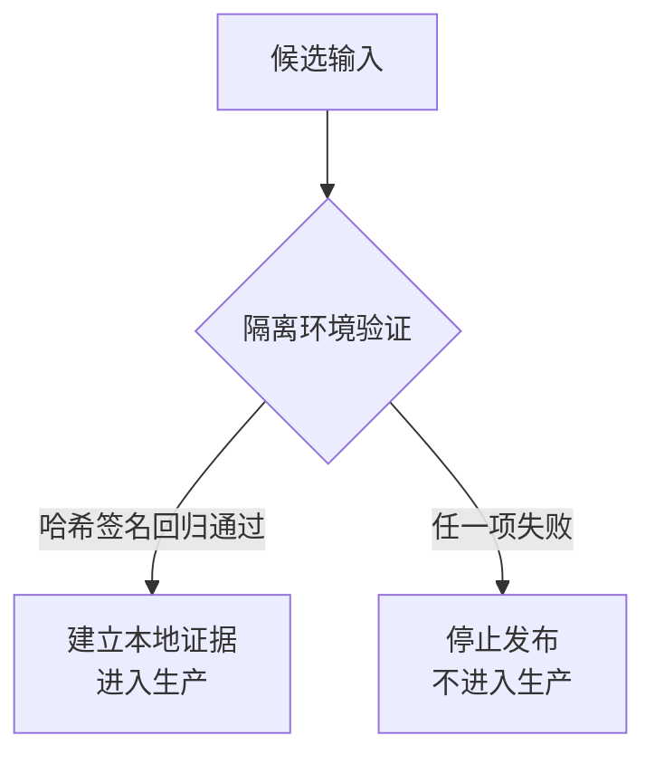
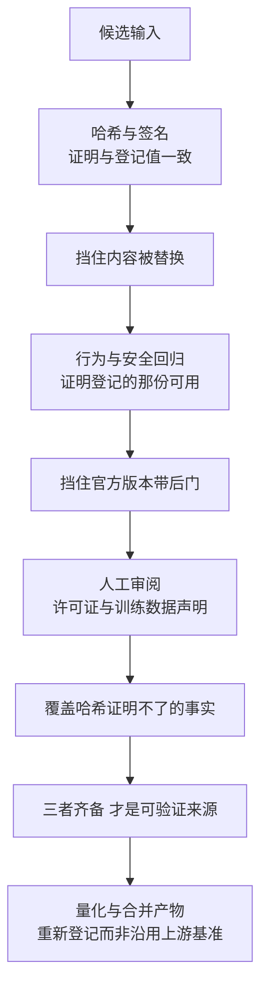

# 模型与数据供应链需要可验证来源

**下载成功不等于**来源可信**。**模型、数据、容器和插件都可能在半路被换掉，而下载过程不会告诉你**。**读完这篇你能给依赖配上可验证来源，也知道哈希（把任意长度数据压成固定长度指纹、不可逆）和签名（用私钥对数据生成可验证的防篡改标记）门禁该挡在哪一步**。

**它解决的是「下载成功」被误认为「来源可信、内容未被替换、许可证可用」的问题**。**核心做法是把模型、tokenizer（分词器，把文本切成模型可处理单元的程序）、数据、容器、驱动和插件绑定发布者、版本、hash、许可证和构建证明，再在断开生产网络、不接真实数据的临时环境里，重跑一遍行为与安全回归测试（回归测试指把当前版本和已知正确的版本对比，确认没变差）；最小实验是替换一个权重或加载脚本，确认哈希/签名门禁能阻止发布**。

**模型权重、tokenizer、adapter（适配器：不动基座权重、只训练一小部分参数来做微调）、embedding（向量表示，把词或样本转成数值向量的数据）、数据集、容器、CUDA（NVIDIA 的 GPU 计算平台）/驱动、插件和工具包都可能被替换、投毒或带来许可证风险**。**下载成功不等于来源可信**，仓库热度也不等于**可复现和可维护**——人气高只说明用的人多，不代表构建步骤被完整记录（不可复现），也不代表作者会持续修复漏洞（不可维护）。

## 供应链为什么必须有可验证来源

**下载完成、校验文件存在、版本号看起来正确，这三点都不足以说明来源可信、内容未被替换、许可证允许当前用法**。**本篇回答：模型、分词器、数据、容器、驱动与插件的可信依据是什么、哈希与签名在哪一步生效、隔离环境要做哪些回归，以及缺证据时怎样阻止发布**。

## 这套机制到底在管什么

**模型与数据供应链里，权重、分词器、数据与容器的字节内容决定加载之后的行为，而下载成功只说明传输完成**。**哈希与签名证明内容与其登记值一致——像封条，证明没被拆过；行为回归证明登记的那一份在功能上符合预期——像当场试用，证明能正常工作**。**两者挡的风险不同：封条挡调包，试用挡以次充好，各不相同**；**量化（把模型权重从高精度数值转成低精度以减小体积，会改动每个数值）会改写权重数值，字节内容变了哈希就变，所以量化与合并之后哈希必然变化，需要重新登记而不能沿用上游基准**。

## 供应链身份由什么构成

**「发布成功」与「来源可信」的关系，报纸堆给了最日常的对照：一份印好的报纸外观完整、内容自洽，但它的可信度完全取决于哪家印的、哪个版本、有没有被中途换过版——读者从不因为"报纸印出来了"就相信头条，他们认报名、认日期、认版本**。**模型供应链里的权重文件和这份报纸一样：下载完成只说明"印出来了"，来源组织、版本、校验和（对数据算出的指纹，用来发现传输或存储中的损坏）、构建方式才是"哪家印的哪一版"**。**仓库热度对应的是报纸的发行量——发行量大从不等于内容可验证**：


*图源：Wikimedia Commons，Daniel R. Blume，CC BY-SA 2.0，https://commons.wikimedia.org/wiki/File:A_stack_of_newspapers.jpg。*

**每个输入记录发布组织、仓库/版本、校验和、许可证、依赖、构建方式、训练数据声明、已知限制和获取时间**。**产物要能一路反查到它对应的源码版本、构建配置和构建环境记录**；**签名/证明验证失败时停止发布，不能以「镜像内容看起来一样」替代**。

## AI 带来了哪些特有风险

**SLSA（软件制品供应链安全等级框架，定义来源可信的阶梯）官方的威胁模型图把整条供应链画成 Producer→Source→Build→Distribution→Consumer 五段链条，每一段上方都标着红色的篡改点：源码仓库可以被提交恶意改动、构建环境可以被注入、分发渠道可以掉包——这五段链条加上汇入构建的依赖项，构成完整的依赖链；任何一个节点失守，下游拿到的就不再是上游验证过的那份**。**模型与数据供应链与之同构（结构一致）：同样经过这五段，权重、分词器、数据集沿链流转**。**图上标红色篡改点的每个节点，就是本篇门禁要卡住的位置**：


*图源：[SLSA 官网](https://slsa.dev/)（slsa.dev），SLSA 项目，Apache 2.0。*


*图源：Torres-Arias 等《in-toto: Providing farm-to-table guarantees for bits and bytes》USENIX Security 2019 论文 Figure 1，[论文 PDF](http://ssl.engineering.nyu.edu/papers/torres-toto-usenix19.pdf)。图上每个步骤都绑定了具体执行者和签名密钥，任何一步的产物被调包，最终 inspect 验证 link metadata 时都会失败——这是「签名/证明验证失败时停止发布」的完整实现，Sigstore、SLSA 的来源证明（provenance，记录产物由谁在什么环境构建出来的证据）都建立在这一模型上。*

- **恶意或污染的微调数据改变拒答、工具和隐私行为**。
- **量化、LoRA（低秩适配：只训练一小撮新增参数就能让大模型学会新任务）、合并权重和转换脚本可能引入后门或数值回归——合并把多份权重叠加，若其中一份带恶意改动，结果即携带后门**。
- **模型仓库中的自定义代码、pickle（Python 的一种序列化格式，加载时会执行其中的代码）/序列化（把内存对象转成可存储或传输的字节格式的过程）和插件可能在加载时执行**。
- **训练/评测数据许可证、个人信息和版权声明不能由模型卡片自动证明**。

## 门禁该卡在哪一步

**门禁要能独立取到被验证对象**。**大体积产物放在外部存储，流转的只是引用与校验值——随产物一起传来的哈希声明可能被同一个人改过，和文件本身一起造假**；**验证方拿引用独立取回原件再算哈希，才能确认没被串改**。


**门禁下载在隔离环境完成；优先安全序列化格式和只读加载；扫描依赖、镜像、权重哈希和许可证；运行静态、行为、安全、泄露和越权（访问了权限范围之外的资源）回归**。**供应商或社区发布只提供候选输入，进入生产前必须建立本地可验证证据**。**格式层的下钻——为什么 pickle 基格式的风险无法靠扫描修复、safetensors（一种默认不执行代码的权重存储格式）如何按设计消除攻击面——见** [[工程知识/AI 系统工程：从模型能力到生产能力/安全与治理/模型权重文件是可执行输入：从 pickle 信任模型到格式即边界]]。



## 一个字节的差距能造成什么

**"看起来一样"与"确实一样"之间的差别可以小到一个比特**。**下面这段对 11000 字节的权重文件翻转第 7 个字节，文件长度完全不变**：

```python
import hashlib, json

LOCK = {"weights.bin": "<发布时登记的 sha256>"}

def gate(path):
    actual = hashlib.sha256(open(path, "rb").read()).hexdigest()
    return actual == LOCK["weights.bin"]
```

门禁在三种改动情形下的表现对照如下：

| 情形 | 文件大小 | 改动字节 | 门禁 |
| --- | --- | --- | --- |
| 原始权重 | 11000 | 0 | 放行 |
| 翻转第 7 字节 | 11000 | 1 | **拦截** |
| 回滚（把系统恢复到上一个可用版本）原始 | 11000 | 0 | 放行 |

**改动量是 1/11000，文件大小、目录列表、下载耗时全部一致，只有哈希不同**。**这就是为什么"镜像内容看起来一样"不能作为放行依据——人眼和 `ls` 都看不见这个差别，而它足以改变模型行为——权重每个字节都直接参与计算，翻一位就改变该位置的数值，输出随之偏移**。

**单字节实验只覆盖了一层风险；来源可信要由三类证据分工，各自挡住不同的失效，分工见下图**：



**对照上面的流程图，三类证据像三层门卫，各挡一层失效：查封条与证件的（哈希与签名）防冒名顶替——只证明与登记时一致、来自声称的发布者，不证明登记的那份本身无害；试功能的（行为回归）防次品——证明这份真能正常干活；查执照的（人工审阅）防违规——许可证与训练数据声明靠它核对**。**分工清楚了，才能说清为什么哈希通过仍不等于安全**。

## 失效长什么样

[[工程知识/缺陷分析：从个案到体系/安全/案例五：安全两例——认证绕过与带漏洞依赖]] 里，带漏洞的依赖通过正常的依赖解析进入构建——它没有被"替换"，它就是被声明的那个版本。这类风险绕过了完整性检查，因为内容确实与来源一致，问题出在来源本身的选择上。

[[工程知识/缺陷分析：从个案到体系/安全/案例二十六：公告栏没查门禁——Redis 的 ACL 键名泄露与解析崩溃]] 展示了另一个断点：凭据与键名在错误信息里被完整暴露。供应链门禁管的是"进来的是什么"，而事故后处理往往卡在"已经泄露出去的怎么收回"——凭据和缓存已被下游系统读取并使用，散布在多处且可能已生效，而一个文件只需删改一处，所以撤销缓存和凭据比撤回一个文件困难得多。

## 这套说法在哪儿会失效

**这套门禁的前提是存在可信的登记基准**。**以下情况它会失效：首次引入某个来源时无基准可比对（此时只能依赖签名与发布者信誉，属于候选输入而非已验证输入）**；**来源方自身被入侵并发布了带后门的"官方"版本（哈希一致但内容恶意，需行为回归兜底）**；**以及量化、合并、转换等二次加工产物——它们的哈希必然与上游不同，必须重新登记而非沿用上游基准**。

**许可证与训练数据声明不能由哈希证明，也不能由模型卡片自动证明**。**它们属于声明性事实，需要人工审阅与法律判断**。

## 怎么自己动手验证

**来源可信度要与哈希门禁对账，可以这样自测：预写「替换一个权重或加载脚本后发布应被拦下」，若实测能发布出去，与预期对不上——被替换的权重没被哈希或签名比对到，说明门禁检查的是别的环节而非产物字节本身**。

- **替换一个权重或加载脚本，确认哈希/签名门禁能阻止发布（上面的单字节实验即最小版本）**。
- **检查量化、LoRA、合并产物的哈希是否被重新登记，而不是沿用上游基准**。
- **加载阶段验证是否禁用 pickle 反序列化、是否只读挂载**。
- **事故演练：冻结版本指针后，确认 embedding、缓存、索引等下游状态能够定位并撤销**。

## 出了事故该怎么处理

**发现来源撤回、漏洞或权重异常时，冻结版本指针，定位受影响的模型/数据/镜像/索引，撤销缓存和凭据，回退到已验证组合，并保留审计记录**。**不要只替换模型文件而忽略由其生成的 embedding、缓存和下游状态**。

关系：[[工程知识/AI 系统工程：从模型能力到生产能力/数据与MLOps/模型发布需要注册、灰度与回滚]] · [[工程知识/软件构建：让变化可以理解、验证与交付/测试与交付/发布门禁必须绑定真实证据]]

