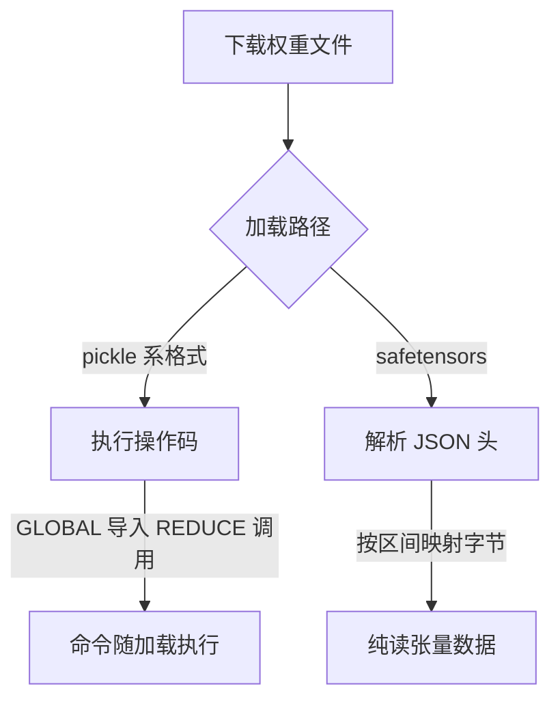
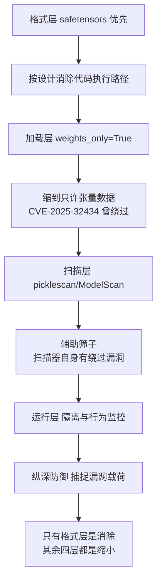

# 模型权重文件是可执行输入

一个 `.pt` 权重文件看起来是数据，**加载它却在跑代码——`torch.load()` 反序列化 pickle 时会执行文件里内嵌的可调用对象**。读完这篇你能判断手上的模型文件该不该直接加载，知道该换成 safetensors（纯张量数据格式，加载时不执行代码）还是加 `weights_only=True`（只重建张量数据、不执行任意对象的加载开关），以及**为什么换完格式仍不能证明权重没被下毒**。

## 开头先记住哪几条结论？

| 维度 | 回答 |
| --- | --- |
| 要解决的问题 | 模型文件被当作"被动数据"对待，但 pickle 基格式在加载时执行任意代码，依赖的信任模型与可执行文件相同。明确"格式即信任边界"才能把 AI 供应链治理贯穿到加载路径上。 |
| 本质 | `.pt/.pth/.bin/.ckpt` 文件本质是 pickle 字节流，内嵌可调用对象在 `torch.load()` 反序列化时执行；这属于文档化的设计行为，不算漏洞。 |
| 做法 | 加载侧：默认 safetensors，旧格式加载必须 `weights_only=True`，未验证文件在隔离环境加载；传播侧：发布仓库强制 safetensors，仓库扫描工具仅作辅助。 |
| 效果与代价 | 效果是攻击面按设计消除而非靠扫描缓解；代价是存量转换成本、多卡分片（把数据按规则切开存到不同节点）与自定义代码（`modeling_*.py`）仍需单独治理。 |
| 边界 | safetensors 只消除了"加载即执行"这条路径，不能证明权重未被投毒（行为篡改藏在数值里），自定义代码、adapter、数据集仍按可执行输入对待。 |
| 验证 | 拿一个旧格式文件用 `pickletools.dis` 看到可见的 GLOBAL/REDUCE 操作码；对比 safetensors 头部 JSON 与 raw bytes 结构；跑一次"恶意 pickle 反弹 shell"与"同名 safetensors 无代码路径"实验。 |

## pickle 是怎么在加载时执行代码的？

打个比方：加载一个模型权重文件，像拆一封信——如果信封里除了信纸还可能藏着一枚会自己弹出的刀片（pickle 里能带可执行代码），那"这封信是谁寄的"就比"信上写了什么"更要紧；换成只装信纸的透明袋（safetensors 这类纯数据格式），刀片就塞不进来。这个比喻到"格式本身就是边界"为止：具体哪些格式安全、怎么校验哈希（把任意长度数据压成固定长度指纹、不可逆）与签名（用私钥对数据生成可验证的防篡改标记）、加载时要隔离哪些权限，要看正文。

**pickle 是一个基于栈的虚拟机（PVM），反序列化时按操作码流重建对象。**核心风险操作码：

- **GLOBAL**：**从任意模块导入可调用对象**（如 `('subprocess', 'Popen')`）。
- **REDUCE**：从栈上弹出一个可调用对象和参数元组，**调用它**。`__reduce__` 方法返回 `(callable, args)`，**unpickler 直接执行**。
- **STACK_GLOBAL**：GLOBAL 的 2.x 高效变体，**绕过部分只匹配 GLOBAL 的扫描器**。

```python
# 生成一个加载即执行命令的 .bin 文件（仅演示，勿分发）
import pickle, subprocess

class Weaponized:
    def __reduce__(self):
        return (subprocess.Popen, ("touch /tmp/pwned", {"shell": True}))

with open("pytorch_model.bin", "wb") as f:
    pickle.dump(Weaponized(), f)
# 任何 torch.load("pytorch_model.bin") 都会在重建对象时执行该命令
```

这条路径不是漏洞：Python 官方文档明文写着 "The pickle module is not secure. Only unpickle data you trust."。PyTorch（Meta 开源的深度学习框架，用于模型训练与推理）的 `.pt/.pth/.bin/.ckpt` 底层就是 pickle，**`torch.load()` 继承全部风险**。JFrog 2024 年在 Hugging Face 扫出约 100 个含恶意代码执行模式的模型，其中 goober2/baller13 的 `__reduce__` 嵌入（把文字或对象映射成向量、语义越近向量距离越近）反弹 shell，连回攻击者的 C2 远程控制服务器。**平台的防线是扫描加标记，不是拦截——被标记的文件仍然可以下载**，这是「格式即边界」缺失时的现实形态：


*图源：JFrog Security Research《Data Scientists Targeted by Malicious Hugging Face ML Models with Silent Backdoor》（2024）配图，https://jfrog.com/blog/data-scientists-targeted-by-malicious-hugging-face-ml-models-with-silent-backdoor/，文档引用。*

这批恶意模型的载荷分布有实测统计：**近半数是潜在对象劫持即 potential object hijack，恶意对象在反序列化时被激活、接管程序控制流**；反弹 shell——攻击者从远端连回来、获得本机命令行权限——约两成，其余散布在文件写入、软件启动、pickle 反序列化等类别——**扫描拦得住已知的恶意模式，拦不住 pickle 格式本身允许的任意代码执行能力**——比如用新的混淆手法构造的 `__reduce__` 载荷：


*图取自上面同一份 JFrog 安全研究报告的载荷类型分布统计（Payload Types distribution），报告链接同上。*

同一个权重文件按两种格式加载，结局在加载那一刻就已分岔：



**pickle 链上每一步都是格式设计好的行为：反序列化即执行，`GLOBAL` 导入、`REDUCE` 调用，攻击载荷走的就是这条正常加载路径**。safetensors 链从 JSON 头直接取张量字节，**整条链没有一处可以执行代码**——这就是"攻击面按设计消除"的含义。

"载体上只有数据、不存在指令"有上百年的实物先例。下图是一卷穿孔纸带：载体的全部信息就是孔位的有无，读带机逐行读过去，任何位置都不可能"执行"出孔位之外的语义——想把一段恶意程序塞进这卷纸带，只能以数据的形式被读出，无法以指令的形式被执行。safetensors 相对 pickle 的差异，正是把权重文件从"可执行载体"改回了"纸带式纯数据载体"。纸带比喻只说明「纯数据无指令」这一层，如何校验与隔离见正文。


> 图：穿孔纸带卷，来自 [Wikimedia Commons](https://commons.wikimedia.org/wiki/File:Punched_paper_tape_roll.jpg)，CC BY-SA 4.0，摄影 Jud McCranie。

口岸边检给"格式即边界"提供了一个具体流程可以完整讲清的实物：查验护照（格式检查）通过后盖章放行（加载执行），但章只证明**入境那一刻证件与人的对应关系成立**，**持证人在境内的行为不在这枚章的担保范围内**——行为问题要靠境内的另一套机制处理。落到 safetensors 上分两句说：其一，**章盖在加载入口，文件里没有指令流，加载这一步无法执行代码**。其二，**权重数值里是否藏着被投毒的行为不归这枚章管，要靠加载后的评测与行为审计接手**。边检比喻只说明格式检查与加载执行的对应关系，数值投毒的检测见正文。

## 为什么格式本身的信任模型就是边界？

safetensors 的安全主张是"让攻击无法表示"。文件里只有头部长度、JSON 头和张量字节，加载路径读的是什么，结构图一目了然：


头与数据的布局如下：前 8 字节是 JSON 头的长度，JSON 头逐个声明张量的 dtype、shape 与字节区间，其余部分是原始张量数据。整份文件里没有操作码流，也没有可调用对象，`__reduce__` 无法藏进一个"没有代码概念"的格式。图取自 Hugging Face 博客 [Common AI Model Formats](https://huggingface.co/blog/ngxson/common-ai-model-formats)。

- 文件 = 8 字节头长度 + JSON 头（tensor 名、dtype、shape、字节区间）+ raw bytes。
- **格式里没有代码的概念**：**没有操作码流、没有可调用对象、没有 import 路径**。`__reduce__` 无法藏进一个"没有代码概念"的格式。
- 代价边界也要摆明：数值投毒（后门权重）照常可表示，**格式安全不等于内容安全**。

| 对比维度 | pickle 系（.pt/.pth/.bin/.ckpt） | safetensors |
| --- | --- | --- |
| 反序列化行为 | 执行任意 Python 代码 | 仅读取张量数据，无代码执行路径 |
| 信任模型 | 与可执行文件同级：只加载可信来源 | 与图像/文档同级：数据文件 |
| 调用链 | torch.load → pickle.load → PVM | load_file → mmap（内存映射，把文件直接映射到进程地址空间按需读取）+ JSON 解析 |
| 静态扫描可行性 | 本质不安全格式靠扫描缓解，扫描器可被绕过 | 无需扫描，攻击面按设计消除 |

与软件供应链的映射关系：**pickle 系格式对应"安装脚本"**，即 npm install（npm：Node 的包管理器）时的 preinstall hook——npm 在安装包之前自动运行的脚本，以当前用户的权限执行；**GGUF（llama.cpp 使用的模型文件格式）的 Jinja2 chat template 对应"软件包里带一个待渲染的模板"**——聊天模板在加载时由 Jinja2 引擎渲染——Jinja2 模板语言本身允许嵌入表达式与函数调用（模型按约定参数格式请求执行外部工具的机制），**渲染即执行这些表达式，所以聊天模板本身就是一条代码执行路径**；渲染引擎若未沙箱化，模板中的代码就会被执行，llama.cpp 生态同样代码执行。这个映射的用途是举一反三：**判断一个新格式安不安全，看它加载时有没有"调用任意可调用对象"的路径**。

## 加载侧为什么要分五层设防？

分层是把格式、加载、扫描、运行、溯源这几道性质不同的关口分开，前一道失效还有后一道兜底。


| 层 | 动作 | 依据 |
| --- | --- | --- |
| 格式层 | 发布与加载默认 safetensors；存量分批转换 | 攻击面按设计消除 |
| 加载层 | 必须加载旧格式时 `torch.load(..., weights_only=True)`（PyTorch 2.6+ 默认）；未验证文件在隔离环境加载 | 缩小但非消除（CVE-2025-32434 曾绕过 weights_only） |
| 扫描层 | picklescan/fickling/ModelScan（专门检测 pickle 恶意载荷的扫描工具）做辅助筛子 | 扫描器本身有绕过漏洞（JFrog 2025 披露 3 个 zero-day——厂商尚未发布补丁的漏洞），不能当主防线 |
| 运行层 | 加载环境网络隔离、行为监控（出站连接、进程派生、文件写） | 纵深防御，捕捉漏网载荷 |
| 溯源层 | 按仓库 commit hash 锁定 + SHA-256（256 位摘要的安全哈希算法） 校验 | 与 [[工程知识/AI 系统工程：从模型能力到生产能力/安全与治理/模型与数据供应链需要可验证来源]] 的发布者绑定互补 |

**五层按"拦不住什么"排下来，不是并列的备选项**



关键区别在表格第三列的措辞：**格式层是"按设计消除"，加载层是"缩小但非消除"**。safetensors 只有头部元信息与裸张量字节，**没有指令流，也就没有让加载器去调用某个函数的通路**；`weights_only=True` 则是把允许重建的对象范围收窄，CVE（Common Vulnerabilities and Exposures，公开披露的安全漏洞编号）-2025（2025 年披露的漏洞编号）-32434 曾绕过它。**扫描层与运行层都不能当主防线**——扫描器本身有绕过漏洞，JFrog 在 2025 年披露过三个 zero-day（厂商尚未发布补丁的漏洞）。溯源层回答的是另一个问题：**commit hash 加 SHA-256 能证明文件来自谁，证明不了文件里有什么**，所以它必须与前四层叠加使用。

## 这篇和供应链既有文章各管哪一段？

[[工程知识/软件构建：让变化可以理解、验证与交付/开发工具/依赖供应链需要锁定来源与构建输入]] **锁"物"的层面（版本/hash/签名/构建输入）**，[[工程知识/AI 系统工程：从模型能力到生产能力/安全与治理/模型与数据供应链需要可验证来源]] **建立了模型供应链的输入清单**，本篇下钻到**加载路径的格式层**：**为什么 safetensors 之前的问题无法靠扫描修复，以及"格式即边界"的判断框架**。

## 怎么动手验证加载即执行？

- **pickle 可视化**：`python -m pickletools.dis model.bin`（pickletools 是 Python 自带的 pickle 操作码反汇编工具）看 GLOBAL/REDUCE 操作码流。预期：能识别导入的可调用对象，包括 `subprocess`、`os.system` 等危险符号。
- **格式对比实验**：同一 state_dict（模型全部参数与缓冲张量的集合）分别存为 `.bin` 与 `.safetensors`，hexdump 对比头部。预期：`.bin` 头部包含 pickle 操作码流；`.safetensors` 头部是纯 JSON + tensor 字节区间。
- **加载行为实验（隔离环境）**：生成武器化 `.bin` 在容器里 `torch.load`，观察预设的 touch 文件是否被创建。预期：文件被创建（证明加载即执行）；同一载荷无法用 safetensors 表示。

关系：[[工程知识/AI 系统工程：从模型能力到生产能力/安全与治理/模型与数据供应链需要可验证来源]] · [[工程知识/软件构建：让变化可以理解、验证与交付/开发工具/依赖供应链需要锁定来源与构建输入]] · [[工程知识/软件构建：让变化可以理解、验证与交付/开发工具/维护者信任是供应链信任的地基：贡献者治理与维护者变更审计]] · [[工程知识/缺陷分析：从个案到体系/安全/案例四十四：投毒不是写错，是写给你看——依赖投毒的三个真实剧本]]