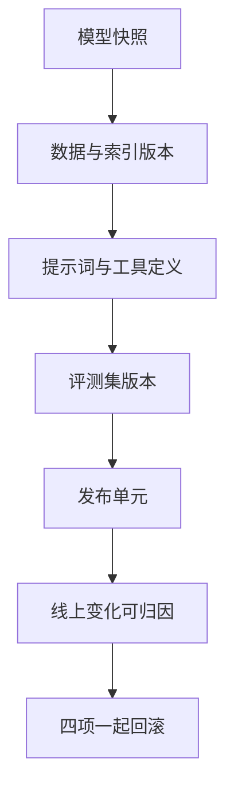

# AI 平台必须统一模型、数据、评测与发布版本

**线上结果变了，却说不清是哪一版提示词（发给模型的输入指令与背景信息）、哪一份索引造成的——因为这些东西各自发布，没人把它们绑成一个版本。读完这篇你能把模型、数据、提示词和评测绑成可重放单元（用完全相同的输入原样复现一次线上行为），让回归可定位、改动可比较。**

AI 平台（承载模型训练与服务的软件系统）要解决的问题是：模型、索引、提示词、工具和评测各自发布，最后无法解释线上结果来自哪一组输入。核心机制是把这些对象绑定成可重放发布单元，再通过灰度（先放小流量再逐步放大的发布方式）、观测（持续采集线上指标以判断版本表现）和回滚（把系统状态退回到改动之前的版本）来切换版本；收益是**问题可定位、改动可比较**；代价是**注册、存储和发布门禁复杂度增加**。

**AI 服务的一个「版本」从来不只是模型文件。实际行为由模型、推理参数（推理时设定的温度、最大长度等可调设置）、提示词、工具、检索索引、业务代码和安全策略共同决定。只记录镜像标签，无法解释回归，也无法可靠回滚。**

## 这些对象怎样绑定成一次可重放的发布单元？

模型、索引、提示词、工具与评测集各自独立发布，线上结果出现变化时无法判断是其中哪一项改动的结果，也无法在原条件下重现。本篇回答：这些对象怎样绑定成一次可重放的发布单元、灰度与观测按什么粒度进行、回滚要恢复哪些对象，以及版本注册带来的开销由哪些环节承担。

## 可重放发布单元是什么？

一个可重放的发布单元要把数据、训练、评估、注册与部署串成一条能原样重跑的链路，让每次线上行为都能追溯到是哪一版数据、训练、评估、注册与部署产生的。下面这张 MLOps（机器学习的工程化方法，覆盖从数据到部署的完整流程）参考架构给出了各阶段的连接关系。


*图源：Microsoft Learn 中文文档，CC BY 4.0，https://learn.microsoft.com/zh-cn/azure/architecture/ai-ml/guide/machine-learning-operations-v2。*




四条线各自独立发布时，线上结果的变化无法归因——把它们绑进同一个发布单元，是这个 YAML（用缩进表示层级结构的配置文件格式） 配置（一种用缩进描述数据结构的配置文件格式）想做的事。打个比方：银行的保管箱库给"统一登记的版本对象"提供了实物：每个箱有唯一编号，箱门铭牌与登记簿一一对应；开箱需要银行钥匙加租户钥匙两把（发布门禁），任何一格被打开过、何时打开、谁开的都查得到登记（归因）。没有统一编号与登记的保管箱墙，一格被动过就无法回答"谁在什么时候动了它"——模型、数据、提示词、评测四类对象各自发布而无统一版本登记时，线上行为变化的处境与此相同。这个比喻只说明统一登记与归因，不涉及具体的存储结构与发布流程。

```yaml
release:
  application_revision: git-sha
  model:
    provider: provider-name
    name: model-name
    snapshot: immutable-id
    serving_runtime: runtime-version
    quantization: format-and-calibration
  context:
    prompt_version: prompt-v7
    tool_schema_version: tools-v4
    retrieval_index: corpus-2026-08-31@embedding-v3
  policy:
    authorization: policy-v5
    guardrails: guardrails-v2
  evaluation:
    suite: support-prod-v12
    result: eval-run-id
```

**版本引用必须不可变；「latest」（指向最新版本的动态标签）只能用于发现候选，不能用于证明一次线上行为。**

## 控制面与数据面怎么分工

**控制面管理模型注册、发布策略、容量、路由、配额和回滚；数据面实际处理请求、检索、模型推理和工具执行。**可以类比餐厅：控制面是前台接单、排桌与退单的规则，数据面是后厨实际做菜——前台瘫痪不应让正在做的菜停火，这个比喻到「规则与执行分离」为止，不涉及具体实现。**两者分离后，控制面故障不应立刻中断已部署服务，数据面也不能自行改变授权或发布版本**；图中从观测指回控制面的反馈回路，是 Trace（记录一次请求经过的各步骤及其耗时）与 SLO（服务等级目标：内部设定的具体指标值）的指标回流，用于判断是否继续放量或回滚。

~~~mermaid
flowchart TD
    R[版本注册与评测] --> C[发布控制面]
    C --> G[流量路由与配额]
    G --> D1["推理副本 A（第一层设计决策）"]
    D1 --> D2["推理副本 B（第二层设计决策）"]
    D2 --> O[Trace 与 SLO 的反馈]
    O --> C
~~~

「统一入口」落到产品形态上就是平台控制台：Kubeflow 的 Central Dashboard 把 Notebooks、Pipelines、Katib 调参与 KServe 端点挂在同一个侧栏里，Pipeline Runs 列表直接记录每次运行的版本与状态——实验、训练、部署、评测同在一个登记体系里，这是「绑定成可重放单元」在开源平台的实物形态：


*图源：[Kubeflow 官方文档 Architecture](https://www.kubeflow.org/docs/started/architecture/)，Kubeflow 项目，CC BY 4.0。*

Kubernetes（容器编排系统，负责调度容器与滚动发布）能调度 GPU、维护副本和执行滚动发布，但它不了解模型质量、KV cache（Key-Value 缓存：缓存注意力机制里已算过的键值对，避免每步重算）容量、token（模型处理文本的最小单位，约相当于一个词或半个词） SLO 或提示词兼容性——这些运行时指标不在它的视野内。Ray Serve、vLLM、TensorRT-LLM 等推理框架可以承担部分服务与运行时能力，但它们只管运行、不记录版本对象，所以仍需应用自己定义版本、评测和回滚门禁。

## 发布流程该怎么走

1. 离线回归：任务结果、检索、工具、安全、延迟和成本同时达到预设的合格标准。
2. 影子流量：新版本处理真实输入但不影响用户，比较分布和资源。
3. 小流量灰度：按用户或会话等稳定标识分组（分桶），避免同一会话跨版本漂移。
4. 逐步放量：每一步都有最短观察窗口和自动停止条件。
5. 回滚：恢复完整发布单元；若索引或数据 schema 不兼容，需要双读/双写（新旧两份数据同时读取或同时写入，切换完成后再撤旧份）或向后兼容期。

影子流量、小流量灰度、逐步放量在平台层的标准实现是一 stamp（相互隔离、自包含的完整部署单元）一版本的隔离部署：


*图源：Microsoft Learn 云设计模式 Deployment（Kubernetes 里管理无状态应用副本与滚动更新的控制器） Stamp pattern，CC BY 4.0，https://learn.microsoft.com/en-us/azure/architecture/patterns/deployment-stamp。流量在 stamp 之间整体搬运，某个 stamp 有问题就整组摘掉，回滚等价于把路由指回旧 stamp，不存在新旧对象混杂的中间态——这正是「恢复完整发布单元」的基础设施形态。*

## 多模型路由要考虑什么

路由器决定每个请求走哪个模型，可以按任务、风险、模态（文本、图像、音频等输入类型）、上下文长度、延迟预算和成本选择模型。路由器本身也要版本化和评测。最便宜模型不一定带来最低总成本：更差的工具选择、更长轨迹和更高重试率可能抵消单次 token 价格。

## 统一版本换来什么、要付出什么代价？

统一发布单元后，收益具体落在三个动作上：回归定位、回滚与审计。

1. 回归定位：对比两次发布单元的差异项，排查范围从全量缩到改动对象。
2. 回滚：还原完整对象组，四项一起回滚，提示词或索引单独出错时不再连带重启全部组件。
3. 审计：回答「当时线上跑的是哪一组版本」。

代价由平台侧承担：注册中心要为模型快照、索引版本和评测结果提供不可变存储，发布门禁要在每次上线前核对全部对象的兼容性，这套基础设施对小团队是固定开销。这套收益存在一道发布频率门槛，原因在于注册与发布门禁的维护是固定成本、不随发布次数变化，发布越频繁，单次分摊越低——发布频率足够高时，定位与回滚省下的时间才盖得过维护成本（盈亏平衡的发布次数 = 固定维护成本 ÷ 单次发布省下的排查时间，超过这个次数统一版本才合算）。发布频率低、对象组成简单的服务，可以先用「镜像标签加版本清单文件」的简化形态，保留对账能力，暂缓自建注册中心。

## 容量与故障该怎么看

- 预热（上线前提前加载数据或建立连接，避免初期变慢）模型和关键 kernel（模型推理用到的底层计算程序），冷启动（实例刚拉起、还没进入正常服务的阶段）的表现不能混进稳态（正常运行状态）的 SLO 统计。
- 扩缩容同时看队列、token 速率、KV cache 和长尾，不只看 GPU 利用率。
- 模型 Provider（提供推理能力的云服务方）或集群故障的回退要验证模型能力、数据边界和输出约定是否兼容。
- 取消、限流（控制单位时间放进来的请求数量，超过配额就拒绝）和 admission control（准入控制：入队前判断系统还接不接得住）要在耗尽显存（GPU 上的内存、模型参数与计算中间结果都存这里）前生效。
- 日志、提示词和检索内容按敏感度采集，不能为了可观测性（通过系统对外输出判断内部状态的能力）复制全部业务数据。

准入控制在耗尽显存前生效，靠的是每个推理副本暴露健康探测端点，由负载均衡器持续判定实例能否继续接流量：


*图源：Microsoft Learn 云设计模式 Health Endpoint Monitoring pattern，CC BY 4.0，https://learn.microsoft.com/en-us/azure/architecture/patterns/health-endpoint-monitoring。推理服务（把模型包装成可调用的在线服务）把 KV cache 余量、队列深度、显存水位（队列或资源的当前占用程度）塞进健康检查的返回里，负载均衡器就能在实例真正耗尽资源前把它摘出流量池——这是 admission control（准入控制）的探针（向系统注入的检测点或检测请求）来源。*

发布单元要与版本四元组（模型、数据、评测、代码这四个版本）对账——预先约定：给定一个运行版本，应能还原模型、数据、评测与代码四个版本，任一版本还原不出或与预期对不上，该发布就不算可重放。

## 接下来该读哪几篇相邻问题？

- [[工程知识/AI 系统工程：从模型能力到生产能力/推理服务与平台/推理服务的核心矛盾是延迟、吞吐、显存与质量]] · [[工程知识/软件构建：让变化可以理解、验证与交付/测试与交付/发布门禁必须绑定真实证据]]
