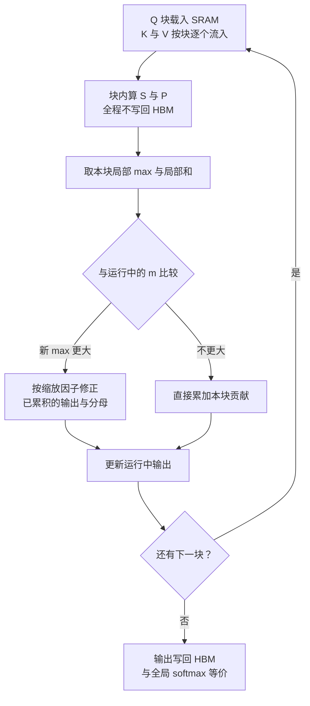
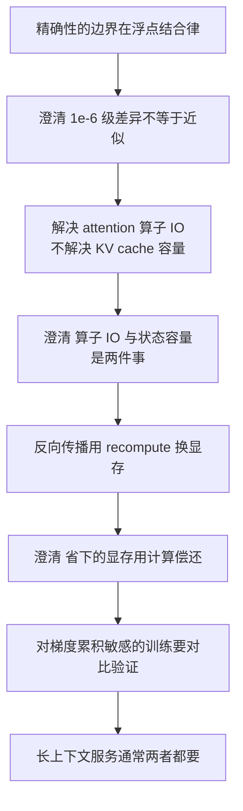

# FlashAttention是IO感知的精确算法，不是近似

这篇讲 FlashAttention：读完你能说清**长序列推理提速卡在哪一层读写，也知道换算子会不会改变模型结果**。**同一个模型同一个序列长度，注意力（模型为每个词分配权重、聚焦上下文中最相关部分的机制）算子时间的差距能到倍数级——差距来自显存读写次数**。**标准 attention（注意力，模型对每个位置回看全部前文并按相关度加权的机制）把 N×N 中间矩阵写进 HBM 再读回来，FlashAttention 用 tiling（分块：把大矩阵切成能放进高速缓存的小块）从头到尾不物化这个矩阵，是 IO 感知的精确算法，不是近似**。

这篇要解决的问题：**理解为什么显存读写（不是 FLOPs，浮点运算次数）才是注意力算子的瓶颈**，**tiling 与 online softmax（在线 softmax：分块时逐步缩放归并的归一化技巧）怎么消除中间矩阵物化**，以及**怎么验证它真的数值精确、显存峰值真的降了**。

FlashAttention 的本质，是**提高每次访存摊到的计算量（算术强度），并让数据尽量留在高速层级里完成计算，减少慢速搬运**——存储层级指 GPU 内部从寄存器、SRAM（静态随机存取存储器，CPU 缓存用的存储类型）到 HBM 速度递减、容量递增的多层结构。

**衡量这根链条两端的指标分别是算力与带宽**：算力以 TFLOPS（Tera FLOPs，每秒万亿次浮点运算）计，数值越高算得越快；数据传输带宽以 TB/s（Terabyte per second，每秒传输的万亿字节数）计，数值越高每秒搬运的数据越多，此处理论峰值指 HBM（High Bandwidth Memory，高带宽显存：GPU 上存放模型参数与中间结果的显存芯片）的读写带宽。**两边的增长速度差距逐年拉大——这意味着仅靠提升硬件难以缓解，算法层面减少数据搬运才是出路**。

拿 attention 来看：**计算量是 O(N²d)，显存读写是 O(N² + Nd)**——d 是每个注意力头的特征维度，N 是序列长度；这里的 O(...) 表示随 N 增长的量级关系。d 远小于 N 时计算量增速虽快，但算术强度低（每次访存能摊到的计算量少）意味着**每次搬运的数据只做少量运算，搬运成本远超计算成本**，因此 **attention 的实际耗时由读写次数决定，而读写的大头正是被物化的中间矩阵**。

这就是下面要展开的瓶颈。在具体实现中，标准实现把 N×N 的 S 矩阵（注意力分数，Q 乘 K 转置的结果）和 P 矩阵（softmax 归一化后的权重）反复写入 HBM 再读回，**时间就花在了最慢的那一层**。

以英伟达两代数据卡 V100、A100 为例：V100 算力约 125 TFLOPS、带宽约 0.9 TB/s；A100 算力约 312 TFLOPS、带宽约 1.5 TB/s——**算力约翻三倍，带宽从 0.9 提升到 1.5 TB/s，提升不到七成**。**标准实现里每个加载的元素只参与少量运算（算术强度低），显存读写耗时盖过浮点计算，被物化的大矩阵正是读写放大（实际写入量是逻辑写入量的多倍）的来源**——**反复搬运中间矩阵，就把时间花在了最慢的那一层**。

从外部看 GPU 算得极快，但每步运算都要反复读写显存取放中间矩阵，而显存正是全系统最慢的一层——**瓶颈在搬运不在算**。补充一点：GPU 有大量并行核心，只是这些核心共享同一块慢速显存。

**FlashAttention 的核心：把 QKV（Q 是 Query 查询、K 是 Key 键、V 是 Value 值，注意力计算的三个输入矩阵）切成小块（tiling），在 SRAM里算完一块的完整 attention，用 online softmax 的缩放技巧逐步归并，全程不把 N×N 矩阵写回 HBM**。**数学上与标准 attention 等价，数值上因浮点结合律有 1e-6 级差异**。


## 标准实现与 tiling 差在哪，为什么称它 IO 感知？

| 维度 | 标准 attention | FlashAttention |
| --- | --- | --- |
| HBM 读写 | **O(N²)：S、P 矩阵物化到显存** | **O(N)：只读 QKV、写 O，中间量留在 SRAM** |
| 显存占用 | S/P 矩阵 O(N²) 字节，N 到数千时该体积超过显存容量上限，**长上下文显存直接耗尽** | O(N) 级，长上下文可行 |
| SRAM 容量约束 | 无 | **每个分块（tile）的大小由 SRAM 容量决定，块间需 online softmax 归并** |
| 数值 | 基线 | **数学上等价，数值上因浮点结合律有 1e-6 级差异** |
| 反向传播 | 物化 S/P 再求导 | **重算（recompute）代替物化，用计算换显存** |

**online softmax 是使能技术**：softmax 分母依赖全行 max 与和，分块计算时每块的局部分母无法直接拼接；**online softmax 用缩放因子逐步归并各块结果**——缩放因子是一个随 max 变化的指数因子，用它对齐（让模型行为符合人类意图与价值观的训练过程）各块的归一化基准，**保证分块计算与整体计算数学等价**。**这是"分块后仍然精确"的关键，也是它与近似方法（稀疏 attention、线性 attention）的本质区别**。

这个分块归并是一个循环：**每一块进来都要拿自己的局部 max 与运行中的 m 比一次，比赢了就用缩放因子回写已经累积的输出**。**各块的指数权重按运行 max 重新缩放后相加，等于以全局 max 为基准的归一化**，因此累加结果与一次性 softmax 相同，分块计算仍然精确。数据流上：Q 块载入后，K 与 V 按块逐个流入，块内算 S 与 P，**每一步取本块局部 max 与局部和参与比较，新 max 不更大时直接累加本块贡献，最终输出与全局 softmax 等价**。



整个循环里 N×N 矩阵始终没有离开 SRAM，最后一次写回的是输出本身，**这正是它与各种近似注意力分道扬镳的地方**。

上表是维度对照，tiling 的数据流长什么样、瓶颈为什么在读写，看结构更直接。


**带宽对比格是 IO 感知的依据：SRAM 带宽 19 TB/s、HBM 1.5 TB/s，差一个数量级，把中间矩阵搬进搬出 HBM 就是把时间花在低带宽层**。数据流格是 tiling 数据流：Q/K/V 切块后 Copy to SRAM，在片上算完 attention，**只有 Output 回写 HBM，N×N 矩阵从头到尾不物化**。实测时间格是 GPT-2（OpenAI 的第二代自回归语言模型） 上的实测：标准实现的时间拆成 Matmul（矩阵乘）、Softmax、复列位移（softmax 后按列做的偏移重排）、Mask 各段，**FlashAttention 的融合核函数（fused kernel：把多步注意力计算合并成一个 GPU 程序）一段远小于前者**。图取自 [FlashAttention: Fast and Memory-Efficient Exact Attention with IO-Awareness（arXiv:2205.14135）](https://arxiv.org/abs/2205.14135) 论文 Figure 1。

## FlashAttention 在哪些情况下会失效？

FlashAttention 会怎么坏？失效集中在四类场景：显存耗尽（内存不够用）、数值差异超标（输出偏差超过允许值）、反向重算失衡（训练变慢）、掩码回退变慢（特殊掩码退回慢速实现）。先用两个类比建立「省搬运不省精度」的直觉，再逐类对照机制与信号。

打个比方：FlashAttention 像厨子做菜时把案板放在手边而不是每次都跑去储物间拿（案板对应 SRAM 片上高速缓存，储物间对应 HBM 显存）——菜还是那道菜、味道一模一样（结果精确），只是少跑了很多趟（显存读写）。这个比喻的边界是：它说明省的是搬运而非精度；分块怎么切、在线 softmax 怎么算、为什么它不丢信息，要看正文。


同样靠「就近取用」省时间的还有分片（数据库或分布式存储里把数据按规则划分到不同节点的技术）：分片里按连续区间划分的做法也是同一个道理，相邻的数据落在同一分片，范围查询就能一趟取完，不用跨片来回跳。这个类比的边界是**：分片解决的是多节点间的数据分布**，tiling 解决的是单芯片内 SRAM 与 HBM 的层级利用，**两者优化的对象不同**。


上面这张图讲它为什么快；快之外还得知道它怎么坏。下面这张表把四类失效、各自的机制和能观察到的信号放在一起，出问题时照着对：

| 失效 | 机制 | 信号 |
| --- | --- | --- |
| 长序列显存耗尽 | tile 配置不当或模型有自定义 attention 变体未被覆盖 | OOM 在 attention 算子 |
| 数值差异超标 | 实现 bug 或 dtype 混用（FP8：8 位浮点格式，动态范围小、缩放误差易累积） | **与标准实现输出 diff > 1e-4** |
| 反向重算失衡 | recompute 换显存的代价在 FLOPs 利用率高（计算已接近硬件上限，额外重算无法被空闲算力吸收）时变贵，直接拉长训练时间 | 训练吞吐下降 |
| 掩码回退变慢 | causal mask（因果掩码：只允许每个位置看到前文）之外的复杂掩码（文档 mask：跨文档互不可见；block-diagonal：分块对角、块内可见）无 kernel，静默回退标准实现 | 性能骤降（某版本升级后 p99 上升） |

失效表里反复出现的 tile 划分在 FlashAttention-2 里长这样：外层循环按行块遍历 Q，内层循环按列块遍历 K 与 V，每个 worker（GPU 上的并行执行单元）处理自己的 Q 块，非对角块（分块矩阵中不在对角线上的块）之间不做通信，不产生跨计算单元的数据搬运；图右的并行维度示意说明为什么这套划分能充分利用 GPU 的 SM（流式多处理器）与内存层级的带宽：


*图源：FlashAttention-2: Faster Attention with Better Parallelism and Work Partitioning（Dao, arXiv 2307.08691）Figure 7 局部，arXiv 论文默认许可，https://arxiv.org/abs/2307.08691。术语对照：worker＝GPU 上的一个并行执行单元，block＝分块，SM＝流式多处理器。*


来源：[稀土掘金《图解Transformer系列二：Self-Attention（自注意力机制）》](https://juejin.cn/post/7241859817563389989)（CC 4.0 BY-SA）


## 动手跑一遍，IO 感知的账到底怎么算？

```text
标准 Attention 与 FlashAttention 的 IO 差异（通用量级）：

标准实现：
  写出 N×N 的 S 矩阵到显存 → 读回做 softmax → 写出 P 再读回加权
  中间矩阵反复进出 HBM：IO 量 O(N² + Nd)，N=4096 时单矩阵 32-64 MB；batch 是每批处理的样本数、heads 是注意力头数，两者相乘（比如 8×32=256 份）累计就达数 GB 级搬运

FlashAttention（分块 + 在线 softmax）：
  把 Q/K/V 切成块，块内算完注意力与 softmax 的归一化统计量
  中间结果不写入显存（SRAM 里完成），IO 量 O(N²·d²/M)，M 是 SRAM 大小（典型数十 MB 级）；d 是特征维度，d² 来自每个分块内 QK^T 与 PV 两次矩阵乘的中间量都随 d 增长；M 越大，每个分块能容纳的行列数越多，因此完成整个矩阵所需的分块轮次越少。轮次少了，Q 与 K、V 从 HBM 重复读取的次数也随之降低
  当 d 远小于 N 时，与标准实现 O(N²+Nd) 相比，FlashAttention 的 IO 降低了约 d 倍；N=4096 时 IO 降一个数量级（算子时间还含计算与内核调度开销，提速幅度小于 IO 降幅）→ 长序列速度提 2-4 倍，显存 O(N²) 降为 O(N)

精确性：逐块 softmax 的数学结果与全局 softmax 完全一致（在线归一化
  修正分母），不是近似——这是它与各种近似注意力的本质区别
```

把 FlashAttention 当近似的实录——**评审时以精度损失为由拒绝引入，实际它是精确算法，拒绝理由不成立**——因拒绝而未引入，等于**放弃了 FlashAttention 省下的显存收益**，长上下文仍按标准实现运行，白白多付数倍显存与延迟；**引入前后用同一输入对比输出即可验证精确性**：**余弦相似度（衡量向量方向是否一致）只反映方向一致，不能排除逐元素数值差异**——两个向量可以方向几乎相同但每个元素的数值差 1e-3，余弦相似度仍接近 1，发现不了这种偏差——**验证精确性应当用逐元素最大绝对误差（输出逐位相减取最大差值）与相对误差（差值除以真值），量级在浮点累积误差的 1e-6 级，算法本身不引入截断误差**。**长序列训练的实录——4096 上下文标准实现因 N² 中间矩阵直接 OOM，FlashAttention 后同卡可跑 32K（显存线性增长），这是长上下文训练得以普及的工程前提之一**。

与 [[工程知识/AI 系统工程：从模型能力到生产能力/推理服务与平台/GPU显存管理决定服务容量上限.md]] 的显存账衔接（attention 中间矩阵占用的激活显存被消除）、与 [[工程知识/性能工程：从用户等待到资源瓶颈/处理器与内存/GPU性能取决于计算、访存、并行与通信.md]] 的访存受限判据衔接（IO 感知算法正是访存受限场景的优化范式）。

这段账有两个实测对照：加速比随序列长度的增长见图 1，长上下文的显存可行性见 [[工程知识/AI 系统工程：从模型能力到生产能力/模型与上下文/KV缓存与上下文长度的显存账：为什么长上下文贵]] 的显存账。


*图源：FlashAttention 论文（arXiv 2205.14135）Figure，arXiv 论文默认许可，https://arxiv.org/abs/2205.14135。*

## 这套说法在哪儿会失效？

- **精确性的边界在浮点结合律**：分块归并与整体计算在浮点下有 1e-6 级差异，**梯度累积（把多个 batch 的梯度相加后再更新参数）会把 1e-6 级的微小偏差随累积步数逐步放大**，对这类训练要做对比验证，**不与"近似"混淆**。
- **FlashAttention 解决 attention 算子的 IO，不解决 KV cache 的容量**：KV cache 是逐请求随长度增长的状态（见 [[工程知识/AI 系统工程：从模型能力到生产能力/模型与上下文/KV缓存与上下文长度的显存账：为什么长上下文贵]]），**两者是"算子层"与"状态层"的不同问题，都贵但贵的原因不同**。
- 反向传播（沿网络逐层回传误差来更新参数的训练步骤）用 recompute 换显存：**省下的显存用计算偿还**；**显存充裕时收益变小，要按配置实测权衡**。
- 复杂掩码支持是滚动前沿：**每个版本的 kernel 覆盖的掩码类型在扩展，复杂变体（block-diagonal、文档掩码）要验证当期版本是否支持，升级时要重测**。
- 与 PagedAttention（把 KV cache 按固定小块分页管理，消除显存碎片）的层次关系：**FlashAttention 管"计算怎么做"，PagedAttention 管"KV cache 怎么放"；两者互不影响、各管各的**，**长上下文服务通常两者都要**，容量分层见 [[工程知识/AI 系统工程：从模型能力到生产能力/推理服务与平台/推理服务的核心矛盾是延迟、吞吐、显存与质量]]。

五条边界各自澄清一个常见混淆：1e-6 级差异不等于近似（它是浮点结合律的结果），attention 算子的 IO 与 KV（Key-Value，键值：用唯一的键存取值的最简单数据模型） cache 的容量是两件事，反向传播省下的显存要用计算偿还，复杂掩码支持要按版本验证，PagedAttention 管存放、FlashAttention 管计算，两者互不影响、各管各的。



标题里的"不是近似"由第一条边界守住：分块归并与整体计算在浮点下有 1e-6 级差异，这是浮点结合律的结果，与"用近似算法换速度"是两回事，对梯度累积敏感的训练要做对比验证。第二条与第五条容易被一起搞混：FlashAttention 优化的是 attention 算子的读写过程，KV cache 是逐请求随长度增长的状态，两者不在同一层；而 PagedAttention 管的是 KV cache 怎么放，与 FlashAttention 管计算怎么做正好互不影响、各管各的，长上下文服务通常两者都要。

## 怎么自己动手验证？

最小验证：同一模型与序列长度，分别用标准实现与 FlashAttention 跑前向，断言输出 diff 在 1e-4 内——1e-4 比 1e-6 宽松，因为半精度本身有舍入误差、attention 算子显存峰值从 O(N²) 降到 O(N)（用 torch profiler 抓取，即 PyTorch 自带的性能分析工具）、attention 算子时间下降符合预期（长序列场景 50%+，与正文速度提 2-4 倍口径一致）。再测边界：开 causal mask 与不开的两组；掩码变体（文档 mask）若报回退警告，说明该掩码没有专用 kernel，会退回标准实现，要确认退回后的正确性与性能影响。

关系：[[工程知识/AI 系统工程：从模型能力到生产能力/模型与上下文/KV缓存与上下文长度的显存账：为什么长上下文贵]] · [[工程知识/AI 系统工程：从模型能力到生产能力/推理服务与平台/Prefill与Decode决定LLM服务如何调度]] · [[工程知识/AI 系统工程：从模型能力到生产能力/模型基础与训练/GPU执行模型与显存层级：SIMT与合并访存]]
