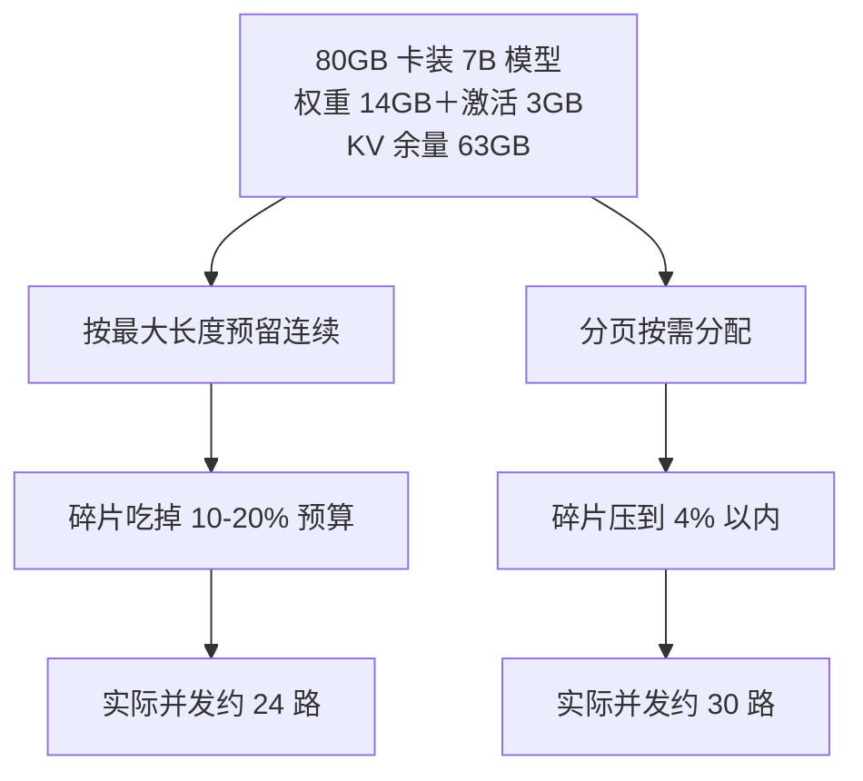

# GPU显存管理决定服务容量上限

**推理服务（把模型包装成可调用的在线服务）吞吐（单位时间能处理多少请求或字符）上不去，CPU 和网络都没满——瓶颈常在显存**。读完这篇你能**算出一块 GPU 能扛多少并发**，也知道权重（模型训练出来的参数，通常占显存最大头）、KV（Key-Value，注意力机制里缓存的键值对）缓存（K 是 Key 键、V 是 Value 值，注意力机制里用来检索信息的两部分，推理时保存的中间结果）和激活（每层前向传播时暂存的中间结果，用完即弃，表中写作「激活/临时」）三块预算该怎么分。

**查 CPU 没满、查网络没满，瓶颈就在显存：权重、KV、激活三块共享同一预算，任何一块超了预算，服务就 OOM（Out of Memory，显存耗尽）或排队**。要解决的问题：GPU 服务容量为什么和 CPU 不一样？**CPU 服务的容量按核数（能同时跑多少任务）和连接数（能同时处理多少网络请求）计，GPU 服务的容量由显存预算的分配决定——预算怎么分，容量就是多少**；矛盾全貌见 [[工程知识/AI 系统工程：从模型能力到生产能力/推理服务与平台/推理服务的核心矛盾是延迟、吞吐、显存与质量]]，本文只覆盖显存这一侧的机制。

## 显存预算怎么三分？

| 占用 | 随什么变 | 压缩手段 |
| --- | --- | --- |
| 模型权重 | 模型规模×精度 | 量化（FP16（16 位浮点数格式，精度与速度的折中）→INT8（8 位整数格式，推理量化常用）→INT4（4 位整数格式，显存最省精度损失最大的量化），精度损失换容量） |
| KV 缓存 | 并发序列数×序列长度×层数 | ① PagedAttention（vLLM 的分页式 KV 缓存管理：把连续显存切成等大的块，像操作系统虚拟内存那样按需映射）把碎片压到块内；② 前缀缓存复用：多个请求开头相同的部分（前缀，如同一段系统提示词）只存一份 KV，后续请求直接引用 |
| 激活/临时 | batch（同时处理的请求数）×序列长度×宽度（模型每层内部的数字个数，比如 4096 这样的大数） | 激活重算：前向传播（模型从输入逐层算到输出的过程）时丢弃中间激活，需要时再算一遍，用额外算力换显存峰值下降 |

**容量上限的推导：可用 KV 预算 = 总显存 − 权重 − 激活预留；最大并发序列数 = KV 预算 ÷ 单序列 KV 占用**。量化就是把权重的数值精度降低（FP16，16 位浮点数占 2 字节，降到 INT8，8 位整数占 1 字节），**每个权重占的字节减半，权重总占用随之变小——权重占得少，留给 KV 的预算就多，单序列 KV 占用不变时，KV 预算大一分、并发就多一分**。

**量化用低精度做计算，单步速度可能更慢或持平：低精度是否更快取决于显卡有没有对应的低精度计算单元**，没有时还要做精度转换。**量化省下的是空间：像用压缩袋把行李压小，箱子能多塞东西，拎起来并不会更轻——快不快是硬件的事，另算**。

这个比方只帮你记住省的是空间不是重量。具体省多少看下文算例的权重计算行——INT8 相比 FP16 字节减半，比喻到此为止。

推理服务的容量就是按这道除法在机架上的每一台里算出来的：每张卡按上面的除法算出能扛的并发，再乘以卡数就是整机或机架的容量：


*图源：Wikimedia Commons，Dsv，公有领域，https://commons.wikimedia.org/wiki/File:Dell_PowerEdge_Servers.jpg。*

## PagedAttention 怎么解决碎片？

打个比方：显存像一家餐厅的桌面——桌面上摆着正在吃的菜（KV cache）和备用的盘子（权重），同时能招待几桌人（并发）取决于桌面还剩多少地方，而不是厨房多大。比喻到"并发为什么受显存限制"为止：具体哪几块在占显存、怎么复用、碎片怎么收拾，要看正文，它只帮你记住"容量是块有限的桌面"。

并发请求共享同一份权重，各自占一份 KV 缓存。沿用餐厅的画面：桌面总量固定，能开几桌取决于**每桌占多大**，**每桌占用就是各自的 KV 缓存**。**并发上不去，多半每份占用没算够，而不是卡不行**。

**传统 KV 缓存按最大序列长度预留连续显存，内部碎片（已分配给请求但用不满的显存）加上外部碎片（空闲但不连续、因而分配不出去的显存）会吃掉预算**。**预留按最大长度算，实际命中最大长度的请求很少，请求远短于预留长度时这两块损耗叠加可达六到八成**，常态负载下实测约 10-20%（下文算例按常态口径）。

**PagedAttention把 KV 缓存分页化管理，这一设计与操作系统虚拟内存（给每个进程独立地址空间、按需映射物理内存）的分页机制思路相同**——操作系统用分页管理内存：把内存切成等大的页框（页框即内存里固定大小的存储单元），用页表（虚拟地址到物理地址的映射表）把虚拟页映射到分散的物理页框，让每个程序以为自己独占连续地址。**序列按逻辑页映射到物理页框，碎片压缩到页内**。

这个比方只帮你记住「逻辑连续、物理分散、按块按需映射」——显存里没有换出到磁盘这一步，比喻到此为止。逻辑块与物理块的对照如下：

**分页后的计算形态也变了：PagedAttention 的 kernel（跑在显卡上、执行注意力计算的程序）按块表（记录每个逻辑块存在哪个物理页框的映射表）逐块取 KV，每次调度只处理有效块，不再依赖连续预留**。论文 Figure 5 画的就是这个逐块计算过程：


*图取自 PagedAttention 论文（arXiv:2309.06180）Figure 5，https://arxiv.org/abs/2309.06180。*

**碎片为什么会吃掉显存预算？因为按最大长度预留出去的每一 MB，都从并发预算里直接扣除，用不满的部分等于白扔——请求的实际长度通常远短于预留的最大长度，多预留出来的空间别的请求也用不上**。

**拆开一张显卡看最直观：卡上显存颗粒的总容量是出厂定死的（8GB 就是 8GB），板上没有任何「再插一条」的扩展槽，这块卡的显存总量无法临时扩大，预算是硬约束**。**正因为总量无法扩大，按最大序列长度预留的浪费才不可接受——这就是分页要去收回的那部分预算**。

**分页化（PagedAttention）在这种刚性总量上做文章：把连续预留切成标准小块按需分配，预留方式下损耗掉的 10-20% 碎片预算被收回来，可用的 KV 预算约多出四分之一，同一块板的容量立刻多装四分之一的并发**。


*图源：同上（Wikimedia Commons），Konradr。*

**分页把碎片吃掉的预算还给并发：按本篇算例，63GB 的 KV 预算里 10-20% 的损耗约等于 6 路并发的份额，损耗从 10-20% 压到页内碎片级别（4% 以内），这 6 路回到预算里，同一张卡的并发从约 24 路回到约 30 路，提升约四分之一**。**这里的得失要看预留策略——预留越保守（按最大长度预留），分页的收益越大；请求长度本就接近预留值时，收益接近零**。分页机制的思路与上文操作系统的分页一致；想看页表怎么把虚拟页映射到物理页框，见 [[工程知识/性能工程：从用户等待到资源瓶颈/操作系统与运行时/虚拟内存与文件系统把地址和持久化分层]]。

**同一张 80GB 卡装 7B 模型，两种显存分配策略各走一条链：按最大长度预留的链碎片吃掉一截，实际并发约 24 路；分页按需分配的链碎片压到页内，实际并发约 30 路，容量上限的差距就出在碎片这一项**。回收的预算有多少，论文的压测给了实数：同一负载下对比 vLLM 与 Orca（另一套 LLM 服务系统，OSDI 2022 论文提出连续批处理）的四种分配方式——vLLM 的分页分配、按请求最大长度预留、按数据集最长序列预留、理想无碎片分配（论文用于对比的上界），柱状图里绿色是真正存了 KV 的份额，其余颜色是预留与碎片浪费的份额（论文用这一分解展示各策略的利用率差异）：


*图源：Efficient Memory Management for Large Language Model Serving with PagedAttention（arXiv:2309.06180）Figure 2，§6.2 压测，https://arxiv.org/abs/2309.06180，论文插图。*

vLLM 一栏**有效利用率 96.3%（浪费 3.7%，即碎片压到 4% 以内）**，按最大长度预留的几个对照策略**浪费 20.4 到 66.6 个百分点**。注意两套口径的差别：**论文压测的负载请求长度远短于预留上限，浪费达到 20 个百分点以上；上文算例按常态损耗 10-20% 估算，收回来的是约 6 路并发、四分之一的提升——压测数字是损耗上限的展示，算例数字是常态负载的估算，同一机制在两种负载下收回的预算不同**。



**碎片的去向决定并发的上限：两条链只差碎片一项，并发差出四分之一——权重是常数、KV 是预算，工程上能收回的只有碎片**。分页机制的块表怎么映射，见 [[工程知识/AI 系统工程：从模型能力到生产能力/推理服务与平台/批处理、KV缓存、量化与并行如何改变服务容量]]。

## 显存预算怎么一步步算出并发上限？

给定模型与卡，显存去向可以一步步算清：先扣权重，再扣激活预留，余量除以单请求 KV 占用得到并发上限。

```text
模型：7B fp16，卡：A100 80GB，目标：最大并发

权重：7e9 × 2 字节 = 14 GB
激活（batch=1，4096 上下文）：约 2-3 GB
KV cache：2 × 层数 × 头数 × 头维度 × 上下文（一次请求覆盖的 token 长度，也叫序列长度） × 2 字节
        = 2 × 32 × 32 × 128 × 4096 × 2 = 2.1 GB / 请求
        （开头的 2 是 K 和 V 各存一份；32 是层数，32 是注意力头数，128 是每个头的维度，末尾 2 字节是 fp16 每元素大小）
可用余量：80 − 14 − 3 = 63 GB → 理论并发 63 / 2.1 ≈ 30 路
以上是无碎片损耗的理论值；实际还有缓存分配器带来的碎片损耗，往下看：

碎片与预留：PyTorch（常用的深度学习框架）自带的缓存分配器 caching allocator（管理显存块复用）释放的显存块留在缓存池里不还给系统，其他请求无法使用这部分空间，形成常态损耗 10-20%：
  实际可用 ≈ 63 GB × (1 − 20%) ≈ 50 GB（按 20% 损耗上限估算） → 50 / 2.1 ≈ 23.8 → 实际并发 ≈ 24 路
  PagedAttention 把 KV cache 按块（16 token/块，块是分页粒度：越小映射越灵活、管理开销略增，16 是 vLLM 默认值）分配，碎片压到 <4%
  → 同卡并发回到 ≈ 30 路，容量提升 25%
```

跑一遍的收获：开头预算表的第三项「激活/临时」在批量推理里近似常数（算例按 3 GB 预留），预算表里真正浮动的是碎片，三个变量（权重、KV、碎片）里，权重是常数、KV 随上下文线性涨、碎片是工程可消除项——vLLM 类系统的容量优势就是把第三项收回来。通过调整 batch 大小的对照实验，还能验证 batch 对吞吐和 P99（99% 请求里的延迟上限，即长尾延迟）的影响。

机制是：batch 越大，排在后面的请求等得越久，长尾（少数请求耗时远高于其余大部分）延迟越高；吞吐则先升后平。实验流程见 [[工程知识/AI 系统工程：从模型能力到生产能力/推理服务与平台/批处理、KV缓存、量化与并行如何改变服务容量]]。

## 上下文涨八倍，为什么并发上限由 KV 预算决定？

**算一笔账：上下文从 4K 涨到 32K，单请求 KV 同倍上涨（按上文公式每请求 2.1GB 推到 16.8GB）。权重不随上下文变，KV 随上下文线性涨，涨到 32K 时 KV 的占比压倒权重，长上下文服务的并发上限几乎完全由 KV 预算决定**。回到餐厅的比方：这一涨相当于给每桌加长八倍的菜单，菜单厚度即每桌 KV 占用；菜单越厚，能同时开的桌数（并发）越少。这个比方只帮你记住「每桌占用涨、桌数就掉」，实际 KV 增长还受层数、头维度影响，比喻到此为止。

**能不能把菜单压薄、腾出桌面？两个手段的收益都能用同一份显存账推出来。GQA（分组查询注意力，Grouped-Query Attention）折叠 KV 头数，具体来说就是让多个查询头共享同一组 KV 头，KV 占用随共享头数比例下降，且按比例的平方放大**：32 个查询头折到 8 个 KV 头，KV 缓存只需存被共享的那几组，占用降到十六分之一。**量化 KV（fp8，8 位浮点数，每元素占 1 字节）把每元素字节数减半，降幅看精度档位**。**长上下文下 KV 涨 8 倍，要靠降头数或量化把 KV 压回预算内才装得下**。

**请求超出并发上限（显存装不下）后的行为形态：表现是排队，报错看不到——装不下的请求在队列里堆积，队列越长 P99 越接近爆炸**。**监控顺序因此有先后：先看显存水位再看延迟，水位到顶、延迟必涨，反过来延迟高未必是显存的事**。**KV cache 只增不减（会话未释放）、碎片缓慢累积**，这套形态和 [[工程知识/缺陷分析：从个案到体系/资源与容量/案例六：容量与泄漏——连接泄漏和 SST 堆积]] 里的连接泄漏属于同一类问题——**资源占用该回落却不回落，趋势图上缓慢上升后不下降的阶梯形态是两者的共同诊断信号**。

## 预算公式怎么和压测结果对账？

对账就是比较公式预估的最大并发与压测实测值，偏差应在 20% 以内；若与预期对不上，就要检查遗漏项。

- 显存水位监控：权重/KV/激活分项占用（nvidia-smi，NVIDIA 显卡自带的显存监控命令 + 推理引擎自身指标），水位满 80% 报警，报警阈值**按 KV 水位单独设置**（KV 是最灵活的预算，最先吃紧），总显存数字正常时 KV 也可能已经紧张。
- 容量推导验证：按公式预估最大并发，压测实测到达的最大并发，两者偏差 <20% 说明预算模型准；偏差大找漏项：CUDA 上下文（NVIDIA 的 GPU 编程平台保留的运行环境）、显卡运行时自身占用的显存、网络缓冲。
- 量化影响的双指标验证：容量增益（并发上限提升）与质量损失（评测集分数下降）同报，只报容量不报质量是自欺。

## 显存容量模型在哪些场景会失效？

- 显存容量与延迟的纠缠：batch 大摊薄单 token 算力成本但排队延迟上升，容量与延迟的 Pareto 前沿（两者此消彼长、无法同时最优的边界）要一起看，见 [[工程知识/AI 系统工程：从模型能力到生产能力/推理服务与平台/批处理、KV缓存、量化与并行如何改变服务容量]]。
- 分布式推理的显存账本：张量并行（把权重矩阵切开分到多张卡）切分权重、流水线并行（把模型各层切开分到多张卡）切层，每卡显存预算重新分配，跨卡通信（NVLink/PCIe，卡间高速互连总线）成为新约束（[[工程知识/AI 系统工程：从模型能力到生产能力/推理服务与平台/Prefill与Decode决定LLM服务如何调度]]）。
- 训练与推理的显存管理是两套：梯度、优化器状态、激活检查点（定期保存进度、故障后从最近一次保存处恢复）构成训练侧预算，本文只覆盖推理。

## 显存机制和哪些相邻问题相关？

- [[工程知识/AI 系统工程：从模型能力到生产能力/推理服务与平台/推理服务的核心矛盾是延迟、吞吐、显存与质量]]：矛盾全景，本文只讲显存维度
- [[工程知识/性能工程：从用户等待到资源瓶颈/处理器与内存/GPU性能取决于计算、访存、并行与通信]]：GPU 性能的通用机制，显存是其中访存侧在推理场景的特化
- [[工程知识/后端系统：在并发、失败与变化中维持服务/基础设施/容量规划与压测要用同一个负载模型说话]]：容量规划的通用方法，显存预算是其 GPU 实例
- [[工程知识/后端系统：在并发、失败与变化中维持服务/基础设施/容量水位线要换算成缓冲期：从百分比阈值到时间预算的六域通用读法]]：显存水位 80% 报警线的通用读法：按 KV 消耗速率换算缓冲期再定响应档位
- [[工程知识/AI 系统工程：从模型能力到生产能力/模型基础与训练/训练作业的显存失效有固定形态：激活峰值、碎片与保存窗口的定位顺序]] —— 训练侧的显存失效形态：与本篇推理侧预算表互补，训练的激活峰值与保存窗口是本篇「激活/临时」行在训练语境的展开