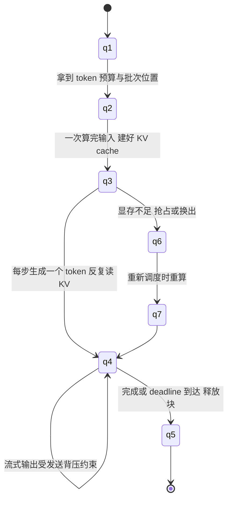

# Prefill 与 Decode 决定 LLM 服务如何调度

生成一个响应分两个阶段：先一口气读完输入，再一个 token（模型处理文本的最小单位，可理解为一个字或词片段）一个 token 往外吐。**两阶段卡的硬件资源完全不同**。读完这篇你能判断请求该排进哪个队列，也知道长输入为什么会拖慢交互请求。

生成一个响应包含两个资源画像相反（一个计算受限、一个访存受限）的阶段，像两个人合用一辆车：一个抢发动机（prefill 吃算力），一个抢油路（decode 吃带宽），**同一时刻只能满足一个**。注意 **prefill 与 decode 其实是同一块 GPU 的算力与带宽在不同时刻被争抢**，车比喻只帮你记住「同一时刻只能满足一边」，不要理解成两路任务各自独立运行。

**Prefill（预填充）一次处理输入序列并建立 KV cache**——即注意力（模型衡量输入各位置相关性的计算）的中间结果缓存，**decode 每步直接读取而无需重算**；这使得 **prefill 并行度高、计算压力大**；**Decode（解码）每步只生成少量 token，却要反复读取已有 KV cache**，受**显存（GPU 上的内存、模型参数与计算中间结果都存这里）带宽和调度开销约束**。**把两者混在一个队列，长输入会阻塞交互请求**：阻塞体现在两类延迟上，新请求等首 token 的时间变长——TTFT（Time To First Token，首 token 时间），在途输出的 token 间隔变长**ITL（Inter-Token Latency，token 间延迟：流式输出时字与字的间隔）**。

所以**调度必须同时盯这两类延迟**，并用 **token 预算（单次或批次允许消耗的 token 上限）和 KV 占用**，限制单个请求能占多少资源。

## 要解决的问题：prefill 与 decode 各自受哪些资源约束

用户看到在途输出的 token 间隔（相邻两个 token 的时间差，即下文的 ITL）突然拉长，或新请求长时间等不到首 token，而 GPU 利用率并不低，**这类现象出在调度层而非模型层**。本篇回答：prefill 与 decode 各自受什么资源限制、长输入为什么阻塞正在进行中的输出、什么时候值得把两个阶段分开部署，以及调度器必须显式处理哪些请求属性。

## 两个阶段为何互相干扰

一个长输入的 prefill 混进正在输出的批次时，GPU 时间被它整块占住——因为**同一次迭代里所有序列共用同一块 GPU**，**prefill 的大矩阵乘吃满算力，decode 只能在下一轮迭代拿到资源**——所有在途会话的下一次 decode 只能等它算完，**用户看到的现象就是 token 流突然停住再恢复**。


这张图是同一批请求（A、B 在途 decode，C、D 新进入）在四种调度器下的迭代时间线，取自 [Sarathi-Serve 论文（OSDI 2024）](https://arxiv.org/abs/2403.02310)：vLLM 与 Orca 把整段 prefill 排在 decode 前面，在途用户的 token 间隔被拉长数秒；FasterTransformer 反过来先 decode，新请求的 prefill 一直排不上。**两种优先级各牺牲一边，这就是混部队列的两难**；Sarathi-Serve 的分块 prefill（图中 Cp1、Cp2）**把一次长 prefill 拆进多个迭代与 decode 交错，两头都不停**。

调度目标因此是**在首 token 和连续输出之间分配有限时间、显存与批次位置**，填满 GPU 只是副产物——**利用率高不等于用户快**，算力被长 prefill 吃满时在途会话全在停摆，**调度的好坏要看两类延迟的账**。

## 连续批处理与分块 prefill 怎么工作

分块的对象是长输入的 prefill：**把一整段长输入切成若干小块，让每块都能与 decode 轮流占用 GPU**。这和 I/O 批量提交的思路类似：把大块切成小块轮流执行。

这个类比只在「把大块切成小块轮流执行」这一点上成立——I/O 批量提交省的是系统调用（程序请求内核提供服务的入口）开销，prefill 分块省的是 decode 停摆时间，**两者要省的东西不同**。但 prefill 切块必须配合 decode 交错，单纯切开并不能直接降低 ITL——**切开的整块仍会占住 GPU 算完才让位，decode 要等该块结束**；只有**与 decode 交替插入，decode 才不用整段等待**。

**调度器维护两条队列：请求进等待队列，被选中后进运行队列**，轮到谁、谁在等，都写在两条队列的头尾指针上。下图 io_uring（Linux 内核的高性能异步 I/O 接口）的提交队列与完成队列是**同一套双队列模式的实例**：


*图源：腾讯云开发者社区《图解原理 Linux I/O 神器之 io_uring》，CC 4.0 BY-SA，https://cloud.tencent.cn/developer/article/2187655。*

早期的做法是静态批处理：凑齐一批请求一起算，中途不增不减，整批全部完成才释放位置，**短请求会被同批的长请求拖住**。连续批处理（请求完成一个就补进一个、不等整批结束的调度方式）让每条序列完成后立刻让位给等待中的新序列，**批次随 decode 步动态变化，不必等整批结束**。

分块 prefill 将长输入切分，在同一调度周期内与 decode token 交错——**一个调度周期就是一次迭代（几毫秒到几十毫秒）**，交错指同一个周期内先跑一块 prefill 的矩阵乘，紧接着跑若干步 decode，交替进行。**它可以降低长输入对 ITL 的阻塞，但会增加调度复杂度**，分块大小也会改变 TTFT、吞吐和 kernel（跑在 GPU 上的计算程序）效率——**块切得越小，每次给 kernel 的矩阵越小，GPU 单次计算的效率越低，吞吐随之下降**。

因为分块大小同时改变 TTFT 与 ITL，**合理参数必须对照真实长度分布和 SLO（服务等级目标，对延迟与吞吐的量化承诺）才能定**——比如约定 ITL 不超过 50ms，分块后实测超过就该调小块。

## 分离 prefill 与 decode 值不值

分离与否，本质是**把两类活分给两拨人**，还是让一拨人轮换着做。主从（一台主节点负责写入、其他从节点同步数据的部署形态） Reactor（一种把连接接入与业务处理分到不同线程的并发模型）是**前者的样板**：主 Reactor 只管接受连接，子 Reactor 管读写，解码、计算、编码交给线程池（预先建好一组线程反复取用、避免频繁创建销毁）。

这个比方只帮你记住「两类活、两拨人」的分工形态。比喻之外的差异在于交接成本：**Reactor 的两拨人共享同一块内存，prefill 与 decode 分池后往往在不同机器上**，交接 KV cache 要跨网络传输，**成本远高于线程之间**。


*图源：ToolsBook《干翻 nio，王炸 io_uring 来了，史上最详细说明及最全图解》，CC 4.0 BY-SA，https://www.toolsbook.org/2024/05/nio-iouring.html。*

将两个阶段放到独立 worker 池（一组独立运行的推理进程，各自持有模型副本与显存），可以**分别扩缩、选择并行策略，并隔离长 prefill 对 decode 的干扰**。但 KV cache 必须从 prefill worker 高效传给 decode worker，代价是**新增网络传输、序列化**（把内存对象转成可存储或传输的字节格式的过程）、路由、故障处理和容量规划这几项成本。

判断要不要分离，看四个条件是否同时成立——**任一缺失都会让分离得不偿失**，例如流量不够大时两个池都空转，跨网络传 KV 的开销抵不掉干扰的收益：**输入长且差异大、两阶段要不同并行度、KV 传输够快、流量够大**。

- **输入很长且长度差异大，prefill 明显破坏 ITL**；
- prefill 与 decode **需要不同并行度（同时使用多少 GPU、如何切分计算，决定一次动用多少算力）或硬件配置**；
- **KV 传输足够快，收益大于跨节点开销**；
- 流量规模足以让两个池都保持合理利用率。

流量小、请求短或互联慢时，**把两个阶段放在同一个池里（共置）通常更简单**。**分离是针对已测得干扰的架构选择**，把它当默认选项会让小流量团队白付复杂度。落到 vLLM 的实现上，分离长这样：每个实例内部仍是完整的调度器加 worker，prefill 实例与 decode 实例靠 connector（vLLM 中负责在 prefill 与 decode 实例之间搬运 KV cache 的模块）与数据传输层交接 KV cache——「两拨人」之间的交接通道就是图里横贯底部的那一层：


*图源：vLLM 官方文档 Disaggregated Prefilling 页，Apache-2.0，https://docs.vllm.ai/en/latest/features/disagg_prefill.html。*

正文说的「KV 传输要跨网络、成本高于线程交接」对应图里的数据传输层：**它是实例之间的独立一层，序列化、路由、故障处理都发生在这一层**——这正是四个条件里「KV 传输够快、流量够大」必须先成立的原因。

## 调度器必须显式处理哪些请求属性？

| 问题 | 需要的策略 |
| --- | --- |
| 请求长度差异 | token 预算、分块 prefill、长度感知队列 |
| 优先级 | 配额与老化（等待越久优先级越高），**避免低优先级永久饥饿** |
| KV cache 不足 | 拒绝/排队、**抢占（强行打断在跑的会话以回收显存）**、换出（把会话的 KV cache 写到内存暂存、腾出显存给新请求）或重算（丢弃 KV、恢复时从输入重新算一遍），**并记录代价** |
| 多租户 | 并发、token、费用和显存预算按租户隔离 |
| 超时与取消 | **deadline 传播（把「最晚完成时间」随请求一起传给链路上的每个环节，超了就取消）**，及时释放队列位置和 KV 块 |
| 流式输出 | 发送背压（下游收得慢时上游必须减速以免堆积）**不能无限占住 decode 状态** |

一次请求从排队到释放，KV cache 走过哪些状态、显存不够时走的是换出还是重算——用状态机看代价落在哪一步：



**抢占、换出与重算都是显存不够时的补救动作：补救发生在哪一步，延迟尖峰就落在哪**——发生在 prefill 阶段，新请求的首 token 延迟（TTFT）变长；发生在 decode 阶段，在途输出的 token 间隔（ITL）变长。

**调度器的假设要与实测对账**——prefill 与 decode 分离的收益，建立在**两阶段瓶颈能用不同指标各自刻画（prefill 吃算力、decode 吃带宽）**的前提上：**瓶颈不同，就能各自选用针对性的并行策略和硬件配置**——两阶段约束的指标不同，**分开部署后才能各自调优，不必在同一个池里互相迁就**，共用一个池时只能折中。分别在启用批处理前后各测一次两阶段延迟；**若实测与预期对不上，就退回联合批处理（两阶段共用一个队列）**。

## 怎么自己动手验证

用短输入短输出、长输入短输出、短输入长输出、长输入长输出四个象限测试——横轴是输入长度、纵轴是输出长度，四角分别考验：短入短出看调度开销、长入长出看 TTFT 与占用时长、长入短出看 prefill 对 ITL 的冲击、短入长出看 decode 长期占用下的公平性；再混合成真实到达分布。**分别比较 TTFT、ITL、吞吐、KV 使用、抢占/重算次数和各优先级等待时间**。**单一固定长度 benchmark 无法证明调度器在生产流量下有效**。


## 两阶段混部到底亏在哪？一笔可运行的量化账

```python
# 两阶段的资源画像（7B 模型、A100，公开量级）

# Prefill：一次性吃 N 个输入 token（并行）
#   算术强度高（每读一字节显存能做很多次计算，大矩阵乘就是典型）→ 计算受限，GPU 利用率可达 70%+
#   延迟：1000 token 输入 ≈ 100-200ms（可并行摊薄）

# Decode：一次只出一个 token（串行）
#   每步读全部权重、只算一个 token → 算术强度极低（读得多算得少，时间都花在搬数据上）→ 访存受限
#   延迟：每 token 20-30ms（被带宽限速，GPU 利用率常 <30%）
#   1000 token 输出 = 1000 步 × 25ms ≈ 25 秒 ← 对话延迟的主体

# 调度的账：一个长 Prefill 混在 Decode 流里
#   200ms 的 Prefill 期间，所有在 Decode 的会话停摆（算力被抢）
#   → 在线会话 TTFT 与 ITL 双双出现毛刺
#   解法：分池调度（Prefill 池与 Decode 池分开，池间传 KV cache）
#   或 chunked prefill（长 Prefill 切成 128-token 块，与 Decode 交错）
```

两阶段混部的实录（示例量级，非特定生产实测）——客服系统高峰期所有会话逐字变卡（ITL 从 25ms 涨到 200ms+），监控显示 GPU 利用率却很高（Prefill 抢走了算力，看起来"很忙"），分池后 ITL 回到稳定 25ms、Prefill 池按上传流量独立扩容；**利用率指标在这里会撒谎，要看的是分阶段延迟**。批处理对两阶段的相反效应见 [[工程知识/AI 系统工程：从模型能力到生产能力/推理服务与平台/GPU显存管理决定服务容量上限.md]] 的 KV 账与 [[工程知识/AI 系统工程：从模型能力到生产能力/推理服务与平台/批处理、KV缓存、量化与并行如何改变服务容量.md]] 的吞吐账——**三本账（显存、批处理、两阶段）合起来才是完整的容量模型**。

## 这套说法在哪儿会失效

- 两个阶段无法彻底解耦：decode 依赖 prefill 建好的 KV cache，**分离部署只是把依赖换成一次网络传输，传输带宽不足时收益转为负**。
- **分块 prefill 的收益与输入长度分布绑定：请求长度接近且都短时，分块引入的调度开销大于它缓解的阻塞**。
- 连续批处理改变批次组成，但**单次 decode 的 kernel 效率随批次碎片化下降**——批次被切成长短不一的片段后，每次启动 kernel 时送入的矩阵变小，单次运算密度下降，吞吐随之走低，**吞吐与延迟的取舍需要按真实长度分布实测**。
- **调度策略不能弥补显存不足：KV cache 超出容量时只能抢占、换出或重算，这些动作本身产生延迟尖峰，属于容量问题**。
- **优先级机制需要老化条件：只按固定优先级排序时，低优先级请求长期得不到调度**。

## 接着读哪几篇：同在AI 系统工程里的相邻问题

- [[工程知识/AI 系统工程：从模型能力到生产能力/推理服务与平台/推理服务的核心矛盾是延迟、吞吐、显存与质量]] · [[工程知识/后端系统：在并发、失败与变化中维持服务/任务与并发/调度必须同时处理优先级、公平与背压]]
