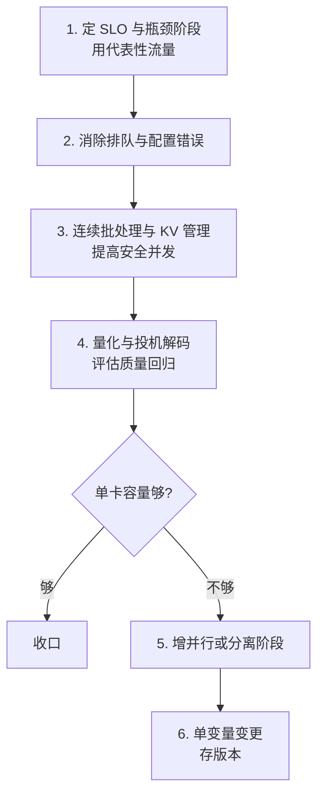
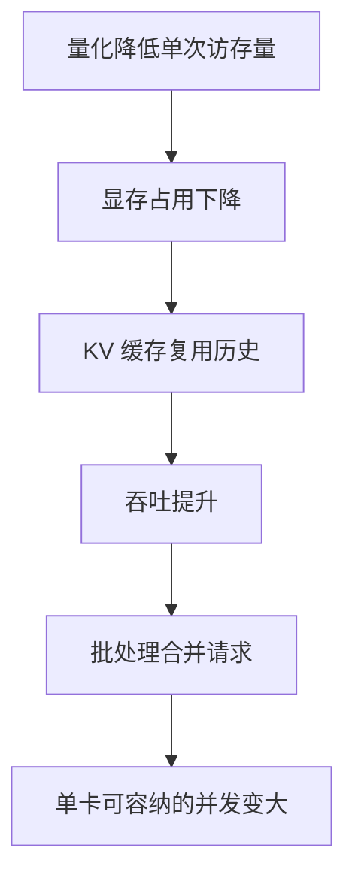

# 批处理、KV缓存、量化与并行如何改变服务容量

本文回答批处理、KV（Key-Value，注意力机制里缓存的键值对）缓存、量化（把模型权重从高精度数值压缩到低精度以省显存提速度）与并行如何改变推理服务（把模型包装成可调用的在线服务）容量（同一套硬件能同时服务多少请求）。读完你能画出自己服务的资源账本，据此判断**该上哪种手段、到哪一步停手**。

推理优化的手段很多：批处理（把多个请求合并成一批一起算，摊薄单请求成本）、KV cache、量化、并行、编译（把多步计算提前融成固定计算图，减少逐次发射开销）、投机解码（用小模型先猜若干 token，大模型一次验证，摊薄逐 token 的生成开销）。**为什么只记名词会得到"显存（GPU 上的内存、模型参数与计算中间结果都存这里）下降但吞吐没变"或"吞吐提高但交互延迟失控"？

因为每种手段改变的资源不同，只看名字看不出它动了哪块账**。本文按「每种手段改变了哪个资源」这条主线展开。

而要知道哪个资源是瓶颈，必须先看清一个事实：**同一个模型，在"少量长上下文请求"和"大量短请求"下，瓶颈完全不同。**

- 长请求：先耗尽 **prefill（对整段输入的一次性并行计算）** 和 **KV cache 显存**（KV cache 缓存历史 token 的键值，供生成时复用）
- 短请求：更容易受 **decode（逐 token 生成阶段）带宽**、调度和排队影响——decode 每次只生成一个 token（模型处理文本的最小单位，约相当于一个词或半个词），需反复读取全部权重和 KV cache，属内存带宽密集，短请求数量多时该环节易成瓶颈

长请求的瓶颈在 prefill 与显存，短请求的瓶颈在 decode 带宽与排队，两类瓶颈落在不同的指标上。所以每次优化都必须同时测量 **TTFT（Time To First Token，首 token 时间：发出请求到收到第一个字的等待）**（首 token 延迟）、**ITL（Inter-Token Latency，token 间延迟：流式输出时字与字的间隔）**（token 间隔）、吞吐、显存和任务质量。**漏测任何一项，就可能只看到某项变好、却忽略了另一项变差，把付出代价误当成免费收益**。

## 为什么 8 卡只跑出 20 QPS？

打个比方：批处理像让一辆班车一次坐满客人而不是每人发一辆车——坐满之后每人的路费（单请求成本）降了，但整车出发要等最慢那一位（尾延迟上升）。比喻到"吞吐和延迟为什么互换"为止：KV cache 怎么复用、量化掉的是哪部分精度、并行切的是哪个维度，得看正文，这里只讲清批处理这一件事。

一个团队用 8 张 A100 部署 70B 模型，预期几百 QPS（每秒查询数），实测只有 **20 QPS**，而且：

- 显存占用很高（80GB 快满了），但 **GPU 利用率只有 30%**
- 长请求（8K 上下文）时更慢，而且**并发一高就 OOM（Out Of Memory，显存不够分配而崩溃）**

吞吐上不去是三个原因叠加：

| 现象 | 真因 |
| --- | --- |
| 显存满但利用率低 | **KV cache 预分配过大**（按最大长度预留，实际用不满） |
| 长请求慢 | **prefill 是计算密集**，8K token 的 prefill 要好几秒 |
| 并发上不去 | 显存被 KV cache 占满，**没有空间给新的并发请求** |

**关键认知**：同样的硬件跑不出该有的容量，差在哪？差在**显存管理方式**与**缺少连续批处理（请求完成一个就补进一个、不等整批结束的调度方式）**（新请求随批次推进随时插入、完成即让位，不必等整批跑完），算力本身有余。换成 vLLM（开源的大模型推理引擎）后，同样的 8 卡跑到了 **150 QPS**。它靠两件事：PagedAttention（分页注意力，把 KV cache 当作分页内存来管理的机制）消除显存碎片，**把预留浪费从 60-80% 压到 4% 以下**；连续批处理让请求随批次随时插入。腾出的空闲显存全部喂给新并发，利用率从 30% 拉起来，吞吐随之涨到七倍半。

## 资源账本该怎么画？

| 资源 | 主要消费者 | 常见优化 |
| --- | --- | --- |
| GPU 显存容量 | 权重、KV cache、激活（每层前向计算产生的中间结果）、工作区（运行时临时存放中间数据的显存空间） | 权重量化、KV 量化、分页、并行切分 |
| GPU 计算 | 矩阵乘、attention（注意力计算）、采样（按概率挑选下一个 token） | 批处理、融合 kernel（GPU 上执行计算的核心程序）、编译、投机解码 |
| 显存带宽 | decode 读取权重和 KV | 量化、布局优化、更大有效 batch（批，一次同时送进 GPU 的多个请求） |
| GPU 互联 | 张量/流水线并行、KV 传输 | 拓扑感知放置（按显卡互联结构安排模型切分位置）、减少通信、重叠通信计算（计算的同时做跨卡传输，不让 GPU 空等） |
| CPU | tokenization（把文本切成 token）、调度、采样、序列化（把数据转成可传输格式） | 并行 tokenizer、批量处理、定位热点（访问集中在少数键或节点上的现象） |
| 网络 | 请求、流式 token、跨节点 KV | 共置（把相关服务放在同一台机器）、压缩、连接复用、背压（下游过载时反向限制上游速率） |

## KV cache 为什么成为核心状态

自回归生成指模型逐 token 产出、每生成一个新 token 都依赖此前全部 token，序列越长重复计算量越大；它若每步重新计算全部历史，成本极高。KV cache 保存各层历史 token 的 key/value，使 decode 复用此前计算，代价是显存占用随并发、上下文长度、层数和表示精度增长。**复用省掉的是逐 token 重算，代价是显存随上下文增长**，这笔账下面单独算。

### 单请求的 KV cache 占多少显存，怎么算？

这个公式部署前一定要算一遍：

```text
每个 token 的 KV 显存 = 2 (K 和 V) × 层数 × KV头数 × 单头维度 × 字节数
```

公式里 KV 头数指该模型注意力层的键值头个数（GQA 分组查询注意力下，多个查询头共享一组 K/V 头，因此 KV 头数少于查询头数），单头维度是每个头的向量长度，两个数都查模型配置可得。

**算例**：Llama-3-70B 级别，权重用 FP16 即 16 位浮点表示。

```text
2 × 80 层 × 8 KV头 × 128 维 × 2 字节 = 327,680 字节 ≈ 0.32 MB / token
```

把不同上下文长度代入这个公式：

| 上下文长度 | 单请求 KV cache |
| --- | --- |
| 2K | 0.64 GB |
| 8K | 2.6 GB |
| 32K | 10.5 GB |
| 128K | 42 GB |

这笔账算出的结论有三条：

- 140GB 权重（70B × 2 字节）由 8 张 80GB 卡分摊：每卡约 17.5GB 放权重，剩约 62.5GB 给其余开销；按 8K 请求单请求 KV 约 2.6GB 折算，单卡并发上限只有二十来个，**能支撑的并发有限**
- 128K 上下文的单个请求就要 42GB —— **这就是为什么长上下文服务昂贵**
- **降低 KV 精度（FP8，8 位浮点数格式，精度更粗但速度更快省显存）能直接减半**，这是 KV 量化价值大的原因

**实操建议**：用上面的公式算出你的模型在目标上下文长度下的 KV 占用，再乘以期望并发，就知道需要多少卡。**别拍脑袋估。**

### PagedAttention 改变的是哪一层内存管理

传统做法：为每个请求**预留**最大长度的连续显存 → 大量浪费（预留 8K 但只用了 500 token）。

PagedAttention 把浪费从多少压到多少？vLLM 论文把新旧两种管理方式画在一张图里：上半是常见做法，每个请求一条连续 KV 存储，按最大长度整条预留，序列内部与序列之间的空槽全是浪费；下半是 PagedAttention，KV cache 切成固定大小的块，逻辑块经块表映射到不连续的物理块，按需分配：


*图源：vLLM 论文《Efficient Memory Management for Large Language Model Serving with PagedAttention》Figure 3（arXiv 2309.06180），https://arxiv.org/abs/2309.06180。*

它的做法是把 KV cache 切成**小块**——类似操作系统的分页，但块始终在 GPU 显存里，不会换出到磁盘，也没有缺页中断（访问的页不在内存、内核从磁盘调入），相似的只是「逻辑连续、物理分散」的映射方式，按需分配，块之间不必连续：

| 请求 | 占用的物理块 |
| --- | --- |
| 请求 A | 物理块 7、1、3（逻辑块 0/1/2，非连续） |
| 请求 B | 物理块 5（另取空闲块） |

"块之间不必连续"靠一张块表实现：请求看到自己的逻辑块永远连续，块表把每个逻辑块翻译到 GPU 显存里任意位置的物理块，**新块用满才分配下一个**。


图中左侧是请求 A 的逻辑 KV 块（请求视角下按 token 顺序编号的连续块），中间 Block Table 记录每个逻辑块映射的物理块号与已填槽数，右侧是 GPU 显存里实际存放数据的物理块池（固定大小的存储块）——逻辑块 0/1/2 分别散落在物理块 7/1/3，生成新 token 时先填未满块的空槽，填满才从池里领新块。逻辑连续、物理分散，预留浪费从此不存在。

图取自 [Efficient Memory Management for Large Language Model Serving with PagedAttention（arXiv:2309.06180）](https://arxiv.org/abs/2309.06180) 论文 Figure 6。

**收益**：

- 显存浪费从 60-80% 降到 **不到 4%**（vLLM 论文实测）
- 支持的并发数提升 **2-4 倍**（同上，论文同负载对照实测）
- 支持**前缀共享**（多个请求共享相同的系统提示前缀）

这套机制落在整个服务里是什么分工：论文的系统总览图把调度器与 KV 缓存管理器画成两个协作组件——调度器决定哪些请求进下一批，KV 缓存管理器负责物理块的分配与块表维护，两者都跑在每个 GPU worker 内：


*图源：同上一篇论文的 Figure 4，系统总览视角（调度器与 KV 缓存管理器在 GPU worker 内的协作），https://arxiv.org/abs/2309.06180。*

**注意**：它改善的是**内存管理**，不改变 attention 对历史上下文的语义依赖。

**前缀缓存的坑**：token 序列**完全匹配**才命中，**前缀差一个字符就当新请求处理**。多租户场景要按租户隔离前缀缓存，A 租户的请求命中 B 租户的前缀属于数据越权（访问了权限范围之外的资源）。

## 为什么量化不是一个开关

- **权重量化**降低模型权重容量与读取带宽，常见于 INT8（8 位整数）、FP8、INT4（4 位整数）等表示。**这笔取舍的本质是精度换空间**：读取更快、占用更小，但精度有损失，质量是否受损要看任务本身的回归结果。
- **激活量化**还会影响中间计算，需要硬件、kernel 和校准（确定量化缩放参数的过程）支持。
- **KV cache 量化**直接扩大可并发上下文，但可能影响长上下文输出质量。

量化收益由模型、硬件、kernel、batch 和序列长度共同决定：同一 INT4 权重，短问答只用到少量 token，量化误差被平均掉，近乎无损；超长上下文累积上万个低精度运算，误差叠加，常先掉点。验收必须同时比较任务质量、TTFT、ITL、吞吐、显存和单位请求成本——对照本节 KV 算例，FP8（8 位浮点数格式，精度更粗但速度更快省显存） 让 128K 单请求 KV 从 42 GB 降到 21 GB，前提是长上下文质量回归过关；**「模型能加载」不是上线标准**。

## 并行策略分别解决哪些瓶颈

| 策略 | 做法 | 主要适用 | 代价 |
| --- | --- | --- | --- |
| 数据并行 | 多副本处理不同请求 | 单副本能装下，流量可分摊 | 每副本重复权重 |
| 张量并行 | 单层张量跨卡切分 | 单卡放不下或大批次 | 高频 collective（跨卡集合通信） |
| 流水线并行 | 不同层放不同设备 | 多节点超大模型 | pipeline bubble（流水线空转时段）、调度复杂 |
| 专家并行 | MoE（混合专家，每次只激活部分专家的稀疏模型）专家分布到设备 | 稀疏 MoE | all-to-all（全网互发）通信、负载不均 |

四种并行的差异只到切分维度为止（数据并行复制整套权重、张量并行切单层、流水线并行切层序列、专家并行按专家切分），通信代价与适用规模差异要看正文——实施时**优先使用能满足容量的最小并行度**。**跨卡越多不代表越快**：同样的张量并行度，跨 NVLink（英伟达显卡之间的专用高速互联）与跨 PCIe（通用扩展插槽总线，带宽低于 NVLink）的扩展效率差距很大：互联拓扑越好、通信占比越低，扩展效率越高；batch 越小，通信占比越高，下降越明显。

## 编译、CUDAGraph 与算子融合各解决哪些问题

推理图相对稳定时，编译和算子融合可减少 Python、kernel launch 与中间读写开销。CUDA Graph（NVIDIA 的 GPU 并行计算平台，把一段 GPU 计算录成图后整体重放的机制）可重放固定形状的 GPU 工作：不录图时 CPU 要逐个下发每条指令，录成图后一次下发整段，**省去重复的调度开销**。

省下的是逐条下发的调度开销。动态形状、频繁控制流和多种序列长度会降低复用率——固定计算图要求输入形状固定，形状多变就套不进同一张图。

因此运行时通常按输入长度分档复用固定计算图（shape 分桶，把相近的输入长度归到几个固定档，每档录一张图），没命中的请求退回即时模式（eager fallback），不录图，算一步发一步。

## 应该按什么顺序优化？



下面六步里，有两条纪律值得单独强调。**单变量变更：每次只动一个主要变量并保存版本，让效果可归因**。**先用尽单卡容量再考虑并行：把 KV 管理与批处理做好后单卡可容纳的并发变大，常常比加卡更划算**。

1. 用代表性流量确定 SLO（服务等级目标，如 p95 时延上限与吞吐下限）和瓶颈阶段。
2. 先消除明显的排队、CPU、网络和错误配置问题。
3. 用连续批处理和 KV 管理提高安全并发。
4. 在质量回归下评估量化和投机解码（speculative 即投机式的：先用小模型猜、再由大模型验证）decoding。
5. 单卡无法满足容量时再增加并行或分离阶段。
6. 每次只改变一个主要变量，保存软硬件版本和完整结果。

## 优化到哪几步该停手？



四种手段分别从访存量与利用率两侧改变容量：访存量侧如量化把权重从 16 位降到 8 位，单次读取数据量减半，显存与带宽占用随之下降，同卡就能放更多 KV 与并发；利用率侧如连续批处理让空闲算力被新请求填满。**两条路都能在不换卡的前提下抬升可服务并发**。

批内 prefill 与 decode 互相拖累的形态，Sarathi-OLLaMA 论文的时间线图画得最直观：不做切块时，一个 8K token 的 prefill 在 GPU 上连跑一整段，同批 decode 请求在这段时间里全部停摆，token 间隔出现一整条空白；把 prefill 切成小份与 decode 混排后，空白被填平，TTFT 与 ITL 同时受益——这正是第 3 步「连续批处理」要吃到的那笔收益：


*图源：Taming Throughput-Latency Tradeoff in LLM Inference with Sarathi-Serve（Agrawal et al., OSDI 2024，arXiv 2403.02310）论文配图，arXiv 论文默认许可，https://arxiv.org/abs/2403.02310。四条时间线自上而下：vLLM 的 prefill 优先让同批 decode 全部停摆，Orca 混排仍有长块干扰，FasterTransformer 的 decode 优先让新请求排队，Sarathi-Serve 的 stall-free 调度把 prefill 切成小块与 decode 混排、全程无停摆。术语对照：prefill＝输入段一次性并行计算，decode＝逐 token 生成，TTFT＝首 token 延迟，ITL＝token 间隔。*

没有统一的「最佳配置」。量化可能改变质量，批处理可能牺牲交互延迟，并行可能被通信吞掉。**判断一种配置是否有效，标准是它在目标负载、硬件和质量门槛下是否仍满足 SLO**。

## 最小容量实验怎么跑？

固定模型、输入/输出 token 分布、GPU 和并发，建立单请求、静态 batch、连续 batch 三组基线（正常状态下的指标水平、用来对比异常）。每组记录 TTFT、ITL、完成吞吐、KV cache 占用、显存、质量和单位请求成本；**只切换一个变量**，例如 paged KV 或 FP8。若显存下降但 p95、质量或错误率变差，**结论应写成「容量换延迟/质量」，不能笼统写成优化成功**。

## 怎么自己动手验证

1. 资源账本核对：对一套真实推理服务清点 KV cache 占用（按并发数 × 上下文长度 × 每 token 字节数），预期与 nvidia-smi 的显存占用对得上，差值即权重与激活。
2. 批处理档位：固定负载扫 batch size 档位，预期**吞吐先升后平、延迟单调上升**，记录拐点作为该服务的运行档位。
3. 断言锚点：容量结论有账本支撑、运行档位有实测拐点。

## 接下来该读哪几篇来搞清量化与批处理的容量交互？

- [[工程知识/性能工程：从用户等待到资源瓶颈/处理器与内存/GPU性能取决于计算、访存、并行与通信]] · [[工程知识/AI 系统工程：从模型能力到生产能力/质量与运营/Agent评测必须覆盖轨迹而不只看最终答案]] · [[工程知识/AI 系统工程：从模型能力到生产能力/推理服务与平台/GPU显存管理决定服务容量上限]]


- [[工程知识/AI 系统工程：从模型能力到生产能力/推理服务与平台/模型量化的精度经济学：位宽精度与显存的三角.md]] —— 量化与批处理的容量交互
- [[工程知识/AI 系统工程：从模型能力到生产能力/模型与上下文/KV缓存与上下文长度的显存账：为什么长上下文贵.md]] —— KV 缓存在容量模型中的位置
- [[工程知识/AI 系统工程：从模型能力到生产能力/推理服务与平台/推理批处理的两难：吞吐与延迟的调度天平.md]] —— 容量参数的交互全景