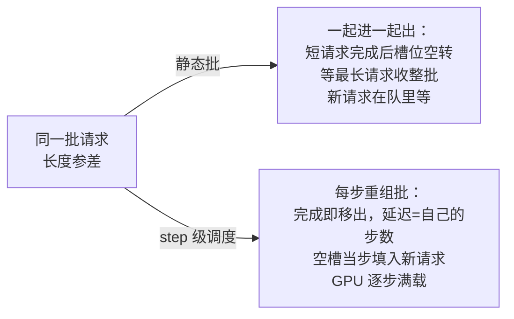

# 推理批处理的两难：吞吐与延迟的调度天平

## 要解决的问题

把多个请求拼成一批一起送进 GPU 推理（用训练好的模型逐字生成文本，计算放在 GPU 上），成本与体验会朝相反方向走——这是推理服务（把模型包装成可调用的在线服务）在吞吐与延迟之间的调度两难。读完本篇，你能把「最大 batch（批，一次同时送进 GPU 的多个请求）」「等待窗口」按服务水平承诺推导成可调参数。

GPU 推理的单位请求成本随 batch 增大而被更多请求分担：把一批请求同时送进 GPU，跑一次推理所花的时间与显存（GPU 上的内存、模型参数与计算中间结果都存这里）代价平摊到每个请求上，同一份权重加载成本由整批分摊，成本因而下降。但**延迟随 batch 增大而劣化**。劣化的原因在批同步：批内所有请求共用同一条解码流水线，**每走一步都要等本步里最慢的那个请求算完**，batch 越大、成员越参差，快的请求被迫陪跑越多步，等待时间越长，延迟随之劣化。

可以把它想成一趟班车：人齐了才发车，车上每个人都有座位，一趟拉完人均油钱最省；但先上车的人要等最后一个到的人，自己的到达时间由别人决定。这个比方到「一起走就有人等」为止，班车不会中途让人下车换人上车，连续批处理（请求完成一个就补进一个、不等整批结束的调度方式）会——它的批次每一步都重新组装，等待的粒度从「整趟车」降到「一个路口」。

一个路口指的是相邻两次解码步之间的间隔：**新请求最多只等这一步就被编入批次**，不必陪跑别人的整个生成周期。批处理的两难要解决的问题是：**在吞吐（成本）与延迟（体验）之间建立可推导的调度模型**，让「最大 batch」「最佳等待窗口」成为按 SLA（服务水平协议，对外承诺的延迟上限）推导的参数，把调度从拍脑袋的玄学变成可推导的模型。

这是推理服务成本模型的调度侧支柱[[工程知识/AI 系统工程：从模型能力到生产能力/推理服务与平台/推理服务的单位请求成本从token定价推出来.md]]，也是排队论在推理场景的特化[[工程知识/性能工程：从用户等待到资源瓶颈/观测与诊断/排队论给容量一个可推导的模型.md]]。

## 连续批处理是怎么把等待压到单步级的？

静态批处理的毛病是整批要等最慢的那个。滚动批处理（rolling/continuous batching，即连续批处理）的做法是：**一个序列生成结束，位置立刻腾出来，新序列马上补进去，批次大小每一轮重新决定**，不再有打包等待——像流水线边上随时上下车的拼车：谁到就上、谁到目的地就下，车不等人齐。这个比喻到「按当前步重组批」为止，实际调度还要处理抢占与显存分配。

*图源：AWS 中国区博客，署名转载，https://aws.amazon.com/cn/blogs/china/accelerate-sagemaker-llm-model-inference-performance-using-rolling-batch/。*

**静态批处理与它的浪费**。请求攒齐一批一起进、一起出（batch 一起开始一起结束）：批内请求长度参差时，短请求等长请求（GPU 空转在补齐空位——padding）上，批的整体时长由最长请求决定。静态批的吞吐上限受制于长度方差：**方差越大浪费越大**。浪费来自批的粒度固定，请求之间不能独立进出。

**continuous batching：让批的成员可独立进出**。vLLM/Orca 的核心改进：**批是逻辑概念，物理上每步调度层重新组装**——已完成请求移出、新请求填入，每步（iteration-level，迭代级）重批。批内不再一起开始一起结束，GPU 每 step 都满载，加上 KV（Key-Value，键值对：按键取值的最简数据模型） 按需分配让完成请求即时腾位、新请求动态补入，并发数拉高，吞吐较传统批处理提升数倍；又因短请求不必等整批、各自步数独立，延迟波动也随之收敛（Orca 论文报告的极端负载场景下，有效吞吐相对静态批最高提升 36.9 倍）。代价：**调度层复杂度（每步重批的开销）、内存管理压力**（KV 缓存——Key-Value 缓存，保存注意力计算中间结果的显存）按需分配，分页管理见 [[工程知识/AI 系统工程：从模型能力到生产能力/模型与上下文/KV缓存与上下文长度的显存账：为什么长上下文贵|KV 缓存显存账]]。

同一张时间网格看两种调度的差别：静态批里序列结束后格子空到整批收工，连续批里空格当步就被新序列填上，GPU 几乎不出现闲置列：

*图源：Anyscale 官方博客《How continuous batching enables 23x throughput in LLM inference while reducing p50 latency》（Anyscale，公司技术博客配图），https://www.anyscale.com/blog/continuous-batching-llm-inference。*

**prefill 与 decode 的两段性**。长输入的 prefill（并行处理全部输入 token）计算受限、短输入的 decode（逐 token 生成）访存受限，**两阶段算术强度（每字节显存访问对应的浮点计算量）相反**。混布调度（prefill 与 decode 同 GPU）互相干扰：大 prefill 计算受限、一次性占满 GPU 算力，正在 decode 的批每步被推迟、排队时间上升，整体延迟随之出现抖动（性能指标不稳定的起伏）。解耦（disaggregated prefill/decode，PD 分离）是趋势：两阶段分池部署，各按自己的负载画像调参。chunked prefill（把长输入的预计算切成小块，与逐字生成交替进行，避免长请求长时间霸占算力）是单机内的折中：干扰减小。**只有显存充裕、负载量大到值得跨机传输时，才值得上 PD 分离那套方案**。

批能不能做大，卡在 KV 缓存这块动态显存上。vLLM 官方博客把分块后的访问方式画了出来：一个请求的 KV 缓存被切成固定大小的块，块与块在显存里不必相邻，注意力（模型为每个词分配权重、聚焦上下文中最相关部分的机制）计算按块遍历，查询向量依次与块 0、块 1、块 2 里的键值向量做点积，块表负责把逻辑顺序映射到任意物理位置。分块让显存里零散的空位都能拿来装新请求，**这是「批的成员可独立进出」在显存层面的支撑**：

*图示：KV 缓存按固定大小的块切分，逻辑上连续的块映射到显存里任意位置的物理块，注意力计算按块遍历。图源：vLLM 官方博客《vLLM: Easy, Fast, and Cheap LLM Serving with PagedAttention》，https://blog.vllm.ai/2023/06/20/vllm.html。*

**调度目标函数**。给延迟 SLA 定吞吐上限：P99（99 分位延迟：99% 的请求快于这个值）约束下最大可接受 batch 与等待窗口，**目标是最大化吞吐×SLA 内请求占比**。参数谱：等待窗口（攒批等待越长吞吐越高，但 TTFT——Time To First Token，首 token 时间：发出请求到收到第一个字的等待——也随之变差）、最大 batch（显存上限内）、优先级抢占：把正在运行的请求暂时让出算力，让对延迟敏感的在线请求（interactive，交互式请求）插队，代价是**批内其他请求的延迟上升**。这些参数与排队论的 M/M/c 模型（c 台服务器同时服务的排队模型，见 [[工程知识/性能工程：从用户等待到资源瓶颈/观测与诊断/排队论给容量一个可推导的模型|排队论篇]]）衔接：GPU 是 c 台服务器，请求到达率 λ（单位时间进来的请求数）与服务率 μ（单位时间处理完的请求数由 batch 参数决定）。
## 这套调度思路从哪来，又要付出什么代价？

代价在**调度侧：请求进队列后**，调度器要在每一轮检测谁生成结束、谁可以补位，批次不再是「攒够一批再跑」的简单结构。

*图源：AWS 中国区博客《加速 SageMaker LLM 推理》框架图，署名转载，https://aws.amazon.com/cn/blogs/china/accelerate-sagemaker-llm-model-inference-performance-using-rolling-batch/。*

批处理与调度是 OS 与数据库的老问题，LLM（大语言模型）推理的特化点在**自回归的两段性**（自回归指逐个 token 生成、每一步依赖前面所有结果——两段性指 prefill 计算受限与 decode 访存受限）与 **KV 状态的粘性**——请求的生命周期内 KV 只增不减，账见 [[工程知识/AI 系统工程：从模型能力到生产能力/模型与上下文/KV缓存与上下文长度的显存账：为什么长上下文贵|KV 显存账]]。Orca（2022，OSDI）提出 iteration-level scheduling，vLLM（2023，PagedAttention）把它与分页 KV 结合：分页 KV 消除显存碎片，使「批的成员可独立进出」在显存层面可行，iteration-level scheduling 才真正推广开来，成为事实标准。PD 分离（2024+，Mooncake/DeepSeek 类）把两阶段分成独立服务，是当下的工程前沿。

**「批的粒度从请求级细化到单步级」**。批大小保持住大批换吞吐，被压到单步级的是请求相互等待的粒度：**相互等待从「整个生成周期」降到「单个解码步」**。粒度细化同时改变了吞吐与延迟的耦合方式：静态批的延迟 = 批内最长请求时间，连续批处理的延迟 = 自己的步数 × 每步时间 + 排队时间——**后者可被调度优化（插队、优先级），前者只能认命**。代价：每步重批不是免费的，调度开销随并发线性涨；P99 优化与吞吐优化在重负载下对立——给突发预留缓冲余量（headroom）意味着少往批里塞请求，重负载时 GPU 本已近满载，**少接的这部分就是损失掉的吞吐（10-20% 是常态）**；PD 分离引入跨机 KV 传输（新成本中心），不是所有规模都值得采用。容量规划要按负载画像（输入长度分布、生成长度分布、到达率）建模，见 [[工程知识/AI 系统工程：从模型能力到生产能力/推理服务与平台/批处理、KV缓存、量化与并行如何改变服务容量|批处理与容量]]。

同一批四个请求，两种调度下走两条路，天平的两端看结构最清楚。

静态批把相互等待锁在整个生成周期，continuous batching 把它压到单步——**损耗从结构上消除，调度参数从此可推导**。

## 这套说法在哪些条件下会失效？

- **「最大批」没有普适值，只有负载画像下的 SLA 推导**。同参数在不同输入/生成长度分布下表现反转：长输入主导时大 batch 摊薄 prefill 更划算，短输入主导时大 batch 只拉长排队，于是同一设置优劣反转。上线流程：采集真实负载画像，用排队模型推导参数，灰度（新版本先放一小部分流量验证，逐步放大到全量）期间验证 P99，按回归结果修正。**文档默认值（vLLM 的 max_num_seqs 等）是起点不是终点**。
- **TTFT与 TPOT（Time Per Output Token，之后每个字的平均间隔）是两个指标，优化方向可能相反**。TTFT主要由 prefill 与排队决定，TPOT主要由批与 decode 决定。优化 TTFT 会劣化 TPOT：为压低首字延迟而优先做 prefill，会让 decode 让路、单字间隔变长。**产品 SLA 要分别承诺，调参要按指标分开设定**。
- **为什么长请求会挤占解码，块大小该怎么调？** Chunked prefill 的块大小是干扰与吞吐的旋钮：块小则长请求分多次做预计算，每次只占一小段算力，decode 被打断得少，但 prefill 总时长拖长（首字延迟劣化）；块大则 prefill 更快做完，但每块占用算力久，decode 被挤占得久。**默认值（512/2048）来自通用负载，长输入重负载要实测调优**。
- **抢占与迁移的代价常被低估**。请求被抢占后 KV 要么丢弃（重算代价）要么换出（拷贝代价），**两个都不是免费的**。优先级调度在 KV 大（长上下文）时成本陡增，见 [[工程知识/AI 系统工程：从模型能力到生产能力/模型与上下文/KV缓存与上下文长度的显存账：为什么长上下文贵|KV 显存账]]的换页思想。

## 怎么自己动手验证这套调度模型？

- **静态 vs continuous batching 对照**：长度方差的合成负载（如对数正态分布生成长度）在两种批处理下跑吞吐与 P99。预期：**方差越大 continuous 优势越大**（静态批的 padding 浪费与批间空隙被消除）。吞吐比随方差的曲线是机制证据。
- **TTFT/TPOT 分离观测**：真实负载下按请求长度分桶统计 TTFT 与 TPOT 分布，预期：**TTFT 随输入长度线性增长（prefill 主导）、TPOT 与长度弱相关（decode 每步同价）**。两指标的不同形态是两段性的直接证据。
- **调度参数扫描**：等待窗口 0-100ms、max batch 64-512 扫描，绘制吞吐-P99 前沿曲线（Pareto frontier）。预期：**前沿上无同时最优的点，SLA 约束下选切点**。前沿曲线是「天平」的定量证据，也是容量承诺的依据。

## 想深入批处理在成本模型里的位置，该读哪几篇？

- [[工程知识/AI 系统工程：从模型能力到生产能力/推理服务与平台/推理服务的单位请求成本从token定价推出来.md]] —— 批处理在成本模型中的位置
- [[工程知识/性能工程：从用户等待到资源瓶颈/观测与诊断/排队论给容量一个可推导的模型.md]] —— 调度天平的通用理论
- [[工程知识/AI 系统工程：从模型能力到生产能力/推理服务与平台/批处理、KV缓存、量化与并行如何改变服务容量.md]] —— 容量参数的交互全景
- [[工程知识/AI 系统工程：从模型能力到生产能力/模型基础与训练/投机采样与推测解码：小模型带路大模型确认.md]] —— 吞吐侧优化的对偶
- [[工程知识/AI 系统工程：从模型能力到生产能力/模型基础与训练/MoE路由的工程问题：负载不均与显存碎片.md]] —— 批调度与专家负载的交互
