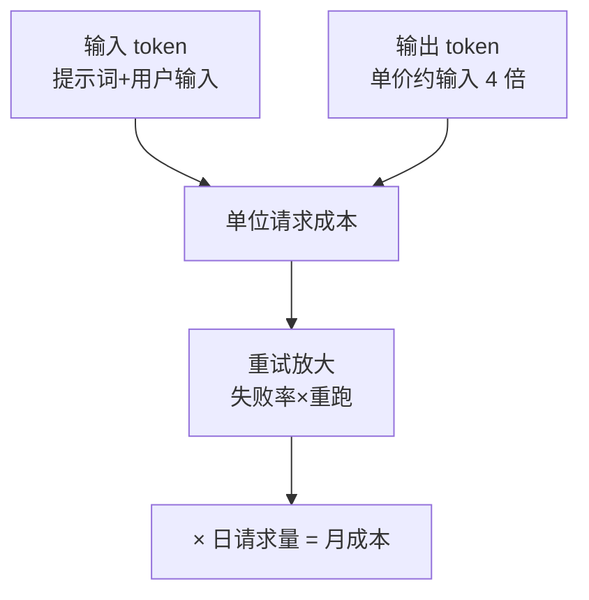
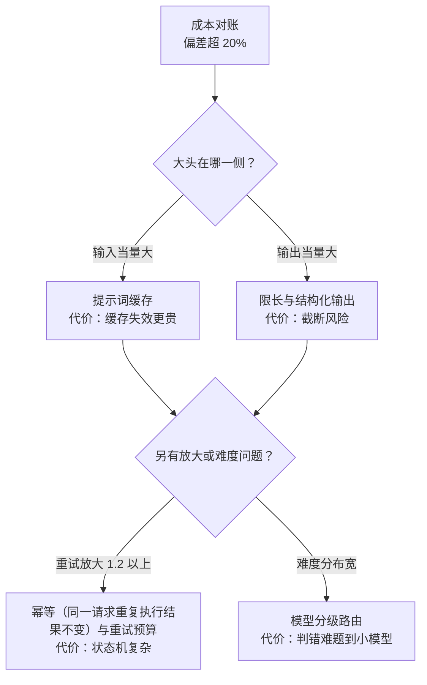
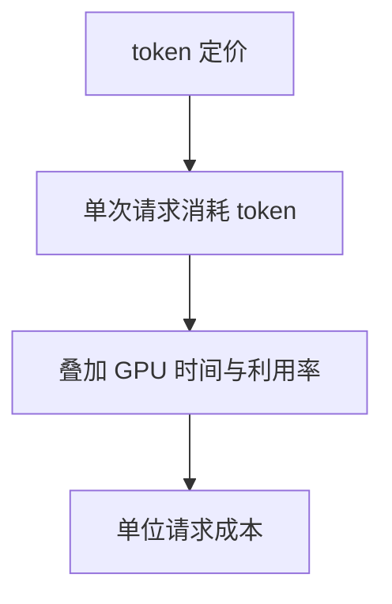

# 推理服务的单位请求成本从token定价推出来

**账单告诉你花了多少钱，但上线前就该知道一个请求要花多少**。**token 定价指模型 API 按输入和输出的 token（模型生成的最小文本单位，约等于一个字或半个词）数量分别计费**。**读完这篇，你能在上线前就算出一个单位请求要花多少钱**。

**模型 API 按 token 计价，业务决策要的却是单位请求成本——处理一个用户请求花多少钱**。**要解决的问题：token 定价怎么推出单位请求成本**。

**两者之间隔着一组可推导的中间量：请求的 token 构成、命中缓存的比率、批处理效率（多个请求合并成一批同时处理，共享权重加载等固定开销，提高每单位算力的产出）、以及失败重试的放大系数**。可以先借出租车计价锚定这条链：token 用量是里程表读数，缓存与批处理是拼车摊薄，重试是返工加的里程，读数乘单价就是这一趟的车费——完整对照见"成本怎么从定价推出来"一节。**把这些量显式写出来，成本就从"看账单才知道"变成"上线前就能算"**。



**缓存命中与重试放大是两个常被漏算的中间量**。**缓存命中指本次请求的前缀与之前请求相同、可直接复用已算结果，命中部分按折扣价计费，因此折减输入侧成本；重试放大指失败请求重跑产生的额外成本，使总成本高于单次成功成本**。**成本预测与账单对不上时先查这两处**。

**推导链是：`请求成本 = 输入 token × 单价 + 输出 token × 单价 + 请求级固定开销`——请求级固定开销是每次请求都发生的固定成本，与 token 数量无关，如鉴权、排队与连接建立——其中输入 token 又由固定部分（系统提示词）与可变部分（用户输入 + 检索上下文）构成**。**输入长、输出短的任务里，系统提示词（约束模型角色与行为边界的常驻指令）与检索上下文常是成本大头且容易被忽视：一个 1500 token 的系统提示词乘以每天百万次请求，就是 15 亿 token 的固定支出；检索带回 10 篇文档、每篇 800 token，单这一项就是 8000 token/请求**。

## 这些中间量各自该怎么得到？

模型按 token 定价，而业务决策需要的是处理一个用户请求花多少钱，两者之间隔着请求的 token 构成、缓存命中比率、批处理效率与重试放大系数。本篇回答：这些中间量各自怎样得到、单位请求成本怎样从 token 单价推导出来、预测值与账单出现偏差时先查哪里，以及成本优化的停止条件是什么。

## 成本由哪几部分构成？

| 构成 | 来源 | 可压手段 | 压缩代价 |
| --- | --- | --- | --- |
| 系统提示词 | 每请求固定 | 提示词缓存（prefix cache） | 缓存失效（缓存里的数据过期或不一致、需要回源加载）时反而更贵 |
| 检索上下文 | RAG（检索增强生成，先检索资料再拼进提示词的回答方式）每请求可变 | 证据筛选、topk（检索返回的结果条数）调小 | 召回率下降 |
| 用户输入 | 不可控 | 上下文压缩 | 信息损失 |
| 输出 token | 任务决定 | 限制生成长度、结构化输出 | 截断风险 |
| 重试放大 | 失败重跑 | 幂等、超时治理 | 复杂度 |
| 无效调用 | 提示词错误、过度反思 | 缓存复用 | 一致性维护成本 |

**批处理与并行的容量效应[[工程知识/AI 系统工程：从模型能力到生产能力/推理服务与平台/批处理、KV缓存、量化与并行如何改变服务容量]]在成本侧的体现：同一 GPU 上并发请求共享权重与 KV（Key-Value，键值对：按键取值的最简数据模型） 缓存（注意力计算的中间结果，存下来供逐步生成时复用，省去每步重算），并发请求复用同一份权重与缓存，使每张卡的固定成本被更多请求分摊**：**每张卡固定成本不变，利用率翻倍使单卡承载的请求数翻倍，单请求分摊到的固定成本减半，单位成本随之减半——所以"每 token 单价"也依赖负载形态：低并发时段利用率低，同样的固定成本由更少的请求分摊，摊到每个 token 的真实单价更高**。

**批处理效率的具体形状：静态批处理把一批请求绑在一起跑完，先生成的序列在网格右侧留下成片空格，GPU 算力按空格比例白白流失——空格比例越高，同样的卡时（一张 GPU 卡运行一小时）产出的 token 越少，单请求分摊的硬件成本越高**：


*图源：Anyscale 官方博客《How continuous batching enables 23x throughput in LLM inference while reducing p50 latency》（Anyscale，公司技术博客配图），https://www.anyscale.com/blog/continuous-batching-llm-inference。*


来源：[稀土掘金《图解Transformer：为什么GPT、Claude、DeepSeek都用同一个架构？》](https://juejin.cn/post/7668503904926236723)（CC 4.0 BY-SA）


## 成本怎么从定价推出来：三个实用的推导

**先补一个对照形状：API 按计量收费像出租车按公里计价——token 是里程表（每个字都有单价），而业务要回答的是"送一趟多少钱"（单位请求成本）**。**一趟多远由路线决定（提示词与检索上下文是绕路的固定里程），路上返工要再加里程（重试放大），拼车能摊薄（批处理与缓存）**。**把这几个量写出来，"这一趟多少钱"就能在上车前算出**。这个比喻到"上车前算出"为止，只用于直观理解计价结构，不涵盖缓存与批处理的实际机制——**现实里里程表在车上，token 用量在日志里，观测点要埋在调用层才能对上账，这是验证一节的内容**。

**盈亏估算**：**给定每次请求平均输入 2000 token、输出 300 token，输出单价约为输入的 4 倍，按公开定价表算出单请求成本，乘以预估日请求量得到月成本**。**这一步的价值是把"用得起吗"从印象变成数字，且能看到哪一项占大头**——**大头在哪一侧取决于输入与输出的长度比和两者的单价差：输入长、输出短**（如检索问答、长文档摘要）**时输入侧占大头，优化精力该投在检索筛选与提示词缓存上；输出长、单价又高（如长文生成、代码补全）时输出侧才是大头，此时压输入长度收益有限**。本文算例里输入折合 2000 当量、输出折合 1200 当量（300×4），两侧接近，压任何一侧都要按当量算。**当量指按单价折算后的可比 token 数：输出 1 个 token 折合输入 4 个 token，因为输出单价约为输入的 4 倍**。

「按公开定价表算」的那张表长这样——以 Anthropic 官方定价页为例，每个模型一列四价：缓存读、缓存写、输入、输出，全部按每百万 token计价，算例里"输出单价约为输入的 4 倍"（如 Haiku 4.5 的 $5 对 $1）就是从这样的表上读出来的：


*图源：Anthropic 官方定价页（claude.com/pricing，API 标签，playwright 实拍，2026-09-28 截图）。Prompt caching=提示词缓存，Read=缓存读（命中部分按折扣计费），Write=缓存写（首次写入按溢价计费），Input=输入单价，Output=输出单价，MTok=每百万 token。截图时点的单价随官方调整而变化，算例数字以截图为准。*

**重试放大系数**：**失败率 5% 且全量重试，平均成本乘 1.05 看似温和，但重试常发生在长请求上（超时引发重试），实际放大可到 1.2**。**重试治理与成本是同一件事**，治理方法见 [[工程知识/AI 系统工程：从模型能力到生产能力/质量与运营/成本控制要从上下文和重试两头下手]]。

**模型分级的成本杠杆**：**任务按难度路由到不同定价的模型（简单分类用小模型、复杂推理用大模型），是最大的成本杠杆之一：小模型单价远低于大模型，通常能把总成本压到几分之一**。**路由判据本身会错，错的代价是难题到了小模型——所以路由要有升级机制**（小模型置信度低时升级），这与"模型提出候选，系统定义正确性"的分工一致[[工程知识/AI 系统工程：从模型能力到生产能力/模型与上下文/模型提出候选，系统定义正确性]]。

三个推导合到一张图上，成本超标时的处置顺序一目了然：先看账确定大头在哪一侧，再选对应的杠杆，同时把每个杠杆的代价记在案，压成本的改动与质量监控同步上线：



## 这套算法在哪些场景不适用？

**成本模型的前提是定价与用量可测：自托管模型（自己部署在自有 GPU 上、不按 token 计费）没有 token 单价，要换算成"GPU 小时 × 利用率"口径 [[工程知识/AI 系统工程：从模型能力到生产能力/推理服务与平台/推理服务的核心矛盾是延迟、吞吐、显存与质量]] 的容量矛盾**。**换算的中间量是单位卡时的吞吐：一张卡每小时成本除以该负载形态下的每秒输出 token 数，得到每百万 token 的硬件成本，再与 API 定价对比，得出的差值就是自托管的盈亏线，显存（GPU 上的内存、模型参数与计算中间结果都存这里）管理与大分块批处理（一次装入大批次请求的批处理方式）决定这条线的高低**[[工程知识/AI 系统工程：从模型能力到生产能力/推理服务与平台/GPU显存管理决定服务容量上限]]。

**API 侧则受定价调整影响，成本模型要注明自身随定价调整的更新频率（即文首元信息里的 change_rate（变化率字段） 字段）并定期与账单对账——预测值与账单偏差超过 20% 说明某个中间量估错了（通常是重试或缓存命中率）**。

**成本不是唯一目标：把检索上下文压到极限伤召回[[工程知识/AI 系统工程：从模型能力到生产能力/知识与检索/RAG的核心是选择可引用证据]]，把输出限制到极短伤质量**。**成本优化的停止条件是"下一块钱的优化要付出超过一块钱的质量代价"——它来自成本并非唯一目标这一前提：检索与输出压到极限会伤召回与质量，优化不能无限进行，质量代价超过节省额时就该停，这个判据与通用性能优化的调优循环同构**[[工程知识/性能工程：从用户等待到资源瓶颈/性能工程：从用户等待到资源瓶颈]]。

## 推算准不准怎么验证？



定价给出的是分子，成本还要看分母能跑多满——分母是硬件产出效率，同样的月租下，利用率三成时每请求摊到的硬件成本是九成时的三倍。使用 API 的用户无法看到底层 GPU 利用率，只能按 token 单价付费；自托管者自己掌握利用率，利用率的高低直接决定其盈亏。


**成本公式要与账单对账——把日志里统计的真实 token 用量代入公式得到推算值，与账单核对不上的部分就是假设漏掉的地方**。

**对线上服务做一次成本对账：从日志统计真实平均输入/输出 token、缓存命中率（请求直接从缓存拿到结果的比例）、重试率，代入成本公式，与账单对比**。**偏差来源通常有三种情况：一是日志里没记 token 用量，需要先补观测；二是缓存命中率与假设不符；三是长尾（少数请求耗时远高于其余大部分）请求（极少数长度远超平均的请求）被平均掩盖**。**token 用量的观测点要埋在调用层，靠推测得不出这个数**。

**最小验证的测法：测试分两组进行，一组用全量检索，另一组只用筛选后的 top3（得分最高的前 3 篇检索结果）。两组各跑 100 个请求，对比成本与质量指标（答案准确率或人工抽检），确认筛选在省钱的同时没伤质量**。

## 成本的账具体怎么算？

```text
一次请求成本的推演账（通用形态，以公开 token 定价口径）：

输入 2000 token、输出 300 token，输出单价约为输入的 4 倍：
    成本 ∝ 2000×1 + 300×4 = 3200 个"输入当量 token"
    → 输出 token 少 100 个，等价于输入砍 400 个（输出单 token 当量更高）
  缓存命中的账：系统提示词 1500 token 可缓存，命中价约为原价 1/10
    → 高频固定前缀进缓存，单请求成本降 40%
  显存摊销的账：一张卡每小时成本固定，吞吐翻倍意味着**同样时间服务两倍请求**，
    单请求摊到的卡成本随之减半
    batch（批大小）与 KV显存管理决定吞吐
    → 成本优化与容量优化是同一件事
  重试的账：失败率 5% 重试一次 → 成本乘 1.05；重试风暴时成本无上限
```

**只压输入不压输出的实录——团队花两周精简提示词省 20% 输入 token，实际成本只降 6%——输出 token 才是大头，输出长度由温度参数即控制生成随机性、也直接影响输出长度的采样（只采集一部分数据以控制记录开销）参数与指令宽松度决定；同时收紧输出上限与结构化输出后总成本降 28%**。**缓存漏配的实录——每次请求把用户历史拼进前缀，缓存命中率归零（前缀必须完全一致才命中）；固定前缀与动态内容分层后命中 70%**。

**重试无预算的实录——上游超时配置过短，1% 请求放大成 4 次重试，月账单多出 18%；重试带预算与退避，与成本账联动**。token 两头的省钱纪律见 [[工程知识/AI 系统工程：从模型能力到生产能力/质量与运营/成本控制要从上下文和重试两头下手.md]]；吞吐与显存的容量账见 [[工程知识/AI 系统工程：从模型能力到生产能力/推理服务与平台/GPU显存管理决定服务容量上限.md]]；结果复用见 [[工程知识/AI 系统工程：从模型能力到生产能力/质量与运营/Agent的缓存与结果复用.md]]。

## 想接着读，该看哪几篇？

- 关系：[[工程知识/AI 系统工程：从模型能力到生产能力/推理服务与平台/批处理、KV缓存、量化与并行如何改变服务容量]] · [[工程知识/AI 系统工程：从模型能力到生产能力/质量与运营/成本控制要从上下文和重试两头下手]] · [[工程知识/AI 系统工程：从模型能力到生产能力/模型与上下文/模型提出候选，系统定义正确性]]
- [[工程知识/AI 系统工程：从模型能力到生产能力/推理服务与平台/推理服务的核心矛盾是延迟、吞吐、显存与质量]] —— 自托管口径的容量矛盾
- [[工程知识/AI 系统工程：从模型能力到生产能力/质量与运营/Agent的缓存与结果复用]] —— 固定开销的另一条压缩路径
- [[工程知识/性能工程：从用户等待到资源瓶颈/性能工程：从用户等待到资源瓶颈]] —— 成本优化的停止判据（调优循环）
- [[工程知识/AI 系统工程：从模型能力到生产能力/数据与MLOps/模型发布需要注册、灰度与回滚]] —— 成本敏感的模型切换如何安全上线
- [[工程知识/AI 系统工程：从模型能力到生产能力/推理服务与平台/模型量化的精度经济学：位宽精度与显存的三角.md]] —— 量化在成本模型中的杠杆位置
- [[工程知识/AI 系统工程：从模型能力到生产能力/推理服务与平台/推理批处理的两难：吞吐与延迟的调度天平.md]] —— 调度天平在成本模型中的位置
- [[工程知识/AI 系统工程：从模型能力到生产能力/模型基础与训练/MoE路由的工程问题：负载不均与显存碎片.md]] —— MoE 在成本模型中的架构侧
- [[工程知识/AI 系统工程：从模型能力到生产能力/推理服务与平台/模型路由与级联：小模型过滤大模型兜底的省钱结构.md]] —— 路由在成本模型中的位置
