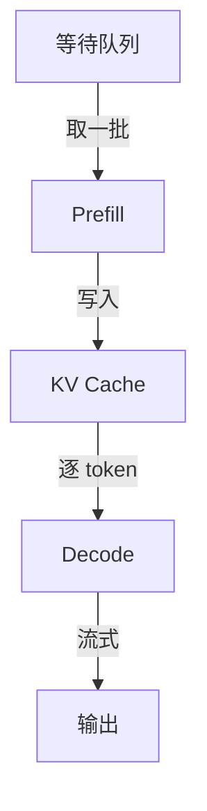

# 推理服务为什么总在延迟、吞吐、显存与质量之间取舍

**推理服务总在延迟、吞吐、显存与质量之间取舍，优化其中一项往往把压力转移到别处（队列、KV cache 即键值缓存、网络或质量）**。**读完这篇你能判断每次优化把代价转嫁到了哪项指标、容量结论该绑定哪类流量**。**最典型的例子：增大批次能提高吞吐，但请求排队时间变长、首字延迟（发出请求到收到第一个输出词的时间）上升**。

**GPU（图形处理器，模型计算的主要载体）与 CPU（中央处理器，负责调度与文本预处理）的总资源固定，某项指标的改善往往靠占用更多某一类资源（显存、算力或带宽）实现**。**该类资源被占后，其余指标只能在更紧的约束下运行——显存被多占后，能同时服务的请求数就变少，排队随之变长，压力转移到队列、KV cache 或网络**。**所以容量结论必须绑定具体流量分布和 SLO（服务等级目标，如「95% 的请求在 1 秒内收到第一个输出词」这类可度量的承诺）**。

**LLM（Large Language Model，大语言模型）服务要分多步处理一个请求：先算输入再逐词生成，这与模型根据输入直接算出结果的一次前向计算完全不同**。**请求长度不同、输出长度未知，prefill（对整段输入的一次性预计算）与 decode（逐 token 生成输出）的资源特征不同，KVcache（存储注意力机制中已生成 token 的键和值，供后续生成时复用、避免重复计算——注意力机制是模型在生成每个词时回看前面所有词来判断哪些更重要的方法）是模型记住已生成内容的中间数据**。**每个请求独占一份、直到该请求结束才释放，因此请求状态长期占用显存**。

## 拉高一角为什么会压塌另一角？

为什么调大批次提升了吞吐，交互请求的等待却变长了？为什么拉长上下文提升了质量，显存却先撑不住了？任何一项指标的改善都会把压力转移到别处。本篇回答：延迟、吞吐、显存与质量之间难在哪、怎样相互制约，容量结论为什么要绑定具体流量分布与目标，四项指标里哪一项在给定场景下是约束条件。

## 四项指标是怎么互相牵扯的？

**推理服务要在延迟、吞吐、显存与质量四者之间取舍，是因为延迟、吞吐、显存这类指标由同一批物理资源支撑：改善一项往往要占用更多某类资源，其余指标只能在更紧约束下运行（质量的下降另有原因，见下文）**。**多卡 GPU 机架（以四张卡的机架为例）是这组取舍最直观的实物原型，单卡显存（例如板载 24GB，实际容量因型号而异）决定了同时能承载多少路请求**，**单请求的首字延迟与整机每秒吐出的 token（模型处理文本的最小单位，约相当于一个词或半个词） 数此消彼长——把批次堆大，整机吞吐上去，每路请求的等待拉长；为了压首字延迟减小批次，每批要算的 token 变少，GPU 计算单元得不到足够的数据供给，大量计算周期空转，利用率掉下去**。

**四张卡插在一个机架里，电、热、显存、PCIe（显卡与主机之间的高速数据通道）带宽全部共享，挤压任何一维，压力都会转移到其余三维，这正是本篇的核心结构**。**机架比喻只说明资源在同一块板上共享；质量下降来自量化或切分改变了计算结果，需单独验证，并非被物理挤掉**。


*图源：Wikimedia Commons，Jasper Reichardt，CC BY-SA 4.0，https://commons.wikimedia.org/wiki/File:Mining-Rig.jpg。*

**显存是最难突破的约束：请求到达时还不知道它会多长，只能按可能的最大值预先留位——按峰值长度预留意味着哪怕多数请求很短，也要按最长那条占足显存，空闲显存被提前占用，请求并发度与上下文长度因此此消彼长**。**按需分块的思路是把逻辑块与物理块分开：逻辑块是请求看到的连续地址范围，每一段对应一段已生成 token 的 KV 数据；物理块是显存中实际分配的不连续小块，二者经块表映射，新块按需申请**。**批处理（把多个请求合并成一批同时计算、提高硬件利用率）因此不必按峰值预留，延迟、吞吐与质量的权衡，都发生在显存容量之内**。

**推理服务的机制层：输入长度各不相同、输出长度事先未知，prefill 需要整段输入的计算、decode 逐 token 生成，KV cache 又把每个请求的状态长期固定在显存里**。**显存接近上限后，批次大小、并发序列与上下文长度三者互相挤压：增大其中一个就必须减小另外两个**；**延迟、吞吐、显存与质量之间的制约来自这套结构，与某个参数的取值无关——无论把批次调到 8 还是 64，只要显存被请求独占、KV 按峰值预留，并发与上下文就互相挤占，换任何参数都绕不开这套占用关系**。


来源：[稀土掘金《图解Transformer：为什么GPT、Claude、DeepSeek都用同一个架构？》](https://juejin.cn/post/7668503904926236723)（CC 4.0 BY-SA）


## 用户感受到哪几个延迟数？吞吐又该怎么量？

设请求到达时间为 t0，首个输出 token 到达为 t1，最后一个 token 到达为 tn（n 是最后一个 token 的序号，共有 n 个输出）：

- **TTFT（Time To First Token，首 token 时间：发出请求到收到第一个字的等待）**：t1 - t0。**由排队、输入处理、prefill和网络共同决定**。**对话、搜索等需要即时反馈的场景，用户对首字等待的感受大致是：2 秒以上明显感到卡顿，多数产品因此把首字延迟目标压在 1 秒以内**。
- **TPOT**（Time per Output Token，每输出 token 耗时）：**通常指首 token 之后，后续 token 的平均间隔**。
- **ITL（Inter-Token Latency，token 间延迟：流式输出时字与字的间隔）**：**相邻输出 token 的间隔分布，即把每个相邻词之间的等待时间列出来看整体情况，而不只看平均值；比平均 TPOT 更能暴露抖动（延迟忽快忽慢、相邻间隔不稳定）——TPOT 是间隔的平均值，ITL 看的是逐个间隔，平均看起来正常时，个别 token 卡几秒只有 ITL 能暴露**。
- **端到端延迟**：**tn - t0，同时受输入长度、输出长度和调度影响**。
- **吞吐**：**每秒请求或 token；必须注明输入/输出长度分布和并发，否则不可比较**。

**平均值会掩盖排队的影响：少数请求的延迟远高于平均水平，拉出一条长尾（延迟分布中远高于均值的那部分请求），只看平均值看不到这部分**。**生产 SLO 至少看 p50/p95/p99（把全部请求延迟从小到大排队，p95 是第 95% 位置那条请求的延迟值，95% 的请求都比它快——p50 即中位数）的 TTFT、ITL、端到端延迟、错误率、每请求 token/成本与质量指标**。

## 容量被什么吃掉了？



**一块 GPU 的显存大致由四部分构成，先把预算表列出来，后面所有权衡都在这张表里做**：

```text
模型权重 + KV cache + 激活/临时工作区（每层计算产生的中间结果）+ 运行时预留（框架与碎片缓冲）
```

**权重量化（降低数值精度以省显存）主要减少第一项；PagedAttention（vLLM 的分页式 KV 缓存管理：像按页管理内存一样把 KV 切成固定小块按需分配，避免整块预留浪费）、分页和回收策略主要改善 KV cache 的碎片（存储空间里零散不连续的小块）与利用率**；**算子融合（把多个连续计算合并成一个，减少中间读写）和 CUDA Graph（NVIDIA 的 GPU 并行计算平台；Graph 把一段 GPU 计算录成图后整体重放，省去逐次启动开销）主要减少执行开销**。**它们不会自动减少输出 token，也不会自动保持质量**。

**原因在于量化和并行只改变计算与显存的使用方式，输出内容由模型权重与采样（只采集一部分数据以控制记录开销）决定，降精度引入舍入误差，可能让输出分布轻微偏移，因此同一提示的回答质量需要单独评测验证**。


*图源：Woosuk Kwon 等《Efficient Memory Management for Large Language Model Serving with PagedAttention》论文 Figure 2（vLLM 官方仓库），https://github.com/vllm-project/vllm-paper/blob/main/figures/two-requests-block-mapping.svg。*

**碎片吃掉多少容量，论文 Figure 1 的实测账最直观——同样服务 OPT-13B（Meta 开源的 130 亿参数模型），三种 Orca 预留策略（按最大长度预留、按 2 的幂次预留、按真实长度分布预留）的 KV cache 有效使用率只有两到四成（图注中的 Max/Pow2/Oracle 三组数字），剩下的全被预留与碎片占走；vLLM 分页后有效使用率达到 96.3%——Orca (Max) 有效使用率仅 20.4%，vLLM 分页后达 96.3%，有效 KV 空间约为原来的 4.7 倍，因此同卡同模型能塞进三倍以上的并发请求**：


*图源：Woosuk Kwon 等《Efficient Memory Management for Large Language Model Serving with PagedAttention》SOSP 2023 论文 Figure 1 右侧柱状图，https://arxiv.org/html/2309.06180v1 （论文引用）。绿色 Token states 是真正在算的 KV cache，红色 Internal frag. 与灰色 External frag. & Others 就是上文的「预留但没用上」——「容量被什么吃掉了」这笔账，在这张图里是按百分比实报的。*

## 四组权衡各让掉了哪些指标？

| 优化动作 | 可能收益 | 常见代价 |
| --- | --- | --- |
| 增大批次 | 提高 GPU 利用率和吞吐 | 排队、TTFT 和单请求长尾上升 |
| 增加并发序列 | 隐藏执行空隙 | KV cache 压力、抢占与重算上升 |
| 权重/KV 量化 | 降显存、提高带宽效率 | 精度变化、校准和内核支持约束 |
| 张量/流水线并行（把一层切开跨卡算/把层分到不同卡） | 容纳更大模型或提高吞吐 | 跨卡通信、气泡（流水线空转时段）和部署复杂度 |
| speculative decoding（投机解码：先用小模型快速猜测多个候选 token，再由大模型一次性验证接受与否） | 减少大模型 decode 步数 | 草稿模型成本、接受率不稳定 |
| prefill/decode 分离（预计算与生成放到不同机器池） | 各自独立扩缩和调度 | KV 传输、网络与队列复杂度 |

## 为什么只看 GPU 利用率会误判？

**GPU 利用率（GPU 计算单元在一段时间内处于工作状态的时间占比）只反映算力被占用的比例**。**队列积压时 GPU 仍在处理旧批次，利用率维持高位，但新请求已排长队、延迟飙升——因此高利用率既可能是系统高效，也可能是队列失控；低利用率可能来自流量不足、CPU/tokenizer（把文本切成分词的程序）瓶颈、网络阻塞或小批次**。**容量实验必须固定**：

- 模型与精度；
- 输入、输出长度分布；
- 并发和到达模式；
- 硬件、拓扑与运行时版本；
- 质量门槛与采样参数；
- 预热、缓存状态和测试持续时间。

**寻找「最大吞吐」时，还要满足既定 TTFT/ITL SLO；超过 SLO 意味着首字或间隔超出用户可接受的等待**，**用户感知为卡顿，因此超过这个边界的吞吐再高，用户也不会觉得服务变快**。

## 出了问题按哪几步查？

**排查推理服务的慢与错，顺着请求走过的路径往下查**。**先看指标链上第一处异常出现在哪：TTFT 突变多半卡在排队或 prefill，ITL 抖动多半出在 decode 或调度；指标链定位到哪一段，再进到对应部件看细节**。

1. 从端到端 trace（调用链追踪记录）分开客户端、网关（站在客户端与后端服务之间的入口层，集中处理路由、鉴权与协议转换）、队列、tokenization（把文本切成词元）、prefill、decode 和流式发送。
2. 看请求长度、batch（批，一次同时送进 GPU 的多个请求）大小、running/waiting 数（调度器里正在计算与排队等待的两类请求数量）、KV cache 使用率与抢占（显存不足时把正在运行的请求换出、稍后重算）。

3. 再看 GPU kernel、算力、显存带宽、互联（多卡之间的通信链路，如 NVLink、PCIe）、CPU 和网络。
4. 只改变一个变量重跑代表性负载，并同时比较质量和成本。


## 想自己测一遍怎么动手？

1. **指标分测：在给定流量分布下分别测 TTFT、TPOT（Time Per Output Token，单 token 输出耗时：解码阶段每个 token 的平均生成时间） 与相邻 token 间隔分布，确认结论绑定到具体 SLO 而不是单次吞吐数字**。
2. **压力转移核对：调大批处理之后确认显存占用与排队延迟随之上升，优化项没有把代价转移到别的指标**。
3. **长度分档：按输入与输出长度分档统计延迟与显存，确认长上下文请求的 KV cache 占用与预期一致**。

## 还想顺着这条线读哪几篇？

- [[工程知识/AI 系统工程：从模型能力到生产能力/推理服务与平台/Prefill与Decode决定LLM服务如何调度]] · [[工程知识/性能工程：从用户等待到资源瓶颈/观测与诊断/性能问题定位]] · [[工程知识/AI 系统工程：从模型能力到生产能力/推理服务与平台/FlashAttention是IO感知的精确算法，不是近似]]
