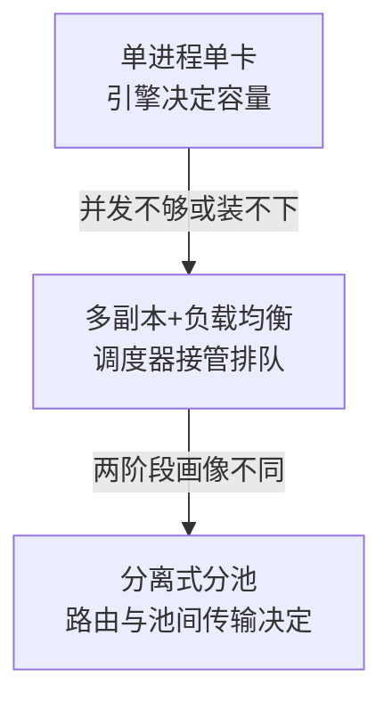
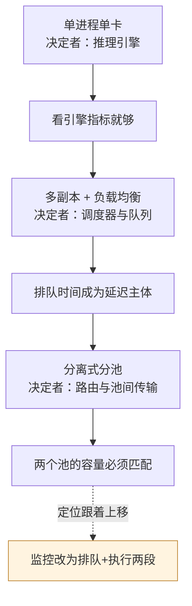

# 模型服务架构从单进程到分布式副本

扩展模型服务要解决三个问题：**单卡容量不够、并发上不去、故障域太大**——故障域指**会一起出故障的最小范围**，单卡坏即整个服务坏，**范围越小说明隔离越好**。但每增加副本、并行或节点，都会增加路由、权重加载、通信和恢复状态。**最小实验**是固定输入/输出分布，逐层比较单进程、多副本和跨节点的 **TTFT**（首字延迟：从发请求到收到第一个字的时间）、**ITL**（字间延迟：相邻两个输出字的间隔）、**吞吐**、**冷启动**（缓存或服务刚启动、还没有数据与连接的状态）与**故障恢复**。

模型服务该按什么顺序扩展？**顺序由瓶颈类型决定。**

显存（GPU 上的内存、模型参数与计算中间结果都存这里）放不下（**容量瓶颈**）时用**张量/流水线并行**，把一个模型的权重拆到多张卡上分担计算；并发不够时用**副本**，把整个模型复制多份分担请求；两者仍不够时再上**跨节点路由**；跨节点之后仍想分别优化两个阶段，就把 prefill（整段输入的一次性预计算，吃算力）和 decode（逐字生成，吃带宽）拆成两个池各自扩容，这就是**分离式服务**。**每一步都是在前面的手段仍不够时才需要。**

后文的「扩展到底改变了什么」讲每一步换来什么，「关键架构选择有哪些」讨论副本、并行与分离式三种选择。每增加一层，就增加调度、通信、版本、故障和观测边界；"能启动多个 Pod（Kubernetes 里最小的可调度部署单元，通常包含一个或多个容器）"不等于**模型服务已经具备可预测容量**。

三级演进的每一步都在解除旧约束，**代价是把决定容量与恢复的实际组件上移一级**。



决定容量与恢复的责任因此上移一级：哪层成瓶颈，就由哪层承担。**单进程时由推理引擎决定，多副本时换成调度器与队列，分离式分池后换成路由与池间传输**（两个池之间搬运键值缓存 KV cache 的网络链路）。「四层各管什么职责」一节的职责表就是这条上移的分工结果。

## 要解决的问题：扩展的每一步换来什么

单卡上跑的服务在并发升高或单卡显存放不下模型时无法继续扩展：显存放不下时，**要么在同卡上加并行、要么加卡成副本、要么跨节点，三种办法本质都是把原本引擎内部的事拆出去**，于是各自带来路由、权重加载、通信与恢复状态。**本篇回答：扩展的每一步换来什么、代价由哪些新增组件承担、冷启动与故障恢复怎样被这些组件影响，以及逐层比较需要用哪几项指标。**小面馆开成连锁是同一步步换来的：一间铺子坐不下（单卡容量不够），添桌椅加厨灶（并行），开分店（副本），再上总店派单系统（跨节点路由）——每一步都解了旧限制，每一步也多出新的账要管：分店备料、派单排队、分店打烊怎么交接（路由、通信与恢复状态）。比喻到「扩张多一层管理」为止：面馆账算错了损失一锅面，服务扩展的账错在容量与恢复上，直接是线上事故。

## 它是怎么做到的，本质是什么

打个比方：从单进程到多副本，像从一家店开成连锁——一家店排队太长（并发上不去），就多开几家（副本），前面再放一个叫号机（负载均衡）把客人分到各店。这个比喻到"为什么要多开、前面要有人分"为止：副本间状态怎么同步、扩缩容怎么触发、会话怎么保持，要看正文。


*图源：Ray 官方文档仓库《doc/source/images/actors.png》，Apache-2.0，https://docs.ray.io/en/latest/ray-core/actors.html。把这张图当成"副本"的抽象：每个 actor 自带状态、各自占用一份资源、各自是一个故障域。模型服务从单进程走到多副本，多出来的正是这些东西——下面这段讲的就是它们各自引入了什么。*

## 扩展到底改变了什么

单实例的容量由显存与批处理（把多个请求合并成一批同时计算、提高硬件利用率）档位（运行时选定的一档 batch，即一次同时送进 GPU 的多个请求）大小工作点决定，**超出之后每一步扩展都引入新的职责分离——副本分担请求、并行分担单模型的计算、路由与调度器接管排队**。比喻到「分工与对账」为止：像一家工厂从师傅一个人包圆设计、加工、发货，变成设计、车间、物流各管一段。引擎相当于师傅全包，调度器相当于车间排产，路由相当于物流派单；每分出去一段就多一道交接与对账，具体分工规则看「四层各管什么职责」一节。**新增组件各自持有状态与故障域，容量上限与恢复时间的实际决定者随之从推理引擎上移到调度器与路由层。**

「决定者」指**谁决定服务容量、谁决定故障后多久恢复**。把「决定者上移」这一步单独画出来，是因为它决定了**出问题时该看哪一层**：


扩容过程中可能出现中间状态不一致，这类成员变更的纪律有成熟参照：分布式一致性算法 Raft（一种以易于理解著称的共识算法：靠领导者与日志复制达成多数派一致） 用于保证多副本数据一致，它的集群扩容做法是逐台加入、等新配置提交后再加下一台。


来源：[博客园《解密 Raft 算法》](https://www.cnblogs.com/traditional/p/12588733.html)（CC 4.0 BY-SA）

副本扩缩遵循同一条纪律：**新副本就绪再摘旧副本，一次只动一步**。原因是**新副本没加载完权重就接流量会全超时**。


## 四层各管什么职责

四层各管各的：**每层负责它下面一层做不了或不该做的事**——推理引擎只管单请求执行，集群调度只管资源分配，副本框架管请求的放置与扩缩，AI 平台管发布与治理。先看副本之间怎么分流量，取决于按什么维度切。按地域划分是其中最直观的一种：像在南北各开一家分店，本地客人就近进店、不用跨城奔波。按地域分流时，让数据靠近使用它的用户，跨区访问就变成同区本地访问。比喻到「就近进店」为止：分流量按什么规则逐条看下文。


| 层 | 负责 | 不负责 |
| --- | --- | --- |
| 推理引擎 | batch、KV cache（缓存已算过的注意力键值对，避免每步重算）、kernel（GPU 上执行具体计算的核心程序，如矩阵乘、注意力计算）、解码和模型执行 | 多租户业务权限、全局流量和发布 |
| 副本/服务框架 | 放置、路由、扩缩、队列和健康 | 修复单实例显存或 kernel 瓶颈 |
| 集群调度 | GPU/CPU 资源、拓扑（卡间与节点间的连接方式，如 NVLink、网卡互联）、重启和节点 | token 级 SLO（服务等级目标，这里指每条生成序列的延迟与可用性承诺）、模型质量和业务状态 |
| AI 平台 | 注册、评测、灰度（新版本先放一小部分流量验证）、成本、审计和回滚（把系统恢复到上一个可用版本） | 代替底层运行时实际执行 |

除了按地域分流，常见的还有按租户、按模型版本切分，各自对应隔离与灰度的需要。

## 关键架构选择有哪些

- **副本扩展**：隔离故障、容易理解，**成本是模型显存的整数倍和冷启动**。
- **张量/流水线并行**：让单个模型跨卡，但引入 collective 通信（多卡之间协同传递、汇总各自计算结果的集合通信操作）和拓扑约束（通信效率依赖卡之间的连接方式）。
- **prefill/decode 分离**：分别优化输入处理和生成，**代价是 KV 传输、两个池的容量匹配和恢复复杂度**。
- **多模型/LoRA（低秩适配：只训练一小撮新增参数就能让大模型学会新任务）复用**：减少重复基座，**代价是加载抖动**（性能指标不稳定的起伏）、**缓存淘汰**（空间不足时按策略移除部分条目）和**租户隔离**。

## 容量与故障怎么算

副本多了以后，故障隔离靠的是资源分隔。**舱壁模式**（源自船舱用隔板分区，一处破损不淹全船）正是实现故障隔离的做法：**把资源按用途分隔成几份，一方耗尽不会连累其他用途**。

打个比方，「一进失火不烧全宅」，对应纵深布局的宅院：前后三进各自围合、以墙相隔、门各有钥——一进里失了火、进了贼，烧不到抢不到别的进；全宅一个大通间时，一处起火处处遭殃。比喻到「一进出事不连累别的进」为止：真正的资源分隔规则就是上文舱壁模式的按用途分隔。


*图源：Wikimedia Commons，作者 zjctming，CC BY-SA 4.0，https://commons.wikimedia.org/wiki/File:Traditional_house_with_courtyards_in_Zhuji,_China.jpg。*

路由按请求数做均衡不够，还要考虑输入/输出 token（模型处理文本的最小单位，约相当于一个词或半个词）、KV cache、优先级、租户和正在生成的序列。副本扩缩必须处理预热、权重下载、缓存恢复、排空、取消、重试和重复输出。**健康检查只能说明进程在响应**；模型是否加载完、队列是否超限、质量是否退化，需要各自的检查手段：模型加载状态接口、队列长度监控、质量抽样评测。

## 这些量在什么数量级：副本与批处理的容量账

单卡吞吐的账：**7B 模型 fp16 权重 14GB，A100 80GB 显存下 KV cache 决定并发上限**（每 token 每 KV 0.16MB，4096 上下文每请求 0.65GB）——显存减权重后约 60GB 可放 90 路并发；批处理把并发变成吞吐（batch 32 时 GPU 利用率从单请求的 5-15% 提到 60-90%）。**批越大吞吐越高，但批内请求相互等待也越久，延迟因此上升——这就是延迟与吞吐的交换关系。**

面包房烤箱是同一笔账：一炉塞满 32 个面团（batch 32），炉子满负荷（利用率 60-90%）、出炉量最大（吞吐高），但早放的面团等晚放的一起出炉（批内相互等待），单个客人等得更久（延迟升）；一次只烤一个（单请求），客人即到即取（延迟低），炉子大部分时间空烧（利用率 5-15%）。交换的转折点上，用可接受的 P99（99 分位延迟：99% 的请求快于这个值）延迟倒推该选多大的 batch。

比喻到「一炉多少个」为止：烤箱溢出顶多面团报废，显存超限是 OOM（内存耗尽崩溃）**直接让服务中断，所以批的档位要按实测拐点定**。副本数的账在容量篇之外还有故障维：**无状态**（副本本身不保存请求相关的中间数据，任意副本都能处理任意请求）推理副本从流量中移除并迁移是秒级的事；**带状态的**（副本持有该请求的 KV cache 或会话上下文）副本下线前要等正在处理的请求完成，把请求处理干净再撤——[[工程知识/后端系统：在并发、失败与变化中维持服务/服务设计/服务发现与负载均衡决定请求发往哪里]] 的摘流纪律原样适用。

## 真实案例里发生了什么：批处理档位与调度的衔接

批处理档位的实测方法在 [[工程知识/AI 系统工程：从模型能力到生产能力/推理服务与平台/批处理、KV缓存、量化与并行如何改变服务容量]] 有完整流程（吞吐先升后平、延迟单调升，拐点即运行档位）；本篇补的是架构层：单进程到副本化后，调度器（连续批处理、请求队列）成为延迟尾部的新决定者——队头阻塞（一个长请求挡住同批短请求）从进程内转移到调度器，监控面板要从"单进程延迟"换成"排队时间 + 执行时间"两段划分，与 [[工程知识/性能工程：从用户等待到资源瓶颈/观测与诊断/排队论给容量一个可推导的模型]] 的两段账一致。银行叫号系统升级是同一个变化：以前一个柜员一条队（单进程），客户等多久看这一队就行；改成综合柜员统一叫号（调度器），客户等的时间变成「前面还有几个人在办」加「正在办的这笔要多久」两段——比喻到「等待被拆成两段」为止：银行大堂经理看排队屏（监控排队时间）就能发现堵点，服务运维的监控面板也要从单一延迟换成两段分账。

## 动手跑一遍会看到什么：架构演进的账

```text
三级演进的容量账（同一模型 7B，公开量级）：

单进程（一个服务进程载一个模型副本）：
  容量：受单卡显存与单进程批处理上限约束（并发约 90 路，按本篇量化锚点的口径；GPU 显存篇按保守预留口径算得约 30 路，差异来自是否按最大序列长度预留）
  失效：进程崩 = 服务全断；发布 = 整体重启（有中断窗口）

多副本 + 负载均衡：
  容量：N 副本线性扩并发（90 × N，按本篇量化锚点口径；GPU 显存篇按保守预留口径算得 30 路/卡）
  失效：单副本崩，流量切走（重试 + 摘除），服务不断
  发布：滚动替换（新版本先起一个副本，健康检查过了再替换旧的）

分离式架构（Prefill 与 Decode 分池）：
  收益：两阶段资源画像不同（Prefill 吃算力、Decode 吃带宽），
    分池后各自按画像扩容，吞吐有明显提升
  代价：池间要传 KV cache
```

把会话状态存在副本里会出什么问题？真实案例中，会话状态 KV cache 绑定在特定副本上，**会话粘性成了硬约束**（同一会话必须回同一副本，其他副本空转，均衡器无法自由分流），副本崩则该会话全部上下文丢失；修复方式是**把会话状态外置或可重建**，与 [[工程知识/AI 系统工程：从模型能力到生产能力/Agent与工作流/Agent状态机与任务恢复：进度是状态不是聊天记录.md]] 的状态外置同构。滚动发布时健康判据为什么不够用？真实案例中，**健康检查只探进程活不探模型加载完**，替换后的副本接到流量全部超时（模型还在加载），**判据要加"首个请求端到端成功"才算就绪**，与 [[工程知识/后端系统：在并发、失败与变化中维持服务/基础设施/Kubernetes管理资源状态，不管理业务正确性.md]] 的探测设计同一条纪律。

## 怎么自己动手验证

部署形态取舍要与分层指标对账——**固定模型与硬件拓扑后预写各形态的 TTFT 与吞吐排序，实测排序与预期对不上就说明瓶颈被换到了另一层**。

固定模型、精度、长度分布和硬件拓扑，**逐层比较单实例、多副本、并行和分离式部署的 TTFT、ITL、吞吐、p99、显存、网络、冷启动和故障恢复**。验证滚动升级（逐个替换实例、期间始终有实例在服务）期间新旧版本兼容、节点丢失、GPU 降级（主动牺牲部分功能或精度，保住核心链路）、KV 传输中断和重复请求。

关系：[[工程知识/AI 系统工程：从模型能力到生产能力/推理服务与平台/Prefill与Decode决定LLM服务如何调度]] · [[工程知识/后端系统：在并发、失败与变化中维持服务/基础设施/Kubernetes管理资源状态，不管理业务正确性]]

