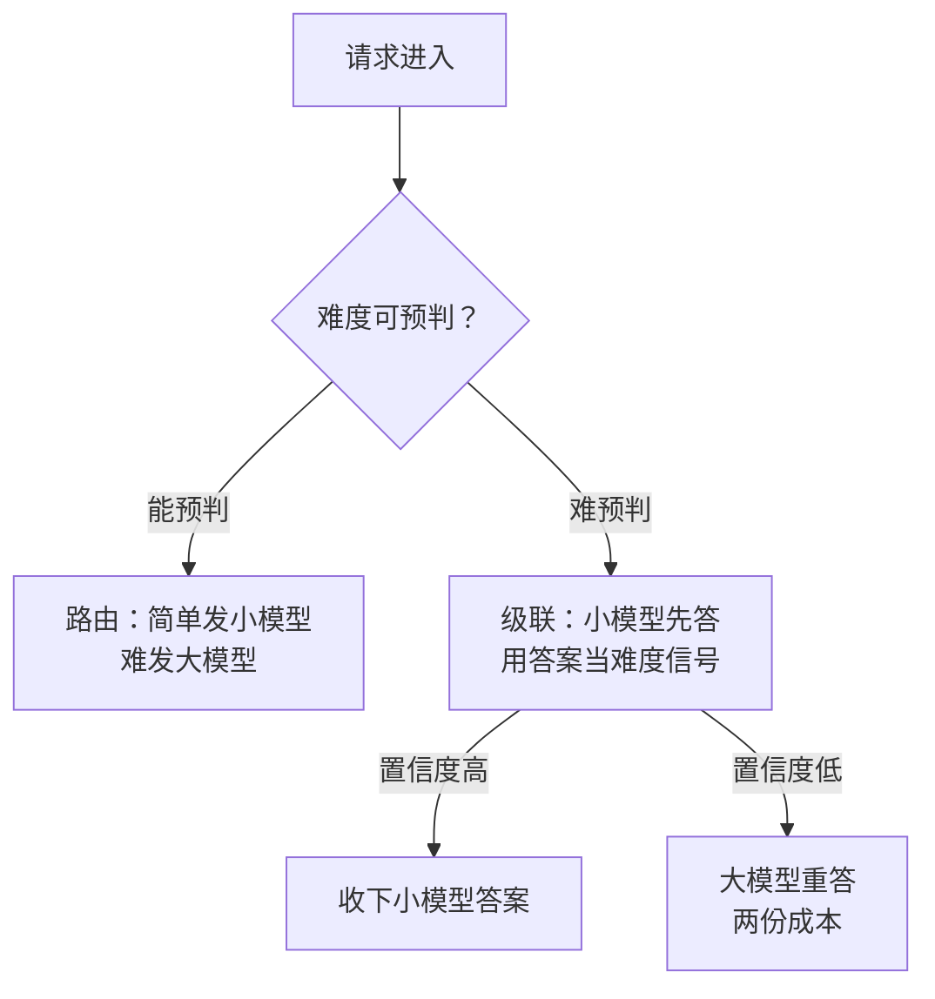

# 模型路由与级联：小模型过滤大模型兜底的省钱结构

## 为什么要按请求难度分配模型

本文讲模型路由与级联——按请求难度分配大小模型来省钱，读完你能按真实请求分布测算省钱空间并设计路由或级联方案。同一 AI 服务的请求难度分布是长尾（少数请求耗时远高于其余大部分）的：多数请求简单（FAQ，即常见问题解答、模板改写、格式化），少数请求难（复杂推理、长文档综合）。

难请求往往要长输出与反复推理，**少数请求可能占掉一半以上的花费**。全量用大模型是浪费——简单请求花大模型的钱；全量用小模型是赌博——难请求质量严重下降。

模型路由要解决的问题是：**按请求难度分配模型，让成本与难度匹配**。两个基本结构：路由（分类器判难度，分发到对应模型）与级联（小模型先答，置信度——模型对自己答案正确性的自评分数，取值 0 到 1——低于设定门槛时升级大模型重答）。

它属于推理服务（把模型包装成可调用的在线服务）成本模型——把 token（模型处理文本的最小单位，约相当于一个词或半个词） 定价换算成单请求成本的方法，见 [[工程知识/AI 系统工程：从模型能力到生产能力/推理服务与平台/推理服务的单位请求成本从token定价推出来.md]]——的一部分：**路由与级联是其中的请求侧杠杆，不买更多卡、不换更便宜的模型，只在请求进来这一步分配得当就能省下钱**。推理服务降本有三个主要方向：**量化压单位成本、批处理（把多个请求合并成一批同时计算、提高硬件利用率）摊固定成本、路由匹配难度与成本**。

## 它是怎么做到的，本质是什么

**路由：先判难度再分发**。难度分类器（轻量模型或规则）预测请求难度，简单 → 小模型，难 → 大模型。可以把它想成医院的分诊台（以下比方只用于理解「先分轻重再分配资源」，两者的错误代价量级不同）：护士先问两句，轻的进普通门诊，重的转专家号。分诊省的是专家的时间，代价是**护士也会看走眼——把重病号分去普通门诊**，这个比方到「分错了代价很大」为止。超出比方范围的是：护士分错一次只影响一个病人，路由器分错的代价要按整批请求的成功率算，而且分诊台自己也要占用看病的时间。分类器是新增组件（它自己也要成本与延迟），**分类错误是直接的质量损失（难请求发给小模型 = 答错）**。路由的关键设计：分类特征（请求文本的什么信号预测难度：长度、领域词汇、历史同类请求的通过率）、分类器的位置（入口处一次判 vs 会话中多次判）。

**级联：小模型先答，不确定再升级**。小模型回答 + 自评置信度（或外部 verifier——独立评分模型）评分，置信度低触发升级（大模型重答或辅助）。**级联的期望成本 = 小模型成本 + 升级率 × 大模型成本**（每个请求都先付小模型的钱，被升级的请求两份都付）。例：小模型 1x、大模型 25x、升级率 15%，期望成本 = 1 + 0.15×25 = 4.75x。**升级率是关键变量**：升级率高则期望成本逼近全量大模型，升级率低则显著省钱。

**路由与级联的对照**。路由是一次决策（判了就走），级联是试探决策（先试再升）。路由的错误显形快（分类错 = 直接质量事故），级联的错误显形慢（**升级漏判 = 质量事故 + 用户等了两轮延迟**）。混合结构是常态：难度可预判的请求走路由（如 FAQ 类请求占比高且特征明显，直发小模型），难度难预判的走级联（小模型试答 + 置信度门槛升级，让答案自己暴露难度）。




*图源：Anthropic《Building effective agents》，CC BY 4.0，https://www.anthropic.com/research/building-effective-agents。这个岔路口的比方只用于理解「分类错误影响整条请求路径」，判错就是走错整条路——对应上文「分类错误是直接的质量损失」。分类器不是免费组件：自己也要算、也要等，省下的钱得先扣掉它那份。*

**为什么把置信度估计比作级联的心脏？**这个比方只用于说明置信度是级联的关键部件：心脏停跳则全身停摆，置信度估计失准则级联的升级机制跟着失效。小模型的自评置信度与真实正确率的相关性决定级联可行性。置信度校准差，即模型自信但常错，会让升级机制失效：**校准差时模型答错却仍给高置信，低门槛放过了它，难请求没被升级，省钱结构在质量上失效**。校准手段按场景选择：温度缩放改动小、见效快，适合快速校准；verifier 模型独立评分，精度高，适合质量要求严的任务；历史统计记录同类请求的经验通过率，适合数据充足、分布稳定的业务。实践顺序是先用温度缩放打基础，再看校准曲线——自评置信度与真实正确率的对照曲线，测法见「怎么自己动手验证」一节——曲线仍明显偏离对角线时再上 verifier。

路由器值不值，RouteLLM 论文在 MT-Bench（多轮对话能力评测基准，MT 即 Machine Translation 机器翻译）上给了实测曲线：横轴是发给 GPT-4 的调用比例，纵轴是整体回答质量——随机路由（蓝线）是要付出的基线（正常状态下的指标水平、用来对比异常），**增强后的路由器（绿线）只需把两成多的请求交给 GPT-4 就摸到 GPT-4 的质量线**，其余七成多由 Mixtral 承接：


*图源：RouteLLM: Learning to Route LLMs with Preference Data（arXiv:2406.18665）论文配图，https://arxiv.org/abs/2406.18665。绿线与蓝线之间的纵轴落差就是路由器的价值：同样的 GPT-4 调用预算，训练过的路由器能换到高得多的整体质量——正文「升级率是关键变量」在这条曲线上就是横轴的读数。*


## 它从哪儿来，要付什么代价

级联与路由在语音识别（1990s，快速匹配 + 精确匹配的两级引擎）与计算机视觉（2010s，级联分类器如 Viola-Jones 人脸检测：简单特征快速否决）有深厚传统——**简单请求不值得贵资源**的工程直觉。LLM（大语言模型）时代的复兴是 2023-2024（FrugalGPT 论文 2023 是标志：用小模型级联替代 GPT-4、省钱 98% 的案例），RouteLLM（2024）把路由器做成开源框架。产品化（各家推理服务商——inference provider）的模型路由、LLM 网关（架在调用方与模型服务之间的一层代理，集中管鉴权、预算、限流与降级）的路由规则把它变成云服务标配。

RouteLLM 开源后长成了独立项目。仓库页 About 区一行「A framework for serving and evaluating LLM routers - save LLM costs without compromising quality」，意为用于部署和评测大模型路由器的框架，在不牺牲质量的前提下节省大模型成本；页面上还有 175 个 commits（代码提交次数，反映维护活跃度）与 5.5k 星标（类似收藏数，反映关注度）。**路由不再是论文里的结构，是能直接 pip（Python 包管理器）安装的组件**：


*图源：[RouteLLM GitHub 仓库页](https://github.com/lm-sys/RouteLLM)（页面截图，2026-09-27）。路由器做成开源框架（正文事实）的实物证据；同时注意 Releases 区的「No releases published」与提交停在两年前——结构已工程化，但接入前要自行评估维护状态，先跑它自带的评测基线再决定。*

**级联的试探成本结构贵在哪、又值在哪？**贵在路由要先付分类成本再分发，级联的失败请求付两份（小 + 大）成本。看起来级联更贵，但级联有一个路由没有的性质：**难度判断可以发生在小模型回答之后**。路由的分类器必须提前猜难度（猜错全赔），级联用小模型的实际回答当难度信号（回答质量本身是很直接的难度证据）。这个「用答案本身当分类信号」的设计，把难度判断从「提前猜」变成「看完答案再判」。预测是提前猜、可能猜错；看实际结果再判证据更硬，因此稳健性高一个档次。代价：升级请求的延迟翻倍——小模型答一轮 + 大模型重答一轮，用户要等两轮首字延迟 TTFT（Time To First Token，首 token 时间）；置信度校准是持续工程（分布漂移后校准失效，简单请求被误升级，省钱结构退化）；级联在升级率极高时才会反超全量大模型：按本文 1x 对 25x 的账本，级联期望成本 = 1 + 升级率 × 25，令 1 + 升级率 × 25 = 25，解得升级率 = 24/25 = 96%，盈亏平衡点在升级率 96%（升级率 50% 时期望成本约 13.5x，仍明显低于直接大模型的 25x）。真正的**风险是升级率漂移：分布变化后升级率悄悄涨**到高位，期望成本 1+升级率×25 随之逼近 25x，省钱效果在无人察觉中失效。上线前按真实请求分布测算升级率与省钱曲线，别拿论文数字外推。

## 这套说法在哪儿会失效

- **路由器的质量上限由什么决定？由被路由模型的质量决定。**路由器再准，把难请求发给弱模型还是错。路由结构的前提是**小模型对简单请求的质量与大模型相当**（这个前提要按任务实测，不是所有任务都有「简单请求小模型就够」的分布）。
- **用户会感知到一致性问题吗？会，这是代价之一。**同一服务不同请求被不同模型回答，输出风格漂移——用户感受到「时好时坏」。产品层要么按会话粘模型（同会话同模型），要么接受风格差异并向用户说明原因。
- **路由决策本身可观测吗？必须可观测。**路由分布（各模型承接占比）、升级率、路由错误率（事后按模型分层的质量监控）三个指标是结构健康的仪表。**路由黑盒化的省钱是假省钱——质量损失看不见**。
- **隐私与合规要求模型间有什么边界？分模型的数据边界。**不同模型（自部署 vs API、不同厂商）的数据边界不同，路由规则要把合规约束编进分发逻辑（敏感数据只发自部署模型），**这是路由器的一个硬约束维度，成本优化在它之后**。

## 怎么自己动手验证

- **难度分布画像**：真实请求日志按事后质量分层（答对的简单/难、答错的简单/难），统计难度分布。预期：长尾分布，多数简单。**分布数据是路由收益上限的估算基础**（P(简单)×成本差）。
- **级联省钱曲线**：小模型 + 置信度门槛升级的模拟（历史请求重放），不同门槛值下的总成本与质量（升级请求的质量按大模型计）。预期：门槛松 → 省钱少质量高，门槛紧 → 省钱多质量降。**曲线的拐点是产品决策依据**。
- **置信度校准实验**：小模型自评置信度与真实正确率的可靠性曲线（分桶统计）。预期：校准良好则对角线关系，偏差大则要校准（温度缩放）或换信号。**校准曲线是级联可行性的前提证据**。

## 动手跑一遍会看到什么？

```python
# 客服工单分类 + 答复生成的级联推演（通用形态）

def cascade(query):
    conf = small_model.classify(query)        # 小模型：4 亿参数，成本 1x
    if conf.score > 0.92:                     # 置信门限
        return small_model.answer(query)      # 85% 的流量止步于此
    # 剩余 15%：低置信（多意图、领域外、歧义）→ 大模型兜底
    big = big_model.answer(query, hint=conf.candidates)   # 成本 25x
    return big

# 账本：小模型 0.001 元/次、大模型 0.025 元/次
#   全量大模型：5 万次/日 = 1250 元/日
#   级联后：5 万 × 0.001 + 0.75 万 × 0.025 = 237.5 元/日（省 81%）
# 门限的两难：调高（0.97）→ 大模型流量涨回 30%，省钱缩水
#             调低（0.85）→ 低难题被小模型硬答，质量事故进场
```

论文里的同一个结构长这样：FrugalGPT 在 HEADLINES（新闻标题类）数据集上学到的级联，便宜的 GPT-J（EleutherAI 的开源 6B 参数模型）先答，其回答打分过 0.96 直接收下，否则交给中等的 J1-L（研究用的长上下文评测集），再不行才动最贵的 GPT-4——**整条链只把 16.6% 的流量送到了最贵的一级**。


这张图三个面板拼出完整证据链：面板 (a) 是学到的级联策略（两个打分门限串起三级模型），面板 (b) 是同一道题 GPT-4 答错、级联答对的实例，面板 (c) 是总账——级联成本 6.5 美元对全量 GPT-4 的 33.1 美元，精度还高 1.5 个百分点。图取自 [FrugalGPT 论文（arxiv 2305.05176）](https://ar5iv.labs.arxiv.org/html/2305.05176)。**自家推演省 81% 与论文实测省 80% 互相印证：门限与流量分布调对了，级联的账就能兑现**。

门限拍脑袋的实录——置信门限抄了别家的 0.9，小模型在垂直术语多的自家领域置信度整体偏低，大量本可自答的请求因置信度低于 0.9 而被判为需升级，三成流量涌向大模型，省钱失效；**按业务指标重校（拿人工标注的"小模型可答"集合重定门限）后回落到一成五**。无兜底画像的实录——大模型兜底后无人看"被兜底的题长什么样"，门限半年不调，新业务线的问题更难，旧门限按老分布定，把它们大量判为低置信，于是全部送大模型，成本悄悄翻倍；**兜底样本要回流分析，它是门限调参与小模型迭代的数据源**。

级联与路由的分工、模型间成本差异的结构性来源见 [[工程知识/AI 系统工程：从模型能力到生产能力/推理服务与平台/模型服务架构从单进程到分布式副本.md]]（副本层）与 [[工程知识/AI 系统工程：从模型能力到生产能力/推理服务与平台/批处理、KV缓存、量化与并行如何改变服务容量]]（单模型层的成本账）。读到这里，你已能按真实请求分布测算省钱空间，并设计路由或级联方案。

## 接着读哪几篇？

- [[工程知识/AI 系统工程：从模型能力到生产能力/推理服务与平台/推理服务的单位请求成本从token定价推出来.md]] —— 路由在成本模型中的位置
- [[工程知识/AI 系统工程：从模型能力到生产能力/推理服务与平台/模型量化的精度经济学：位宽精度与显存的三角.md]] —— 单位成本侧的降本杠杆
- [[工程知识/AI 系统工程：从模型能力到生产能力/模型基础与训练/投机采样与推测解码：小模型带路大模型确认.md]] —— 小模型辅助大模型的亲缘结构
