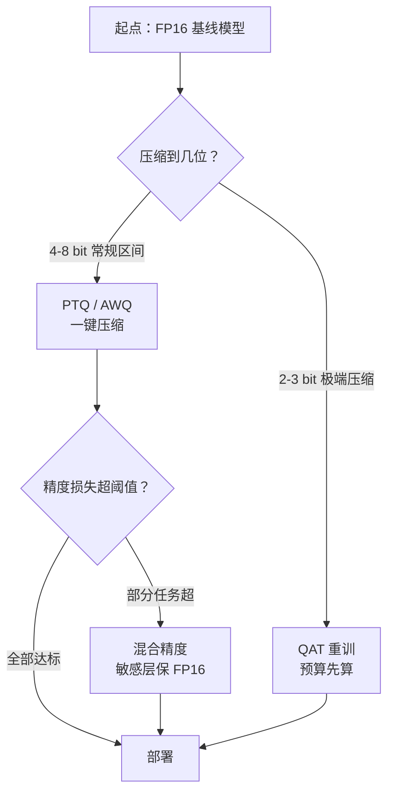
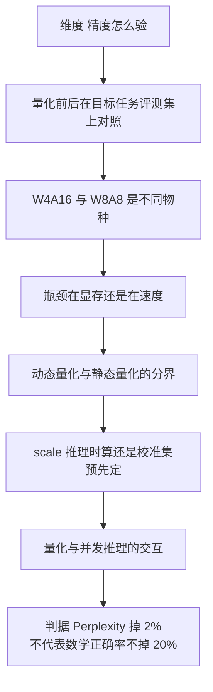

# 模型量化的精度经济学：位宽精度与显存的三角

## 要解决的问题是什么

为什么大模型能塞进一块显卡？答案藏在**显存的三元方程**里：模型权重、KV 缓存（模型生成下一个字时复用之前算过的中间结果，省算力但占显存）、激活值三者共享一块 GPU 显存；激活值是模型每层前向计算产生的中间结果。读完你能估算一块显卡能放多少并发，也知道降位宽要拿什么精度去换；显存层级的物理约束见 [[工程知识/AI 系统工程：从模型能力到生产能力/模型基础与训练/GPU执行模型与显存层级：SIMT与合并访存]]。权重占大头且只读，量化（把权重从高精度浮点数换成低精度整数存储）是**压缩权重、降低显存占用的最高杠杆手段**。

但位宽压缩有代价：INT8（8 位整数）/INT4（4 位整数）的表示误差让模型输出偏离 FP16（16 位浮点，训练出的大模型权重的默认存储格式）基线（正常状态下的指标水平、用来对比异常），部分任务（数学、代码）比闲聊敏感得多。量化要解决的问题是**找到位宽、精度损失、显存收益的三角平衡点**——把位宽、精度、显存想成三角形的三个角，压一个角、另外两个角就跟着动，让每 bit 的压缩都换到可接受的质量损失。

三个角分别是位宽、精度、显存：显存容量固定时，位宽越低、精度损失越高、能放的参数越多，**三者互相牵制**。这个三角比方只到三个角互相牵制为止，真实取舍还涉及任务敏感度等更多维度。

量化是推理服务（把模型包装成可调用的在线服务）成本模型（见 [[工程知识/AI 系统工程：从模型能力到生产能力/推理服务与平台/推理服务的单位请求成本从token定价推出来.md]]）里最硬的一个杠杆。

位宽换了多少、精度丢了多少，可以借用一把尺子来理解：旧尺子的刻度是 1 毫米（FP16），换成 1 厘米（INT4）之后，原来能量出来的 3.7 毫米现在只能记成 4 厘米附近的一个近似值。

这个比喻到「误差如何计算」为止——尺子刻度是均匀的，而权重分布不是，个别很大的值和大量很小的值混在一起，刻度怎么划（scale 是缩放系数，决定整数刻度对应多大数值范围）**才是量化真正的难点**。

## 量化到底改变了什么

打个比方：量化像把一张高清照片存成压缩格式——文件小了很多（显存省了）、传得快了（带宽省了），但放到特别大时会看出马赛克（精度损失）。这个比喻到「省空间换精度」为止：具体几比特合适、哪些层不能压、校准用的参考数据怎么选，要看正文。

**量化的数学：线性映射与反量化**。FP32（32 位浮点）/FP16 权重映射到低 bit 整数：scale×q+b（q 为 INT4/INT8 整数，scale/b 为该组的缩放与零点）。存储从 16 bit/参数降到 4-8 bit/参数，7B 模型权重**从 14GB 到 3.5-7GB**。推理时反量化回浮点计算（或直接整数算术，INT8 Tensor Core）。误差来源：量化噪声（映射不可逆，位于两个整数之间的值被迫取整）、**离群值难题**（权重分布长尾，少数大值撑大 scale 压垮多数小值的分辨率）。

**三条路线**。
- 训练后量化（PTQ）：训完直接压。**简单但精度损失不可控**，大模型对它意外友好（涌现的离群值通道可以被平滑迁移，如 SmoothQuant——平滑量化，把激活里的离群值搬到权重侧再量化）。「平滑迁移」长什么样，论文的直觉图最直观：上排是原始分布，激活侧尖峰（离群值）吃掉大部分量化档位、其余值只剩很低的有效位数，权重侧平缓得几乎不用操心；下排经过平滑变换，尖峰从激活侧搬到权重侧，两侧都落进「easy to quantize」的区间——

*图源：SmoothQuant 论文（arXiv:2211.10438）Figure 1，https://arxiv.org/abs/2211.10438，论文插图。*

上排的红色尖峰就是正文说的「离群值难题」：**少数大值撑大 scale，多数小值的有效位数被压光**；下排的迁移变换数学上等价，模型输出不变，量化难度却从一侧挪到另一侧——「大模型对 PTQ（Post-Training Quantization，训练后量化：模型训完再压精度，不重新训练） 意外友好」的工程前提，就是**这类只动尺度、不动输出的变换存在**：量化误差主要来自离群值撑大 scale，把离群值搬走后两侧分布都变平缓，scale 不再被撑大，小值分辨率自然保住。
- 量化感知训练 QAT（Quantization-Aware Training）：**训练时模拟量化噪声，精度最好**，但要重训，成本高：只有当压到 2-3 bit、训练后量化的精度已经崩塌时，**这笔重训成本才划算**，所以它只用于极端压缩。

- 混合精度（同一模型的不同层用不同位宽存储）：敏感层（首尾层、attention 输出投影——注意力层把加权结果映射回模型维度的矩阵，数值范围大、对量化敏感）保 FP16，其余量化。**精度损失曲线的非均匀分布决定了「哪里该花 bit」**。

「同一套东西按精度分档、档位即公差承诺」在计量行业有现成的实物——量块：每块钢的出厂刻字是名义尺寸（0.55 英寸、4 英寸），实际长度与名义值的偏差按精度等级承诺，K 级对标定基准、1 级对车间测量；等级越高的块越贵，但不是所有测量都买得起 K 级。位宽之于模型权重与此同构：**FP16 是标定室的高等级，INT8/INT4 是车间档**——选择哪一档，取决于**下游任务对公差**（精度损失）的敏感度，而非档位本身的高低。这个比喻只到「按精度分档等于承诺公差」为止：量块的等级只对应允许的偏差范围，怎么标定、怎么使用不在比喻内。

压缩的收益最终落在显存账单上。下图是两根 DIMM（内存条：插在主板上的内存模块）内存条的正面特写：每颗颗粒的容量焊在电路板上，卡上的标签就是档位承诺（上根 PC-133，下根 DDR400 512MB）——买多大容量的条子决定能装多大的模型，位宽选择决定同样的容量装下多少参数。这个类比只到容量与位宽共同决定能装多少参数为止：内存条实际的电路走线，和模型在显卡里怎么摆放没有关系。

> 图：168 针与 184 针 DIMM 内存条对比，来自 [Wikimedia Commons](https://commons.wikimedia.org/wiki/File:168_pin_and_184_pin_DIMM.jpg)，CC BY 4.0，摄影 Veeblefetzer。

路线选择的判据按两个问题走：**部署目标在消费级单卡还是数据中心集群；压缩目标在 4 bit 以上还是以下**。消费级单卡跑大模型，选 PTQ/AWQ（activation-aware weight quantization，按激活分布挑重要权重保精度的一种 PTQ）的 W4A16 形态（权重压到 4 bit、激活保持 16 bit 浮点），省显存与带宽，计算仍走浮点；数据中心吞吐优先，选 W8A8（权重与激活都压到 8 bit 整数）全整数流水线吃 Tensor Core（英伟达 GPU 里的矩阵运算单元）红利。**压到 3 bit 以下时 PTQ 的精度损失断崖，必须上 QAT**，重训成本要提前算进预算。三条路线常组合使用：主体走 PTQ，敏感层保 FP16，极端场景局部 QAT。生态现状也影响选择：llama.cpp 的 GGUF（llama.cpp 的模型量化文件格式）把 PTQ 做到分档一键（q4_K_M 等档位），AWQ/GPTQ（GPTQ 是另一种训练后量化方法，用二阶信息补偿量化误差）的社区实现覆盖主流开源模型，QAT 的工具链仍稀疏（PyTorch 官方的 TorchAO、Hugging Face 的 bitsandbytes 两个量化库各覆盖一段）；**如果工具链不支持你的模型结构，QAT 要自写算子，成本远高于 PTQ，选型前先确认覆盖**。

**KV 缓存和权重各占多少显存？**量化权重省的是静态占用（一次性的），KV 缓存随 batch（批，一次同时送进 GPU 的多个请求）与上下文长度线性涨，显存账见 [[工程知识/AI 系统工程：从模型能力到生产能力/模型与上下文/KV缓存与上下文长度的显存账：为什么长上下文贵.md]]。**长上下文服务里 KV 可能反超权重成为大头**，只压权重不压 KV 的显存收益封顶。KV 量化（FP8（8 位浮点数格式，精度更粗但速度更快省显存）/INT4 KV）是**长上下文服务的第二杠杆**，但 KV 误差直接进注意力（模型为每个词分配权重、聚焦上下文中最相关部分的机制）计算，**比权重量化更伤精度**，要按任务实测。

**硬件换代能带来多少量化收益？**硬件整数吞吐与显存带宽决定量化的实际收益：INT8 Tensor Core 的吞吐量高于 FP16（具体倍数查当代硬件规格表），**显存带宽受限的场景是 decode（模型逐字生成的阶段）**：每生成一个 token（模型处理文本的最小单位，约等于一个词或一个字）都要把全部权重从显存读一遍，**速度卡在显存带宽**，批处理（把多个请求合并成一批同时计算、提高硬件利用率）与容量的交互见 [[工程知识/AI 系统工程：从模型能力到生产能力/推理服务与平台/批处理、KV缓存、量化与并行如何改变服务容量.md]]；**权重带宽需求减半，读取耗时随之减半**；在纯带宽受限的 decode 阶段，**生成速度就接近线性提升**。量化的收益结构是三维的：**显存（能装更大模型或更大 batch）、带宽（decode 提速）、算力**（INT8 每个时钟周期能完成更多次乘加，同样电费算得更快）。

## 压缩位宽付出了什么代价

量化省的是带宽与容量，代价是精度。这和把数据按哈希（把任意长度数据压成固定长度指纹、不可逆）函数（一种把任意输入映射成固定长度指纹的函数，输出看起来近似均匀）散列到不同节点是同一类权衡：得到均匀分布，失去相邻性。这个类比只到「得到均匀就要放弃相邻」为止：哈希分片（把数据按规则切开存到不同节点）管的是数据怎么分布，量化后的权重分布是否均匀要看权重本身，不能照搬。

量化并**不是大模型时代的新发明：它与信号处理里的量化噪声理论出身相同**（1950 年代的 PCM——脉冲编码调制，把模拟信号转成数字信号的早期技术），神经网络量化研究在 2015 前后因移动端部署兴起（TensorFlow Lite、INT8 推理）。**大模型时代的节点是 LLaMA 开源后的社区量化生态**（llama.cpp 的 GGUF、GPTQ、AWQ），把 PTQ 从论文技术变成一键操作。AWQ的关键观察：**1% 的显著通道决定量化误差**，保护它们（按激活分布缩放权重）比全模型 QAT 便宜几个数量级。

「一键操作」的实体就是 llama.cpp 这个仓库：About 区一行「LLM inference in C/C++」，README 直接给 GGUF 量化档位的跑法，92.7k 星标、Fork 22.7k、Issues 2.5k——社区量化生态活在日日有合并的提交流里：

*图源：[ggerganov/llama.cpp GitHub 仓库页](https://github.com/ggerganov/llama.cpp)（页面截图，2026-09-27）。正文机制段的 GGUF 分档（q4_K_M 等档位）就维护在这个仓库里；README 首屏直接回答「怎么在 CPU 上跑量化模型」，Issue（GitHub 仓库的问题讨论区）则记录着各档位在真实任务上的精度争议。*

**离群值通道为什么值得单独保护？**权重分布的长尾离群值撑大 scale 是精度损失的主因，AWQ 观察到离群值在激活侧（少数通道的激活值系统性超出正常范围），于是**把激活的幅度迁移到权重侧（通道等比缩放，数学上等价）**，让权重分布回到可量化范围。不重训、不微调（在预训练模型上用少量数据继续训练、让模型适配具体任务），**一次前向统计就完成**。这次迁移把 PTQ 的精度**从「能跑」拉到「接近 FP16」**。

同一组权重的三种结局放在一张图里，PPL（困惑度）直接标在面板下方：

43.2 到 13.0 的差距主要来自那 1% 的通道：**少数离群值撑大 scale，压垮多数小值的有效位数**；保住这 1% 通道就保住整体量化分辨率。缩放变换把混合精度（面板 b）的精度收益搬进了整块 INT3（面板 c），**硬件不付出任何代价**。

位宽压缩比是不可绕开的物理限制，4 bit 以下（3/2 bit）的精度损失在数学与代码任务上断崖，闲聊与摘要感知不到：数学与代码靠多步精确运算，权重误差会逐层累加放大；闲聊靠语义冗余掩盖小误差，所以低位宽下前者先失准——质量评测必须覆盖任务谱，单一 benchmark 覆盖不了；量化的「免费午餐」只到 4 bit，再往下要 QAT 与极端技巧，工程性价比急剧下降。服务侧的隐性代价：量化模型与 FP16 基线的输出分布不同（轻微但系统），下游的输出解析、评测基线都要重新校准，混布量化与非量化实例的 A/B 结论会带噪声。

## 这套说法在哪儿会失效

- **精度损失是任务依赖的，没有普适安全位宽**。Perplexity（困惑度：语言模型的标准评测指标，衡量对下一个词的预测有多"拿不准"）掉 2% 不代表数学正确率不掉 20%。上线路径：**目标任务的评测集**（构建方法见 [[工程知识/AI 系统工程：从模型能力到生产能力/质量与运营/评测集的构建与维护：从场景采样到难度分层.md]]）上量化前后对照，**给「可接受损失」定业务阈值，再看显存收益值不值**。
- **W4A16 与 W8A8 是不同物种**。压权重量化（W4A16：省显存与带宽，计算仍 FP16）与全整数流水线（W8A8：权重激活都 INT8，吃 Tensor Core 红利）**服务不同目标**：前者是消费级卡跑大模型，后者是数据中心吞吐。**选型时先分清目标**，别被「量化」一个词混过去。
- **动态量化与静态量化的精度/开销分界**。动态量化（推理时实时算激活 scale）**精度好但有额外开销**；静态量化（校准集预先定 scale）**快但分布漂移**（输入域变化后 scale 失配）会静默掉精度。**输入分布稳定的服务用静态，开放域用动态或定期重校准**。
- **量化与并发推理的交互**。Continuous batching（连续批处理：请求随到随进批，不等攒齐一批再跑）的吞吐收益依赖大 batch，而 **batch 涨激活显存涨——压权重省的空间被激活吃回一部分**。容量规划要按「**权重+KV+激活峰值**」三维算，见批处理与容量的容量模型（上文链接）。

四条边界分别卡在选型的四个取舍维度上，见下图：

第二条是最容易被"量化"一个词混过去的取舍。华为云社区 [量化实战：把 70B 模型塞进单卡](https://bbs.huaweicloud.cn/blogs/490699) 给出的对照很直接：W4A16（weight-only）**显存降 4 倍、速度提 1.5-2 倍靠带宽省**，但矩阵乘仍是 FP16，不吃 INT 算力；W8A8（weight+activation）**显存降 2 倍、速度提 2-3 倍**，靠的是 INT8 Tensor Core，代价是**激活有 outlier、精度损失更大**。

该文还给出了为何没有 W4A4（权重与激活都压到 4 位整数的量化档位）：**INT4 激活量化会让精度崩塌，W4A16 才是 INT4 的实际可用形态**。RainLib [大模型量化全景解析](https://blog.rainlib.com/blog/llm-quantization-deep-dive) 进一步澄清了一个常见误解——W4A16 常被理解成"模型用 4-bit 运行"，更准确的说法是**权重以低比特存储，激活与多数中间计算仍是高精度**，所以速度收益取决于**内核能否把解包、反量化与矩阵乘融合起来**。第一条边界正源于此：**不同任务对量化误差的敏感度差得很远，只能在自己的评测集上量化前后对照**。

## 怎么自己动手验证

- **精度对照实验**：同一模型 FP16 vs INT8 vs INT4，在数学、代码、闲聊三类评测集跑对照。预期：闲聊差异小（<2%），**数学与代码在 INT4 出现可测损失（5-15%）**，AWQ 普遍好于朴素 PTQ。任务谱的差异化损失是「**无普适安全位宽**」的直接证据。
- **显存与吞吐实测**：7B/13B 模型在不同位宽下的显存占用、decode 吞吐、TTFT（首 token 延迟，从发请求到吐出第一个字的时间）。预期：**显存近线性于位宽（14GB→7GB→3.5GB）**；decode 吞吐在带宽受限区随位宽近线性提升。容量收益的实测数字是部署决策依据。
- **离群值可视化**：抽取权重与激活的分布（直方图/分位数），预期：**激活侧少数通道值域远超其余**（离群值通道存在），AWQ 前后权重分布对比（缩放后尾部收敛）。分布图是**激活感知量化机制的直观证据**。

## 想继续深入该读哪几篇？

- [[工程知识/AI 系统工程：从模型能力到生产能力/推理服务与平台/推理服务的单位请求成本从token定价推出来.md]] —— 量化在成本模型中的杠杆位置
- [[工程知识/AI 系统工程：从模型能力到生产能力/模型基础与训练/GPU执行模型与显存层级：SIMT与合并访存.md]] —— 显存带宽的物理约束
- [[工程知识/AI 系统工程：从模型能力到生产能力/推理服务与平台/批处理、KV缓存、量化与并行如何改变服务容量.md]] —— 量化与批处理的容量交互
- [[工程知识/AI 系统工程：从模型能力到生产能力/模型基础与训练/投机采样与推测解码：小模型带路大模型确认.md]] —— 另一维度的降本杠杆
- [[工程知识/AI 系统工程：从模型能力到生产能力/推理服务与平台/模型路由与级联：小模型过滤大模型兜底的省钱结构.md]] —— 单位成本侧的降本杠杆
- [[工程知识/AI 系统工程：从模型能力到生产能力/模型基础与训练/混合精度与数值稳定：低位宽训练的溢出与下溢管理.md]] —— 训练侧的低位宽：溢出与下溢如何决定量化能压到几位

## 相关

[[工程知识/AI 系统工程：从模型能力到生产能力/推理服务与平台/AI推理服务的容量模型——从token预算到机器数的推导演练.md]]

## 相关

[[工程知识/AI 系统工程：从模型能力到生产能力/推理服务与平台/GPU分片把整卡切成可分配份额：份额粒度、装箱与隔离的三笔账.md]]

## 相关

[[工程知识/AI 系统工程：从模型能力到生产能力/推理服务与平台/流式输出把首字节时间变成交付语义：背压超时与断流恢复的工程边界.md]]