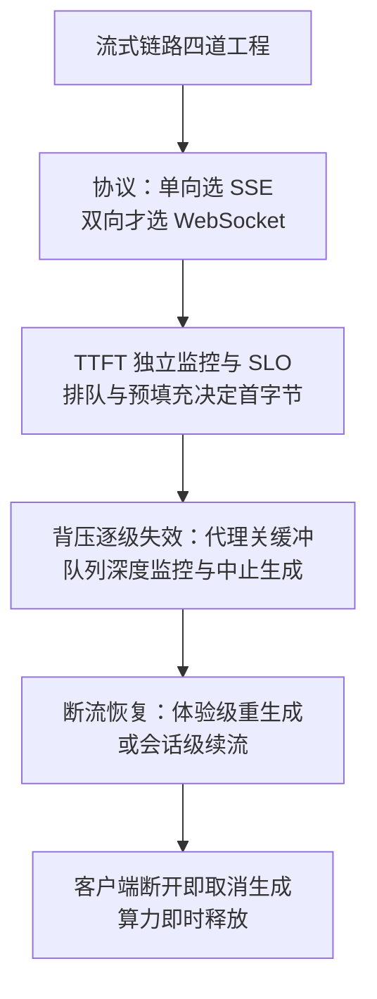

# 流式输出把首字节时间变成交付语义：背压超时与断流恢复的工程边界

**流式输出（streaming，服务端边生成边推送、客户端边接收边渲染）把延迟体验从「总时长」改写成「首字节时间 + 持续流动」——交付语义变了，超时、背压与恢复的全部设计跟着变。** 读完你能回答：SSE 与 WebSocket 的选型边界、TTFT 为什么成了核心指标、背压怎么沿链路传递、断流恢复为什么不能只靠重试。

## 要解决的问题

非流式模式下，用户等的是全部生成完成（长回答 30 秒起步，期间白屏）；**流式把等待切成「首 token 时间（TTFT，time to first token）+ 每 chunk 间隔」——首字节 300ms 到达，体验从「卡死」变成「正在打字」**。但体验改写的另一面是工程约束的重写：连接长时间保持、每个 chunk 都要经过代理与网关、客户端断开时服务端要停止生成——**非流式的「请求-响应」模型里不存在的问题（背压、断流、代理缓冲）全部变成一等公民。**

## 机制：协议选型、三个约束与恢复设计

### 协议选型：SSE 与 WebSocket 的分界

| 维度 | SSE | WebSocket |
| --- | --- | --- |
| 方向 | 单向（服务端→客户端） | 双向 |
| 协议 | 普通 HTTP | 独立协议（升级握手） |
| 断线重连 | 内建（`Last-Event-ID` 续传） | 应用层自建 |
| 基础设施兼容 | 代理/网关/负载均衡原生支持 | 部分中间件需显式配置 |

LLM 推理是「请求→流式响应」的单向场景，**SSE 的兼容性与内建重连是天然优势；WebSocket 的双向能力（语音对话、协作编辑）在该场景是闲置成本**。**选型判据：单向流选 SSE，需要客户端持续上行才选 WebSocket。**

### 约束一：TTFT 是交付语义的核心指标

**流式模式下用户的体感由 TTFT 与 chunk 间隔决定，总时长退居次要**。推理侧影响 TTFT 的因素：预填充长度（prompt 越长首 token 越慢）、排队深度（批处理把新请求排在当前批次后）、首 token 的采样路径。监控要把 TTFT 独立成一级指标（与总时延、吞吐并列），SLO 也要为它单独设线——**用总时延的 SLO 管流式服务，等于用错误的度量管正确的系统。**

### 约束二：背压沿链路逐级失效

客户端收得慢（弱网、渲染卡顿）时，理想行为是把「慢」传回服务端让生成降速或挂起。**现实是背压（backpressure，下游处理速度约束上游生产速度的机制）沿链路逐级消失：代理缓冲了 chunk（收满才转发，客户端的慢传不回源站）、HTTP chunked 编码没有流控语义、推理引擎默认生成完不管客户端死活**。补偿手段按层：**代理关闭对 SSE 的缓冲**（`X-Accel-Buffering: no`、`proxy_buffering off`）、**服务端监控发送队列深度**（客户端 ACK 滞后即降速或断开）、**推理引擎支持中止**（客户端断开时取消生成，算力立即释放）。

### 约束三：断流恢复的两级设计

流式中途断开（网络抖动、移动端切换）的恢复设计分两级：**体验级**——前端展示已收内容、提示重连，重连后从头重新生成（成本：token 重复计费）；**会话级**——服务端保留生成上下文（KV cache）与断点位置，重连时从断点续流。SSE 的 `Last-Event-ID` 机制为会话级续传提供了协议挂钩，但推理场景的续传还要求服务端保留 KV cache（显存成本）——**续传深度是体验与显存成本的定价关系，按业务价值选档**，多数对话产品的答案是**短窗口续传（30-60 秒内重连续流，超时从头再来）**。

## 案例：断流与队头的相邻问题

[[工程知识/后端系统：在并发、失败与变化中维持服务/基础设施/队头阻塞是共享队列的排队税：一卡全等的传递链与解法]] 的批处理队头**直接决定 TTFT：长输出请求把批次拖长，新请求的首 token 时间被拉长——流式把「总时长问题」改成「TTFT 问题」后，队头阻塞的形态跟着改写，分桶与抢占的解法不变**。[[工程知识/AI 系统工程：从模型能力到生产能力/推理服务与平台/推理批处理的两难：吞吐与延迟的调度天平]] 是这个天平的推理侧展开。心跳与判活的视角同样适用：**长连接流的活性要靠 chunk 间隔监控（连续 N 秒无 chunk 即判流故障）**，[[工程知识/性能工程：从用户等待到资源瓶颈/存储与网络/心跳与keepalive是活性探测的最小语言：从协议内建到应用层判活]] 的判活语言在这里以「数据本身做心跳」的形态出现。

## 怎么测

- **TTFT 基线**：不同 prompt 长度与并发深度下的 TTFT 分布，**SLO 按分布设线而非平均值**。
- **代理穿透验证**：全链路（网关、CDN、反向代理）**确认无缓冲——用慢客户端收流，观察服务端发送队列是否同步积压（积压说明背压断了）**。
- **断流演练**：流中途 kill 客户端连接，**验证推理引擎取消生成（GPU 利用率回落）、计费按已生成 token 结算**。
- **续传测试**：断开后 30 秒内重连带 `Last-Event-ID`，**验证会话级续流；超窗后验证降级到重生成路径**。

## 哪些认识一看就错

- **「流式只是前端体验优化」——它重写了交付语义：TTFT 成核心指标、背压与断流成为新故障域、计费与监控全跟着变；当纯前端改动对待会漏掉整条链路的改造**。
- **「WebSocket 比 SSE 先进」——单向场景 SSE 的 HTTP 兼容性与内建重连是实质优势；协议选型按通信方向定，不按新旧定**。
- **「断线重试就够了」——重试重新生成是体验级兜底；重连风暴（断流后客户端集体重试）会打爆排队系统，重试要带退避与会话级续传分流**。
- **「代理透明所以不用管」——默认开启的代理缓冲正是流式卡顿的头号成因（chunk 被攒满才转发）；每一跳代理都要显式关闭缓冲并验证**。

## 效果从哪来、要付什么代价

**流式把用户等待从总时长压缩到 TTFT，感知延迟下降一个量级；取消生成让客户端断开立即释放算力，无主生成不再消耗 GPU**。代价是**链路级改造：每一跳代理的缓冲配置、TTFT 的独立监**控与 SLO、断流恢复的两级设计、计费按流结算——非流式的简单「请求-响应」被拆成一整套流式工程。**收益与回答长度正相关（越长流式收益越大），短回答场景（分类、抽取）流式收益趋零，按内容形态选模式**。

关系：[[工程知识/后端系统：在并发、失败与变化中维持服务/基础设施/队头阻塞是共享队列的排队税：一卡全等的传递链与解法]] —— 批处理队头对 TTFT 的直接决定。[[工程知识/AI 系统工程：从模型能力到生产能力/推理服务与平台/推理批处理的两难：吞吐与延迟的调度天平]] —— 推理侧的调度定价。[[工程知识/性能工程：从用户等待到资源瓶颈/存储与网络/心跳与keepalive是活性探测的最小语言：从协议内建到应用层判活]] —— 长连接流的判活：chunk 间隔即心跳。
