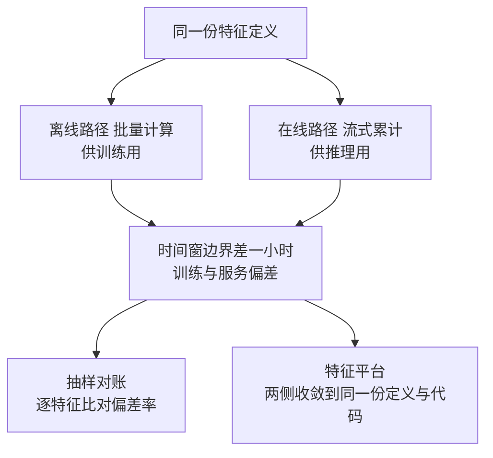
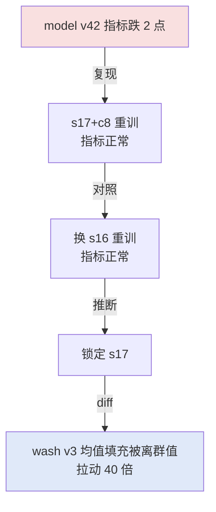

# 数据集、特征与模型版本必须可追溯

读完本篇，你会知道怎么给每一批数据、特征、模型产物打上不可混淆的版本，并在指标回退时快速定位到是哪次数据或配置变更。这里的产物包括 AI（人工智能）模型及其全部输入。可追溯性解决的是模型变好或变坏后，无法回答「是哪批数据、哪套特征、哪个训练代码和哪个模型产物造成的」。**核心机制是为数据快照、特征定义、训练配置、模型、评测和部署（含提示词、工具与调用轨迹 trace）建立不可歧义的版本关系**；最小实验是回放同一版本组合，确认能重建指标和服务输入。

## 先记住哪几句

| 维度 | 回答 |
| --- | --- |
| 要解决的问题 | 同一个模型、服务或评测结果在输入数据、代码、配置变化后可能悄悄改变，导致无法解释指标回退（回归指指标退回到旧水平，区别于统计里的回归分析）、复现结果或安全回滚。 |
| 本质 | 把数据、表示、模型、运行和评测绑定成一个不可混淆的版本图，而不是给结果贴一个模型名称。 |
| 做法 | 为每个输入和产物记录来源、快照、哈希、代码 revision、配置、依赖、索引、工具和硬件，并以运行 ID（一次训练或推理过程的唯一编号，用来把输入、配置、模型、输出串成一条可追溯的记录）关联它们。 |
| 效果与代价 | 可以定位变化来源、重放请求、比较候选并整体回滚；代价是版本存储、元数据（描述数据的数据，例如这份数据集的来源、哈希、生成时间）维护和脱敏治理成本上升。 |
| 边界 | 可追溯只能说明「使用了什么」，不能证明模型质量、因果关系或所有场景都正确；仍需独立评测和线上观测。 |
| 验证 | 随机抽取一个运行 ID，确认能重建输入、版本、配置、输出和评分；故意替换数据或提示词，检查系统能否识别差异。 |

一个 AI 结果**不能只标记「模型名」**。同一模型在不同数据快照、embedding（把文字、图片等内容转成一串数字表示，机器靠它计算相似度）、特征、提示词（发给模型的输入指令与背景信息）、工具、索引、依赖和硬件下可能产生不同结果——这就是上面摘要表要为每个环节登记版本的原因。**可复现和可回滚（把系统状态退回到改动之前的版本）的最小身份是：输入数据版本、代码 revision、训练/推理配置、模型产物和评测结果的完整关联**。

## 版本对象要登记哪些字段

打个比方：数据集与特征像一道菜的食材清单——光知道"做出来了"不够，得能说出用的哪批菜、谁处理的、什么时候切的，否则吃出问题根本查不到是哪一步。这个比喻到"为什么要留痕"为止：具体要记哪些字段、血缘怎么建、怎么回溯，要看正文。

版本对象之间的依赖关系构成一张有向图（节点带方向连线：箭头从原材料指向产物）。源表（存原始数据的表）产出特征视图（从原始字段加工出的可用特征），特征视图组成数据集，数据集训练出注册模型（通过评测后登记入库、可供部署的模型版本），模型再部署成服务。追溯就是从下游节点沿边回溯到上游。


*图源：Snowflake 官方文档，CC BY 4.0，https://docs.snowflake.com/en/developer-guide/snowflake-ml/ml-lineage。*


| 对象 | 至少记录 | 常见失真 |
| --- | --- | --- |
| 数据集 | 来源、时间、过滤、许可、哈希、分布 | 用「最新数据」覆盖旧快照（某一时刻的完整只读副本） |
| 特征/embedding | 生成代码、模型、维度、归一化、窗口 | 新旧表示混用、离线/在线不一致 |
| 模型 | 基座、权重/adapter、tokenizer（分词器：把文本切成模型能处理的 token）、精度、依赖 | 只记录产品别名，不记录快照 |
| 评测集 | 样本、标签、切片、污染策略、版本 | 测试集被训练或提示词泄漏 |
| 运行 | 提示词、工具、索引、解码、硬件、trace | 无法解释线上回归 |

## 数据到服务的约定卡在哪条分叉上

偏差的产地是一条分叉：同一份特征定义被复制到两条计算路径上，口径就在分叉处各自变化。分叉只是把「定义复制到两处」画成一岔路的比喻，边界到此为止；两路各指什么、口径差怎么产生，看下面的因果：



抽样对账只是把偏差测出来，特征平台才是把两条支路并回一个节点：两条路径都调用同一份代码，约定写进共享代码里就不会再被两边各抄一份而各自变化，所以 schema（字段名、类型与是否必填等结构约定）、缺失值与时间窗的约定要落在共享代码与接口约定测试上。

训练、离线特征和在线推理必须约定 schema、缺失值、时间窗、迟到数据、权限和默认值。特征生成逻辑若在训练和服务两处复制，**极易产生 training-serving skew**（训练与服务偏差：训练时算特征和线上算特征的逻辑或数据环境不一致，模型吃到的东西和学的对不上）；共享代码、接口约定测试和代表性回放比文档承诺更可靠。

## 变化管理怎么走

新数据/特征/模型先产生不可变版本，让候选与已上线版本互不覆盖，出问题时能整体切回。版本经过评测和数据质量检查再注册为候选；灰度（新版本先放一小部分流量验证，逐步放大到全量）时同时比较质量、延迟、错误、资源和成本。**发现回归时切回上一个完整版本，不能只回滚权重而保留不兼容 tokenizer、schema 或索引**——只换权重不换配套，接口对不上，服务启动即报错或静默产出错误结果。

血缘登记不必从零造工具：开源血缘工具 Marquez 按 namespace（命名空间，把同一项目下的数据集和任务归到一组，避免名字撞车）组织元数据，Datasets 页列出每个数据集的命名空间、来源与更新时间，点开任一条目能看到它的 schema、版本与产出它的 Job——上面版本对象表里的「来源、时间、哈希（把任意长度数据压成固定长度指纹、不可逆）」这些字段，在这类工具里是一等公民：


*图源：[Marquez 官网](https://marquezproject.ai/)（marquezproject.ai），Marquez 项目，Apache 2.0。*

## 动手跑一遍会看到什么：一个坏样本的定位全程

模型指标突然跌 2 个百分点，版本链把定位压到十分钟，排查路线见下图：

```text
回溯链（全部有 hash 指针）：
  model v42 = train(data_snapshot s17, feature_view fv9, config c8)
  s17 = build(ods v2026-09-15, 清洗规则 wash v3)
  fv9 = feature_table ft4@2026-09-15

定位动作：
  1. 用 s17+c8 重训 → 指标正常 → 排除训练代码与配置
  2. 用 fv9 但换 s16 → 指标正常 → 锁定 s17
  3. s17 与 s16 的 diff（差异对比）→ 清洗规则 wash v3 在 9-15 把缺失值填充策略从"删除"改成"均值"，
一个字段的均值被离群值拉动 40 倍——均值偏移说明特征分布异常，diff 逐行比对定位到具体行 → 坏变更定位到行级
```



跑一遍的收获：没有版本链时这场排查是"大家都在改什么"的会议；有版本链时是三次重训的 diff——定位时间从过去的好几天缩到三次重训的几个小时。重训的成本（小时级 GPU）是版本链价值的直接标价，买的是定位确定性。

## 这些偏差量在什么数量级？

**线上特征与训练特征的偏差（training-serving skew）是静默杀手**：训练用离线表算的"用户近 7 天点击数"，线上同一特征由流式计算实时累计，口径差 1 小时边界。这种差让模型上线后吃到的特征和训练时不一致；模型靠该特征给候选内容排序，特征口径一变，排序质量下降，于是离线 AUC（衡量排序质量的指标，0.5 为随机、1.0 为完美） 0.82 的模型上线后 CTR（点击率，点击次数除以展示次数）不达预期。**偏差排查的第一步就是对账同一个样本在两侧的特征值**（抽样 1000 条，逐特征比对，偏差率 >1% 的特征逐个修）。特征平台的价值就是把两侧计算收敛到同一份定义。

## 怎么自己动手验证

追溯能力最终要落到界面上——从任一模型出发能逐级看到它依赖的数据集与源表，否则只能算记录了数据而没有可用能力。


*图源：同上（Snowflake 官方文档），CC BY 4.0。*


给定一个运行 ID，应能重建：输入样本、数据/模型/代码版本、配置、工具调用、输出和评分。随机抽取线上请求做脱敏（遮盖敏感字段的部分内容、保留可辨识形态）回放；对数据分布、缺失率、标签延迟、embedding 漂移和模型输出拒答率设阈值。**无法重建的结果不能作为生产结论**。

关系：[[工程知识/AI 系统工程：从模型能力到生产能力/推理服务与平台/AI平台必须统一模型、数据、评测与发布版本]] · [[工程知识/软件构建：让变化可以理解、验证与交付/测试与交付/发布门禁必须绑定真实证据]]
