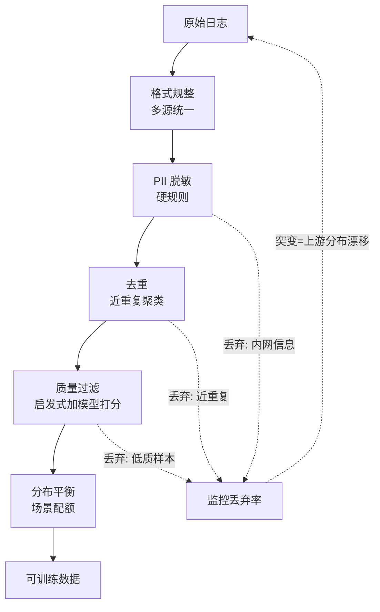
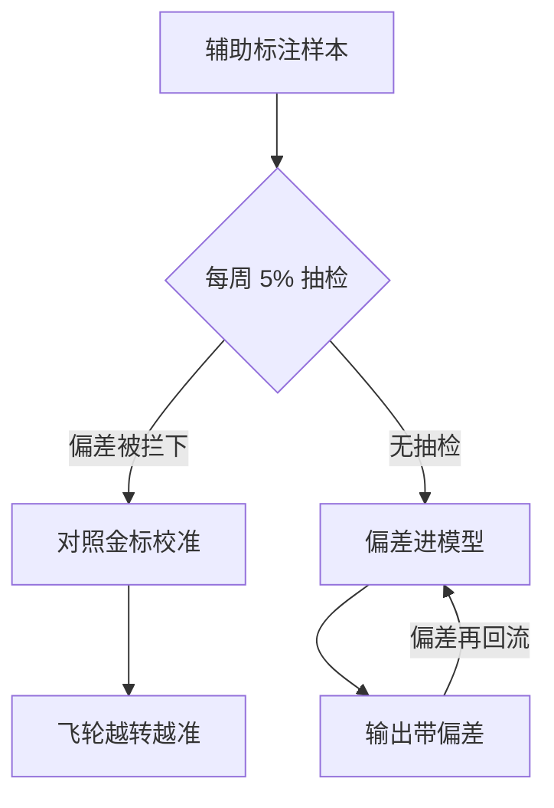
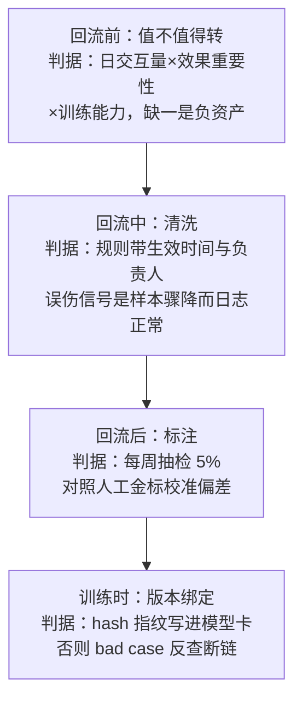
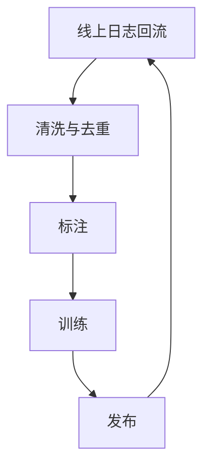

# 数据飞轮的工程闭环：日志回流清洗与标注

## 要解决的问题是什么

数据飞轮要解决的问题：**把「上线日志」变成「训练资产」的工程回路**。读完这篇你能**判断回路断在哪一环**，也能**定位日志量大、模型却没变好的原因**。**AI 系统的效果上限由数据决定**：上线后的真实交互日志（对话、工具调用轨迹、用户反馈）是**最有价值的训练信号**，但它是**原始的——噪声、PII（Personally Identifiable Information，个人身份信息）混杂其中、格式不一**。回路一圈走**回流、清洗、标注、入库、训练、上线、再回流**：**转起来，系统随使用变好（用户的每次交互都在为下一版投票）**；**转不起来，系统停在上线时的水平**。

这套回路像一家餐馆改菜单：**每天看哪些菜剩得最多（收集日志）、把明显馊掉的挑出去（清洗）、请厨师长判断剩菜是口味问题还是备料过多（标注），再据此调整下一版菜单（重训上线）**。这个比喻到"为什么必须成环"为止——**只看剩菜不调菜单，等于白记；调了菜单不回看新数据，等于蒙着改，环断在任何一处，餐馆的口味都不会变好**。这是 MLOps（机器学习运维：把训练、评测、发布与监控串成可重复的流程）区别于传统 Ops（运维：保证服务正常运行的日常维护工作）的核心：**运维对象不只是服务可用性，还有数据资产的增长率**。

蒸汽机的飞轮与离心调速器给这个回路提供了实物：**飞轮把做功冲程的多余能量存进旋转惯性，供吸气冲程取用——转起来之后，维持转速的能量远小于从静止启动**；**离心调速器随转速自动收放进汽阀，转速偏高就节流、偏低就补汽，无需操作员盯着**。数据回路里的**回流管道是储能（把上线后的真实交互存成资产），清洗与质量过滤是调速器（丢弃率突变即节流，防止坏数据把回路带飞）**——**回路一旦转起来，系统的每次运转都在为下一版积累动能**。这个比喻到「回路如何自我维持并自我纠偏」为止：**调速器只能抑制转速波动，数据质量的判准仍要靠清洗规则与人工抽检，比喻替代不了它们**。

## 日志怎么变成训练资产

飞轮转起来之前，先得有地方存放每一次转动的记录——日志回流的存储介质本身就是这套机制的物理基础。下图是 StorageTek 磁带库内部：成排的磁带槽位与机械臂，把线上系统吐出的日志成批归档，回流清洗与标注的第一步就是从这里把记录取出来。


> 图：StorageTek 磁带库，来自 [Wikimedia Commons](https://commons.wikimedia.org/wiki/File:StorageTek_tape_library_(51993015872).jpg)，CC BY 2.0，摄影 Jorge Franganillo。

**回流日志从哪四条管道来？****推理日志**（请求与响应全量，**注意采样率——只留存部分请求的占比，与脱敏规则**）；**用户显式反馈**（点赞点踩、评分、采纳/拒绝——**最稀疏但最准的信号**）；**用户隐式反馈**（重试、编辑后重写、复制行为、会话时长——**密度高但要推断**）；**外部信号**（下游业务指标——客服系统的解决率，**最贴近业务但归因链长**）。**四条管道的信号质量与密度互补，回流设计要四路全开**。

**清洗漏斗每层都在丢什么？** 原始日志到可训练数据的漏斗：**格式规整（多源格式统一）→ PII 脱敏（个人标识、内网信息，硬规则）→ 去重（近重复聚类，防止少数模式淹没分布）→ 质量过滤（启发式——按人工经验写死的判断规则，加模型打分，过滤低质样本）→ 分布平衡（场景配额，防止高频场景淹没长尾场景）**。**漏斗每层的丢弃率要监控：丢弃率突变说明上游分布漂移（新场景涌入或故障注入坏数据）**。

原始日志到可训练数据要过**五层**：**格式规整、脱敏、去重、质量过滤、分布平衡**。**每层都在丢东西，丢弃率是上游分布漂移的传感器，损耗只是附带读数**——**它一突变，先怀疑上游**。



三层过滤各自丢弃不同原因的样本，**汇到同一个数字就分不清是哪一层在变，所以丢弃率要按层分别收**：三层丢弃汇到同一个监控点，**突变即回头查上游分布**，而不是**继续调漏斗参数——把分布漂移当清洗规则问题来修**，只会越修越偏：**分布漂移的根因在上游，调清洗规则解决不了上游问题，反而会把新场景的合理样本当脏数据误删**。

清洗与标注只是回路的中段，ml-ops.org 的 MLOps 全景图把飞轮画成三个相扣的环：Design 定问题与数据可得性、Model Development 做数据工程与模型验证、Operations 负责部署与监控触发——「飞轮转起来」指的就是这三个环持续咬合：


*图源：ml-ops.org《MLOps Principles》配图 mlops-loop-en.jpg，https://ml-ops.org/content/mlops-principles，ml-ops.org 项目配图，CC BY 4.0。*

**标注有哪三种模式、各适合什么场景？** **人工标注**（**质量天花板**，**成本与速度的劣势**）；**LLM（Large Language Model，大语言模型）辅助标注**（**强模型预标 + 人工抽检修正，成本降一个数量级**，**质量依赖辅助模型与任务的匹配度**）；**用户行为当标注**（**采纳/拒绝直接当正负样本，零标注成本但偏差大——用户只在极端场景反馈，沉默样本不可知**）。**三模式的组合按信号价值分配：高价值场景人工，长尾（少数请求耗时远高于其余大部分）场景 LLM 辅助，显式反馈直接用**。

**飞轮健康度靠哪三个指标度量？** 三指标：**回流率（日志可回流的占比）、清洗存活率（原始到可训练的转化率）、标注吞吐（单位时间产出标注样本）**。**三个环节是串联的：上一环的产出就是下一环的输入，总产出等于回流率 × 清洗存活率 × 标注吞吐（比如三环各做八成，总产出只剩约五成）**，所以**任一环的转化率低都按乘积拖累总产出，三指标乘积才是数据资产增长率**。瓶颈诊断：**哪个环节的转化率低，就是飞轮的堵点（常见根因是 PII 规则过严与辅助标注质量差）**。

飞轮闭环在中文语境下的完整形态，华为云 MLOps 流程图画得直接：数据与特征管理进模型开发训练，经注册与版本管理到部署服务化，监控与治理环节把数据回流和触发重训两条线接回起点——「转起来」对应的就是这两条回接线：


*图源：华为云 ModelArts MLOps 流程文档（华为云开发者学堂课程图），中文图。*

## 这个回路要付出什么代价

数据飞轮（data flywheel）一词来自产品圈（用户使用产生数据、数据改进产品、产品吸引用户），**MLOps 工程化是 2020s 的事**。**标注侧的变化来自 LLM 辅助标注（2023+）**：**过去人工标注是数据集构建的瓶颈（贵、慢、不一致），强模型把标注成本降一个数量级后，飞轮的经济性成立——此前回流日志的成本高于价值，飞轮转不动**。**RLHF（人类反馈强化学习：用人类偏好数据微调模型行为）/数据运营是提示工程之后的竞争力主战场**，各家 Agent 产品的差异化越来越体现在**数据回路质量**。

怎么把用户行为直接当标注用？**点踩这类显式反馈稀疏且不够客观——用户只在愤怒时反馈**；**重试、编辑、复制这类隐式行为密度高但语义模糊**。把多个隐式信号组合成「质量推断」（**重试 = 失败信号、编辑后重发 = 不满信号、复制 = 有用信号**），再加上会话上下文（同一会话里前后的提问与回答），**可以推断出比单信号更准的质量标签**。**信号设计把反馈采集从「求用户配合」变成「读用户行为」**：**省掉了求用户打标的成本**，但**组合多路信号仍要工程投入**，所以**信号成本大幅下降，不是绝对为零**。

代价：回路每一环都有成本与风险——**回流有合规成本（PII 处理不当是法律风险，脱敏规则要前置到采集层）**；**清洗漏斗的规则要维护（规则老化：业务变化后旧规则误杀新场景样本）**；**标注质量要抽检——LLM 辅助标注的系统性偏差会污染训练集，偏差样本回流进模型再产生偏差数据，飞轮变成「偏差放大器」，这是数据飞轮最危险的失败形态**。**飞轮的治理比飞轮的建设难：建设是一次性工程，治理是持续运营**。

**最危险的失败形态「偏差放大器」怎么长出来：抽检这道闸门在不在，飞轮走向两个结局**。

**辅助标注的偏差会不会被放大，取决于抽检这道闸门在不在：有抽检**，**偏差在校准环节被拦下**；没有，**偏差会自己回到模型里再长一遍**。


**右边那条链是只闭环——偏差进模型、输出带偏差、偏差再回流，飞轮越转越偏**；**左边那条靠金标（人工标注的黄金标准答案）校准把闭环剪开**。**抽检不是质检成本，它是剪断偏差回流环的闸门**：**有它在，偏差被拦下；没有它，偏差继续回流**。

## 这套说法在哪儿会失效

- **飞轮不是所有系统都值得转**。判断式成本收益：**日交互量大（信号密度够）× 效果对业务重要（改进值得投入）× 有训练能力（数据要有去处）**。**三者缺一，飞轮是负资产（回流存储成本 + 合规风险，无产出）**。
- **清洗规则的演进要跟业务同步**。**规则集的版本化（每条规则带生效时间与负责人）**，**新场景上线前评审清洗规则是否误伤**。**规则误伤的发现信号：某场景样本量骤降而上游日志量正常**。
- **标注质量抽检是持续成本不是一次性**。**LLM 辅助标注的偏差随任务漂移（辅助模型对特定类型样本系统性偏好）**，**定期抽检（每周 5%）+ 偏差校准（对照人工金标）是飞轮的质量保险**。**无抽检的标注管道是慢性毒药**。
- **数据集版本化与模型版本化要绑定**。**训练数据集的版本（内容 + 处理规则版本）与模型版本绑定**，否则**「这个模型是用哪批数据训的」无法回答**，问题回溯（bad case，即处理出错的样本，反查数据源）断链。**工具上用数据集的 hash 指纹（对数据集内容算一串固定长度的数字，内容一变指纹就变——HuggingFace datasets 等工具内置此能力）**，**流程上把数据集版本写进模型卡**。

四条边界按飞轮的四个阶段排，每条卡在一个环节上：



**第一条决定要不要建飞轮：日交互量、效果重要性、训练能力三者缺一，回流只剩存储成本与合规风险**。**后三条管的是飞轮转起来之后的质量**：**清洗规则要跟着业务走，误伤的发现信号是某场景样本量骤降而上游日志量正常**；**标注抽检是持续成本，辅助模型的偏差会随任务漂移**；**最后一条最容易被忽略——数据集版本不与模型版本绑定，「这个模型是用哪批数据训的」就无法回答，问题回溯直接断链**。

## 怎么自己动手验证



闭环的价值取决于**每一环是否真的接上**。**断点通常落在清洗与标注之间**，因为**清洗出的样本要等人补强标签才能进训练，这一交接最依赖人工、最容易空转**：


- **怎么用一个月真实日志测出漏斗转化率基线（正常状态下的指标水平、用来对比异常）？** 全管道跑一个月真实日志，统计每层丢弃率与总存活率，预期：**总存活率 10-30%（原始日志到可训练），PII 层丢弃率随业务敏感度波动**。**基线数字是飞轮健康度的锚点**。
- **标注模式对照**：同一批样本（1000 条）分别**人工、LLM 辅助、人工抽检 LLM** 三模式标注，统计一致率与成本。预期：**LLM 辅助成本降 90%+，一致率 80-90%（任务依赖）**；**抽检修正后一致率接近人工**。**三模式的成本-质量曲线是标注策略依据**。
- **飞轮效果实验**：回流数据训练迭代版（LoRA 微调：低秩适配，只训少量新增参数就能改变模型行为；或提示词迭代）与基线版在相同评测集（构建方法见 [[工程知识/AI 系统工程：从模型能力到生产能力/质量与运营/评测集的构建与维护：从场景采样到难度分层.md]]）对比。预期：**真实分布的改进显著（业务场景分数上升），公开榜分数不动或下降（分布差异）**。**业务改进是飞轮价值的直接证据**。

## 怎么拿一次上线后的真实回流来对账

```python
# 一个翻译 Agent 的飞轮闭环（通用推演）

# 第 1 环 采集：线上请求-响应-用户行为全量写入日志
log = {"query": in_text, "answer": out_text,
       "feedback": user_action,      # 采纳/修改/放弃 = 隐式标签
       "trace_id": tid, "model_ver": "v2.3"}

# 第 2 环 清洗：回流的原始日志不可直接训
#   脱敏（用户内容去标识）→ 去重（同 query 高频样本限权）→
#   质量过滤（放弃类样本要区分"答案差"与"用户场景不需要"）

# 第 3 环 标注：用户行为是弱标签，强标签要人补
#   修改过的答案 = 免费的强标签（用户已给出更好版本）
#   按模型不确定性采样送人工标注（主动学习：只挑模型最拿不准的样本让人标，标注预算省六成）

# 第 4 环 回训与评测：新数据进训练 → 评测集验证不回退 → 上线
#   闭环的完成标志：本月标注的样本出现在下月模型的行为改进里

# 飞轮转速的账：日请求 10 万、采纳率 70%、修改类强标签 3% →
#   日产强标签 3000 条，一个月 9 万条 → 足够支撑一次领域微调
```

**采集环缺失的实录**——模型上线三个月，**日志只记请求与响应，没记用户行为（采纳/修改/放弃），飞轮的第一环就断（无标签来源，人工标注从零起步，冷启动——新系统还没有数据积累、要从零开始的状态——要多花两个月）**；**修复是行为埋点（在代码里插入统计上报语句、收集用户行为数据）先行（上线日就有数据）**。**清洗环跳过的实录**——直接拿原始日志微调（在预训练模型上用少量数据继续训练、让模型适配具体任务），**重复样本让模型过度拟合高频表达（top 1% 的 query 占训练量四成），生成千篇一律**；**去重与限权后恢复多样性**。评测环的衔接见 [[工程知识/AI 系统工程：从模型能力到生产能力/质量与运营/评测集的构建与维护决定所有评测的地基.md]]（**回流的失败样本是评测集的活水**；标注治理见 [[工程知识/AI 系统工程：从模型能力到生产能力/数据与MLOps/训练数据治理：来源、许可与污染决定语料的长期价值.md]]）。

## 还想顺着飞轮往下读哪些篇？

- [[工程知识/AI 系统工程：从模型能力到生产能力/质量与运营/评测集的构建与维护：从场景采样到难度分层.md]] —— 飞轮效果验收的评测基础
- [[工程知识/AI 系统工程：从模型能力到生产能力/质量与运营/Agent评测必须覆盖轨迹而不只看最终答案.md]] —— 轨迹数据的评测视角
- [[工程知识/数据系统：在并发与故障中保存事实/数据治理/数据质量的三重校验：完整性时效与一致性.md]] —— 清洗漏斗的质量校验同源思想
- [[工程知识/AI 系统工程：从模型能力到生产能力/生态与选型/精调与RAG的边界：什么时候微调更划算.md]] —— 精调数据集的工程来源
