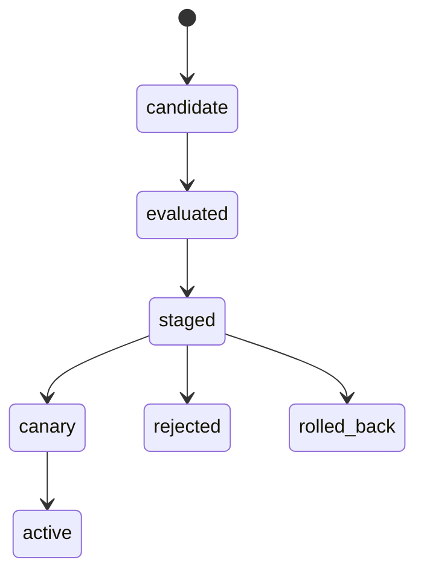

# 模型发布需要注册、灰度与回滚

**新模型上线后质量、延迟或安全行为变化不可控：没记录就不知道该退回哪一套组合，旧文件也可能已被清理，没法原样恢复**。**读完这篇你能用注册、灰度和回滚三件套把模型发布变成可控动作**。可以把它想成新药上市：**先在登记册上写明成分和批号（注册），再找一小批人试用观察反应（灰度），发现不对立刻从货架上撤回来（回滚）**。这个比方只到分批放量为止。**药出了问题，靠批号能追回具体哪一批；模型的「批号」是权重快照（某一时刻的完整只读副本）加训练数据版本，这两项都要在注册表里登记，少一项就追不回去**。

**三件套各管一段：注册保存可追溯身份，灰度让新旧版本在相同流量切片（把总流量按用户、租户或比例切成可对照的几份）中比较，回滚恢复已验证组合**。**双版本并行期间两套模型同时在线，GPU 显存（GPU 上的内存、模型参数与计算中间结果都存这里）和算力要按两份准备，观测（记录延迟、错误率、日志等运行指标）也要多分一个版本的记录；回滚模型管不到外部副作用（模型触发的动作已实际发生，如通知已发出、款项已扣除，换回旧模型撤不回这些结果）——回滚只换模型，外部世界不会跟着退回**。

**模型运行不只靠权重文件，发布时要同步切换一整套配套组件：tokenizer（分词器：把文本切成模型能处理的 token）、提示词（发给模型的输入指令与背景信息）、工具 schema（工具的参数结构定义）、RAG 索引（RAG 检索增强生成：用外部知识库给模型补充答案，索引就是那份知识库的检索目录）、量化（降低数值精度以省显存）、推理引擎（把模型权重加载并跑出预测结果的运行时）、GPU 驱动、权限、观测和客户端兼容（调用方的接口版本要和新模型对得上）**。**只复制权重文件上线会漏掉其他环节**。

## 注册表到底要保存哪些身份信息？

**新模型上线之后质量、延迟、成本或安全行为发生变化，而团队只能看到整体指标变动，无法判断当前流量由哪个版本服务，也说不清回退之后能恢复到什么状态**。**本篇回答：注册保存哪些身份信息、灰度怎样让新旧版本在同一批流量上比较、回滚能撤销什么与不能撤销什么，以及双版本并行期间的成本如何核算**。

## 注册、灰度与回滚背后的机制是什么？


*图源：Nacos 官方中文文档《Nacos 架构》（Alibaba Middleware 开源项目，Apache-2.0），https://nacos.io/zh-cn/docs/v2/architecture.html。这张中文架构图的中间那个"注册中心"，就是模型注册表在微服务里的对应物：它存的是"谁可用、哪一版、什么身份"。模型发布要建的注册表，职责与它同构——下面这段讲的正是它该存什么。*

**不登记会发生什么？模型上线后没人说得清线上跑的是哪一套组合，质量、延迟或安全行为的变化不可控，出问题也没法退回**。**注册表要保存的正是那些会改变线上表现的组件身份。模型每次回答的内容由权重、分词器、提示词、工具结构与索引一起决定，改动其中任何一项都会改变线上表现**。**注册表保存不可变的身份与证据，灰度让新旧版本在同一批流量下产生可比较的结果，回滚恢复的是版本组合；已经产生的外部副作用不在回滚的作用范围内**。

## 注册表里要存哪些发布对象与状态？



**注册表中的版本必须不可变，记录来源、许可证、校验和（对数据算出的指纹，用来发现传输或存储中的损坏）、依赖矩阵（各依赖库版本之间兼容关系的对照表）、评测集、风险结论和回滚目标**。**production 这样的别名（指向当前线上版本的标签）随时可以改指向，回滚时它可能已指向别的版本，所以不能代替具体的版本快照**。

## 灰度要比较什么、怎么分桶？

**灰度比较的是两条路径的结果：同一个模型登记表里，staging 版本（预发布版本：已通过评测、尚未承接线上流量的版本）与 production 版本（生产版本：正在承接线上流量的版本）在相同流量分桶下并排对照，胜出者才晋级**。


*图源：Databricks《Developments in MLflow: A System to Accelerate the Machine Learning Lifecycle》论文 Figure 1 左半（Model Registry UI），https://go.databricks.com/wp-content/uploads/2020/08/deem_mlflow.pdf。*


**按用户、租户、任务类型或流量比例分桶（把用户按某个维度分成固定的几组，同一组始终走同一个版本），并保持稳定主体（同一个用户始终落在同一个桶里）以减少样本偏差（两组用户在进入实验前就有差别，导致比较失真）**。**比较的指标分两类**。**质量类：成功率、事实/引用、拒答与越权（模型拒绝回答的频率与越过权限回答的频率）、工具参数、业务护栏（防止模型输出违反业务规则的兜底检查）**。**性能类：TTFT（首字延迟：从发请求到收到第一个字的时间）/ITL（字间延迟：相邻两个输出字的间隔）、token（模型处理文本的最小单位，约等于一个字或半个词）消耗、GPU 显存、错误率、成本**。**平均分提高可能掩盖特定人群受损——平均分是全量用户的汇总，高风险切片恶化意味着一部分用户实际受损，扩大灰度会让更多这样的用户受害，此时应停止扩大灰度**。

**灰度放量与金丝雀发布（像矿里先放一只金丝雀探危险，新版本先以小比例试水）的分批推进是同一件事：新版本先以小比例承接流量，每个观察周期确认指标正常再扩大一批，直到全量替换旧版本**。这个比方只到小比例试水为止：具体的分批节奏与判停规则见「灰度与回滚的成本怎么量化、案例怎么回流」一节。


*图源：cactusli.net《常见的项目部署方案》（个人技术博客，作者原创流程图），https://cactusli.net/devops/cicd/Common-project-deployment-solutions.html。*

## 回滚到底能退到哪一步、退不掉什么？

**回滚能退到哪一步，取决于进度记在哪：登记表里「生产指针指向哪个版本」就是进度本身**。**回滚就是修改登记表中生产别名指向的版本号，使其退回上一个已验证版本——前提是那个版本的制品全部还在**。

**回滚必须覆盖模型、tokenizer、提示词、工具、索引和配置的兼容组合**；**数据库和数据事件的字段结构（schema）采用先兼容读写（新旧版本都能读写）、再迁移（所有流量切走之后改数据）、最后删除旧路径（清理只服务旧版本的代码和数据通道）**。**保留旧版本能跑起来的完整环境——依赖库版本、容器镜像（打包好的运行环境文件）、GPU 型号和驱动版本，并定期真的拉起一次旧版本确认能用——依赖库或驱动版本不兼容时，光有文件也拉不起来，所以不能只在登记表里留个下载链接**。

**「旧版本能不能顶上」的判定要绑真实状态，而不是进程在不在**。**健康端点监控模式把这两件事分开：外部监视进程按周期访问应用自己暴露的健康端点，由应用汇报能否服务；返回不健康的实例会被监视进程标记，由负载均衡器移出转发池**：


*图源：Microsoft Learn 云设计模式 Health Endpoint Monitoring pattern，CC BY 4.0，https://learn.microsoft.com/en-us/azure/architecture/patterns/health-endpoint-monitoring。模型发布里一次回滚之后的健康判定同样走这条链路：应用自己汇报权重加载、索引连接与推理就绪状态，而不是由部署动作的成功返回值代为回答——端口通或 Pod（Kubernetes 调度的最小部署单元，可含一个或多个共享网络的容器） Ready 都可能在依赖没连上时给出假阳性。*

## 动手跑一遍会看到一份怎样的完整登记表？

看完一份真实登记表长什么样。新版推荐模型 v2.3 从训练完到全量的每一步都有对应登记：

```text
注册表（模型登记表）：
  model: rec-ranking  |  version: v2.3  |  stage: staging → production
  训练数据: d-2026-09-14 快照  |  评测报告: report-2317 AUC 0.812（AUC 衡量排序质量，越接近 1 越好），对比线上 0.805
  血缘（这个模型从哪来）: 特征 schema v8、基座（在其上继续训练的底层模型）v2.1、超参（训练配置参数）run-993 的 config 快照

灰度（5% → 25% → 全量，每档一个观察周期）：
  对照指标：CTR（点击率）、停留时长、服务错误率、P99 延迟（99% 的请求都快于这个值，衡量最慢那批用户的体验）
  对照方式：同流量分桶，新模型桶 vs 旧模型桶，差值通过统计显著性检验（用统计方法确认差异不是随机波动）才算数
  守门：错误率或 P99 超阈值 **→ 自动回退到 v2.1**

回滚（把"退回去"变成一个动作而非一次抢修）：
  回滚对象是"模型版本指针"：生产指针从 v2.3 指回 v2.1
  前提：v2.1 的制品、特征 schema、依赖服务全部仍在位（登记表保证）
  回滚后复盘：指标分歧样本 + 特征分布对比，定位 v2.3 的失效面
```

**跑一遍的收获：发布流程的三个环节各管一件事——注册表管"哪个版本带什么证据在什么阶段"，灰度管"用对照而不是感觉判断好坏"，回滚管"坏了的退路是不是一条真的路"**。**任何一件缺失，另外两件都会跟着失效（没登记就没法回滚，没灰度就没发现在线退化）**。

## 灰度与回滚的成本怎么量化、案例怎么回流？

**灰度的账：5% 桶的目的是用最小代价攒出统计可判的样本量（转化率类指标日活百万级时 5% 桶一天够判 1% 量级的差异），档位越大覆盖用户越多，一旦模型有问题影响面越大；信心足够才敢扩大到下一档，扩大就多暴露用户；档位逐步扩大，让暴露的风险跟着信心的上升同步放大**。**回滚的成本账：制品（模型运行需要的所有文件：权重、依赖库、配置）在位时回滚是分钟级指针操作；制品缺失（旧版本被清理、特征 schema 已升级不兼容）时回滚变成天级抢修——登记表的保存期就是回滚能力的有效期**。

案例回流：[[工程知识/软件构建：让变化可以理解、验证与交付/测试与交付/灰度与功能开关的边界：交付节奏与配置漂移.md]] 的对照纪律在模型域原样成立（灰度要对照，开关要清理）；回滚退路失效的实录形态见 [[工程知识/缺陷分析：从个案到体系/稳定性/案例十一：上游修好了，你这边没有——一个发行分支的移植缺口.md]]——备份与退路本身是要验证的资产，不是想当然的存在。

**发布就绪要与清单对账——预写版本可追溯、回归通过、trace（每次请求的完整调用记录）可区分版本、回滚已演练四项均打勾，任一项与预期对不上就退回补齐**。

## 动手验证前需要准备哪些东西？

- [ ] **版本、产物哈希（把任意长度数据压成固定长度指纹、不可逆）和运行配置可追溯**。
- [ ] **离线任务、对抗样本、权限、工具失败和长上下文回归通过**。
- [ ] **线上 trace 能区分模型版本、索引版本和推理后端**。
- [ ] **自动停止阈值、人工审批和回滚命令已演练**。
- [ ] **回滚后不会把新版本产生的状态交给旧版本错误解析**。

关系：[[工程知识/AI 系统工程：从模型能力到生产能力/数据与MLOps/数据集、特征与模型版本必须可追溯]] · [[工程知识/AI 系统工程：从模型能力到生产能力/推理服务与平台/推理服务的核心矛盾是延迟、吞吐、显存与质量]]

