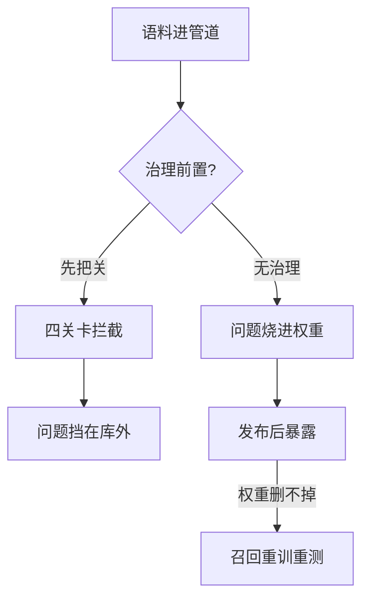
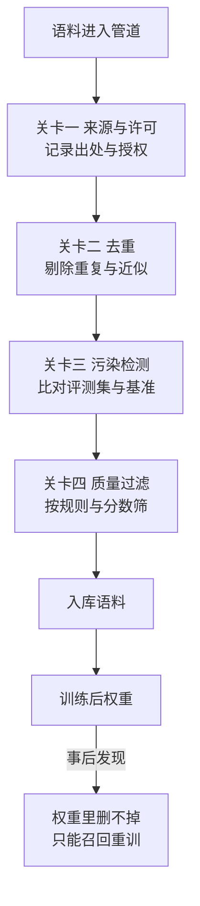
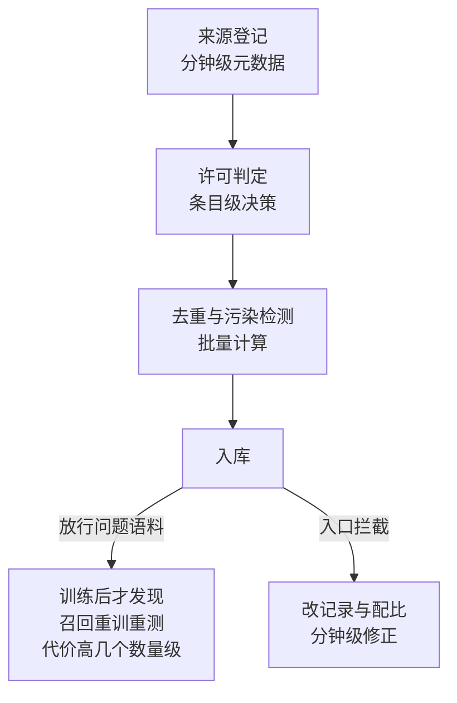

# 训练数据治理：来源、许可与污染决定语料的长期价值

**模型上线三个月后被发现用未授权语料训练、评测集（用来衡量模型能力的数据集）泄漏进训练集导致分数虚高、个人信息混入语料被监管点名**——这类问题在模型发布后无法补救，**只能在数据入口处拦截**。要解决的问题：**把来源、许可、去重与污染检查做成训练数据管线的强制关卡，让每一份进入训练的语料都可追溯、可审计、可撤回**。读完这篇，你能照着搭一条可溯源、可审计、可按来源撤回的强制管线。

本质是**数据资产的风险前置**。训练完成后，**语料的问题固化进权重**——模型在训练时把语料内容学进参数，问题随权重一起定型，**事后无法局部删除：许可违规无法从权重里「删除」某本书，污染无法在事后从分数里「减去」那份泄漏**。**治理必须在混料前完成**，出问题后排查只剩**把已发布的模型下架并重新训练（即召回重训）**。

**图书馆的采编流程给"入口拦截"提供了百年实物**：一本书进入馆藏前要过**采购验收（来源与授权）、查重（馆藏里是否已有同书或译本）、分类编目贴索书号（可追溯可定位）**——进库之后想撤掉一本书，**要遍历全部书架、影响所有借阅记录，成本远超入库时把关**。**语料治理的四关卡结构与此相同（同构）：问题烧进权重，就是一本撤不掉的书**。这个比喻到「入库前后成本差」为止，四关卡的具体机制看正文。

把治理前置与出问题后排查两条路径的成本差画出来：




## 管线是怎么用四关卡拦住问题的？

打个比方：**训练语料像一座水库——上游有工厂排污，许可不清就是排污，水就永远有毒；评测集的题漏进水库是污染，测出来的分数就全是假的**。这个比喻只说明「上游污染下游」的因果关系；具体许可怎么查、污染怎么检测、去重怎么做，看正文。




**四关卡的价值在于把问题挡在权重之前，越靠后的关卡漏过的代价越高**：


| 关卡 | 检查什么 | 拦截什么 | 证据物 |
| --- | --- | --- | --- |
| 来源登记 | 抓取 URL、时间、版本、哈希 | 无法说明出处的语料 | lineage（记录每份语料从哪来、经过哪些处理的来源谱系） |
| 许可判定 | 语料许可证、收集授权、合规地区 | 未授权商用内容 | 许可证清单 + 决策记录 |
| 去重与清洗 | 精确/近似去重、质量过滤、PII（personally identifiable information，可直接或间接识别到自然人的信息）命中 | 重复、低质、隐私数据 | 去重率、PII 报告 |
| 污染检查 | 与评测集 n-gram（连续 n 个词组成的片段）/嵌入（把文本转成向量的表示）重叠 | 评测泄漏 | 污染率报告 |

**四关卡顺序不可交换：污染检查必须对最终混料配方——把多份语料按比例混合成训练集的方案——执行，去重后再查污染才准，因为重复内容会放大重叠信号；许可判定必须在混料前，混入后无法按来源分离**。

**四个关卡的成本权重相差悬殊：登记与判定是入库前的轻量动作，污染与许可一旦放行到训练阶段，代价就从记录一步跳到重训**：



## 治理会在哪些地方失效？

| 失效 | 机制 | 信号 |
| --- | --- | --- |
| 评测污染 | 评测样本或近似变体进入训练集 | 训练 loss 在评测集异常低；独立新评测大幅掉分 |
| 许可违规 | 语料许可未判定或误判 | 发布后收到下架/诉讼；无法按源撤回 |
| PII 泄漏 | 个人信息混入语料并被模型记忆 | 模型能复述个人信息；监管问询 |
| 记忆化泄露 | 模型逐字复现训练语料 | 抽样生成与语料高重合 |
| 数据版本漂移 | 重训时语料版本已变，结果不可比 | 同配置重训结果分叉 |

## 动手跑一遍会看到什么：一次污染检测的全过程

怀疑语料被测试集污染（模型在评测集上异常好），n-gram 重叠检测给出证据：

```python
from collections import Counter

def ngrams(text, n=13):
    toks = text.split()
    return set(tuple(toks[i:i+n]) for i in range(len(toks)-n+1))

# 评测集每个样本的 13-gram 在训练语料中查重
overlap = [len(ngrams(q) & train_grams) > 0 for q in eval_questions]
# 典型读数：污染率 4% —— 这 4% 的样本指标接近满分，剔除后整体分下降 3 个点
# 结论：报告里那 3 个点是"背下来的"，能力估计必须用去污染后的分数
```

复现要点：**13-gram是公认的经验阈值（更短误报高、更长漏检）**；**对中文按单字 bigram（相邻两个汉字组成的片段）+长度阈值，或按句子做哈希（把任意长度数据压成固定长度指纹、不可逆）比对**。**污染的来源通常并非恶意——爬取时间晚于评测集发布**，数据治理的来源字段（URL+抓取时间）**让这类污染在入库前就能按时间线拦住**。

## 许可与去重的成本、收益在什么数量级？

来源登记要落到具体的语料源头。公开语料的最大单一来源 Common Crawl，其官方入口把"这份数据从哪来、放在哪、怎么取"写成了一页声明：**抓取桶 `s3://commoncrawl/`（S3 即 Simple Storage Service，AWS 的对象存储服务）、区域 US-East-1、HTTP 直取前缀 `data.commoncrawl.org`**——**lineage 的起点就是这类可指向的出处声明**，来源登记**把这些字段连同抓取时间与版本一起固化**：


*图源：Common Crawl 官网 Get Started 页面截图，https://commoncrawl.org/get-started，文档引用。*

「临帖先问帖的来路」的实物原型是习字的碑帖：**练字的功夫全从帖上来——帖是真迹拓本，练出的是真功夫；帖是赝品翻刻，败笔也一并练进手上，改都改不掉；私藏的字帖没授权就翻印分发，是另一桩要吃官司的事**：


*图源：Wikimedia Commons，作者 Mx. Granger，CC0，https://commons.wikimedia.org/wiki/File:Calligraphy_brush_at_Zhu_Jiuying%27s_former_residence.jpg。*

**语料之于模型就是碑帖之于习字者：来源登记是问帖的来路，哪次拓的、藏于谁家；许可判定是问能不能临，私帖不外传；去重是同一本帖不用临两遍，重复无益反固化；污染检查是核对帖里混没混进评测的"考题"——四关卡全在开练之前，败笔进了手上（权重）就洗不掉**。这个比喻到「开练前四关」为止，四关卡的具体机制看正文。

**许可合规的成本在入库时最低**：来源清单里每条带 license 字段（宽松/署名/禁用），**禁用类直接不进管道**——**事后清洗（从已训练模型里"忘记"数据）在技术上不可行**，版权诉讼的判例逻辑同样如此——**侵权材料混入训练集后，权利人主张的是赔偿与停止使用，不存在「从模型里删除这部分」的补救方式**。**去重的收益同样可算：公开语料典型重复率 15-30%，用 MinHash 去重后仍普遍如此**；MinHash 是估算集合相似度的哈希方法，用于快速去重，**重复内容让模型过拟合（死记高频句式、丧失举一反三能力）高频表述，去重后同等算力的损失曲线更平**——**去重删掉的是彼此近似的冗余副本，留下的独立样本更多**，所以**每剔除 10% 重复，同预算下能训练的独立样本数随之上升，有效数据不降反升、多 11%（公开语料的典型幅度）**。

## 这套说法在哪些地方会失效？

- **污染检查是概率性的**：n-gram 重叠抓不到改写泄漏，嵌入相似度抓不到跨语言泄漏；**检查通过是下限证据不是证明**。
- **许可判定存在灰区**：爬取内容的 robots 协议（网站用 robots.txt 声明允许哪些内容被抓取）与版权、合成语料的教师许可传递、开源数据的再分发条款，**都需要法务参与而非纯技术判断**。
- **去重不是越狠越好**：**近重复样本有时承载真实的分布信息（热门话题）**，过度去重会削平长尾（少数请求耗时远高于其余大部分）；去重阈值**要对照目标任务调**。
- **治理记录本身也是资产**：**审计、复现与合规都要回读管线记录，记录丢了等于治理白做**。

## 怎么自己动手验证

语料价值要与四份证据对账——**预写 lineage 覆盖率、许可判定覆盖率、去重与 PII 报告、污染率四项齐全，缺项与预期对不上就先补审计**。

最小验证：**对最终混料配方跑一次全管线审计，产出四份证据**——lineage 覆盖率即每份语料可溯源比例，许可判定覆盖率含决策记录，去重率与 PII 命中报告逐项列出，污染率对评测集 n-gram 与嵌入双查。另做一次撤回演练：**随机抽一份语料，按 lineage 记录从混料中移除并重算配比，断言全过程可执行且结果可复现**。

关系：[[工程知识/AI 系统工程：从模型能力到生产能力/模型基础与训练/预训练数据决定模型能力上限]] · [[工程知识/AI 系统工程：从模型能力到生产能力/质量与运营/评测集的构建与维护决定所有评测的地基]] · [[工程知识/AI 系统工程：从模型能力到生产能力/安全与治理/模型与数据供应链需要可验证来源]]

## 治理的效果从哪来，又要付什么代价？

**把来源、许可、去重与污染检查放在混料之前，换来的是每一份语料可溯源、可审计、可按源撤回，语料问题的发现时点提前到入库阶段**。代价是**管线需要维护 lineage 与许可决策记录**，去重阈值**和污染检查的口径要随任务调整**，灰区的许可判断还需要**人工参与而非由技术规则单独决定**。

