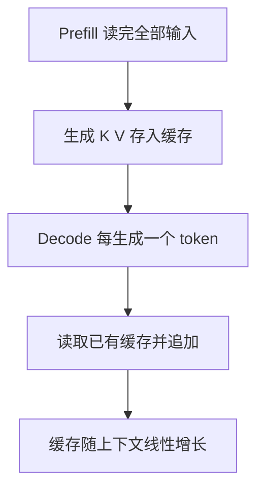
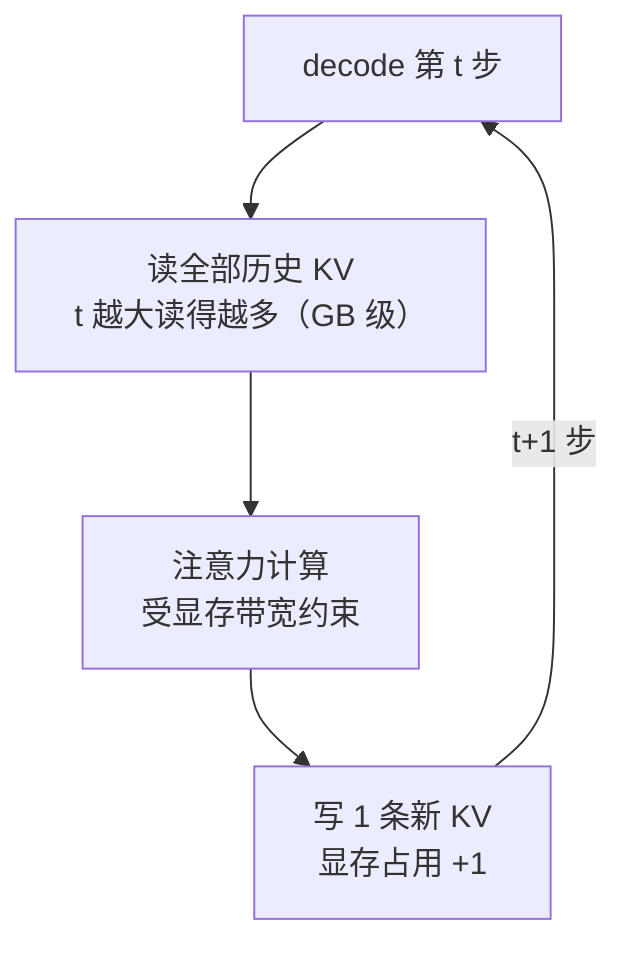
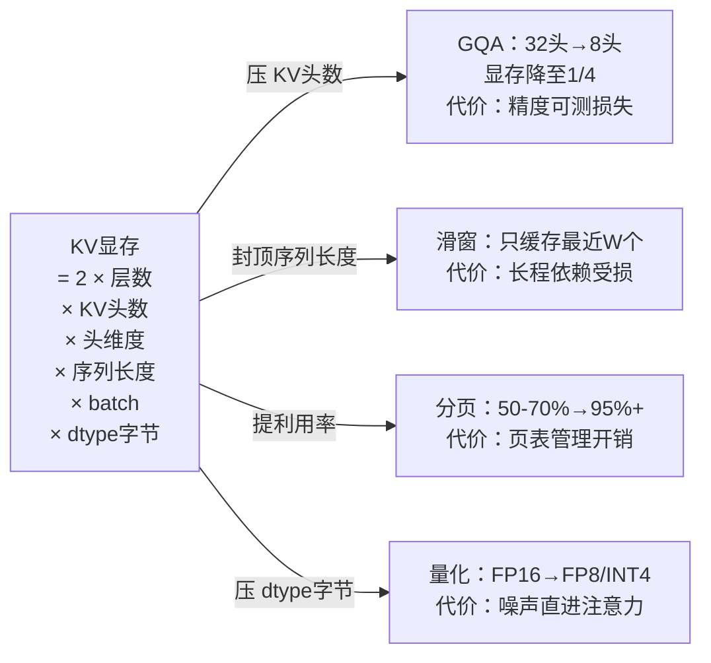

# KV缓存与上下文长度的显存账：为什么长上下文贵

## 长上下文服务的显存账到底贵在哪儿？

长上下文为什么贵？**要解决的问题就是算清 KV（Key-Value，注意力机制里缓存的键值对）缓存这笔显存账**。LLM（大语言模型）推理时把注意力（attention，模型回看前文、计算各词重要程度的机制）矩阵的 K、V 向量缓存下来避免重算（自回归——autoregressive）：模型逐个 token 生成，每一步的输出依赖之前所有步骤的结果；解码（decode）：每步只算一个新 token，历史 K/V 直接复用。**这让每 token 的成本从「重算全历史」降到「增量一步」。**

缓存以显存计价：**KV 缓存大小 = 2 × 层数 × KV 头数 × 头维度 × 序列长度 × batch（并发请求数）× dtype 字节数**——2 对应 K 和 V 两个向量，层数是模型的层数，KV 头数与头维度是每层注意力的结构参数，dtype 字节数是每个数值占的字节数，序列长度就是上下文长度。公式随上下文与并发线性膨胀，在长上下文与高并发相乘时，KV 显存会超过权重成为大头。

读完这篇你能给长上下文服务做容量规划与压缩路线选型：本文写这笔账的构成、优化手段的谱系与它们的代价，也是权重量化[[工程知识/AI 系统工程：从模型能力到生产能力/推理服务与平台/模型量化的精度经济学：位宽精度与显存的三角.md]]压不动的部分；KV 侧压缩见本节第四条 KV 量化路线，以及量化篇。

## 缓存为什么会随上下文膨胀？机制是什么

KV 缓存是什么：大模型生成文字时一步接一步，每一步都要"回看"前面全部内容算注意力。**把每步算出的两样中间结果——K 向量与 V 向量（可以理解为"每个词的检索标签"与"每个词的内容摘要"）——存起来，下一步直接复用，这就是 KV 缓存。**

这像会议速记员的工作方式。速记员的做法：发言者每说一句，在笔记本上接着记一行，回答问题时翻本子，不必重听整场会议——这里的重听对应模型重新计算注意力，不是真的回放语音。

对应关系：本子是缓存，省掉的重听是重算；本子越记越厚，是显存占用随上下文增长；整场会议结束前谁也不能撕页，是上下文在请求结束前都要保留。这个比喻到此为止。

它没覆盖到的有两点：**速记员的笔记本可以一直续下去，KV 缓存的显存却有固定容量，满了就必须淘汰旧内容或拒绝新请求**；**速记本不占会议室面积，KV 缓存占的却是显卡显存，而显存同时还要装下模型本体，这正是长上下文服务的容量矛盾**。

账目构成与代价随上下文怎么涨：

**账目构成**。Transformer 每层每个 KV 头为每个 token 存 K 和 V 两个向量（各 head_dim（注意力头维度字段）维）。**公式里最活跃的变量是序列长度与 batch**：32k 上下文的 7B 模型（32 层 × 8 KV 头 × 128 维，FP16 半精度浮点每个数占 2 字节），**单请求 KV 约 2×32×8×128×32768×2B ≈ 4GB——单请求就吃掉一张消费级卡的显存**。**长上下文与高并发相乘，KV 显存成为容量天花板。**

**四条优化路线**。
- MQA/GQA（多查询/分组查询注意力）：**MQA 是所有 Q 头共享同一组 KV，GQA 是每组 Q 头共享一组 KV**，KV 头数从「每 Q 头一个」降到「全局一个」或「每组一个」。**KV 头数是公式里的乘数**，LLaMA-2 7B 用 GQA 把 32 个头归成 8 组，**KV 显存按头数比例直降**（收益按架构配置表核对，不按经验数字）。代价：**Q 与 KV 的信息交互减少，精度有可测损失**（中等难度任务损失很小、困难任务可测出损失）。现代模型架构默认 GQA。三种结构的差别一图看尽（图中数字以 8 个 Q 头的配置为例，KV 头数从 8 降到 2 再到 1，就是 KV 显存的压缩比）：
  
  
  
  *图源：GQA（Grouped-Query Attention，分组查询注意力：KV 头分组共享，省显存） 论文（arXiv 2305.13245）Figure 2，arXiv 论文默认许可，https://arxiv.org/abs/2305.13245。术语对照：MHA＝多头注意力，GQA＝分组查询注意力，MQA＝多查询注意力，KV heads＝KV 头数。*
- 滑动窗口（允许连续发送未确认数据、控制流量的机制）注意力：**只缓存最近 W 个 token 的 KV，公式里序列长度封顶 W**。代价：**窗口外信息不可见，全文档问答这类长程依赖任务受损**；配合少量全局层可缓解——每 k 层里留一层不受窗口限制、能看到全部上下文的全注意层。
- PagedAttention（把 KV cache 按固定小块分页管理，消除显存碎片）：**KV 显存按页管理**——借鉴操作系统虚拟内存（给每个进程独立地址空间、按需映射物理内存）把内存切成固定大小页、用到哪页分配哪页的思路，消除预留块内用不满的内部碎片与预留块之间散落空闲块的外部碎片，**静态预分配下有效利用率常只有 20-40%，浪费 60-80%**；**PagedAttention 把利用率提到 96%+、浪费压到 4% 以下**（操作系统领域顶级会议 SOSP 2023 的高吞吐大模型推理框架 vLLM 论文实测）。vLLM 的核心。代价：**页表（虚拟地址到物理地址的映射表）管理开销与跨页注意力计算的实现复杂度**。「块不必连续」的机制长这样——逻辑序列里的第 1、2、7、3 块，经块表翻译落在物理显存的任意空块上：

  

  *图源：vLLM 论文（SOSP 23）arxiv HTML 版 Figure 6，arXiv 论文默认许可（非独占分发权），https://arxiv.org/html/2309.06180v1。图中逻辑视角展示一条序列的连续 KV 块，物理视角展示显存里的空闲块池，中间的块表（block table）把两者接起来，物理块可以散落各处，这正是「消除外部碎片」的全部机制：显存里任何空块都能被任何序列使用，不再要求为一条序列预留一整段连续显存。*

  块表这套机制在系统里由谁执行，看 vLLM 的整体结构更清楚：中央调度器把每一步的指令发给各个 GPU worker，KV 缓存管理器按这些指令分配与回收物理块，注意力算子只按块表给出的物理地址读写——管理显存的和执行计算的是两件事，因此换一套分配策略不必重写算子。

  

  *图源：PagedAttention/vLLM 论文（arXiv 2309.06180）Figure 4，arXiv 论文默认许可，https://arxiv.org/abs/2309.06180。*
- KV 量化：KV 的 dtype 从 FP16（16 位浮点数：占 2 字节的半精度格式） 压到 FP8（8 位浮点数格式）/INT4（4 位整数格式，每个数只占半个字节）。**KV 误差直接进注意力权重，比权重量化更伤精度**——权重像菜谱，KV 像每道菜尝出的味道；菜谱写错整锅偏，味道记错却直接进每一口的判断，所以更敏感。这个比喻只说明误差进入判断的位置不同，不代表权重与 KV 在数值精度要求上的差异。**敏感度高的代价换来的是显存收益：KV 占用随序列长度线性增长，压 dtype 直接砍掉这块体积**。按任务实测接受度，见量化篇（[[工程知识/AI 系统工程：从模型能力到生产能力/推理服务与平台/模型量化的精度经济学：位宽精度与显存的三角.md]]）的 KV 段。

**上下文工程视角的省钱**。**公式里的序列长度不只是模型能力问题，还是工程输入**：系统提示占位、工具结果回填、检索片段拼接都把序列长度推大。做上下文工程[[工程知识/AI 系统工程：从模型能力到生产能力/模型与上下文/上下文工程是在有限预算内构造决策现场.md]]时，你在固定显存预算下做内容取舍——预算表发给 Agent 框架的调用方之后，每个环节按价申请份额，「多塞一个检索片段」由此成为有价格的操作。

**计算与访存的耦合**。decode 阶段每步要读全部历史 KV，**KV 显存大小同时决定访存量**：32k 上下文的每步访存 = 全部 KV（GB 级）。**每步需把全部 KV 从显存搬进计算单元，搬运字节数 ÷ 显存带宽 = 每步耗时，故 KV 越大每步越慢，decode 速度受显存带宽约束**。比方到「管口每秒出水量有上限」为止：搬运耗时受带宽上限约束，管子容量与管口粗细是两回事。

带宽墙（memory bandwidth wall）指显存每秒最多搬运多少 GB 的硬上限，**KV 每步要搬的量贴着这条上限，超过就变慢**；**它和容量（占多少显存）是两本独立的账**，带宽墙在 GPU 显存层级中的位置见 [[工程知识/AI 系统工程：从模型能力到生产能力/模型基础与训练/GPU执行模型与显存层级：SIMT与合并访存]]。**长上下文的「贵」是双重的：显存占用（容量）与访存量（速度），两个账要一起算。**

每一步都搬全部历史 KV 的代价，海市蜃楼给了一个贴切的画面：远处沙地上"看起来有水"的那片光亮，走近了是干沙——长上下文窗口（模型一次能读入的最大文本长度）里塞进的内容同样如此：看起来都该在场，但其中相当一部分 token（长尾的检索片段、重复的系统提示、过期的工具结果）在当前步不参与最终答案，却每一步都要随全部 KV 一起被搬过带宽墙。对应关系：地平线对应离当前生成位置最远的上下文，「看起来有水」对应那些看似在场却暂时用不上的背景 token。上下文工程省的就是这部分「地平线上的水」：离开场越远的背景，越要在预算表里按价申请：

*图源：Wikimedia Commons，Ashabot，CC BY-SA 4.0，https://commons.wikimedia.org/wiki/File:Desert_mirage,_Egypt.jpg。*

图中回路解释长上下文的双重贵：每步读的量随 t 线性涨（速度账），每步写的量累积占显存（容量账），同一状态两个账同时恶化。

带宽墙的参照系是整个存储层级：越往上越快越贵越小，越往下越慢越便宜越大——寄存器、处理器缓存、内存、闪存、硬盘、磁带，每一层都是一个「快但装不下」与「装得下但慢」的折中。GPU 的显存层级是这个金字塔在推理场景的实例化：寄存器与共享内存最快，HBM（High Bandwidth Memory，高带宽内存：与 GPU 封装在一起显存）显存居中，主机内存与 NVMe（面向闪存的高速存储接口协议）在塔底——KV 缓存住在 HBM（高带宽显存，焊接在显卡封装内的内存颗粒，离计算单元更近、带宽更高，存放 KV 缓存的就是这层显存）这一层，长上下文把它撑满后，塔基的容量再大也救不了塔身的带宽：

*存储器层次结构：寄存器、各级缓存、内存、硬盘自上而下容量递增、速度递减（图源：博客园）*

*存储层级的容量、速度与代价阶梯（图源：Wikimedia Commons，Danlash 原图，公有领域）*

## 四条路线怎么选

四条路线压的是同一个公式里的不同乘数，选型判据逐条列明：**GQA 是预训练（用海量文本先训练出通用语言能力、之后再适配下游任务）期架构决策，推理侧改不了，只能选模型时核对**；**滑窗适合上下文需求天然短的任务（短问答、分类），长程依赖任务（全文档问答、长代码库）先出局**；**分页与量化可叠加在任意架构上，属管理层手段**；**压 KV dtype 前先跑任务谱实测（数学与代码任务敏感，检索增强类相对鲁棒）**。**没有单变量最优——按「任务最小上下文 × 各项精度损失 × 显存单价（每 GB 显存的硬件成本）」三项一起权衡，再定各路线的参数。**

## 这套 KV 缓存管理思路从哪来？付出了什么代价

KV 缓存的管理难题随 2020s 初的开源对话模型服务化凸显——缓存本身早是自回归推理标配，但 vLLM 之前各框架的 KV 管理简陋，静态预分配。**PagedAttention是分水岭**：把 OS 分页思想搬进 KV 管理，论文实测（SOSP 23 的 vLLM 论文，显存浪费对照实验）**有效利用率从约 20% 提到 96% 以上（浪费从约 80% 降到 4% 以下）、同负载吞吐提升 2-4 倍**。

GQA从架构侧把 KV 头数变成设计参数，此后开源模型默认 GQA。FlashAttention（2022-2023）从计算侧解决注意力的显存访问效率（IO 感知精确注意力），与 KV 缓存管理正交但互补。

**PagedAttention 把「页」立为显存管理单元，两类碎片随之消解**。静态预分配按最大序列长度留显存（**8k 预算实际用 2k 浪费 75%**），PagedAttention 把 KV 切成 16 token 一页（每页字节数随模型配置而定，7B 级约 2MB，SOSP 23 的 vLLM 论文），**按需分配页、逻辑序列到物理页的映射表维护连续性**。一次对 OS 虚拟内存页表的借鉴解决内部与外部两类碎片，同时顺手支持跨请求前缀共享（系统提示相同的请求共享页）——**prefix caching 是这页管理机制的自然延伸**：多个请求的前缀逻辑块映射到同一批物理块，靠引用计数共享，**避免相同前缀被反复存储与重复 prefill**。

代价：**所有优化都在压公式里的某个乘数，但没有免费午餐——GQA 压头数伤精度、滑窗压长度伤长程、量化压 dtype 伤数值、分页提利用率加管理开销**。长上下文服务的容量规划是多元方程：**任务的最小上下文需求（内容侧） × 每优化项的精度损失（模型侧） × 显存单价（硬件侧）**，联合求解的判据见《四条路线怎么选》。

四条路线各自压着公式里的哪个乘数、付出什么代价，看这张图：

## 这套说法在哪儿会失效

- **「支持 128k 上下文」≠「128k 上下文便宜」**。模型架构支持的长度上限是能力问题（RoPE 外推——旋转位置编码在训练长度之外延展位置表示，详见位置编码篇），**服务成本随长度线性涨**。产品层按 token 计费的价格表通常对长上下文收取溢价，**工程层容量按「目标上下文 × 目标并发」算 KV 预算**，见推理成本模型 [[工程知识/AI 系统工程：从模型能力到生产能力/推理服务与平台/推理服务的单位请求成本从token定价推出来.md]]。
- **吞吐-延迟曲线随长度劣化**。批处理（把多个请求合并成一批同时计算、提高硬件利用率）的调度天平[[工程知识/AI 系统工程：从模型能力到生产能力/推理服务与平台/批处理、KV缓存、量化与并行如何改变服务容量.md]]里，**长上下文请求占显存时间长（decode 步数多）**——请求 decode 期间 KV 一直留在显存里，因此始终占着一个 batch 槽位；并发 batch 的槽位总数有限，**一个请求占得久就少一个别人能用的槽位，短请求因此更难排进队**。调度策略（按长度分池、优先级抢占）是长短混布服务的必修课。
- **prefix caching 的收益上限由业务决定**。共享前缀越长占比越高（客服机器人的固定系统提示 vs 开放对话的零共享），**收益上限就是前缀长度占总 KV 的比例**。评估先量前缀共享率（日志统计），再决定是否上机制。
- **KV 量化的任务敏感性要实测**。**检索增强（RAG，即检索增强生成：先从外部资料里检索再让模型据此回答）类任务对 KV 噪声相对鲁棒（注意力集中在检索片段），数学与代码任务敏感**。任务谱实测（量化篇的验证段同源方法后再定 KV 位宽）。

## 怎么自己动手验证

- **KV 显存公式实测**：不同（层数， KV 头数， 头维度）组合下加载模型，实测 KV 占用 vs 公式值，预期：误差 <5%（公式是账目骨架的证据）；改变序列长度与 batch，占用线性增长。公式与实测的吻合度是容量规划可靠性的前提。
- **GQA 收益实验**：同一模型家族 GQA 与 MHA（多头注意力，每 Q 头配一个 KV 头的标准形态）版本（或配置开关）对比 KV 显存与吞吐，预期：KV 显存按头数比例下降、吞吐上升、评测分数小幅下降。三角关系（显存、吞吐、精度）的实测曲线是架构选型依据。
- **PagedAttention 碎片实验**：vLLM 的 PagedAttention 与静态预分配（旧框架或配置）对照，同负载（序列长度分布有方差）跑吞吐，预期：分页版吞吐提升 2-4 倍（来源：vLLM 论文实测区间，SOSP 23），长度分布越参差收益越大；分布无方差时两者接近。

## 接着该读哪几篇？权重侧与 KV 侧压缩怎么分账

- [[工程知识/AI 系统工程：从模型能力到生产能力/推理服务与平台/模型量化的精度经济学：位宽精度与显存的三角.md]] —— 权重侧压缩与 KV 侧压缩的分账
- [[工程知识/AI 系统工程：从模型能力到生产能力/模型与上下文/上下文工程是在有限预算内构造决策现场.md]] —— 显存预算的内容侧决策
- [[工程知识/AI 系统工程：从模型能力到生产能力/推理服务与平台/推理服务的单位请求成本从token定价推出来.md]] —— 长上下文在成本模型中的计价
- [[工程知识/AI 系统工程：从模型能力到生产能力/推理服务与平台/推理批处理的两难：吞吐与延迟的调度天平.md]] —— KV 状态粘性对调度的约束
- [[工程知识/AI 系统工程：从模型能力到生产能力/模型与上下文/上下文工程的分层设计：系统提示工具结果与记忆.md]] —— 窗口约束的显存侧
