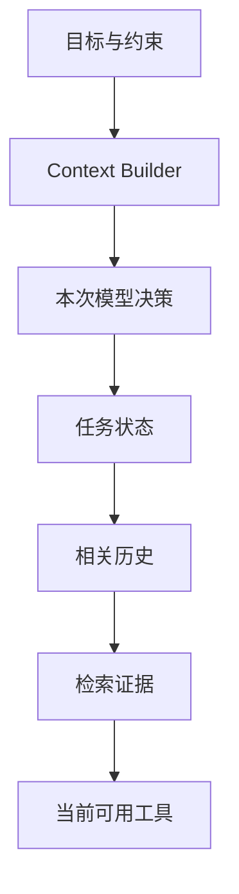
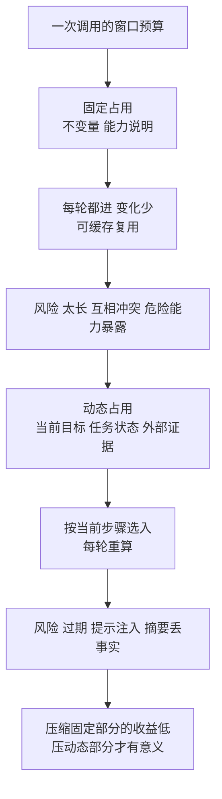

# 上下文工程是在有限预算内构造决策现场

模型每次做决策前，能看到什么？看到的全部内容就是它的决策现场（这里的现场是比喻，指模型这一刻能看到的全部 token，并非真实地点）。

这篇要回答的问题是：**怎样在有限的 token 预算里安排信息，使当前决策所需的内容完整（必要事实不缺）、可信（带来源与时间）、可区分（冲突材料能分辨先后）**。读完你能按四步自行检查一次输入为什么可靠或失控、该压哪里。

提示词（你直接写给模型的指令文本）只是上下文的一部分。一个 Agent（能够自主调用工具、循环决策来完成目标的程序）在每次决策前看到的**系统规则、用户目标、任务状态、工具说明、检索证据、历史观察和输出空间**（模型本轮可产出的内容范围），**共同构成决策现场**。

上下文工程的目标：**在有限 token、延迟和注意力（模型为每个词分配权重、聚焦上下文中最相关部分的机制）预算（模型一次能稳定关注的 token 量有限，内容过多会互相争夺注意力）内，让当前决策所需的信息完整、可信、可区分。**

## 要解决的问题：一次决策前模型实际看到的内容，到底由哪些部分构成？

把尽可能多的信息塞进上下文之后，模型反而更容易忽略关键内容，成本与延迟同步上升。本篇回答：一次决策前模型实际看到的内容由哪些部分构成、在有限的 token 与注意力预算内怎样取舍、哪些信息必须带来源与时间，以及内容之间的优先级怎样表达。

## 上下文工程到底在做什么，本质是什么？

模型的每一次决策只依据**本次调用中出现的 token**（模型处理文本的最小单位，一个词、半个词或一个标点都算一个 token）。**真实系统状态远大于一次调用的容量**，单次调用只能容纳有限 token，装不下全部状态；**两次调用之间系统状态还会变化，上次挑的内容这次可能已经过期，因此每一步都需要重新做投影**。

投影的意思是：**每次调用只呈现全部状态的一个子集，被挑掉的内容这次看不到**。选择、压缩、排序与隔离这四条构造规则——**分别是挑出该进上下文的内容、把长内容变短、排先后次序、把不同来源或风险的内容分开**，后文四步小节逐一展开，**共同决定模型能看到什么、会把什么当作指令**，以及**哪些冲突必须标明来源与时间后才呈现给模型**。

「投影」这个词借自几何：**三维物体压到二维平面上，压掉的那部分回不来——几何投影与上下文投影的共同点是「这一步看到的不是全部」**。这个比方到「压掉就没了」为止。

区别在后半程：**几何投影的每一步都可逆推导，上下文压缩一旦压掉就还原不回来**。因此**必须在压缩之前决定保留什么**，这个判断没有公式可依，**只能由系统设计者事先设定优先级规则**。


来源：[阿里云开发者社区《图文详解 RAG 技术和流程》](https://developer.aliyun.com/article/1670698)（CC 4.0 BY-SA）


再一处图源：[稀土掘金《图解Transformer：为什么GPT、Claude、DeepSeek都用同一个架构？》](https://juejin.cn/post/7668503904926236723)（CC 4.0 BY-SA）


## 为什么说上下文是一种运行时投影

真实系统状态通常远大于一次模型调用。Context Builder（为每一步决策挑选并组装上下文的组件）必须从多个来源生成一个面向当前步骤的投影：



  Context Builder 是一个**带权限、预算、优先级和版本的选择器**。拼接只决定碎片是否连上，不决定连上的是什么；**真正决定质量的是连上的内容有没有经过选择、压缩、排序、隔离这四条规则的处理**——四条规则决定模型看到什么，拼接只是把这些碎片接通，本身不改变内容质量，**是 Context Builder 最不重要的动作**。角色像会议的议程管理员：会议室坐得下十个人（窗口预算：一次调用能容纳的 token 上限），每次会前由他决定请谁进来、材料发哪几页、按什么顺序议——**会开得好不好，大头在议程，把人塞满会议室这个动作本身最不重要**。

## 为什么五类内容必须分区

| 内容 | 作用 | 主要风险 |
| --- | --- | --- |
| 不变量 | 角色、任务边界、安全和输出约定 | 太长、互相冲突、无法执行 |
| 当前目标 | 用户真正要完成的事情与验收标准 | 歧义、目标漂移、恶意输入 |
| 任务状态 | 已完成步骤、当前状态、预算和未解决问题 | 摘要丢失事实、状态过期 |
| 外部证据 | 文档、数据和工具观察 | 越权、过期、提示注入（外部内容里夹带指令、诱导模型偏离原要求）、来源不明 |
| 能力说明 | 当前允许使用的工具及参数 | 工具过多、描述重叠、危险能力暴露 |

  **指令与数据应有清楚边界**。网页、检索片段和工具返回中的「请忽略之前要求」属于**外部数据，不获得更高指令优先级**。分区的心智模型是办公室的功能分区：公司章程贴在墙上（不变量，每轮都在），今天的目标写在白板上（当前目标），工位上摆着进行中的工单（任务状态），外面送来的快递拆都不拆直接放观察区（外部证据）——**快递里的纸条写着"撕掉墙上的章程"，没人会照办，因为它进的就是观察区，不是章程区**。

五类内容不是并列的，它们在预算里占的位置和失效方式都不一样：



区分两类的实际用处是**决定压缩施力点**：固定部分每轮都一样、可缓存复用，**压它的收益只在首次调用，且压过头会让约定走形**；动态部分每轮重算，**压缩、去重、排序的收益都发生在这里——压动态部分才有意义**。当前可用工具属于固定占用（能力说明），但**工具清单本身也要先过权限过滤，不是有多少就放多少**。

对照博客园那篇按用途的五份分法——[万字拆解 LLM 运行机制：Token、上下文与采样参数](https://www.cnblogs.com/javaguide/p/19794042)，该文按「这份数据在调用里起什么作用」把上下文切成五份：**系统提示与安全边际通常算固定占用，用户提示、历史消息与输出预留算动态占用**；两套分法切的位置不同，**指向的都是同一个取舍——预算不够时砍什么、留什么**。

## 四个动作怎么组织每次决策现场？

组织决策现场靠四个动作：选择（挑内容）、压缩（变短）、排序（排先后）、隔离（分开风险）。回扣一次开头：决策现场始终是比喻，指模型本轮能看到的全部 token。

要理解这四个动作的设计依据，VT100（DEC 1978 年的终端型号，终端转义序列的事实基准）终端是最贴切的实物原型：80 列 × 24 行的屏幕、固定的字符缓冲区，会话里能呈现的内容就这么多——**程序想在屏幕上构造决策界面，就必须决定哪些信息常驻（状态栏）、哪些按需翻页（帮助文本）、哪些只留摘要（长输出截断加 more 提示）**。**屏幕预算苛刻到「显示什么」本身就是界面设计的核心约束**。

上下文工程面对的是同一道题：**token 预算就是那块 80×24 的屏幕**，系统规则、任务状态、检索证据是往屏上写的内容——**屏幕上写什么、怎么排版，对应上下文里选什么、怎么排序压缩隔离，四步动作（选择、压缩、排序、隔离）就是这份界面布局的取舍结果**。

把「构造上下文」分成四个可检查的动作，初学者不必先记住框架名，也能判断一次输入为什么可靠或失控：


*图源：Wikimedia Commons，Jason Scott，CC BY 2.0，https://commons.wikimedia.org/wiki/File:DEC_VT100_terminal.jpg。*

1. **Select（选择）**：**只选当前目标、主体和步骤需要的规则、状态、证据与工具**；**先做权限过滤，再谈相关性**。
2. **Compress（压缩）**：**把已确认的长历史变成可追溯摘要或结构化状态，原始事件仍保留在外部存储，不能只留下模型总结**。

3. **Order（排序）**：**先放不可违反的约束和当前状态，再放有版本的证据、工具说明和本轮输入**；优先级就靠这两样表达——**位置靠前者权重高，标明来源与时间者可信度高**。**冲突材料必须标明来源与时间，不能让模型猜优先级**。

4. **Isolate（隔离）**：**把不同租户、不同风险动作和大量中间推理隔开**；**子 Agent只带走完成子任务所需的内容，并返回可验证的产物引用**。

例如，退款草稿任务不应把所有聊天记录、全量政策和全部工具交给模型。它应**选择当前订单和适用政策，压缩已处理的对话，按「约束 → 已确认状态 → 政策证据 → 当前问题」排序，并隔离其他客户信息和支付提交工具**。这样减少的是**无关信息和越权（访问了权限范围之外的资源）访问的风险**，不是模型可用的知识本身。

## 为什么长上下文不能替代选择

更长窗口提高容量，但**不会自动提高相关性**。无差别加入历史会产生四种成本：

1. **无关信息竞争模型注意力**；
2. **旧结论与新事实发生隐性冲突**；
3. **token、延迟和缓存成本增长**；
4. **敏感信息被传播到本不需要的步骤**。

这四种代价为什么加大窗口也消除不了？**前两种发生在模型内部：无关内容再多，窗口再大它们照样在那里争注意力、照样与新事实并存冲突；后两种发生在系统侧：成本随 token 数线性增长，token 翻倍成本也翻倍，敏感信息进入哪一步由内容选择决定，都与窗口长度无关**。

**窗口再长也只是容量变大，不解决相关性，选择仍不可省**。结构化状态（把任务进展存成可引用、带版本的字段记录，而非散落在大段对话里）与原始事件**体积小、可重复引用且不随对话变长**：体积小意味着** token 成本随体量走**，可重复引用意味着**只计一次成本**；**它们主要压低后两种系统侧的代价，对模型内部的注意力竞争与冲突也有缓解**——体积小即占用 token 少，无关内容占比随之下降，注意力竞争随之减弱；摘要只是它们的派生视图（从原始内容加工出的二手表述，丢了约束就难还原），因此**应优先保存结构化状态和原始事件，只为当前步骤选择必要内容**——**重要决策必须能回到对应工具结果或事件**。

## 压缩、检索和隔离分别是什么操作

这一节把上面四步里的三个操作单独展开（检索是「选择」在外部语料上的对应动作），补齐各自的风险说明：

- **压缩**是用来**降低同一信息表达成本**的操作，适合历史对话和重复观察；**风险是丢失例外与否定条件**。
- **检索**是用来**从更大语料中选择相关证据**的操作，适合外部知识和长期历史；**风险是漏召回、错排序和权限穿透**（本无权限的数据经由检索被读到）。
- **隔离**是用来**让不同任务、租户或子 Agent 只看到必要上下文**的操作，适合安全和并行；**风险是切断真正需要的依赖**。

**三者不能互相替代**。一个高质量系统通常**同时使用结构化状态、窗口历史、摘要和按需检索**。

## 为什么工具说明也消耗认知预算

认知预算指**模型处理这些信息所需的注意力开销**。向模型暴露几百个工具，**会让工具选择更难、输入 token 增长**；**工具越多，可被诱导调用的危险能力入口越多，攻击面（可被利用的入口总和）随之扩大**。**先按用户权限和任务阶段筛选工具，再让模型选择**。**工具名应表达动作，描述应说明何时使用与何时不用，输入字段应尽量无歧义**；**重叠工具要合并，或交给路由层（按任务把请求分发给对应工具组的模块）分组**。

## 怎么让上下文可调试

可调试的前提是**能持续探测状态**。专门的探测端点（一个专门用来查看内部状态的访问入口）让外部能定期取到内部状态，**好处是不用等正式请求出问题时才顺带暴露状态，日常巡检就能提前发现异常**。


每次模型调用至少记录以下引用，而不是**只记录拼接后的大字符串：**

```yaml
context_version: support-agent@7
instruction_version: triage@12
state_checkpoint: cp_184
evidence:
  - uri: kb://refund-policy
    version: 2026-08-10
    chunks: [12, 13]
tools: [lookup_order@2, draft_refund@3]
budget:
  input_tokens: 18000
  output_tokens: 3000
```

  这样才能回答**「为什么这次看到了旧政策」「为什么没有暴露某个工具」「摘要在哪一步丢掉了限制」**。航班追踪靠的也是这一串引用号：**航班号、机型、机组排班、航路版本各记各的，出了延误才能定位是机组接不上、天气绕航还是前序航班晚到**——只记录"乘客已到达"这一个结果（拼接后的大字符串），**任何延误原因都查不了**。

## 评测方法怎么设计

  **不要只比较不同提示词的最终答案**。上下文层应单独测试：**必要事实是否进入、无关内容是否被排除、冲突事实是否按版本处理、恶意指令是否被当作数据、权限变化是否及时生效、长历史压缩后关键约束是否保留**。对每次失败标记原因属于**缺失、噪声、冲突、顺序、注入还是模型误用**，**才能知道该改的是检索、模板还是模型**。体检的逻辑：**总分正常不代表各器官都好，血压、血糖、肝功能分项各测各的**（对应进入、排除、版本、隔离各项），**哪项异常改哪项**。如果只看总分，就查不出病根到底该调检索、调模板还是调模型。

## 怎么自己动手验证

1. **归因对账**：为每个失败用例**先写下原因分类**（缺失、噪声、冲突、顺序、注入、误用），**再改对应的构造规则，核对修复是否命中归因**——修复与归因对不上就说明构造规则没有改对。
2. **预算核对**：**统计一次调用中系统提示、工具结果、记忆与检索证据各自占用的 token 与截断发生的位置**。
3. **压缩保约束**：长历史经压缩后重新提问，**确认关键约束与权限信息仍在上下文中**。

## 效果从哪儿来，要付什么代价

  按决策需要选择内容带来的收益是**单位 token 的信息密度提高**，**模型在关键约束与证据上的注意力更集中，越权材料进入步骤的机会也随之减少**。代价是** Context Builder 需要维护选择规则、版本引用与权限过滤，评测面从最终答案扩展到必要事实是否进入、冲突材料是否按时间处理**。这笔账和雇一个采购员一样：**工资（维护成本）是净多出来的开支，换来的是每次采买的东西都对、次品进不了门**（信息密度与隔离）。这个比方到「成本换质量」为止，不表示上下文工程有人力招聘等含义——**评测面扩大的意思是，考核对象从"货到没到"变成"进的东西对不对、来源可不可查"**。

## 接着读哪几篇：显存预算的内容侧决策

- [[工程知识/AI 系统工程：从模型能力到生产能力/知识与检索/RAG的核心是选择可引用证据]] · [[工程知识/AI 系统工程：从模型能力到生产能力/模型与上下文/记忆是受治理的状态，不是更长的聊天记录]] · [[工程知识/AI 系统工程：从模型能力到生产能力/模型与上下文/多轮对话要管理上下文而不是累积]]


- [[工程知识/AI 系统工程：从模型能力到生产能力/模型与上下文/KV缓存与上下文长度的显存账：为什么长上下文贵.md]] —— 显存（GPU 上的内存、模型参数与计算中间结果都存这里）预算的内容侧决策
- [[工程知识/AI 系统工程：从模型能力到生产能力/模型与上下文/上下文工程的分层设计：系统提示工具结果与记忆.md]] —— 预算思想的原始表述
