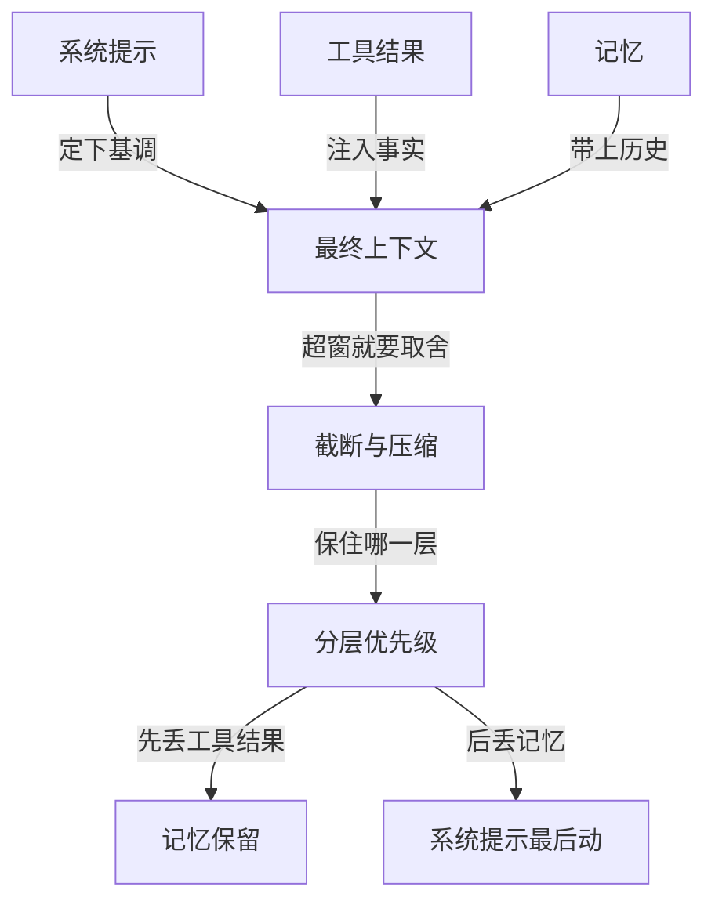

# 上下文工程的分层设计：系统提示工具结果与记忆

## 上下文窗口满了为什么会退化

读完这篇你能把上下文分成五层、给每层定配额，并决定预算不够时谁先被挤出窗口。这篇讲上下文工程的分层设计：把窗口当预算管。

Agent 的上下文窗口是一个**竞争性资源**：系统提示、工具定义、检索片段、工具返回结果、历史对话、记忆，这六类内容归入五个生命周期层（工具返回结果与历史对话同属轨迹层，见后文分层），全部塞进同一条有限窗口。**窗口受显存（GPU 上的内存、模型参数与计算中间结果都存这里）与注意力（模型为每个词分配权重、聚焦上下文中最相关部分的机制）的双重约束**——KV（Key-Value，键值对：按键取值的最简数据模型） 缓存随长度线性增长撑显存，**注意力计算量随长度平方涨**（每个 token 都要和其余 token 算一遍关联，N 个 token 就是 N² 次计算），两头一起卡窗口[[工程知识/AI 系统工程：从模型能力到生产能力/模型与上下文/KV缓存与上下文长度的显存账：为什么长上下文贵.md]]。

可以把它想成一张会议桌：座位有限，谁坐下谁占掉一个位子，后来者只能挤掉先来的——座位数就是窗口容量，每个入座者就是一层要占的内容。这个比方到「位子会被挤掉」为止。

会议桌不会因为你多放一份材料就变长，**上下文窗口的长度却是固定的，且谁被挤掉由排序规则决定而不是由重要程度自动决定**。**每层都想多占，但窗口满 = 系统退化**（注意力稀释：注意力被长内容摊薄、关键处被忽视，关键指令被挤出、成本线性涨）。

上下文工程要解决的问题是：**把窗口当作有预算的分层系统来设计**，**每层内容的进出、优先级、压缩都显式管理，而不是“塞满为止”**。上下文工程是在有限预算内构造决策现场[[工程知识/AI 系统工程：从模型能力到生产能力/模型与上下文/上下文工程是在有限预算内构造决策现场.md]]；本文把这一预算思想展开成可执行的分层设计。

## 它是怎么做到的

*图源：Anthropic《Effective context engineering for AI agents》，页面版权归 Anthropic，引用注明出处，https://www.anthropic.com/engineering/effective-context-engineering-for-ai-agents。*

「Possible context to give model」一栏就是本文要讲的分层设计：图中列出的文档、工具、记忆、领域知识与历史消息，是各层内容的候选来源全集（本文五层与它的对应：系统提示与工具定义出自工具与指令类，检索片段出自文档类，轨迹层对应历史消息，记忆层对应记忆条目）；筛选（Curation）箭头是预算表（记录每层配额与进出优先级的清单）在每轮做的事——哪些进窗口、哪些留在窗外，正是下文各层配额与准入优先级要回答的问题。

**上下文为什么要按生命周期分层？** 把上下文按生命周期与变化率分层：
- **系统层（系统提示）**：全程驻留，变化率最低。任务定义、行为约束、输出格式。**占比很小**。
- **工具层（工具定义）**：全程驻留，按 Agent 能力集静态定义。**工具多的系统这层随工具数量显著膨胀**——schema（工具的参数定义文本）随工具数量增多而体积膨胀，**不控制就会挤占其他层的预算**（工具分组按需加载来控制）。
- **检索层（RAG，检索增强生成 Retrieval-Augmented Generation：先从外部资料检索相关片段再交给模型）片段**：任务相关时进入，完成后释放。**变化率高。通常是大头，检索片段的相关性与准确性直接决定最终回答质量**。
- **轨迹层（历史对话与工具调用）**：随任务增长，**是预算的动态大头**。要压缩（见后文）。
- **记忆层（跨会话知识）**：受治理的状态[[工程知识/AI 系统工程：从模型能力到生产能力/模型与上下文/记忆是受治理的状态，不是更长的聊天记录.md]]，选择性注入。**占比同样不大**。

**轨迹层是唯一会自己长起来的一层**，要回答两个问题：**长到什么时点触发压缩、压缩之后细节靠什么找回来**。

唯一会自己长起来的是轨迹层，其余各层占比由加载策略决定，所以预算表真正要管的是这一层的增长与它的触发线。

**每层配额满了先丢哪一层？** 每层设配额（字符或 token 数），内容超出触发该层的压缩或拒绝。**准入优先级（谁先被挤出去）：轨迹层最老的部分 > 低相关检索片段 > 工具层未用过的定义 > 系统层（永不被挤）**。**这个优先级是设计决策，不是默认行为——不设计就是隐式的“最新优先”：新内容不断进来、最旧位置的内容先被丢弃，系统提示恰好常驻窗口开头这个最旧位置，就可能被长工具结果挤掉**。

**轨迹太长怎么压缩？四种手段**。
- **截断（最粗暴）**：保留最近 N 轮。**丢早期约束与目标**。
- **摘要（最常用）**：旧轨迹摘要成任务状态。**摘要损失细节——工具调用的精确参数与结果拿不回来，要在摘要里保留关键 ID 与结论——保留 ID 与结论后，可凭 ID 从外置记录重读精确参数与结果，把摘要丢掉的细节找回来**。
- **外置（最结构化）**：轨迹状态外置到文件/数据库，**上下文只留指针与摘要**。**Agent 重启可恢复**（状态的持久化，即把进行中的任务进度存到外部，进程重启后能从中断处继续），工具结果按需重读。
- **选择性保留（最精细）**：**按信息价值保留（未完成的任务、未确认的假设、用户明确要求记住的）**。

**工具返回的大结果怎么不撑爆窗口？** **工具返回经常是预算杀手（一个目录列表或一次网页抓取的结果就能长到挤占整轮对话预算的量级）**。分层处理：**原始结果外置（文件/缓存），上下文只留结构化摘要（关键字段 + 指针）**；大结果按需重读（工具结果二次读取工具）。**工具结果的 schema 设计要面向上下文预算（返回摘要 + 全量的两级 API）**。

## 分层设计从哪儿来，要付什么代价？

分层要解决的问题是「谁先被挤掉」。这和 NIO（非阻塞 I/O 多路复用框架，把接受连接与读写处理分给不同线程的编程模型）的线程模型是同一类取舍：接受连接与处理读写分在不同角色上，每个角色只占自己那一份，不够时才谈腾挪。这个比方到「分角色各占一份资源」为止，超出比方的地方：NIO 的线程调度由系统强制执行，上下文分层要靠你手动设计优先级。

上下文工程一词在 2024 年前后流行开来（依据本文 sources 列出的 Anthropic 构建有效 Agent 指南与各家 Agent 框架文档的发布时间），但**思想源头是操作系统的内存管理**：分页、交换、优先级、准入控制（决定哪些内容允许进入窗口）。**把窗口当内存管，把每层内容当进程管——生命周期不同（驻留 vs 换出）、优先级不同（系统级 vs 用户级）、管理动作不同（压缩 vs 释放）**。这个类比不是装饰，**它直接给出设计动作：预算表 = 内存配额，轨迹压缩 = 页面交换（轨迹像被换出的页面：窗口装不下时移到外部，需要时再换回来），检索准入 = 缓存替换（LRU 类：优先淘汰最久没被用到的片段），记忆治理 = 长期存储**。Claude Code 的上下文管理（compact 命令，即把历史对话压缩成摘要以释放窗口；系统提示驻留）是产品化代表。

**「轨迹外置把上下文从存储变成缓存」**。轨迹不外置时，任务状态全部挤在窗口里，窗口要完整就得开大，**长任务与有限窗口的矛盾由此而来**。轨迹外置到文件、数据库、记忆系统后，**窗口只装最近与最相关的部分，Agent 需要时通过工具重读**。**轨迹外置解开了长任务（数百轮）与有限窗口的矛盾：任务可以无限长，窗口只装当下需要的切片**。代价：**分层与压缩都是工程复杂度——预算表要按任务的层配比调；摘要压缩有损——关键信息丢失后，Agent 无法从外置记录找回精确参数，只能基于残缺摘要行动，于是偏离原定任务，即行为漂移；压缩策略要评测——压缩前后任务成功率对比的做法见评测集篇** [[工程知识/AI 系统工程：从模型能力到生产能力/质量与运营/评测集的构建与维护：从场景采样到难度分层.md]]；**外置引入一致性负担（外部状态与上下文摘要的同步，脱同步时 Agent 决策基于过时状态）；工具两级 API 的开发成本（每个工具都要摘要版）**。**上下文工程是随任务演化的运营对象，一次设计管不了全部任务阶段**。

外置之后的整体结构，MemGPT 论文 Figure 3 画得比文字直白：LLM 处理器持有固定大小的主上下文，任务状态住在外部存储，两者之间靠系统调用（程序请求内核提供服务的入口）式的换页通道连接。

图取自 [MemGPT: Towards LLMs as Operating Systems（arXiv:2310.08560）](https://arxiv.org/abs/2310.08560) 论文 Figure 3：LLM（大语言模型）处理器只握固定窗口（主上下文），任务状态住在外部存储（外部上下文），通过搜索与换页按需调进窗口——轨迹外置把上下文从存储变成缓存的教科书结构。

## 分层设计在哪些情况下会失效？

- **系统提示是不是越多越好**？**几十条规则的指令密度过高，模型的遵循率下降——注意力稀释、指令间相互冲突**。**系统层要克制：任务定义 + 少量硬约束 + 格式要求，其余放工具层或检索层按需注入**。**指令遵循率的实测（系统提示加减指令的对照实验）比拍脑袋靠谱**。系统层写多细才合适，Anthropic 给的标尺是一根光谱：

*图源：同上（Anthropic《Effective context engineering for AI agents》），页面版权归 Anthropic，引用注明出处。*

「Too specific」一栏把每种意图的每一步都写成 if-else，模型遇到清单外的情形没有出路；「Too vague」一栏只剩一句原则，具体动作全靠模型自己猜；「Just right」一栏写清角色、工具边界与响应框架，把「怎么做」留成引导而不是**硬编码——这就是系统层「任务定义 + 少量硬约束 +** 格式要求」三件套的实物对照。
- **工具数量失控是 Agent 退化主因之一**。**工具定义占掉预算，把系统提示里的关键指令挤出去；同时候选一多模型更易选错（工具数量上升时选择准确率明显下降）。两步叠加才让 Agent 退化**。**工具分组（按场景打包按需加载）与工具合并（功能重叠的合并）是两层治理**。
- **记忆注入要按相关性过滤**。**把记忆当聊天记录塞的全量注入挤占预算且引入噪声——无关记忆干扰判断**。**相关性检索（当前任务与记忆条目的匹配）+ 治理（过期记忆清理**，见 [[工程知识/AI 系统工程：从模型能力到生产能力/模型与上下文/记忆是受治理的状态，不是更长的聊天记录.md]]**）是记忆层的准入控制**。
- **长上下文模型能不能省掉分层**？长上下文窗口（如十几万 token 级）降低了“装不下”的压力，但**注意力稀释（中间内容被忽视的 lost in the middle 现象）、成本随长度成正比涨、KV 显存**[[工程知识/AI 系统工程：从模型能力到生产能力/模型与上下文/KV缓存与上下文长度的显存账：为什么长上下文贵.md]]**三个约束仍在。窗口变大只是抬高预算上限，三条约束一条没少，所以仍要分层**。lost in the middle 的原始实测就是最直接的证据——**同一份答案文档在 20 篇检索文档里挪位置，模型准确率（预测或判断正确的比例）画出来是一条 U 型曲线**：

*图源：[Lost in the Middle: How Language Models Use Long Contexts（TACL 2023，arXiv:2307.03172）](https://arxiv.org/abs/2307.03172) Figure 1，arXiv 非独占分发许可。文档放进上下文不等于被用上：中段位置的准确率一度低于闭卷（完全不给文档）基线（正常状态下的指标水平、用来对比异常）——窗口装得下与注意力用得上是两件事，这正是分层摆放（重要内容头尾放）的实证依据。*

## 怎么自己动手验证分层是否走对路？

验证要看的是上下文进出有没有走对路。用 io_uring（Linux 的高性能异步 IO 接口，用两个共享环在用户态与内核间递请求收结果）的提交队列/完成队列（SQ/CQ，请求与结果分两条队进出）作对照是最直白的：请求从一条进、结果从另一条出，两边各有头尾指针，进出的边界写得很清楚。这个对照到「请求与结果分两条队进出」的结构为止；io_uring 的调度由内核强制执行，上下文分层要靠你手动定优先级。

- **预算占用画像**：真实 Agent 任务跑一批（几十个量级），统计每层的 token 占比分布。预期：**轨迹层随轮次增长成大头（不管理时占比过半），系统+工具层被挤压**。**画像数据是预算表设计的依据**。
- **压缩策略对照**：截断/摘要/外置三策略跑同一长任务集，对比任务成功率与 token 成本。预期：**外置成功率高（细节可重读）、截断最差（丢早期约束）、摘要居中**。**三策略的曲线是选型依据**。
- **lost in the middle 复现**：关键信息放上下文头部/中部/尾部三组对照，测试模型检索准确性。预期：**中部最低（U 形曲线）**。**位置效应的实证是分层摆放（重要内容头尾放）的依据**。

## 想读预算思想的原始表述该接着读哪几篇

- [[工程知识/AI 系统工程：从模型能力到生产能力/模型与上下文/上下文工程是在有限预算内构造决策现场.md]] —— 预算思想的原始表述
- [[工程知识/AI 系统工程：从模型能力到生产能力/模型与上下文/记忆是受治理的状态，不是更长的聊天记录.md]] —— 记忆层的治理展开
- [[工程知识/AI 系统工程：从模型能力到生产能力/质量与运营/评测集的构建与维护：从场景采样到难度分层.md]] —— 压缩策略的评测方法
- [[工程知识/AI 系统工程：从模型能力到生产能力/生态与选型/精调与RAG的边界：什么时候微调更划算.md]] —— RAG 片段的上下文预算管理