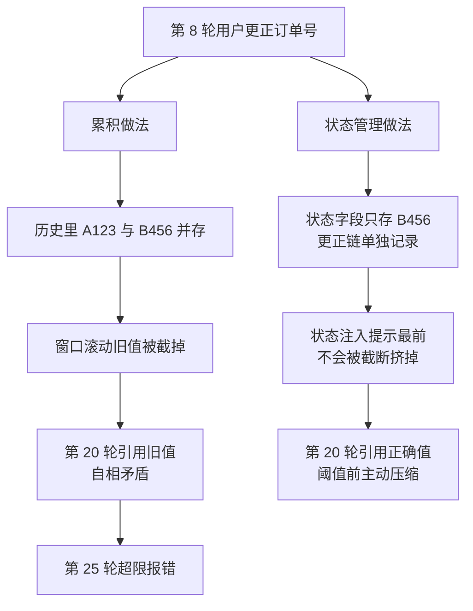
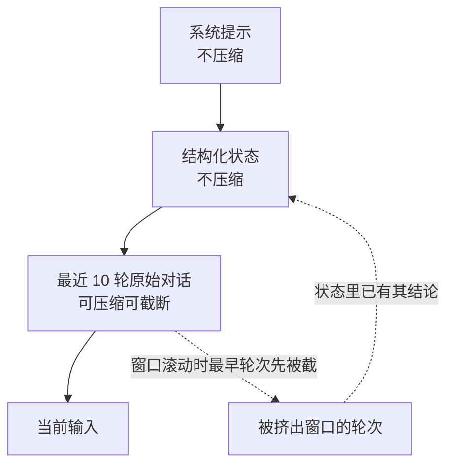

多轮对话要管理上下文而不是累积它

## 要解决的问题：历史记录与当前事实为什么要分开存放

多轮 Agent 的上下文要管理而不是累积：历史与当前事实分开存、按轮抽取状态、到阈值就压缩。客服 Agent 在二十轮之后开始自相矛盾，引用已经作废的订单号，或在上下文被压缩（裁掉早期对话以腾出窗口空间）的那一刻直接报错中断，**就是只累积不管理的下场**。

人工客服的工单系统就是为同一问题设计的：通话录音（历史记录）可以翻，但客户的"最终收件地址、当前诉求"写在工单字段里（当前事实），每一轮客服接手先看字段——录音里第 3 分钟客户报过一个地址、第 9 分钟改口了，字段里只留最新的那个；没有工单字段的客服，全靠翻录音背旧话，二十轮后必然拿错。本篇回答：**历史记录与当前事实为什么要分开存放、压缩在什么时机触发、用户更正怎样覆盖旧值**，以及单次会话该在什么位置结束。

读完你能给自己的多轮 Agent 设计一套「抽取状态 + 主动压缩」的上下文方案，避开第 20 轮的自相矛盾与超限报错。


## 这件事发生在什么场景：多轮对话会在哪类情况下开始失控

打个比方：多轮对话像在白板上写字——白板面积有限，写满了就得擦掉一些再写；一直往上加而不擦，最后要么写不下，要么很重要的那行被挤到角落看不见。这个比喻到"为什么要管理"为止：具体怎么压缩、什么该保留、摘要怎么保证不丢关键约束，要看正文。


*图示：ELIZA 程序的一段真实对话记录。图源：Wikimedia Commons《ELIZA conversation》，公有领域／CC 授权，https://commons.wikimedia.org/wiki/File:ELIZA_conversation.png。六十年前那个程序只有"上一句"这一种上下文，如今模型能装下几十万字——但"能装下"不等于"该装下"，下面这段客服对话就是证据。*

证据就在下面这段客服 Agent 的真实形态对话里：

```
第 1 轮：用户说"我要退货，订单号 A123"
第 8 轮：用户补充"其实是 B456，刚才说错了"
第 15 轮：Agent 又问"请问您的订单号是？"  ← 忘了
第 20 轮：Agent 说"已为您退货 A123"        ← 用了被更正的旧信息
第 25 轮：上下文超限，报错
```

这段对话暴露了三个叠加的问题：

1. **早期的错误信息没被纠正**，后面又被引用
2. **关键信息被挤出上下文**（窗口满了，最早的被截掉）
3. **最终超限崩溃**

**根因：把对话当成"累积的消息列表"，而不是"需要管理的状态"。**


*图示：提示词（发给模型的输入指令与背景信息）工程与上下文工程的对照。图源：Anthropic《Effective context engineering for AI agents》，https://www.anthropic.com/engineering/effective-context-engineering-for-ai-agents，© Anthropic。*



两条链各自走完：右链第 20 轮的正确引用与左链第 20 轮的错误引用是同一个位置的两个结局，**分岔点只在第 8 轮之后有没有一处不会被挤掉的状态**。


来源：[稀土掘金《图解Transformer：为什么GPT、Claude、DeepSeek都用同一个架构？》](https://juejin.cn/post/7668503904926236723)（CC 4.0 BY-SA）


## 方案是什么：历史和当前事实要怎么分开管理

### 整体思路是什么

```
历史（messages）      = 原始对话，会被压缩/丢弃
当前事实（state）     = 提取出的结构化状态，始终保留
```

  **关键认知：模型的"记忆"来自上下文，而上下文会满。上下文一满就会挤掉最早的内容：多数框架按固定策略（如只保留最近 N 轮）滚动丢弃，不识别哪条是关键事实，所以挤掉哪些不由你决定，关键事实不能只靠"还在上下文里"来保证——要有一个不会被挤掉的地方存关键事实。**

  打个比方：上下文像一块白板，写满了就得擦掉最早的字才能继续写，擦哪块不由你挑；结构化状态是钉在白板旁边的登记簿——白板怎么擦，登记簿都在。比喻到"登记簿不随白板擦写"为止：登记簿里该记哪些字段、怎么更新，还是要靠下面的机制。

### 每一轮该更新什么状态

```json
{
  "user_goal": "退货",
  "order_id": "B456",              // 第 8 轮更正后的值
  "order_id_history": ["A123"],    // 保留历史，便于追溯
  "confirmed_facts": [
    {"fact": "订单 B456 已付款", "evidence": "tool_result_12", "verified": true}
  ],
  "pending_questions": ["退货原因"],
  "resolved": false
}
```

**每一轮对话后更新这个状态**，而不是让模型从历史里回忆。便利店交接班本就是这个东西：接班的人不靠听完上一班全天的顾客对话来接手，看的是本子上的几行——钱箱数、待取快递、报修中的冰柜；**每一笔变化发生时就更新，本子上的字永远是最新的**。这个比喻只到「关键事实要单独持久化、每轮更新」为止；具体存哪些字段、怎么触发更新，看下面的状态定义与提取机制。

### 注入方式：为什么状态要优先

上下文按下面的顺序组织，其中结构化状态始终排在最前面，不会被历史挤掉：

- 系统提示
- 当前状态（结构化，含 user_goal、order_id 等字段，始终在最前，不会被挤掉）
- 最近 10 轮对话（原始历史，保留语气和细节）
- 当前输入

病历首页贴在病历最上面的道理相同：过敏史、当前用药（关键状态）钉在首页，后面按时间排的是历次就诊记录（历史）——医生翻病历先看首页的过敏史，不管后面记录多厚；过敏史要是混在 30 页记录的中间，翻到之前就开错了药。比喻只到「关键内容要放在最显眼的位置」为止；模型不会主动翻页，状态要靠应用层注入到提示词最前面来保证。



图：窗口滚动时信息流去哪——原始轮次被截掉，但它已确认的结论先一步进过状态层，被截不等于丢失。

状态要放在最前面，有两个原因：

1. **不会被上下文截断挤掉**
2. 模型对靠前的文字判断权重更高——注意力机制（让模型对输入的不同部分分配不同权重的核心结构）是模型计算「这段输入和当前任务相关度」的方式，**输入位置越靠前越容易被赋予高权重**；关键状态放最前，每一轮推理都会把最前的内容纳入相关性计算，这个事实因此始终参与输出；放后面就可能被压缩后的历史淹没

### 三种压缩策略怎么排可靠性顺序

**策略 1：提取状态（最可靠）**

用一次便宜的模型调用，从历史中提取结构化状态。

三类策略各自丢失什么信息：**提取状态把关键字段显式存进结构，历史怎么压缩都不影响它**；滑动窗口只保住最近几轮，更早的事实随窗口滑出；摘要什么都"提了一嘴"，真要用时细节已经不在。逐项对比看下面的分析。

```python
def extract_state(history, current_state):
    return llm(
        model="small-fast-model",
        system="从对话中提取/更新结构化状态。只输出 JSON。",
        user=f"当前状态：{current_state}\n\n新增对话：{recent}\n\n输出更新后的状态：",
        response_format=json_schema(StateSchema)
    )
```

**用便宜的小模型做这件事**——提取是把对话里的字段填进固定结构，不涉及推理判断，所以**小模型够用，不需要强模型**。

**策略 2：滑动窗口 + 保留关键轮次**

```
保留：系统提示 + 当前状态 + 最近 N 轮 + 被标记为"重要"的轮次
```

值得单独保留的轮次有四类：含用户明确更正的、含关键决策的、含待办与结论的、被后续轮次反复引用的。

- 包含用户明确更正的（"刚才说错了"）
- 包含关键决策的
- 包含工具返回关键信息的

**策略 3：摘要（最不可靠，但最简单）**

让模型把早期对话压缩成一段摘要。适合对话早期的过程细节已经不重要、只需保留大意的场景，成本最低。

**风险**：摘要会丢信息，也可能加入不存在的内容。**用法**：**只作为辅助，关键事实必须走结构化状态**。

### 用户更正要怎么处理

这是多轮对话最容易出错的地方。

日常对应就是报错电话号码：你说"打 138 开头那个"，对方拨了旧号还理直气壮——两个号码都"在通话记录里"，他没被告知哪个作废。比喻只到「新旧值并存会让对方选错」为止；真正的解法是状态里只存最新值并写进提示词规则，不能只靠口头说一句。

**错误做法**：历史里同时存在 A123 和 B456，模型自己猜。

**正确做法**：状态字段只保留最新值，**历史值单独存**：

```json
{
  "order_id": "B456",
  "corrections": [
    {"from": "A123", "to": "B456", "at_turn": 8, "reason": "用户说刚才说错了"}
  ]
}
```

**这条规则要写进提示词才算生效：用户更正后以最新值为准，旧值不再参与推理**：

```
如果用户更正了之前的信息，以最新的为准。
不要使用已经被更正的旧值。
```

### 上下文窗口该怎么管

**提前规划，不要等超限**。油表到红线前就得加油（到 80% 就触发压缩），开到熄火才推车（超限报错）已经晚了；加油顺序也有讲究：先倒掉后备箱的杂物（最大的工具返回），再清旧票据（早期轮次），驾驶证和现金（状态与系统提示）永远随身。比喻只到「要在触顶前提早动作」为止；**80% 是人为设定的阈值，压缩会丢信息，不像加油那样无损**。

```python
MAX_CONTEXT = 180_000     # 留 20k 余量

if estimate_tokens(messages) > MAX_CONTEXT * 0.8:
    messages = compress(messages)   # 触发压缩
```

**压缩按占用空间增长的速度排优先级：工具返回往往一次占掉大量 token（模型切分文本的基本单位，中文大约每 1-2 字一个），最先截断或摘要它，再压缩早期轮次**：

1. 先截断/摘要**工具返回**的大内容（最容易膨胀）
2. 再压缩**早期的对话轮次**
3. **状态和系统提示永远不压缩**

### 长对话该怎么分段

对于超长任务（比如一次持续几小时的协作）：

| 策略 | 做法 |
| --- | --- |
| **按子目标分段** | 完成一个子目标就开新会话，把状态传下去 |
| **任务化** | 把长对话分成多个独立任务，各自有明确的输入输出 |
| **显式存档** | 让用户显式"保存进度"，下次加载 |

**推荐按子目标分段**：每个会话保持短小（10-20 轮），上下文压力小，且失败影响范围小。

## 效果从哪儿来，要付什么代价

管理上下文的代价是要维护状态。UDP（无连接的网络传输协议）不维护所以轻，TCP（面向连接的网络传输协议）维护所以贵——三次握手（TCP 建立连接前、双方交换三个报文确认彼此收发能力的流程）建立、四次挥手（TCP 断开连接时、双方交换四个报文释放资源的流程）释放，都是状态。

这个类比只到「维护状态要付出代价」为止：具体怎么维护上下文，看上文的提取与注入，网络协议那套实现搬不过来。日常版是寄平信与打电话：平信（UDP）写完就寄，不管对方收没收，便宜但可能丢；电话（TCP）先"喂，听得到吗"再谈事，每通电话都要接通挂断（状态维护），贵在可靠——管理上下文就是给关键对话上电话的那份可靠，工单字段（状态）的维护成本是电话费。

**收益**

- **不会自相矛盾**：关键事实在结构化状态里，不会被"遗忘"或用错
- **不会超限崩溃**：主动管理而不是被动截断
- **成本可控**：上下文不会无限增长
- **可恢复**：状态可以持久化，会话中断后可恢复

**代价**

- **需要设计状态 schema**：不同任务的状态结构不同
- **多一次提取调用**：每轮（或每几轮）要跑一次小模型
- **提取可能出错**：提取错了会把错误值写进状态、一路带到后面的轮次，所以已确认的关键事实要在工具返回或用户更正时做一致性校验，发现对不上就回写正确值——**重要事实要验证**
- **对话的自然感可能下降**：过度结构化会让回复显得机械

## 从什么地方做

起步像给新岗位写交接清单：第一件事是列出"这件事里不能记错的五样东西"（关键事实），清单列不出来，后面的板子（状态结构）就没法定。

**第一步：列出这个场景的"关键事实"**

问：哪些信息，如果在第 20 轮被忘了/记错了，会导致严重问题？

客服：订单号、用户意图、已确认的信息
代码任务：目标、改过的文件、已排除的方案

值班室墙上的交接板是这套流程的实物：先定"哪些事必须上板"（关键事实清单），再定板子分区（状态结构），白板装不下时擦旧计划留结论（主动压缩），口头交代一律落板（更正显式更新），一个班次干不完的活写成新班次的任务（按子目标分段）。

**第二步：设计状态 schema，每轮更新**

用便宜模型提取。**不要每轮都提取**（成本），可以每 3-5 轮，或检测到关键信息变化时。

**第三步：把状态注入到提示词最前面**

确保它不会被截断。

**第四步：设上下文阈值，主动压缩**

到 80% 就触发。**不要等到报错。**

**第五步：处理更正**

检测"我说错了"、"其实不是"这类表述，显式更新状态并记录更正历史。

**第六步：长任务按子目标分段**

一个会话不要超过 20-30 轮。**完成一个子目标就归档并开始新的。**

## 多轮对话里哪些错最常见

**错误 1：把历史当状态**

让模型从 30 轮历史里回忆订单号 → 容易出错。**状态要显式提取。**

**错误 2：等超限才处理**

报错了才压缩 → 用户体验是"突然崩了"。**主动管理。**

**错误 3：摘要后不保留关键事实**

摘要丢了订单号 → 后续全错。**关键事实走结构化，不依赖摘要。**

**错误 4：忽略用户更正**

历史里同时有新旧值 → 模型随机选一个。**状态只存最新值。**

**错误 5：工具返回不限制大小**

一个大文件读了进来，占了一半上下文 → 后面几轮就满了。**工具返回要截断 + 引用。**

**错误 6：无限累积**

以为"上下文大就不用管" → 迟早会满，而且满了之后是硬失败。**必须主动管理。**

压缩策略的效果要先写预期——压缩后关键事实（约束、决策、身份）必须可召回，抽查对账对不上的轮次说明压缩策略把该留的磨掉了，要换保真优先的策略。

上下文管理的机制与本质：把对话历史当缓存管理——缓存条目有写入、有失效、有命中率（请求直接从缓存拿到结果的比例），上下文条目有产生（每轮）、有保真降级（压缩）、有淘汰（过期决策）。这个比喻只在「有限窗口里要决定存什么」这一层成立：缓存的命中率等细节不适用，**关键约束必须进结构化状态，不能靠碰运气命中**；
本质问题是**有限窗口里存什么——存的是可复用的决策与约束，一次性过程细节让位给结论与状态**。

## 怎么自己动手验证

最小验证：构造一段 25 轮以上的客服对话，中途更换订单号、撤销一次用户更正、插入一次大体积工具返回。**断言压缩触发前的每一轮里，关键字段（订单号、当前诉求、已承诺事项）与最新取值一致；断言用户更正之后模型不再引用旧值**。交接班盘库是同一验证：接班时抽查本子上的三行——钱箱数对不对、改过的订货量是不是最新值、大件快递登记全不全（关键字段与最新取值一致）；再故意把一件订货量改两遍，看本子上留的是不是第二次的值（更正覆盖旧值）。

边界验证：把上下文用量推到触发阈值之前的两轮，**检查压缩是否在报错之前发生，而非等到请求被拒**。

关系：[[工程知识/AI 系统工程：从模型能力到生产能力/模型与上下文/上下文工程是在有限预算内构造决策现场]] · [[工程知识/AI 系统工程：从模型能力到生产能力/质量与运营/成本控制要从上下文和重试两头下手]]

## 这套说法在哪儿会失效

- 状态提取不适用于以推理过程本身为交付物的会话：讨论、教学、头脑风暴的中间结论有价值，压缩掉之后会话失去意义。
- 摘要会丢信息也会引入不存在的内容：关键事实必须走结构化状态，摘要只作辅助，不能作为事实来源。
- 上下文上限是硬边界：**压缩只能推迟触顶，不能取消触顶**；单会话轮数需要有停止条件。
- 用户更正要靠状态覆盖实现：历史消息不删除时，**模型仍可能在旧值和新值之间随机选择**。
- 长会话的分段要求任务本身可以切分：目标跨多轮逐步收敛的任务，硬切会丢掉尚未收敛的部分。

## 接着读哪几篇：还有哪些相邻问题值得继续看

- [[工程知识/AI 系统工程：从模型能力到生产能力/模型与上下文/上下文工程是在有限预算内构造决策现场]] · [[工程知识/AI 系统工程：从模型能力到生产能力/模型与上下文/记忆是受治理的状态，不是更长的聊天记录]]
