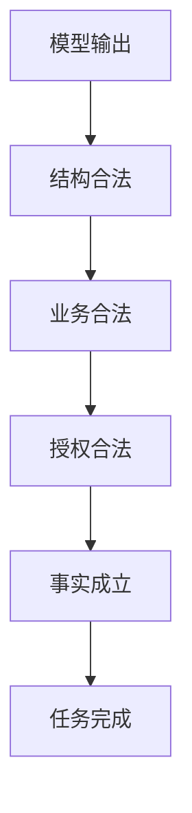
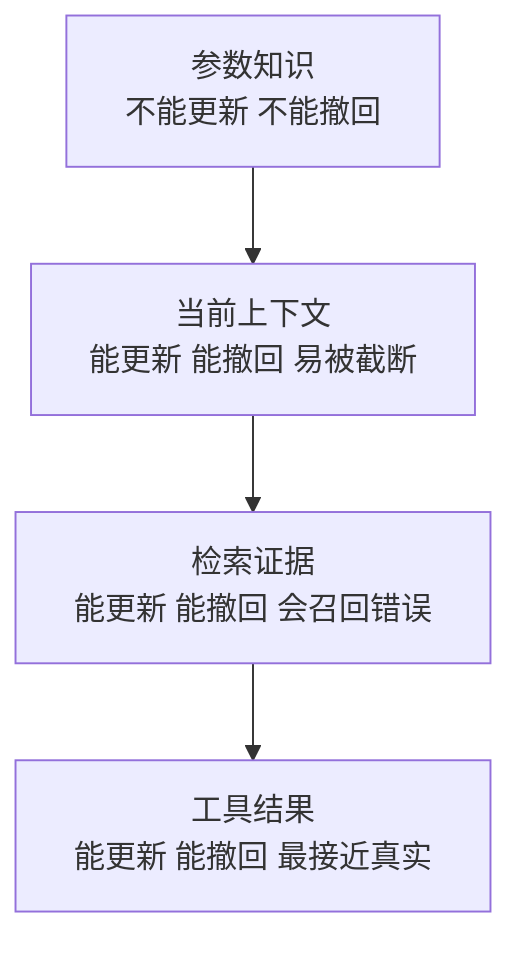

# 模型提出候选，系统定义正确性

这篇要解决的问题：模型输出的每个字都像真的，但它凭什么对事实负责？模型输出只是高概率续写、对事实没有断言力（无法给出可验证的真假声明），正确性从哪里来。读完你能把"正确性"拆成几种分别可验证的东西，也知道哪几种该由系统而非模型来证明。模型输出可能在语法正确、语气自信的同时与真实世界完全不一致，既然输出本身不可信，就需要回答：正确性有哪几类、各由谁证明。**工程系统无法让模型停止具有概率性，只能把"正确性"分成几种，并为每一种建立独立的证明**。

这一篇给出这个划分：从模型输出到业务结果要经过五道边界（结构、业务、权限、事实、任务），每一道由不同的机制负责证明。结构化输出只约束字段格式——schema（预先定义的字段结构与格式约定）只管住字段长什么样，碰不到业务规则、权限和事实真相。核心结论是——**结构化输出只解决第一道**，模型返回 `status: success` 既不能证明命令执行过，也不能证明用户目标完成。

## 要解决的问题：正确性可以分成哪几种

系统若按文本本身判断正确性，错误会直接进入业务数据——这正是首段那个编造的成功状态引出的教训。本篇回答四个问题：正确性可以分成哪几种（五道边界一节）、每一种由谁来证明（同节的证明责任表）、格式合法与事实成立之间的差距怎样弥补（推理预算与结构化输出一节）、模型与业务之间需要怎样的接口隔离供应商差异（应用接口一节）。

## 为什么 JSON 合法、语气自信，结果却是编的？

一个运维 Agent（能自己决定步骤、调用工具完成任务的 AI 程序）被问"昨晚的定时任务有没有成功"。它返回：

```json
{
  "status": "success",
  "checked_at": "2026-09-14T08:00:00Z",
  "log_summary": "任务已完成，处理 12,483 条记录"
}
```

**格式完全合法，语气非常确定。但它是编的**——这个 Agent 根本没有被授予访问生产日志的权限，它只是"合理地续写"了一个看起来像结果的 JSON。

上线后被发现，是因为有人手动查了日志核对：**那个任务其实失败了**。

这个案例暴露的核心问题是：**"模型输出了 `status: success`" 和 "任务真的成功了" 之间，没有任何必然联系。** 而很多系统直接把前者当成了后者。

模型输出不可信且无法自证，同一句话可能对应模型训练时见过的真实信息，也可能只是按上下文拼出来的合理续写，从输出本身无法区分。既然模型自己分不出真假，就不能让它自我判定，必须由一个不靠续写、能独立取证的程序来判定——例如像下文 CoVe 那样围绕每条事实主张单独核查的验证流程，或像 NeMo Guardrails 那样在模型之外运行的护栏代码。**正确的分工由此而来**：模型本身无法为事实背书，因此模型只负责把开放输入转换成**候选**（理解、计划、动作建议），判断正确性的责任归系统——由系统定义**哪些候选才算正确**。

这个分工有具体的工程实现。Meta 2023 年发表的 Chain-of-Verification（链式验证：先让模型给出回答，再由系统逐条核实其中的事实主张）论文给出了一条完整流程：模型先生成基准回答（候选），系统再围绕回答里的每条事实主张生成验证问题，独立执行验证——第三步标出的 `1836: ×` 正是基准回答里「1835 年德克萨斯脱离墨西哥」这个错误被验证环节抓出来的时刻，最后才输出验证过的回答——候选与裁决的分离一目了然（裁决指验证环节的代码按既定判据做出判定，不依赖人）：


*图源：Meta 论文《Chain-of-Verification Reduces Hallucination in Large Language Models》（arXiv 2309.11495，Figure 1）。Baseline Response=基准回答（候选），Plan Verifications=计划验证问题，Execute Verifications=执行验证（√/×=通过与不通过），Final Verified Response=验证后的最终回答。第三步抓出的 `1836: ×` 对应基准回答里写错的 1835 年——候选里的错误由验证环节裁决，模型自己发现不了。*

这个分工在工程框架里有标准实现形态：NVIDIA NeMo Guardrails 把可编程护栏放在应用代码与模型之间，模型输出必须先过护栏定义的判定逻辑才能回到应用——正确性由护栏层的代码与规则证明，模型只提供候选：


*图源：NVIDIA NeMo Guardrails 官方文档 How it works，https://docs.nvidia.com/nemo/guardrails/about-nemo-guardrails-library/how-it-works，文档引用。护栏的判定逻辑由五类规则（rails）组成：输入、输出、对话、检索、执行，分别拦在模型交互的不同位置；模型给出的每一条候选都要先被这层代码拦一道，才轮得到应用决定收下还是退回。*

## 从模型到业务结果要经过哪五道边界？



五道边界依次是：结构合法（JSON 与字段类型符合约定）、业务合法（参数与状态转移符合领域规则）、授权合法（当前主体有权执行）、事实成立（声称的命令与数据真实存在）、任务完成（用户目标真正达成）。这些边界在逻辑上分层，每道可以比作一道闸门，但它们是代码里的校验步骤，不是强制串行的物理闸门，可以按错误代价决定建到哪一层（见效果与代价一节）；从模型输出的位置看，**结构最近、任务最远，越往后越依赖外部证据**。逐道对照如下：

| 正确性 | 要回答的问题 | 谁负责证明 |
| --- | --- | --- |
| 结构正确 | JSON、类型和必填字段是否合法？ | schema 解析器（按预先定义的 JSON 结构与字段规则做校验的程序） |
| 业务正确 | 参数范围、状态转移和领域约束是否合法？ | 业务代码与数据库约束 |
| 权限正确 | 当前主体是否有权读取或执行？ | 身份、策略与资源服务 |
| 事实正确 | 声称的命令、数据和外部事实是否真实存在？ | 工具结果、来源和证据记录 |
| 任务正确 | 用户目标是否真正完成？ | 可执行验收、评测器或人工确认 |

结构化输出只解决第一道——模型返回 `{ "status": "success" }` 既不能证明命令执行过，也不能证明用户目标完成，这正是首段编造案例暴露的差距。

## 模型能力来自哪里？四种来源的可信度有什么不同

**"模型知道" 不是一个足够精确的工程描述。** 必须继续问：这句话的信息来自哪里？因为四种来源的更新方式和可靠程度完全不同。

四种来源的差别不在强弱排序，而在两个问题：**能不能更新、能不能撤回**。参数知识两个都不行，其余三种都可以。参数知识（训练时固化在模型权重里的知识）固定下来后无法纳入最新事实，需要实时或专有信息时只能靠检索或工具现查现取，**这正是必须接检索或工具的原因**。



| 来源 | 特点 | 能更新吗 | 能撤回吗 | 典型失效 |
| --- | --- | --- | --- | --- |
| **参数知识** | 训练时学到的，覆盖广 | 不能逐条更新 | 不能 | 知识过时、记错细节 |
| **当前上下文** | 本次对话可见 | 能 | 能 | 被截断、被噪声干扰 |
| **检索证据** | 从外部库召回 | 能 | 能 | 召回错误、内容过期、越权 |
| **工具结果** | 真实执行得到 | 能 | 能 | 调用失败、参数错、超时 |

同一问题走三种来源，结果差别如下：

```
问："公司的报销流程是什么？"

参数知识：模型知道"一般公司的报销流程" → 但不知道你们公司的
检索证据：从内部 wiki 召回 → 但可能召回的是旧版流程
工具结果：调用 HR 系统 API → 最可靠，但需要权限和正确的调用

如果只依赖参数知识，模型会编一个"看起来合理"的流程 —— 这正是前面那个事故的原因。
```

基于这四种来源的差异，工程上要守三条规则：

- 需要**实时/专有信息** → 必须接检索或工具，不能靠参数知识
- 检索到的内容**必须带来源和时间戳**，供后续验证
- 工具结果**最接近真实**，但仍要验证调用是否真的执行了——见 [[工程知识/AI 系统工程：从模型能力到生产能力/安全与治理/执行证据必须独立于AI结论]]

## 模型选型要比较哪些维度？

模型选型（为具体任务挑选合适模型的过程）应从任务分布出发，分别测量：

- 指令遵循和结构化输出稳定性；
- 工具选择、参数生成和停止判断；
- 长上下文中的证据定位与抗干扰能力；
- 中文、代码、图片或音频等实际模态（模型能处理的不同信息形式）；
- 三类安全边界（系统必须守住、模型可能越过的三种行为界限）下的行为——拒答（模型主动拒绝回答）、越权（超出授权范围的操作）、提示注入（外部输入诱导模型违背原指令）；
- P50/P95 延迟（分别表示一半、95% 的请求快于该值）、吞吐（单位时间内能处理的请求或 token 数量）、token 与整体任务成本；
- 供应商可用性、数据政策、区域、版本和弃用路径（供应商停止支持某模型后如何迁移到替代方案）。

一个模型在通用 benchmark（标准评测集）上更强，不代表它在你给工具定义的 schema、你的数据分布和你规定的响应时间上限（延迟预算）下更优。模型升级也不是配置替换：**它可能同时改变工具偏好、输出长度、拒答策略和成本曲线**。

## 推理预算与结构化输出该怎么正确使用？

结构化输出的可靠性来自约束解码（在生成每一步用规则限制可选 token 的技术）：在每一步生成时，用状态机（按规则在有限状态间跳转的判定程序）判定哪些 token（模型一次生成的最小文本单元）合法，把不合法的从候选里屏蔽掉，模型只能在合法路径上走。这让 schema 从"提示它遵守"变成"**它在结构上没法不遵守**"。但约束解码只保证字段格式合法，无法覆盖字段背后的业务规则、权限与事实真假，**这正是它只能覆盖五道边界第一道的原因**。


*图示：用状态机掩码 logits（模型给每个候选词打出的原始分数——来源：arXiv 2307.09702 的 fsm-logits-mask）。结构化输出的保证来自屏蔽机制本身，提示词（发给模型的输入指令与背景信息）里的请求提供不了这种保证。*

当任务路径复杂、可验证且错误成本高时，可以分配更高的推理预算（分配给一次推理的计算量或时间，不涉及调用费用）：更长的思考链条让模型在多步推理里自我校验，错误代价高时才值得付出这份计算。但**推理预算只影响思考深度，改变不了它没掌握的事实**；若任务本身没有可自动判定的对错标准，再长的思考链条也无法自行确认真假，缺失的事实和模糊的完成条件仍要靠检索、工具与判据（预先定义的判定标准）补齐。结构化输出适合把模型判断交给程序，但 **schema 应表达模型可以判断的内容，不能让模型填写它无法证明的字段**。

举一个模型输出的候选做例子：

```json
{
  "recommended_action": "run_tests",
  "arguments": {"suite": "integration"},
  "reason": "修改影响数据库事务边界",
  "uncertainties": ["本地依赖可能未准备"]
}
```

执行器（真正运行命令、产生退出码与输出记录的程序）再生成不可伪造的事实：

```json
{
  "command_id": "cmd_42",
  "exit_code": 1,
  "stdout_ref": "artifact://cmd_42/stdout",
  "stderr_ref": "artifact://cmd_42/stderr",
  "started_at": "...",
  "finished_at": "..."
}
```

第一段的语义判断权属于模型，第二段的事实写入权属于执行器。

## 有哪些常见错误

- 用 `temperature=0` 当作确定性或事实保证；它只能减少部分采样（只采集一部分数据以控制记录开销）变化。这个错误来自对温度的误解：采样温度是连续可调的，调低只是让输出分布更集中，不等于**关闭随机性**。以下按机制逐条看。
- 要求模型给自己一个置信度，并把这个数字直接当概率使用；未经校准的自报置信度没有统计语义。
- 在提示词里写「必须安全」，却没有服务端权限、参数校验和副作用（操作对外部状态产生的额外影响）控制。
- 把更长上下文当作长期记忆，忽略内容选择、冲突和时效。
- 只保存最终回答，不保存模型版本、上下文、工具轨迹和外部证据，导致失败无法重现。

## 效果从哪儿来，要付什么代价

把正确性分成五道边界分别证明，换来的是**错误不再直接进入业务数据**：格式合法但金额算错的输出会在事实边界被拦下，不会写进账单，模型的能力仍然可用。代价是**每条边界都要独立建设——schema 解析、业务校验**、权限服务、证据记录、验收器，缺一道就意味着**该层的正确性由模型自行保证**，而模型无法自证。五道边界全部建设的成本不低，所以按错误代价决定建设到哪一层：只影响展示的错误可以止于结构边界，涉及资金与权限的必须走到事实与任务边界。

## 稳定的应用接口应该长什么样？

业务层不应直接依赖某个供应商的响应对象。内部接口至少显式接受任务（要完成什么）、上下文（本轮可见的信息）、工具能力（允许调用的工具清单）、输出约定（结果字段与格式）和预算（token 与时间上限），并返回候选结果、工具请求、拒答或错误。模型别名和供应商特性留在适配层（负责在不同供应商接口之间做转换的代码层），业务正确性留在模型之外。

正确性判据（把候选对照既定规则打出通过或不通过的程序化条件）要与候选一起对账。系统先按预定义判据给每个候选打分，保留判据命中的原始证据；**判据与证据对不上的候选直接淘汰**（通不过筛选就出局，与缓存腾空间的淘汰无关）；只剩判据覆盖不了的分歧才交给人裁决。

## 怎么自己动手验证

最小验证：对同一批任务构造两类断言（可程序化判定的预期结果检查），一类检查输出的格式与结构，一类检查内容与外部事实是否一致。预期格式类断言通过率接近满分，事实类断言需要外部校验才能判定；**把外部校验移除后重跑，仅凭模型输出无法得出正确性结论**。

边界验证：修改模型版本或调整采样参数后重跑同一断言集，预期格式类断言的通过率变化有限，事实类断言的失败案例能够被逐条定位到具体记录。

## 接下来该读哪几篇相邻内容？

- [[工程知识/AI 系统工程：从模型能力到生产能力/模型与上下文/上下文工程是在有限预算内构造决策现场]]：讲模型拿到的输入窗口怎么治理，与本篇的候选分工互补。
- [[工程知识/AI 系统工程：从模型能力到生产能力/安全与治理/AI可以做语义决策，系统必须守住事实边界]]：讲事实类正确性为什么必须由系统证明，是本篇五道边界的展开。
