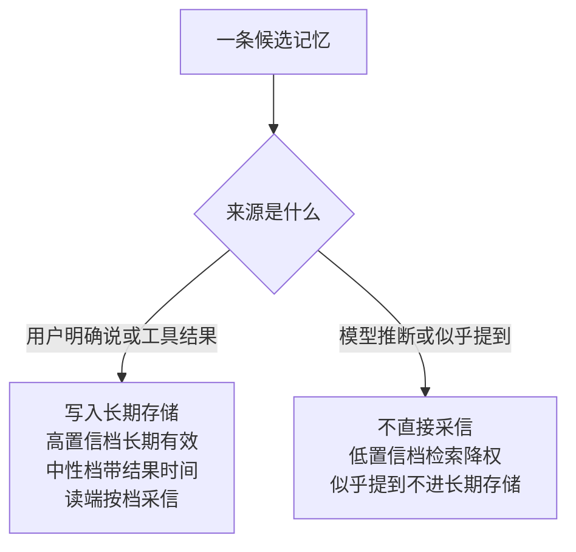
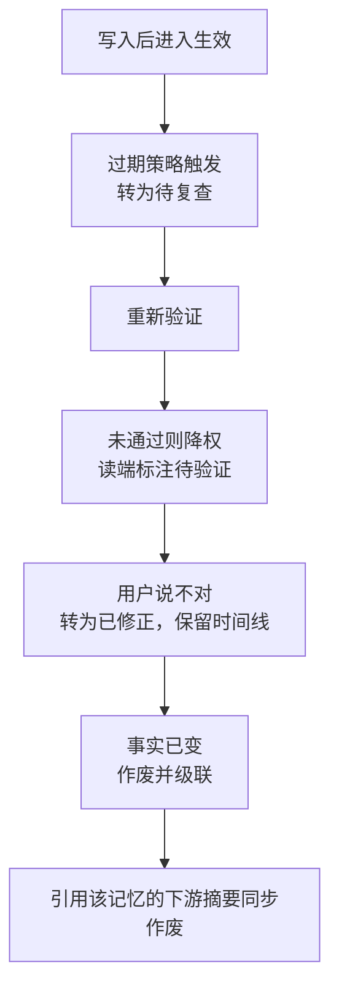

# 记忆写入治理：来源、主体与过期决定记忆的可信度

这篇讲记忆写入的治理：给每条记忆定义来源、主体、置信度、过期等元信息字段，读完你能为记忆系统设计可审计的写入规则，判断一条记忆该不该信、何时撤回。Agent 记住了一条"用户喜欢简短回复"，三个月后用户早已换了偏好，但 Agent 还在用它回复；这条记忆还缺来源记录——不知道是用户亲口说的、模型猜的还是某次幻觉（模型生成看似合理、实际与事实不符的内容）的输出被当成事实写进去了——没有人能判断该不该删。要解决的问题：**让记忆可解释、可撤回、可审计，防止污染和过期记忆无限传播**。

## 它是怎么做到的，本质是什么

打个比方：记忆像冰箱里的剩菜——贴了标签（来源、谁放的、什么时候放的）才知道能不能吃，没贴标签的放久了就只能整盒扔掉；别人说的一句话被你当成自己的笔记记下来，是最容易出问题的一类。这个比喻到"为什么要记来源与过期"为止：比喻里"别人说的话被当成自己笔记"对应来源与主体混淆；具体的元数据字段有哪些、过期策略怎么定、冲突时怎么判，要看正文。

本质是**写入阶段**（把记忆写进存储的那一步）的治理与读取阶段（每次检索把记忆放进上下文的那一步）的信任相配：读取阶段的信任判断依赖写入阶段写下的字段。记忆系统的失效大多发生在写入端：**无来源（无法审计）、无主体（无法判断适用范围）、无过期（旧事实永远覆盖新事实）、无置信度（猜测与用户确认混为一档）**。读端只是放大器——被污染的记忆在每次检索时把错误注入上下文。治理投资在写入端，收益在读端：写入端把来源、主体、过期字段写清楚，读端每次检索时才能按字段判断可信度，省去逐条重新核实的成本。

## 写入四元组与纠错语义分别管住什么？

| 字段 | 回答什么问题 | 缺失后果 |
| --- | --- | --- |
| 来源 | 这条记忆从哪来（用户原话/工具结果/模型推断） | 无法审计、无法撤回污染源 |
| 主体 | 记的是谁的偏好/事实（用户/会话/全局） | 串租户（租户指共用一套系统的不同用户或项目，串租户即 A 的数据被记到 B 名下）、A 的偏好写到 B 头上 |
| 置信度 | 一次猜测还是用户确认 | 模型猜的「用户讨厌电话」和用户当面确认混在同档，读端无从区分，错误猜测被当成用户事实采信 |
| 过期 | 什么时候该重新验证 | 没有过期时间，用户偏好更新后旧记忆仍排在最前被原样采纳，当初有用的记忆持续给出错误答案，好处变成了负担 |

纠错语义：用户说"不对"时，**定位原记忆做修正或作废，避免往记忆里追加一条否定**；修正要保留时间线（谁在何时改了什么），**作废要能级联**（引用这条记忆的下游摘要同步作废）。

MemGPT 论文把「写入」与「修正」两种动作的差别画得最清楚——同样是对话里出现的新事实，**写入是往记忆块（MemGPT 中记忆切分存储的最小单元）追加一条，修正是在原记忆块上就地替换**，旧值不被否定条目覆盖：


*图源：MemGPT 论文《Towards LLMs as Operating Systems》(arXiv:2310.08560) 配图，https://arxiv.org/abs/2310.08560。*


*图源：同上（MemGPT 论文《Towards LLMs as Operating Systems》），(arXiv:2310.08560) 配图。*

按来源把记忆分成三档写入：**用户明确说的进高置信档、长期有效；工具结果进中性档、带结果时间；模型推断的进低置信档、检索时降权**。归哪一档由写入路径按来源自动判定，不需要人工挑选。上下文里"似乎提到"的不写入长期存储，最多保留会话级临时记忆。分流逻辑如下图：



图：写入端按来源分流，各档位的字段定义见上文四元组表格。

这条分流在工业系统里落成了流水线（比喻到「写入分多步处理」为止，具体结构看下文）。Mem0 论文的系统架构图把记忆写入画成两阶段：提取阶段把新消息连同会话摘要与近期历史交给 LLM（大语言模型），产出候选记忆；更新阶段取出候选与向量库（一种按语义相似度检索记忆的数据库）中最相似的一批旧记忆，交回 LLM 做工具调用裁决。裁决按新旧记忆的语义关系选操作：内容相同且无变化选 NOOP（不动），相互矛盾选 UPDATE（补充）或 DELETE（删除被新信息否定的），包含补充信息选 ADD（新增）——**「写入要过裁决而不是照单全收」正是治理思想在管线里的形状**：


*图源：Mem0 论文《Building Production-Ready AI Agents with Scalable Long-Term Memory》Figure 2（arXiv 2504.19413），https://arxiv.org/abs/2504.19413。*

修道院档案馆的木盒给「写入四元组」提供了实物：盒面有标签（来源）、锁着案卷归属（主体）、按年份排架定期销毁（过期）、动过的记录写进登记册（纠错）。没有标签的盒子几年后没人说得清里面是什么——记忆条目缺这四个字段是同样的下场。这个比喻只说明四个字段各自对应盒子的一项属性，具体的字段定义与分档规则以正文表格为准。

## 记忆系统会怎样悄悄失效？

| 失效 | 机制 | 信号 |
| --- | --- | --- |
| 幻觉写入 | 模型推断被当成事实持久化 | 检索到"用户说过 X"但用户没说过 |
| 串租户 | 写入时没绑定主体标识 | 用户 A 的数据出现在 B 的回复里 |
| 无过期累积 | 记忆只增不减，旧偏好永远有效 | 回复风格与用户当前偏好背离数月 |
| 纠错变污染 | 否定信息以追加方式写入 | 同一主题正反两条记忆并存 |
| 来源缺失 | 无来源字段，审计时无从下手 | 无法回答"这条记忆从哪来" |

## 这套说法在哪些情况下会失效？

- 记忆治理与状态一致性是两个问题：治理解决"写入什么、怎么撤回"（本篇），一致性解决"并发读写谁保证正确"——见 [[工程知识/AI 系统工程：从模型能力到生产能力/模型与上下文/跨会话状态的一致性先于记忆的长度]]；两层都做才完整，只做一层会从另一层漏：比如写了来源但并发读写没保证，撤回的旧记忆仍可能被读到；反之只有一致性没有来源，撤回时也说不清该撤哪条。
- **置信度是设计值不是模型输出值**：只有写入路径清楚这条记忆来自用户原话还是模型推断；模型在写入时并不**比写入路径更清楚这条记忆是用户原话还是自己猜的**，让它打分等于让它评估自己的猜测，自然不可信，所以**档位由写入路径按来源硬性决定（用户原话 > 工具结果 > 模型推断），模型不参与**。
- 过期策略有维护成本：review_after 是记忆上标注的下次复查日期，到期后需要有人或有调度进程去扫描并触发验证；无复查机制的过期字段等于没有过期。
- 与 RAG（检索增强生成，从外部资料检索片段再交给模型）证据的区别：记忆是"关于用户的长期事实"，RAG 证据是"关于世界的可引用材料"；两者的新鲜度与权限传播机制同构——见 [[工程知识/AI 系统工程：从模型能力到生产能力/知识与检索/RAG的新鲜度与权限传播：撤回的数据不能再被检索到]]——但对象不同，不混用同一张表。

## 动手跑一遍写入与失效流程会看到什么？


记忆写入之后还有状态要管：「过期策略触发」把生效的记忆推进待复查，用户说不对时走「已修正」或「已作废」两条边，而追加否定条目那条边正是要避免的「正反并存」：



作废要级联、修正要保留时间线，写入字段与读回时的对账条件都要一次跑通。

接口示意是伪代码，只演示字段与判定条件；`memory.write`/`memory.read` 是假想的记忆系统接口，接任何具体实现前先对照字段清单核对：

```python
memory.write(
    content="用户的项目用 PostgreSQL 16，连接池上限 50",
    source="user-stated",          # 来源：用户明说 / 系统推断 / 第三方文档
    subject="user-project",        # 主体：关于谁的事实（用户 / 项目 / 会话）
    confidence=0.9,                # 来源分：明说 0.9、推断 0.6、文档 0.8
    expires_hint="check-on-use",   # 过期语义：用到时验证 / 定期重确认 / 永不过期
)

# 读回时的对账：
m = memory.read("连接池上限")
if m.confidence < 0.7 or m.stale_days > 90:
    # 低置信或过期 → 不直接用，向用户求证或标注"待验证"
    ...
# 冲突裁决：同一主体两条记忆矛盾
#   新覆盖旧（状态类事实：当前版本号），或并存标注适用条件（偏好类）
```

记忆失效的实录形态有两类。一类是环境变了记忆没更新："项目用 PostgreSQL 16"写成时是真实的，半年后升级到 18，旧记忆从资产变误导，检索命中后照着旧版本回答完全错误，所以**状态类事实必须带"check-on-use"语义而非永不过期**。另一类是主体错位：把 A 项目的事实记到 B 项目名下，在多项目工作区的检索里静默串台，**主体字段是隔离边界，缺失就串**。同域的写入纪律见 [[工程知识/AI 系统工程：从模型能力到生产能力/Agent与工作流/反思要有外部锚点.md]]（写入要锚证据）与 [[工程知识/AI 系统工程：从模型能力到生产能力/模型与上下文/多轮对话要管理上下文而不是累积.md]]（会话内上下文管理与跨会话记忆是同一治理问题的两个时间尺度）。

## 怎么自己动手验证？

过期策略要靠持续探测来驱动。探测结果直接决定这条记忆还能不能被继续使用。


*图源：Microsoft Learn 中文文档，CC BY 4.0，https://learn.microsoft.com/zh-cn/azure/architecture/patterns/health-endpoint-monitoring。*


记忆可信度要与来源分档对账——预写推断条目被降权、过期条目触发复查、错误条目可追到写入事件，任一项与预期对不上就是治理规则没有生效。

最小验证：构造一个含 5 条记忆的测试集（用户原话 1 条、工具结果 1 条、推断 1 条、过期 1 条、错误 1 条），断言：检索时推断条目被降权、过期条目触发复查提示、错误条目能按来源定位到写入事件；再注入一次"用户说不对"的纠错指令，断言原记忆被修正或作废而非追加否定条目。最后做串租户测试：两个模拟租户并发写入，各自读取，断言 A 读不到 B 写入的记忆、B 也读不到 A 的。

关系：[[工程知识/AI 系统工程：从模型能力到生产能力/模型与上下文/记忆是受治理的状态，不是更长的聊天记录]] · [[工程知识/AI 系统工程：从模型能力到生产能力/Agent与工作流/工具是受约束的能力，不是提示词里的函数名]] · [[工程知识/AI 系统工程：从模型能力到生产能力/数据与MLOps/训练数据治理：来源、许可与污染决定语料的长期价值]]
