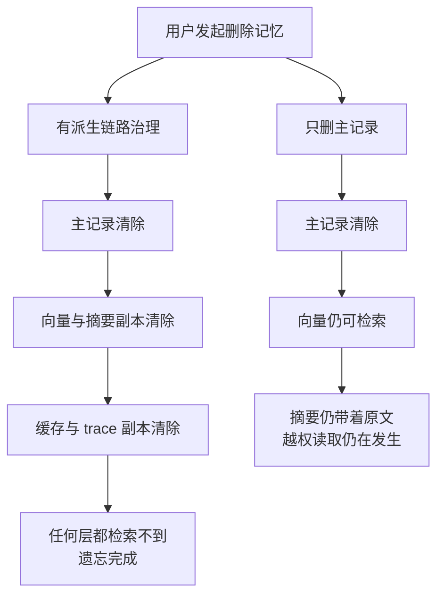

# 记忆是受治理的状态，不是更长的聊天记录

记忆是受治理的状态，不是堆得更长的聊天记录：**每条记忆都要登记来源、权限、时间与删除规则**。读完你能写一条带冲突与撤回的记忆，验证读取、覆盖和遗忘。**无限追加聊天记录会把旧轮次里的错误结论、已失效信息和曾临时出现的敏感内容原样带回模型，被模型当作事实再次采纳并输出，错误与隐私就这样被持续传播。**记忆可被多副本检索、可异步更新，每一条都要登记来源与权限。这个动作像档案室对每份档案登记那样。比喻到「逐条登记」为止：档案室登记完就不管副本去向；至于记忆的副本复制与异步更新，靠后面的派生链路治理去管，不在逐条登记这一步。

## 哪几句值得先记住？

| 维度 | 回答 |
| --- | --- |
| 要解决的问题 | Agent 需要跨步骤或跨会话保留有用信息，但把所有历史直接塞回上下文会造成噪声、过期、隐私泄露和无法恢复。 |
| 本质 | 记忆是有所有者、生命周期、来源和删除语义的状态；对话只是其中一种临时表示。 |
| 做法 | 分离对话、任务状态、用户记忆和领域知识，规定写入条件、读取范围、冲突优先级、TTL（Time To Live，存活时间，到期后数据可被自动删除）；撤销和派生数据（由主记录生成并依赖它的副本，如向量、摘要、缓存）的清理规则一个不能少。 |
| 效果与代价 | 相关信息更容易被稳定召回，任务可恢复且隐私边界清楚；代价是分类、权限、迁移和一致性（多个副本与主记录内容保持相同）管理更复杂。 |
| 边界 | 摘要和模型推断（模型从对话中猜测的偏好或事实，未经用户确认）不能升级为事实；记忆不能替代实时业务 API、版本化知识库或业务数据库事务。 |
| 验证 | 测跨会话召回、无关记忆干扰、冲突处理、删除传播和越权读取，并检查关键结论是否能回到原始事件。 |

Agent 的「记忆」常把四种不同对象混在一起：当前对话、任务执行状态、用户长期偏好和外部知识。**它们的所有者、生命周期、准确性和删除要求不同，不能都保存成消息并在以后整段塞回模型。**


*图示：MemGPT 的系统流程：上下文在有限窗口与外部存储之间换入换出。图源：MemGPT 论文（2310.08560）。*

## 记忆分成哪四种状态，各自归谁、失效方式有何不同？

记忆按所有者与生命周期分成四种状态。对话上下文归当前会话，只占当前窗口。任务状态归当次运行，只活在检查点（定期保存进度、故障后从最近一次保存处恢复）里。用户记忆归用户本人，跨会话保留。领域知识归知识库维护方，由独立版本管理。

先说清什么是失效：这里说的失效只指停止返回，不指数据消失——物理副本仍在，可能被再次检索到，真正的消失要等遗忘一节的派生清理，才能做到任何层都检索不到。四类的失效触发方式各不相同：对话上下文随窗口滚动即弃，任务状态随运行结束失效，用户记忆按用户要求或到期自动停止返回，领域知识由维护方换新版即旧版失效。用食品的保质期来比方——保质期到了食品不再上架，对应条目到期不再被读取返回。比喻到此为止：食品到期等于内容作废，记忆到期只是停止返回、内容本身不作废，二者只在「到期即下架」这一点上相似。

| 状态 | 例子 | 生命周期 | 正确存储 |
| --- | --- | --- | --- |
| 对话上下文 | 最近几轮问题与回答 | 当前会话 | 窗口历史 + 可追溯摘要 |
| 任务状态 | 当前步骤、工具结果、预算、审批 | 一次运行直到完成或过期 | 检查点与事件日志 |
| 用户记忆 | 偏好、明确授权保存的事实 | 跨会话，可查看和删除 | 结构化档案（profile，按字段存用户信息的记录）或带来源的 memory store |
| 领域知识 | 政策、文档、代码和数据 | 独立版本与权限 | RAG（检索增强生成，从外部知识库检索相关内容）、数据库或业务 API |

把领域知识写入用户记忆会造成**版本漂移**（政策文档已更新，旧版本仍留在用户记忆里，之后引用的每一条都是过期的）；把工具执行状态只留在对话里会**破坏恢复**（Agent 崩溃重启后，对话窗口已清空，工具调用到哪一步无从查起）；把模型推断（模型从对话中猜测的用户偏好或事实，不是用户明确确认的）的偏好当作用户事实会产生**错误个性化**（模型误判用户喜欢简洁回答，此后所有回复都被强行压缩）。**这三条是三类越界**，下文按各自的小节分别展开。

短期的东西和长期的东西，分界线画在哪，LangGraph（一个用于构建有状态 Agent 的开源框架）官方文档里有一张现成的对照图：短期记忆是对话消息本身，随线程（线程即一条会话的独立执行序列）由 checkpointer（LangGraph 中按线程保存对话与检查点的持久化组件）持久化；长期记忆是提炼出的事实条目，跨线程由 store（LangGraph 中跨线程存放长期记忆条目的存储组件）持久化，两者在模型调用前汇合。


*图源：LangChain 官方文档《Memory overview》，MIT，https://docs.langchain.com/oss/python/langgraph/memory。*

两条进模型的路径对应两类生命周期：「Human/AI message 随线程」一路是对话上下文与任务状态的存法，生命周期不超过一次运行或会话；「条目存 Store」一路是用户记忆的存法，跨会话、可按命名空间（按用户或用途分开的独立存储空间）隔离与删除。把该随线程过期的东西写进 Store，就是上面第三类越界的具体写法。

## 哪些场景必须全套治理，哪些场景可以先不动？

**必须全套治理的场景，与可以先不动的场景，分界就在记忆错了会不会造成实际伤害。**多用户产品保存偏好与授权，记忆错了就是错误个性化与越权（访问了权限范围之外的资源）；长期运行的任务型 Agent 保存任务状态与中间结论，记忆错了就是重复劳动与错误决策；合规要求可删除的场景，漏删就是法律风险。

三类场景各有最吃紧的一项：多用户产品最怕越权写入，所以写入策略最吃紧；长期运行的任务型 Agent 最怕错误结论累积，所以 TTL 最吃紧；合规场景最怕残留泄露，所以派生清理最吃紧。单用户本地工具、即用即弃脚本助手、仅当轮缓冲的场景，无跨主体越权与合规删除压力，错误影响范围小，相对于个位数记忆的收益，维护派生链路的开销偏高，属于「可以先不动」的一侧，只做对话窗口与摘要即可。

## 为什么写入比读取更危险？

**写入比读取危险，是因为错误写入会污染此后所有会话的召回结果。**写入要跨边界，读取不一定。

`read()` 这类读取调用（程序读取数据的一次调用）要从用户态（普通程序运行的状态）跨到内核态（操作系统核心运行的状态）：用户程序没有直接操作底层资源的权限，每次读取都要穿过这道边界，由内核代查权限——跨边界正是难以确认之处，这像过安检要逐道核验，每过一道都查一次放行。这个比方到每一道都要核验一次放行为止，不类比安检的速度或严格程度。

写入比读取更难收尾：读取到这一层就算完成，写入还要让下游所有副本都生效才算数——向量是记忆转成的数字化检索副本，缓存是暂存以供快速读取的副本，摘要是压缩后的内容概要——向量要重新算嵌入（把文字或对象映射成向量、语义越近向量距离越近）并入库、缓存要失效重取、摘要要重算，任一处未同步就会出现读到旧值。

**长期记忆必须有写入策略。每条记录至少回答：谁说的、是事实还是推断、属于谁、为何需要保存、何时过期、能否被用户查看和删除。模型可以提议记忆，但系统应按类型和政策决定是否写入数据库。**

mem0 的官方管道图把「写入前先治理」画成了一条流水线。流水线里有两个新名词：嵌入指把文字含义转成的一串数值，用于计算相似度；实体指人名、机构、概念等对象。管道的运作是：响应结束后异步抽取候选记忆，抽取前先做上下文查找（已有哪些相关记忆），抽出的条目再过一轮去重加向量化，实体间还要建立链接，最后按类型分写到三处存储：SQL 库放事实与元数据，向量库放嵌入，实体库存实体及它们之间的关系。上下文查找回答「为何需要保存」，去重回答「是否重复存」，分库存储回答「按什么类型治理」，每一步都在拦截「不值得存、重复存、存错地方」的条目。


*图源：mem0 官方仓库文档插图《Memory Extraction》，Apache-2.0，https://github.com/mem0ai/mem0（extract memories 记忆抽取 / deduplicate 去重 / entity linking 实体链接；深色为官方原图配色）。图上五段流水线对应正文写入策略的五问：上下文查找回答「为何需要保存」，去重回答「是否重复存」，分库存储回答「按什么类型治理」。*

```yaml
memory_id: ...
subject: user:123
kind: explicit_preference
value: "回答优先使用中文"
source_event: event:456
confidence: high
created_at: ...
expires_at: null
visibility: user_editable
```

「用户可能喜欢深色界面」这类推断应具有较短 TTL 和较低权重，不能覆盖用户明确设置。

## 为什么摘要不能当事实源？

**压缩长历史时，摘要可能省略否定、例外、版本和责任主体。摘要用于帮助选择信息，关键事实仍应链接到原始事件或结构化状态。**新闻摘要是同一个风险：编辑把「法院驳回原告全部诉讼请求」缩写成「双方纠纷已解决」（省略否定与责任主体），读者只看摘要就引用，方向完全反了——比喻到「摘要可当导读不可当证据」为止：读者还能翻报纸原文核对，Agent 的对话历史被滚动丢弃后没有原文可翻，所以关键事实必须链接到原始事件。**更新摘要时要防止低质量新摘要覆盖已经确认的重要约束。**

## 为什么读取要过滤相关性、权限与冲突？

长期记忆不是每次全部加载。Context Builder（上下文构造器，负责挑选哪些记忆进入本次上下文的组件）**只读取当前任务相关且当前主体有权看到的记录**，就像前台按门禁权限与本次需求发资料：只发该人有权拿、且本次要用的材料，门禁权限对应权限过滤，本次需求对应相关性筛选，这个比方到「按权限和需求发材料」为止。冲突裁定不在前台发材料的比方里，它发生在筛选之后、返回模型之前，是在筛选之外多出的一层：**按明确事实优先于推断、新版本优先于旧版本、用户设置优先于模型观察**——例如用户明确设置了深色界面（用户设置），模型又从对话推断他喜欢浅色（模型观察），此时按用户设置执行，推断不采用。**被撤回或过期的记忆必须停止进入上下文和缓存。**读取还有一处易被忽略：某些托管记忆服务会在检索未命中时自动把推断写回长期记忆（常见于**开启了自动记忆抽取的配置**）——即把本次对话内容当场抽取为候选记忆存入库中，读取路径上由此发生了写入。**此时读取等同于写入，同样受写入策略约束，应显式关闭或纳入治理。**

## 为什么遗忘要作为一项功能来做？

**系统需要 TTL、用户删除、权限撤销、数据保留期限和派生数据清理**（删除主记录时一并清理由它生成的副本）。**删除主记录但保留向量**（供检索用的数字化副本，删了主记录它仍能被搜到）、摘要、缓存或调用轨迹（trace，每次请求的完整调用记录），**仍然没有真正遗忘**。注销会员是同一个动作的完整版：销掉会员卡主档案（删除主记录）只是第一步，取回的复印件（摘要）、电子系统里的扫描件（向量与缓存）、收银小票存根（trace）都要按流程销毁，忘了任何一份，这个人的信息就还「在册」——比喻到「遗忘是销毁一套材料」为止：会员档案清不干净是合规扣分，记忆副本清不干净是隐私持续泄露，所以删除传播要实测延迟。**生产设计要维护派生链路，并测试删除传播延迟。**



图只回答一个问题：删除动作走完之后，派生链路上还有哪几层活着决定遗忘是否成立。「只删主记录」链路少走一层，结局就是仍有层可检索到这条记忆、遗忘落空——向量仍可检索、摘要仍带着原文，越权读取仍在发生；「有派生链路治理」链路走完全部三层清理才做到任何层都检索不到，每一步就是为补那一层存在的。

## 记忆要怎么评测？

评测覆盖六个维度，其中五项可以想成质检员抽检库房的五个抽检面（这个比方只覆盖这五项，第六项摘要压缩不在其中）：跨会话召回必要偏好（对的单发得出去）、无关记忆干扰当前任务（发错地址的拦得住）、冲突时选择正确来源（两单冲突时按发货单还是口头单有章法）、撤权和删除后不泄露（撤单后仓库里不残留）、恶意用户不能向其他主体写入记忆（外人插不进单）。第六项是摘要压缩是否丢失约束，这一项评的是内容质量，与前五项的权限、召回不同类：摘要会省略否定与责任主体，例如「驳回全部诉讼请求」被省略成「纠纷已解决」，结论方向完全相反，与前文「为什么摘要不能当事实源」一节的新闻摘要是同一个风险。

库房抽检错一件货赔一件，而记忆评测漏掉的错误记忆率会随会话数放大，所以错误率与暴露率要单独计数。质量指标不能只有「记住了多少」，还要测错误记忆率和不必要暴露率（暴露率指不必要暴露的发生比例）。

## 怎么自己动手验证？

删除要与派生链路对账——预写撤权后主记录、向量、摘要、缓存与 trace 中的副本全部清除，任一层仍可检索到，与预期对不上就是传播链断了一环。退租查房，正是删除传播的对账动作：租客退租（发起删除），房东按查房清单逐项核对——墙上的钉子眼、家具磨损、钥匙把数（主记录、向量、摘要、缓存、trace 各一份副本）——清单上任何一项没还原，押金不结（传播链断一环即对账不过），比喻到「按清单逐项验」为止：查房一次就完，记忆的删除传播还要记录耗时进监控——派生副本的清除可能异步滞后，只有记下耗时，才能确认删除在可接受时间内真正不可检索。

1. 删除传播：写入一条记忆后发起删除（用户删掉这条记忆）与撤权（撤销读取授权使记忆不再进入上下文），确认主记录、向量、摘要、缓存与 trace 里的派生副本按派生链路一并清除，并记录传播耗时。
2. 冲突取源：构造两条来源不同、内容冲突（内容矛盾）的记忆，确认系统按来源可信度与时间取用正确的一条。
3. 越权写入：以非授权主体身份尝试向其他主体的记忆写入，确认被拒且留下记录。

## 接着该读哪几篇展开记忆治理？

- 想理解记忆的预算约束（记忆占用上下文预算），读 [[工程知识/AI 系统工程：从模型能力到生产能力/模型与上下文/上下文工程是在有限预算内构造决策现场]]
- 想弄清跨会话状态怎么保持一致，读 [[工程知识/AI 系统工程：从模型能力到生产能力/模型与上下文/跨会话状态的一致性先于记忆的长度]]
- 想掌握领域知识的检索侧做法，读 [[工程知识/AI 系统工程：从模型能力到生产能力/知识与检索/RAG的核心是选择可引用证据]]
- 想深入记忆写入的治理细节（来源、主体与过期），读 [[工程知识/AI 系统工程：从模型能力到生产能力/模型与上下文/记忆写入治理：来源、主体与过期决定记忆的可信度]]


- [[工程知识/AI 系统工程：从模型能力到生产能力/模型与上下文/上下文工程的分层设计：系统提示工具结果与记忆.md]] —— 记忆层的治理展开
