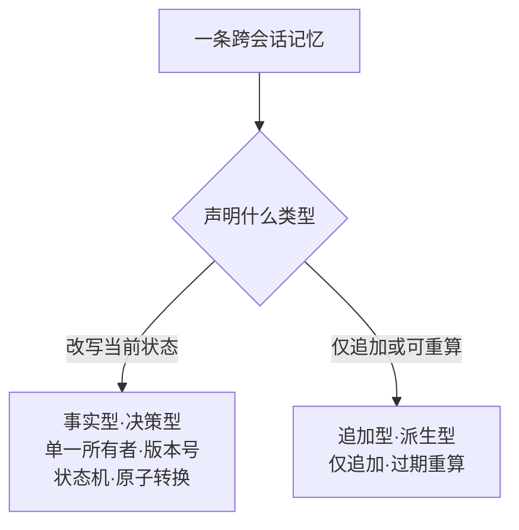
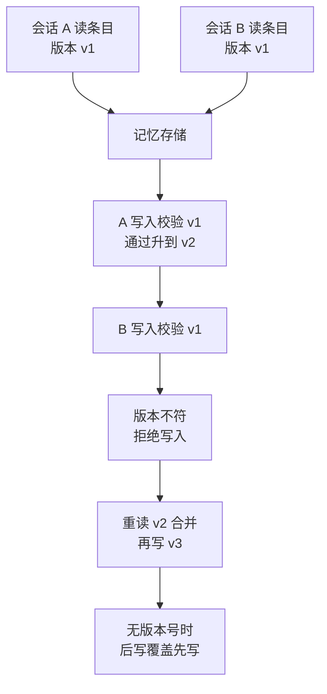

# 跨会话状态的一致性先于记忆的长度

读完这篇你能判断记忆该不该共享，以及并发读写要靠什么保证一致。**记忆一旦跨会话保存，就从一个人的便签变成了多人共写的共享状态**，丢失更新（后写直接覆盖先写，先写的内容丢失）、脏读（读到对方还没提交就被改掉的中间值）、写冲突（两人同时改写同一份，谁覆盖谁无法裁决）**全都会来——因为记忆层同样允许多个会话同时读写，却没有默认加锁，和没有并发保护的数据库一样会出这些错**。

本篇要解决的问题是：**跨会话记忆的多个写入者之间，靠什么保证读到的是一致的状态，为什么缺了这道保证记忆越长错得越多**。Agent 的记忆要跨会话持久化后，会遇到一个数据库早就回答过的问题：**多个会话并发（多个会话同时进行、彼此交错地读写同一份状态）读写同一份状态时，谁来保证一致**。

记忆不是更长的聊天记录[[工程知识/AI 系统工程：从模型能力到生产能力/模型与上下文/记忆是受治理的状态，不是更长的聊天记录]]，跨会话让它**从单线程状态（只有一个执行流在读写，不会出现两人同时改）升级成共享状态**——而**共享状态的全部经典问题（丢失更新、脏读、写冲突）随之而来**，只是发生位置从数据库挪到了记忆层。

典型失效形态：**两个并行会话各自读到"用户偏好 A"，各自写入"用户偏好 A'"与"用户偏好 A''"，后写覆盖先写（丢失更新）；或会话 A 写入半份记忆（进程在两条写入之间崩溃），会话 B 读到自相矛盾的两半**。这些不是理论风险——**凡是允许并发会话的产品都会遇到**。

## 跨会话状态为什么会自相矛盾？

| 状态类型 | 冲突后果 | 机制 |
| --- | --- | --- |
| 事实型（用户偏好、档案） | 覆盖丢信息 | 单一所有者 + 版本号乐观锁（乐观锁：假定冲突很少，不加真锁，写时校验版本号，不符则重读合并） |
| 追加型（对话历史、事件流） | 顺序混乱 | 仅追加日志，禁止改写 |
| 派生型（摘要、索引） | 可重算 | 版本号 + 过期重算，允许暂时陈旧 |
| 决策型（任务进度、承诺） | 错误推进 | 显式状态机（把状态变化列成有限几个、只允许规定的转移），转换必须原子（状态转移要么完整发生要么不发生，不出现半完成的中间态） |

选择路径与并发控制的通用判据同构——同构指两者的判断步骤一一对应，见 [[工程知识/后端系统：在并发、失败与变化中维持服务/任务与并发/并发控制先定义共享状态和完成条件]]：先定义状态的所有者与完成条件（完成条件就是这条状态算处理完所必须达到的样子，比如任务标为已完成、某字段被确认），再选机制。记忆的每一条都要写明自己属于哪一类状态，因为不同类型冲突后的修复方式不同：覆盖丢信息的要防覆盖，可重算的允许暂时陈旧；写入路径据此选择乐观锁还是仅追加。

类型声明就像机场安检前的物品申报：不申报类型就过不了检，申报了才能被检查与登记。检查与登记就是约束与审计，也是治理的起点，所以没有类型声明的条目两条路都进不去——这是"记忆是受治理的状态"里治理的第一层含义。



图：类型声明如何映射到机制选择——改写当前状态的两类（事实型、决策型）用乐观锁与显式状态机保护写路径，仅追加或可重算的两类（追加型、派生型）用仅追加日志与过期重算，逐型机制对照见上文的类型表格，没有类型声明的条目两条路都进不去。

事实型状态的丢失更新可以用版本号防住：**读时带版本，写时校验版本，不符则重读合并**。追加型状态最简单也最稳：**禁止改写、只许追加，顺序问题交给时间戳与因果序**（由事件先后依赖推导出的顺序，不依赖物理时钟，例如先改后读）[[工程知识/后端系统：在并发、失败与变化中维持服务/分布式可靠性/时间顺序与因果必须显式建模]]。

并发会话共享状态需要的协调，可以用接力赛的交接区作实物原型。4x100 接力的交接只能在 20 米交接区内完成，棒从一人传到另一人必须有交接确认；出了交接区才交棒、或两人同时松手，成绩会被取消。对应到记忆写入：


*图源：Wikimedia Commons，2017 Canada Summer Games，CC BY 2.0，https://commons.wikimedia.org/wiki/File:2017-08-04-Matt_Duboff-4x100_%2835543395104%29.jpg。*

两个并行会话各写各的，就是交接区外交棒；版本号就是交接确认——先写者的版本在案，后写者发现棒已易主，重读合并再交；追加日志则规定棒只能向前传，不许往回改；半截棒交出去，就是半条记忆被读到。这个比喻只到「交接必须确认」为止，再往下就属于机制实现。版本怎么存、冲突以哪次写入为准，机制见后文的案例与动手验证两节。

## 记忆为什么容易踩这三个坑？

打个比方：跨会话状态像你的病历本——本子厚不厚（记忆多不多）不重要，重要的是每次不同医生翻开，看到的过敏史和用药记录是同一份（一致）；各写各的、互相矛盾，本子越厚越危险。这个比喻到"一致比多更要紧"为止：冲突怎么判、以哪次写入为准、版本怎么存，要看正文。

1. **写入即事实的错觉**。模型把"这次会话里用户说了 X"直接写成"用户偏好 X"，把一次表达当成长期事实。

事实型写入需要频率或确认门槛（同一信号出现 N 次或用户确认后才升级为持久事实），否则记忆被单次噪声污染。
2. **无界的追加增长**。

每会话都追加，记忆长度随使用无界增长，最终撑爆上下文预算（模型单次能读入的 token 量——token 是模型切分文本的最小单位，可粗略看作字或词的片段）总量，超出就要裁剪或折叠；上下文是有限预算的构造现场，见 [[工程知识/AI 系统工程：从模型能力到生产能力/模型与上下文/上下文工程是在有限预算内构造决策现场]]。追加型状态必须配归档策略：超过阈值的部分折叠为派生摘要，摘要本身是可重算的派生状态。

3. **会话内缓存与持久层的不一致**。会话内通常有一份内存态缓存，会话结束时写入磁盘。

崩溃时机不对，写入磁盘的就是旧版本——这是缓存经典失效模式在记忆层的复刻，缓存改变一致性、故障模式与读写路径的分析见 [[工程知识/后端系统：在并发、失败与变化中维持服务/服务设计/缓存改变读写路径、一致性与故障模式]]。


来源：[CSDN @bjmayor《图解分布式事务模式》](https://bjmayor.blog.csdn.net/article/details/154004146)（CC 4.0 BY-SA）
同一份状态要跨多台机器共享时，一致性还要再加一层：**日志条目按索引与任期（Raft 每次选举产生的递增编号，用来区分不同轮次的领导者与日志）排列，只有被多数机器复制过的条目才算提交**——这是 Raft（一种以易于理解著称的共识算法：靠领导者与日志复制达成多数派一致） 分布式一致性协议的核心规则。记忆层跨会话的写入顺序与提交判定，与这套日志机制同构：**记忆条目也按写入序号排列，并由存储层在多数副本（同一份数据在多台机器上保存的多份拷贝）确认后才标记为已提交，这与 Raft 的提交判定一一对应**。这个同构只到「写入序号加多数确认才提交」为止；记忆层不必实现完整 Raft 选举，任期与领导者由存储层封装。


来源：[稀土掘金《深度解析 Raft 分布式一致性协议》](https://juejin.cn/post/6907151199141625870)（CC 4.0 BY-SA）


## 从案例看，不一致会怎样暴露？

```text
同一用户跨会话的三条记忆，一致性对账：

会话 1（三月）：用户说"项目用 MySQL 8.0"
会话 2（六月）：用户说"刚迁到 PostgreSQL 18"
会话 3（今天）：问"帮我连数据库"

不一致的记忆库直接回答：按三月记忆给 MySQL 连接串 → 全错
一致性的三种保障（按事实类型选）：
  **状态类（当前用哪个库）：新事实覆盖旧事实（时间戳裁决，最后声明的为准）**
  **偏好类（回答风格）：并存 + 适用条件（工作场景用简洁版、教学场景用详细版）**
  **冲突不明（两条矛盾且无法判新旧）：降级为向用户求证，不猜**

长度与一致性的关系：**记忆越长，冲突概率越高（条目越多、时间跨度越大，事实被改写而旧条目未裁决的机会越多，矛盾条目出现的概率随条数上升）**
  **100 条无冲突的记忆 > 1000 条含 50 条互相矛盾的记忆**
  **一致性是记忆可用的前提，长度只是容量的量度**
```

记忆冲突的案例（事实型状态的丢失更新，对应类型表格的事实型一行）：助手按旧记忆（项目用 Redis 5）回答缓存配置问题，用户半年前已升级 Redis 7（新会话提过但检索命中了旧条），给的配置参数在新版本已废弃，排查半天发现是**记忆库新旧并存未裁决**。修复：**状态类记忆带时间戳覆盖，检索时按主题最新优先**。

跨会话不一致的案例（决策型状态的写冲突）：两个会话各自记录了矛盾的项目决策（A 会话说用方案一、B 会话说用方案二），**后续会话随机采信，用户感觉助手反复无常**。修复：**决策类记忆带来源会话引用，冲突时并列呈现而非静默采信**。记忆治理的三要素（来源、主体、过期）见 [[工程知识/AI 系统工程：从模型能力到生产能力/模型与上下文/记忆写入治理：来源、主体与过期决定记忆的可信度.md]]——本篇补的是第四维：**写入之后的一致性维护**。

## 这套说法在什么情况下会失效？

**一致性有代价，不是所有记忆都值得强一致**：强一致指任意时刻读到的都是最新已确认值（靠版本号、锁实现）——**每次写入要先校验版本或抢锁，冲突时写入被拒、需重读重试，往返与重试推高了失败率与延迟**；弱一致里的最终一致**允许暂时读到旧值、过后收敛**，在"记忆暂时旧一点"可接受的场景里更经济。**判据还是错误代价（这条状态写错后要花多大代价纠正）——决策型状态（任务承诺）必须强一致，事实型可以分钟级收敛，派生型随便旧**。

**记忆层的一致性不能依赖模型自觉**。让模型"记得先读再写"没有强制力：**多个会话各自运行、互不知道对方已写，没有强制校验就会各写各的、互相覆盖——机制要实现在运行时（存储层或编排层），模型只感知接口**，这个分工与"模型负责判断，运行时负责执行语义"同构[[工程知识/AI 系统工程：从模型能力到生产能力/Agent与工作流/模型负责判断，运行时负责执行语义]]。

## 怎么自己动手验证一致性？

版本号校验在后写者提交那一步把它挡回，逼它重读合并；无版本号的对照则在此处直接丢失先写的修改。两个会话同时改同一条记忆时，时序如下：



实验的判读就在这条时序上：会话 A 的写入校验通过后版本升到 v2，会话 B 再提交 v1 时被拒绝写入，只能重读合并；没有版本号的对照实现则丢失先写的修改。

并发写入实验：两个会话同时读同一记忆条目、各自修改不同字段、先后写入。预期行为：**版本号校验让后写者重读合并；无版本号的对照实现则丢失先写的修改**。这和 [[工程知识/后端系统：在并发、失败与变化中维持服务/任务与并发/并发控制先定义共享状态和完成条件]] 里两个线程同时改同一行数据的实验做法相同，只是把余额换成了记忆条目。

崩溃一致性（进程被强行终止后，已经确认写完的数据必须完整保留、还没确认写完的不能留一半）实验：**在两条追加写操作之间强制终止进程（kill），重启后检查第二条是否留下一半**。追加日志的崩溃恢复依赖写入顺序（先写数据后提交指针；日志先行指先把操作记进日志、再做实际改动，出错时按日志重放），机制见 [[工程知识/数据系统：在并发与故障中保存事实/可靠性与运维/InnoDB用日志连接事务、恢复与复制]] 的日志先行原则。

## 接着读哪几篇来补上记忆增长的上游约束？

- 关系：[[工程知识/AI 系统工程：从模型能力到生产能力/模型与上下文/记忆是受治理的状态，不是更长的聊天记录]] · [[工程知识/后端系统：在并发、失败与变化中维持服务/任务与并发/并发控制先定义共享状态和完成条件]] · [[工程知识/后端系统：在并发、失败与变化中维持服务/服务设计/缓存改变读写路径、一致性与故障模式]]
- [[工程知识/AI 系统工程：从模型能力到生产能力/模型与上下文/上下文工程是在有限预算内构造决策现场]] —— 记忆增长的上游约束
- [[工程知识/后端系统：在并发、失败与变化中维持服务/分布式可靠性/时间顺序与因果必须显式建模]] —— 追加顺序的因果基础
- [[工程知识/AI 系统工程：从模型能力到生产能力/Agent与工作流/模型负责判断，运行时负责执行语义]] —— 一致性机制的实现位置
- [[工程知识/AI 系统工程：从模型能力到生产能力/质量与运营/可观测性必须能重建一次决策]] —— 记忆写入的观测要求