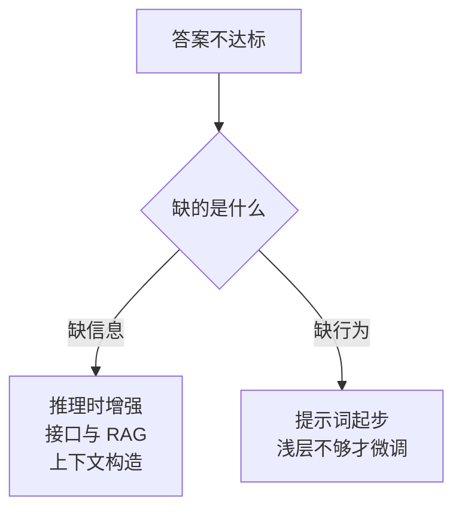

# 预训练、后训练、RAG 与工具改变不同层次

读完这篇你能判断手上这个问题该改模型、改提示词（发给模型的输入指令与背景信息）、接外部资料还是接工具。**模型、提示词、RAG（检索增强生成，先从外部资料取证据再让模型据此作答）、微调和工具不在同一条升级轴上**。升级轴指按改动代价由低到高排列的次序，这四类手段代价相差悬殊，无法排在同一根尺度上。正确选择取决于**你要改变的是哪一样：**

- 参数中的能力——模型权重里储存的本领
- 一次调用看到的信息——本次对话里出现的资料
- 稳定行为——每次回答都一致的格式和风格
- 外部世界的真实状态——当下真实发生的事。

可以把选手段这件事想成培养一名员工，四层改动分别对应：上学读书是他脑子里的本事（改这些要重新上学）；岗前培训教的是这家公司的规矩和说话方式；手边的资料柜是他干活时能翻的东西；打给外部系统的电话能拿到今天才发生的事。**四样东西改动的代价差着几个数量级——提示词以分钟计、RAG 以小时到天计、微调以天加 GPU 成本计、预训练以月计**——因此**选错层就会出现用重新上学的方式去解决「资料柜里少一份文件」这类问题的情况**。

这个比方只用来区分四层改动的代价，不涉及模型的实际工作机制。对应关系：上学读书是预训练，岗前培训是后训练，资料柜是 RAG，打给外部系统的电话是工具。

这个比方到「代价分级」为止，人忘了东西可以提醒，模型没有「提醒」这回事，**知识一旦进了权重就只能重新训练才能改**。
## 这四种手段各自改的是哪一层

模型答不好的时候，团队容易把所有问题都归到同一种手段上：继续微调、继续加检索、继续加工具，改动之后效果没有变化，也说不清问题出在哪一层。本篇回答：参数中的能力、单次调用看到的信息、稳定的行为习惯、外部世界的真实状态各自由什么手段改变，以及一项需求应该由哪一层承担。

## 模型是怎样产生输出的？

输入先被 tokenizer（分词器，把文本切成模型能处理的最小单元）切成 token（模型处理文本的最小单位，一个词、半个词或一个标点），再映射为向量（一串数字组成的表示）。Transformer（用注意力机制处理序列的神经网络结构）通过注意力（模型为每个词分配权重、聚焦上下文中最相关部分的机制）和前馈网络混合上下文，最终产生下一个 token 的概率分布；解码策略从分布中选择输出——它指从概率分布中挑选输出 token 的规则，如贪心（每步取局部最优、不回头的算法思路）解码、束搜索，束搜索每次保留多条候选路径再择优。这个过程解释了三条工程事实：

- **模型输出天然是条件概率结果，不是事实证明**；
- **上下文长度会增加注意力计算、KV cache（缓存已算过的键值向量以加速生成、随上下文变长而增大的显存区域）占用和服务延迟**；
- **温度（控制输出随机程度的采样参数）和采样（只采集一部分数据以控制记录开销）改变输出分布**——但**模型只能从训练时学过的分布里取词，没学过的知识本就不在分布中，调温度只是重排（布局或尺寸变化触发重新计算排版）已有可能，不能把未知事实变成已知事实**。


*图源：Lilian Weng 博客《The Transformer Family》，个人技术博客配图。*

**模型参数保存的是从训练数据中压缩出的统计规律**——比如语言中的搭配习惯、代码的语法模式、常识性关联；模型据此推断下一个词最可能是什么。这些规律大量例子中反复出现的模式被神经网络用数值方式概括，而不是**逐条存下来的原文**。**模型参数能概括、组合和推断，却不能像数据库记录一样逐条查询、更新、授权和删除：想让模型忘记训练数据里的某条个人信息，或让某条知识只对特定用户生效，都做不到**。


来源：[阿里云开发者社区《图文详解 RAG 技术和流程》](https://developer.aliyun.com/article/1670698)（CC 4.0 BY-SA）


## 能力是分哪几个阶段形成的

~~~mermaid
flowchart TD
    P[预训练<br/>模式与知识] -->|基座模型| S[监督微调<br/>任务形式示例]
    S -->|指令模型| A[偏好对齐（让模型行为符合人类意图与价值观的训练过程）<br/>安全倾向]
    A -->|对齐后模型| I[推理时增强<br/>上下文注入<br/>RAG 检索<br/>工具调用]
    I -->|完整上下文| O[可验证输出]
~~~

能力按预训练、后训练、推理时增强三个阶段形成，各阶段改的层不同。

### 预训练改的是哪一层

大规模自监督训练让模型学习语言、代码、图像与世界模式。**它决定广度和基础能力，但知识有训练时间边界，来源也难逐条追踪**。**为了更新一个业务事实重新预训练，成本和控制粒度都不合理**。

### 后训练改的是哪一层

监督微调（用标注好的问答示例教模型按期望格式作答）、偏好优化（用人类偏好排序训练模型倾向）和安全训练（教模型拒绝有害请求）改变模型如何响应：遵循指令、形成稳定格式、拒绝某些请求或采用特定表达。**后训练适合塑造反复出现的行为，不适合承载需要实时更新、精确撤回或按用户授权的事实**。

**微调前要先排除三个更常见的问题：输入信息不足（缺少必要上下文）、任务定义含糊（目标与验收标准不清晰）、输出没有确定性验证（无法自动判断对错）**。**只有在固定评测集上，微调相对提示词与 RAG 有稳定收益，且推理成本、数据治理和升级成本可接受时才值得采用**。

### 推理时增强改的是哪一层

| 机制 | 把什么带进本次决策 | 最适合 | 主要风险 |
| --- | --- | --- | --- |
| 指令与示例 | 任务、约束和少量范例 | 格式、风格、临时规则 | 冲突、注入、上下文噪声 |
| RAG | 可更新、可引用的外部证据 | 文档问答、知识密集任务 | 漏召回、过期、ACL（访问控制列表，限制谁能读取哪些证据）、错误引用 |
| 工具 | 实时查询或真实动作 | 交易、搜索、执行、计算 | 越权、重复副作用、不可用 |
| 记忆 | 跨步骤或跨会话状态 | 个性化、长任务 | 污染、过期、隐私和删除 |

## 选机制时该先按缺的东西排序，顺序怎么定？

选机制之前先按缺的东西的类型排序，下面按从信息到行为排列：


*图源：Microsoft Learn 中文文档，CC BY 4.0，https://learn.microsoft.com/zh-cn/azure/architecture/ai-ml/guide/rag/rag-solution-design-and-evaluation-guide。*

1. **任务是否可以由普通程序可靠完成？可以时，模型只处理难以枚举的语义部分**。
2. **缺失的是实时事实吗？用权威 API 或数据库工具；需要从非结构化语料找证据时再用 RAG**。
3. **缺失的是当前任务背景吗？优化上下文选择、压缩和结构**。
4. **缺失的是稳定行为吗？先用提示词与 schema（数据结构约定）建立基线（正常状态下的指标水平、用来对比异常），再评估微调**。
5. **缺失的是多步骤适应性吗？把模型放入有状态工作流，不要把更多推理轮次误当成能力本身**。

## 为什么质量问题要按层定位

**质量问题如果不按层定位，就会找不到修复点**。模型升级后答案变差，可能是能力回归；RAG 接入后仍答错，可能是数据缺失、召回失败、排序失败或证据未被采用；工具调用成功却业务错误，可能是授权或幂等（同一操作重复执行结果仍一致的性质，不具备时重复调用会引出错乱）问题。**把所有失败都记为「模型幻觉（模型生成看似合理、实际与事实不符的内容）」，就无法形成可修复的系统：归为幻觉就跳过了定位根因的步骤，而不同根因对应不同修复手段，定位不到层就改不动，系统自然修不动**。

同样一个"答案变差"的现象，可能来自能力回归、数据缺失、召回失败或授权问题，不把当时的输入固定下来就无法区分是哪一种，因此每次运行都应记录模型快照、提示词、检索索引、工具 schema、代码 revision 和评价结果。具体评测见 [[工程知识/AI 系统工程：从模型能力到生产能力/质量与运营/Agent评测必须覆盖轨迹而不只看最终答案]]。

相关（结构基础）：[[工程知识/AI 系统工程：从模型能力到生产能力/模型基础与训练/Transformer如何把序列建模成可扩展计算]] —— 注意力机制（让模型对输入的不同部分分配不同权重的核心结构）为何能并行建模序列

## 动手跑一遍能看到哪四层杠杆的差别？

这里的杠杆指改动成本与生效速度不同的四类手段：浅层靠近上下文（提示词、RAG、工具），深层靠近权重（后训练、预训练），与物理杠杆无关。同一个"模型答不对自己的产品规格"问题，四层杠杆的介入点：

```text
预训练（改权重，最重杠杆）：
  把产品文档混进预训练语料 → 模型"记住"规格
  成本：重新预训练（百万美元级）→ 只值得放高频核心知识

后训练（改行为分布）：
  监督微调（SFT，用标准答案数据教模型）/偏好优化（DPO）教会"回答规格问题时引用文档"的行为
  成本：万级样本 + 数千卡时 → 改行为不改知识

RAG：
  规格文档入库，回答时检索注入 → 知识随文档更新（天级生效）
  成本：一条数据管线 → 知识新鲜度要求高的场景首选

工具（改能力边界）：
  模型不确定时调"查规格"接口 → 让系统替模型拿事实
  成本：一个工具接口 → 把"知道"外包给可验证的数据源
```

杠杆选错的实录——**产品知识更新每周一次的团队选择 SFT（Supervised Fine-Tuning，监督微调：用标准答案数据教模型） 灌知识，每次更新重训一轮（成本与延迟都不成立），换 RAG 后更新只是重新入库（分钟级）；反过来，客服语气风格用 RAG 硬塞示例文档，效果忽好忽坏，换后训练（几百条偏好对）行为才稳定**——**知识新鲜选 RAG、行为稳定选后训练，两层管的事不同：RAG 改的是上下文供给，随文档天级更新；后训练改的是权重里的行为分布，不承载实时事实**。**四层的成本给出升级的次序：层越深（越靠近权重）改动的成本越高、生效越慢，先用浅层杠杆解决不了的才向深层升级**——和买还是自己做的决策思路一样，把每条约束都摆到桌面上比较[[工程知识/软件构建：让变化可以理解、验证与交付/架构与代码/购买与自建的决策框架：每条约束都摆上桌面.md]]。这个比方只用来类比取舍顺序，不涉及实际采购决策。



图：该在哪一层介入——判据是缺的东西的类型：缺信息走推理时增强（接口、RAG 证据、上下文构造），缺行为先用提示词与 schema，浅层出现稳定收益缺口才升级到微调。

## 怎么自己动手验证

1. 杠杆归因：**把同一批失败样本分别用提示调整、检索补充、后训练与工具接入试验，确认改善出现在预期的那一层，其余层表现不变**。
2. 成本对照：**记录每一层变更的实施周期与推理开销，确认所选层是能解决问题的最浅一层**。
3. 边界核对：**知识类失败在该层得到修复，行为类失败没有被顺手改掉**。

## 接着读哪几篇：同在AI 系统工程里的相邻问题

- [[工程知识/AI 系统工程：从模型能力到生产能力/模型与上下文/模型提出候选，系统定义正确性]] · [[工程知识/AI 系统工程：从模型能力到生产能力/知识与检索/RAG的核心是选择可引用证据]]