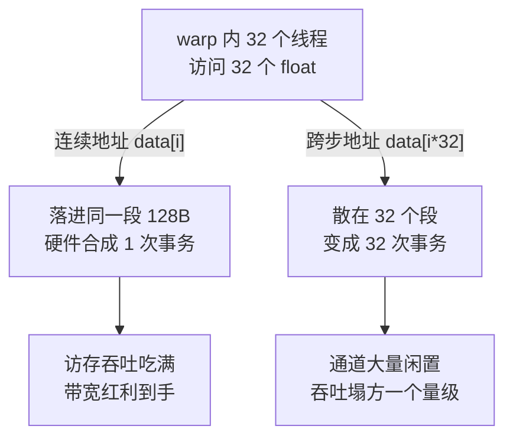
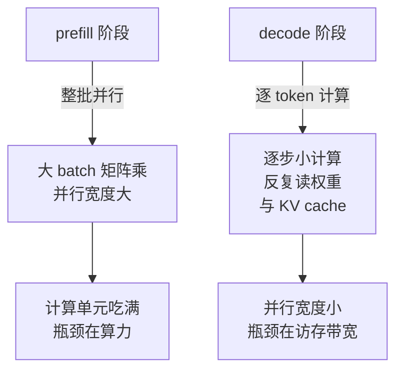
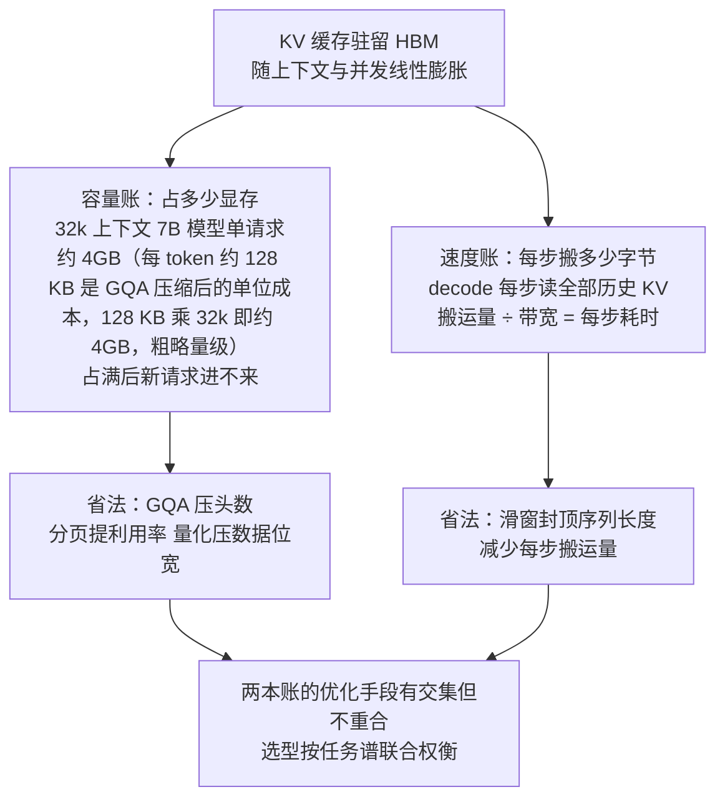

# GPU执行模型与显存层级：SIMT与合并访存

## GPU 执行模型要解决什么，为什么访存会拖住计算？

读完这篇你能判断一个 GPU 程序的瓶颈在算力还是访存，并写出避免分支发散、用上合并访存的代码。GPU 执行模型要解决的问题，是**用一条指令驱动成千上万的计算单元**，同时不让访存拖住计算单元。

CPU 的优化方向是单指令流的水深：乱序、预测、大缓存，见 [[工程知识/软件构建：让变化可以理解、验证与交付/语言与运行时/CPU微架构与流水线：分支预测乱序执行对程序员的可见影响.md]]；GPU 的方向相反：单核简单，核数海量（数千到上万），**靠并行宽度换吞吐**。执行模型是 SIMT（single instruction, multiple threads）：一批线程（warp，32 个）锁步执行同一条指令，走不同路径的分支会分裂执行。

这个模型的两个可见后果：**分支发散吃掉并行度、访存模式决定吞吐大半**。瓶颈怎么判断，见 [[工程知识/性能工程：从用户等待到资源瓶颈/处理器与内存/GPU性能取决于计算、访存、并行与通信.md]]；本文写模型本身。

可以把它想成一条流水线上的一排工人：工头喊一声口令，所有人同时做一个动作（SIMT）；领零件时大家要的零件如果放在同一段连续的货架上，一趟就能全取回来（合并访存，对应硬件上 128B 内的连续地址）——地址一散开就得分多次取；各人要各人的、散在不同格子，就得来回跑好几趟。这个比方里，工人同队、同听一个口令对应 SIMT，领零件对应访存模式。

但这个比方有断裂点，在并行自由度上：工人可以各自走向不同货架（对应不同线程访问不同地址），但整队必须同时出发、同时返回；硬件同理，地址可以不同，**warp 内所有线程却必须锁步，分支发散时只能串行执行各分支**。

## GPU 是怎么把海量线程组织起来并喂饱计算单元的？

显存分层的取舍，和分片（把数据按规则切到不同的存储片）是同一类问题：数据放得离计算越近，走的链路越短、延迟越低；按什么规则分到哪一片，决定了**访问是本地的还是跨片的**——最常见的规则是按哈希（把任意长度数据压成固定长度指纹、不可逆）分，键决定了**它落在哪一片：落在同一片就是本地访问**，落在别的片就要跨片搬运。这里把显存的各层比作存储片，键对应数据地址——离计算近的层延迟低这一点两者一致。这个比方到「按规则分到最近一片」为止：真实显存层级是固定的高低快慢分层，数据同时驻留多层，并非按哈希动态选片。

**warp 与分支发散**。调度单位是 warp（32 线程锁步）。warp 内所有线程执行同一条指令；if-else 分支让 warp 分裂：先执行 then 分支的线程（其余空闲），再执行 else 分支（先前那批空闲）。两个分支都执行完才汇合，**warp 的有效吞吐减半**。发散是 SIMT 的税：控制流越复杂（每线程走不同路径），浪费越多。**GPU 友好的代码要"全体一致"（warp 内线程尽量走同一路径）**。排序、分桶、直方图（把数值按区间分桶统计、看分布形态）类算法天然让相邻线程按数据值走不同分支（例如按值分桶时，相邻线程可能进不同的桶），最容易触发 warp 分裂，所以这些算法的 GPU 版本都要围绕"消除发散"重构。

芯片面积怎么分，决定了**这套执行模型的重心在哪**。中央处理器把大块面积给了控制逻辑与缓存，运算单元只占一角；图形处理器反过来，绝大部分面积用来堆同样的运算单元，控制逻辑压到最小一列：

*图源：Wikimedia Commons《Cpu-gpu》，CC BY-SA 3.0。*

**显存层级与合并访存**。GPU 的存储是金字塔：寄存器（每线程私有，最快）→ 共享内存/L1（每 SM 共享；SM 即流式多处理器，GPU 的运算单元簇）→ L2（全芯片）→ 显存 HBM（high bandwidth memory，高带宽显存，慢一个数量级以上，但带宽极高）。比喻到由快到慢的层级顺序为止：真实数据可同时驻留多层（如显存的数据搬进共享内存后两处都有），并非只能选一层。合并访存（coalesced access）：warp 的 32 个线程访问连续地址（如 32 个 float 正好 128B 一段），**硬件合成一次显存事务**；地址散乱则每个线程一次事务，访存吞吐塌方。**访存模式是 GPU 编程的第一定律**：矩阵乘的分块（tiling）、共享内存的显式搬运，全是把"散乱访存"重写成"连续访存 + 局部复用"。同一个 warp 的两种访问写法在硬件里走到哪里，一张图看完：

这座金字塔在真实芯片上的容量与带宽标注见下图：每 SM 的计算单元与寄存器、L1/共享内存相邻，全芯片 40 MB L2 汇聚后再到 40 GB HBM2（第二代高带宽内存），L2 与 HBM2 之间就是上面说的带宽墙（1.55TB/s）：

*图源：NVIDIA GTC 2020《Optimizing CUDA Applications for NVIDIA A100 GPU》官方演讲材料第 3 页，https://developer.download.nvidia.com/video/gputechconf/gtc/2020/presentations/s21819-optimizing-applications-for-nvidia-ampere-gpu-architecture.pdf（© NVIDIA，供学习引用）。*

**kernel 与主机-设备分工**。GPU 代码（kernel）从 CPU 启动，数据经 PCIe/NVLink（NVIDIA 卡间高速互联，带宽远高于 PCIe） 在主机内存与显存间搬运。kernel 内部：grid（全部线程）→ block（每 SM 一个或多个）→ warp→ thread。内存拷贝与 kernel 启动是异步的（流 stream），CPU 发起后可继续干活——但**拷贝与计算的流水线重叠要显式设计，否则 GPU 在等数据、CPU 在等 GPU，两边空转**。在大语言模型（LLM，Large Language Model）场景下，prefill/decode 的性能差异根源在两种负载吃的是存储层级的不同位置，prefill 是处理输入 prompt 的阶段，decode 是逐 token（模型处理文本的最小单位，约相当于一个词或半个词） 生成的阶段。prefill 是大 batch（批，一次同时送进 GPU 的多个请求）矩阵计算，并行宽度大、计算密度高。decode 是逐步小计算，反复读权重与 KV cache（注意力机制中缓存的历史键值对，用于加速逐 token 生成——访存密集、并行宽度小），**两者对 GPU 的压榨方式完全不同**。

这个层级结构长这样：Grid 是本次启动的全部线程，Block 是分到同一个 SM 上的一组线程，Thread 是其中最小的执行单位——调度时硬件把 Block 派给 SM、把 Thread 按 32 个一组打成 warp， occupancy（一个 SM 上能同时驻留的 Block 数）受共享内存、寄存器与每 Block warp 数等资源上限约束，并非只由这棵层级结构决定：

*Grid、Block 与 Thread 的两级结构（图源：Wikimedia Commons，NVIDIA CUDA，即 NVIDIA 的 GPU 编程平台）文档配图，CC BY 3.0*

下方的 prefill/decode 对比图回答：为什么同一块卡两个阶段快慢悬殊——两种负载吃的是金字塔里不同的层，prefill 压计算单元、decode 压显存带宽，各自的优化方向随之不同。

*图源：[稀土掘金《图解Transformer：为什么GPT、Claude、DeepSeek都用同一个架构？》](https://juejin.cn/post/7668503904926236723)（CC 4.0 BY-SA）。*

KV 缓存驻留在金字塔的 HBM 层，其代价同时往两个方向走，**两本账要分开记**。KV 体积可通过 GQA（Grouped-Query Attention，分组查询注意力：KV 头分组共享，省显存）压缩，即分组查询注意力（模型为每个词分配权重、聚焦上下文中最相关部分的机制），多个查询头共享一组键值头，下文算式会用到。容量账记的是 KV 占掉的显存份额，决定还装不装得下新请求。速度账记的是每步要把多大的 KV 搬过带宽墙，带宽墙即 HBM 的带宽上限，每秒能搬的字节数有天花板，决定每步多慢。**同一份缓存，两本账同时随上下文长度（token 数）增长而恶化**：

图上两条支路的省法有交集（滑窗同时压两本账）也有分岔（量化只省容量、速度侧要靠减搬运量）——两本账的优化手段各有侧重，选型时要联合权衡。

## 这套执行模型从哪儿来，又让使用者付出什么代价？

SIMT 继承自 SIMD（向量机的思想，1960s 的 ILLIAC IV 到 Cray），创新在"每线程有自己的寄存器组与程序计数器表象"——编程模型看起来是标量线程（写 C 的 for 循环），硬件执行是锁步批量，抽象层把向量化的苦活藏了。GPGPU（2006 CUDA）把"图形卡"变成"通用并行处理器"是关键转折：之前的 GPU 编程要借图形 API（把数据伪装成纹理），CUDA（NVIDIA 的 GPU 并行计算平台与编程模型） 给了 C 的直路。

**warp 的"表象标量、执行向量"**（程序员看到单线程代码，硬件用同一份指令流驱动整批线程做向量并行，并未为每个线程存一份代码）——像你写一份单机循环，硬件用这一份指令流同时驱动上万份执行。程序员写的是每线程一份的标量代码，硬件按 warp 批量执行，同一个程序既是"一万个线程"又是"三百多个 warp 指令流"。编译器与硬件一起维持这个假象（分歧时的锁步分裂、汇合，都是自动的）。这个比方到「一份代码被复制成多份同时跑」为止：真实差异在锁步执行与分支分裂，硬件并非真的复制了程序。代价：这个模型的收益前提是**问题本身有海量数据并行**（图像像素、矩阵元素、token 序列），串行依赖强的任务（图算法的指针追逐、数据库的逐行处理）在 GPU 上水土不服，**发散与访存散乱会把并行红利吃光**。选型判据：SIMT 的红利来自海量并行，访存带不动足够计算时运算单元会空闲。访存带宽固定时，计算量越大越能摊薄搬运成本，运算单元才能持续忙碌；反之，访存密集型问题带宽再高也喂不饱运算单元。因此值得上 GPU 的是**计算密度（计算量/访存量）足够高、能在有限带宽上喂饱运算单元的问题**。

## 这套说法在哪些地方会失效？

- **利用率指标会骗人**。SM 利用率高可能是在空转的发散分支上打转；显存带宽高可能全是未合并的散乱事务。判断瓶颈要 warp efficiency（有效 warp 占比）+ 内存事务数（例如 l1tex__t_sectors，用来计量被访问的显存扇区数这类计数器）联合看，**单指标都片面**，方法论见 [[工程知识/性能工程：从用户等待到资源瓶颈/处理器与内存/GPU性能取决于计算、访存、并行与通信.md]]。
- **共享内存与寄存器是零和资源**。每 SM 的共享内存与寄存器文件总量固定，kernel 用得多则同时驻留的 block 数少（occupancy 下降）。最大化 occupancy 与最大化每 block 资源是两个方向相反的目标，**最优解通常在中间，且依赖负载形态，没有普适配置**。
- **主机-设备传输常是隐藏瓶颈**。PCIe（外设高速总线）带宽（几十 GB/s）远低于显存带宽（TB/s 级），当搬运的数据量足够大时，低速链路上的传输耗时就会盖过计算时间——小数据拷贝未必是瓶颈。"计算搬不动的数据、搬运便宜的计算"是反模式，修法是**让数据尽量留在显存（多 kernel 串联、避免中间结果回传主机）**。
- **HBM 的带宽红利依赖访问模式**。HBM 的带宽靠极宽的并行通道（数千 bit 位宽），**合并访存才能喂满；散乱访问让通道闲置**。内存层级优化的思路（连续访问 + 局部复用）与 CPU 的缓存优化同源，见 CPU 缓存与分支决定有效执行时间 [[工程知识/性能工程：从用户等待到资源瓶颈/处理器与内存/CPU缓存与分支决定有效执行时间.md]]。

## 怎么自己动手验证上面这些说法？

- **合并访存实测**：同一 kernel 两种写法（线程 i 访问 data[i] vs data[i*stride]），stride=32 时 32 个线程打 32 个不同内存事务段。预期：**连续访问的 kernel 耗时数倍快于 stride 访问，profiler 的内存事务数差一个数量级**。数字对不上先查编译器是否已优化（常量折叠、向量化改写）。
- **分支发散实测**：kernel 内 if (threadIdx.x % 2) 分支 vs 无分支版本，预期：**发散版耗时约两倍（warp 内一半线程总在空转）**。把 if 换成位运算消除分支，预期耗时回落。这是 SIMT 发散税的最小实验。
- **occupancy 与资源实验**：调节 kernel 的每 block 共享内存用量，观察 occupancy 与吞吐的关系，预期：**不是单调——共享内存加大（每 block 用途大）先升后降（驻留 block 数减少），拐点位置因 kernel 而异**。单点最优不等于**全局最优**，要扫参数。

## 想继续深入瓶颈判断与 LLM 场景，该接着读哪几篇？

- [[工程知识/性能工程：从用户等待到资源瓶颈/处理器与内存/GPU性能取决于计算、访存、并行与通信.md]] —— 瓶颈判断的方法论与 LLM（Large Language Model，大语言模型） 场景
- [[工程知识/软件构建：让变化可以理解、验证与交付/语言与运行时/CPU微架构与流水线：分支预测乱序执行对程序员的可见影响.md]] —— CPU 与 GPU 两条优化路线的对照
- [[工程知识/性能工程：从用户等待到资源瓶颈/处理器与内存/CPU缓存与分支决定有效执行时间.md]] —— 同源的内存层级优化思想
- [[工程知识/数据系统：在并发与故障中保存事实/查询与索引/列存与向量化执行：OLAP引擎快的两个来源.md]] —— SIMD 思想在 GPU 的极致形态
- [[工程知识/AI 系统工程：从模型能力到生产能力/推理服务与平台/模型量化的精度经济学：位宽精度与显存的三角.md]] —— 显存带宽的物理约束
- [[工程知识/AI 系统工程：从模型能力到生产能力/模型基础与训练/投机采样与推测解码：小模型带路大模型确认.md]] —— decode 阶段的算术强度分析
- [[工程知识/AI 系统工程：从模型能力到生产能力/模型基础与训练/MoE路由的工程问题：负载不均与显存碎片.md]] —— 显存与带宽的物理层级