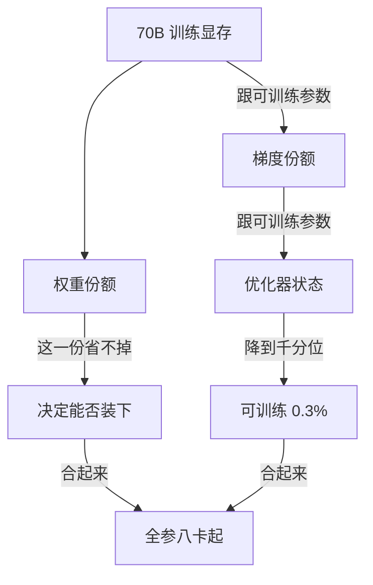

# LoRA与参数高效微调：改行为不改基座

**给开源模型加领域能力，全参数微调要动全部权重、显存（显卡内存）动辄数百 GB；而多数行为变化其实集中在少数几个关键维度（低维子空间）——LoRA（低秩适配，冻结原模型、只训练一对小矩阵即适配器的微调方法）冻结基座、只注入这对小矩阵，让可训练参数降到千分位，优化器状态与梯度那份显存同步缩小，于是单卡可调 7B 模型**。要解决的问题：**用最小可训练参数获得目标行为改变，同时保留基座能力、可回滚（把系统状态退回到改动之前的版本）、可合并部署**。读完你能用单卡给 7B 模型加领域能力，且随时删适配器回滚，不丢基座原有能力。

本质是**低秩假设：微调引起的权重变化量 ΔW 近似低秩——就像用一条窄走廊概括两间大屋之间的所有走动路线，不必重装整间屋子；这个比喻到「变化集中在少数维度」为止，矩阵怎么算要看正文**。用两个小矩阵的乘积 B·A（rank r 远小于原维度）去拟合它。**训练时只更新 B 和 A，前向时 ΔW 加到原权重上；部署时可把 B·A 合并进 W，推理零额外开销**。

## LoRA 是怎么只训一小撮参数就改变行为的？

打个比方：LoRA 像给一台已经调好音的钢琴贴几片弱音垫——钢琴本身没动（基座权重冻结），只在某些琴弦上加了薄薄一层，音色就变了；垫子揭下来，琴还是原来那台。这个比喻到"改行为不改基座"为止：低秩矩阵怎么插、秩取多大、合并回去怎么算，要看正文。


| 组件 | 作用 | 工程含义 |
| --- | --- | --- |
| rank r | 低秩近似维度 | 越大拟合能力越强、参数越多；常见 8-64 |
| alpha α | 缩放系数，实际缩放为 α/r | 控制适配强度，稳定训练 |
| target modules | 注入位置（q/k/v/o、FFN（Feed-Forward Network，前馈网络）） | 决定改变哪类行为；全投影层覆盖最广 |
| 合并 | W' = W + B·A | 部署时合并，推理延迟不变 |
| 量化底座 QLoRA | 4-bit 基座 + LoRA | 显存再降一个量级，但训练与部署精度要分开管理 |

QLoRA 的「显存再降一个量级」在机制图上是三种微调方案的显存构成对照：全参微调的优化器状态是一整块 32-bit 大块，LoRA 把它拆成挂在适配器上的小块，QLoRA 进一步把基座从 16-bit 压成 4-bit（砍掉约四分之三的权重显存）、优化器状态在显存吃紧时换页到 CPU 内存，合计把显存再降约一个量级：


*图源：QLoRA 论文（Dettmers et al., 2023）Figure 1，https://arxiv.org/abs/2305.14314。三列从左到右正是「省的是优化器状态与梯度那份」的逐级展开：全参的优化器状态跟全部权重走，LoRA 只跟适配器走，QLoRA 再把基座压到 4-bit、把优化器状态换页到 CPU 内存——右侧的 CPU 虚线框就是分页优化器（paged optimizer）的落点。*

**训练数据形态决定行为改变的类型：指令对（「指令+期望回答」的训练样本）改变输出格式与风格，领域语料改变知识分布（但知识注入效果有限，见边界），偏好对（「好回答+差回答」的对比样本）改变取舍方向**。**LoRA 只决定怎么省参数，不决定学什么；同样用 LoRA，喂客服对话学的是客服口吻，喂翻译对学的是翻译风格，方法不变，内容全由数据决定，数据质量上限依然是效果上限**。

旁路的参数账在下面 rank 的例子里直接算；优化器只更新可训练参数，状态自然也只为其保留；优化器状态如何按卡切分，见分布式训练与并行策略一文的 ZeRO（零冗余优化器，把优化器状态按卡切分以降低显存）分级切分。旁路本身长什么样，论文原图一眼说清：


图里另一条分支 B·A 是全部可训练参数：中间瓶颈 r 远小于两端维度 d，**这就是「低秩假设」的形状——权重变化量被压进一个 r 维子空间；训练开始时 B 为零，输出与原模型完全一致，训练结束 B·A 才携带行为增量与 W 相加**。

**LoRA 常被与其前身 Adapter 微调放在一起比较，两者的结构差别一张图看清：Adapter 在 Transformer 层之间插入新的串行子网络（改变模型结构、推理多一段计算），LoRA 不插入新层，只在原权重旁挂低秩旁路（结构不动、合并后零开销）**：


*图源：SwanLab 官方教程《重温 LoRA 的原理，对比 LoRA 和 QLoRA》转载（原 HuggingFace Blog 图），https://docs.swanlab.cn/course/llm_train_course/03-sft/6.llamafactory-finetune/lora1.html。左图就是上文 Figure 1 的旁路结构落在真实 Transformer 层里的样子：三个 Linear（W_q、W_k、W_v）各挂一条旁路；右图的串行结构则是「推理有额外延迟」的来源——LoRA 部署时可把 B·A 合并进 W，Adapter 做不到。*

## LoRA 和全参微调、RAG、Prompt 的边界在哪？

**LoRA 的边界在「改哪一部分」：冻结的是基座权重，注入的是低秩旁路，训练只发生在旁路里，改动范围天然被限定在可插拔的适配器上**。下表按这个维度把相邻方案逐一对照。

| 方案 | 参数量 | 改知识 | 改行为 | 回滚 |
| --- | --- | --- | --- | --- |
| 全参数微调 | 100% | 可能 | 深 | 需另存整份权重 |
| LoRA/QLoRA | 0.1-1% | 弱（限与训练数据同类的新知识） | 强 | 删适配器即回滚 |
| Prompt（提示词）/上下文 | 0 | 无（每次注入） | 浅 | 天然可回滚 |
| RAG（检索增强生成） | 0 | 无（证据注入） | 无 | 删索引即回滚 |

**判断顺序：知识型需求先试 RAG，行为/格式/风格型需求用 LoRA，需要改变推理方式或深度能力时才考虑全参数**。**混用时要意识到 RAG 改变每次输入、LoRA 改变权重分布，两者叠加的效果不是简单相加，需用同一评测集分别测**。

## 这套说法在哪儿会失效？

- **低秩假设对"学新事实"较弱：注入知识的检索式访问仍应交给 RAG，LoRA 更适合改"怎么回答"而非"知道什么"**。
- **rank 不是越大越好：r 过大易过拟合小数据集，且参数收益递减；从 r=8 起步翻倍实验比直接上 r=256 更省**。
- **合并是单向门：B·A 一旦加进基座权重就与它混为一体，无法再单独拆出某个可回滚的 LoRA，多适配器并存场景（每租户一个适配器）要保留分离形态，牺牲一点延迟换隔离**。
- **量化底座上的 LoRA 合并回高精度基座时可能出现精度下降，部署前用同一评测集对比合并前后的得分**。

## 跑一遍 rank 的账能看出什么？

LoRA 的参数节省与 rank 的关系，一行的账：

```python
# 70B 模型，全参微调：可训练参数 = 70e9
# LoRA 只在注意力与 MLP 的权重矩阵旁挂低秩分解：
#   W' = W + (alpha/r) * A @ B，其中 A: r×d，B: d×r
# r=16, d=8192 的一个矩阵：A+B = 2*16*8192 = 262,144 参数（原矩阵 67,108,864 的 0.4%）
# 全模型 70B 参数下，r=16 挂满常见层：可训练参数约 2e8（0.3%）
# 显存账：优化器状态（Adam 的 m、v 两份）只对可训练参数保留
#   全参：70B × 3 份 × 2 字节 ≈ 420GB；LoRA：0.3% × 420GB ≈ 1.2GB
```

跑一遍的收获：**模型权重那份显存要全量加载、冻结，份额不变；LoRA 省下的是优化器状态与梯度那份，它们只跟着可训练参数走——优化器状态降到约 1.2GB，加上冻结的权重份额仍远小于 80GB，这就是 70B 模型能在单卡 80GB 上微调的数学**。**rank 的选择：8-32 覆盖大多数适配任务，rank 翻倍的效果提升递减，任务与基座差异越大 rank 需求越高**。

## 省下的显存到底换来了什么？

省下来的显存，换的是可训练性：**三份显存份额的对照是——权重那份必须全量加载、冻结，而梯度与优化器状态只随可训练参数走，LoRA 把后两份压到千分位**。

70B 能上单卡靠的是三份显存份额里只有两份跟着可训练参数走：



份额账算清，效果与成本的实测数字才对得上：实测的显存与精度数字都来自同一份份额账，账算清了，与全参的差距、合并后的零额外开销才能逐条对上。

**效果与成本的实测数字：任务精度上 LoRA 与全参微调的差距通常在 1-2 个点内（适配类任务），推理成本零增加（合并后 W' 与原矩阵同形）；训练显存约为全参的十分之一量级（70B 模型全参需 8×A100，LoRA 单卡可跑），训练时长降 60-80%——因为每步只需更新千分位参数，计算与通信量同步下降**。**失效形态的量化：能力回退与 rank 正相关（rank 越大，旁路容量越大，训练中越容易改写基座权重承载的通用能力），公共基准掉分超 3 个点就该降 rank 或混入通用数据**。

**与 [[工程知识/AI 系统工程：从模型能力到生产能力/模型基础与训练/后训练对齐与微调改变行为边界]] 的衔接：LoRA 是对齐（让模型行为符合人类意图与价值观的训练过程）管线里控制遗忘的杠杆；与 [[工程知识/AI 系统工程：从模型能力到生产能力/模型基础与训练/分布式训练与并行策略如何切分模型]] 的衔接：显存账里的优化器状态份额（Adam 三份状态）正是 ZeRO 分级切分的对象——两篇的账本是同一本**。


*图源：LoRA 论文（Hu et al., 2021）Figure 4/5 实验曲线，https://arxiv.org/abs/2106.09685。*

## 怎么自己动手验证？

**微调效果要与三版本对照对账——预写目标行为提升、基座回归不降超阈值、合并前后差异在噪声内，任一项与预期对不上就不算改动成功**。

**最小验证：固定评测集（目标行为集 + 基座能力回归集各一），对比基座、LoRA 适配后、合并后三个版本；断言目标行为提升、基座回归不降超过阈值、合并前后差异在噪声内**。**再测回滚路径：卸载适配器后输出与原基座逐 token 一致**。

关系：[[工程知识/AI 系统工程：从模型能力到生产能力/模型基础与训练/后训练对齐与微调改变行为边界]] · [[工程知识/AI 系统工程：从模型能力到生产能力/生态与选型/精调与RAG的边界：什么时候微调更划算]] · [[工程知识/AI 系统工程：从模型能力到生产能力/模型基础与训练/预训练数据决定模型能力上限]]