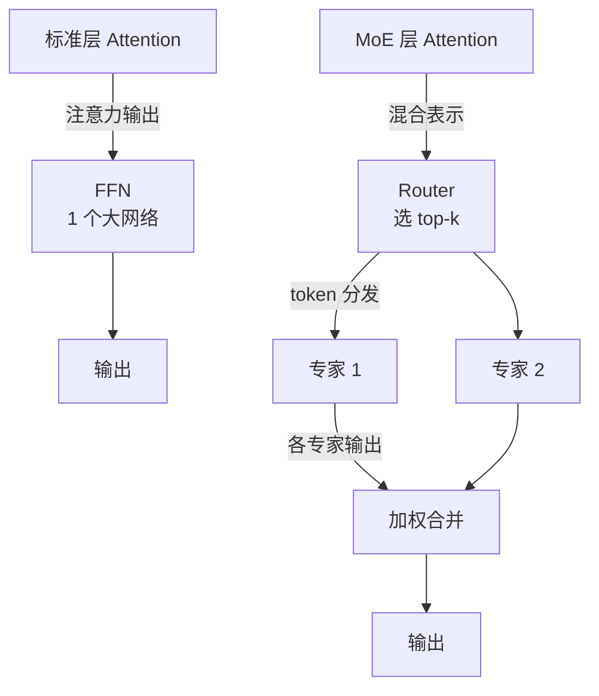
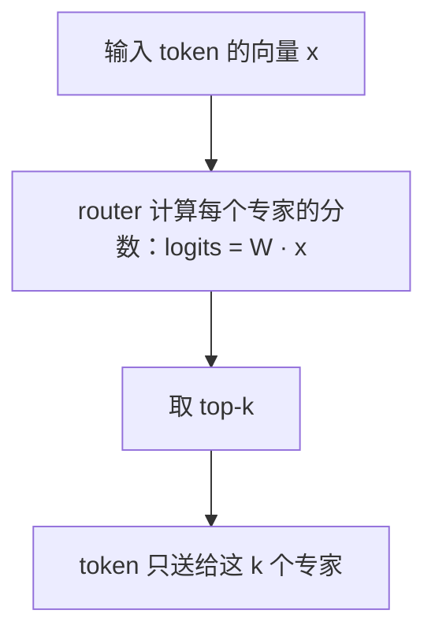

# MoE 用稀疏激活换取参数容量和通信复杂度

每 token（模型处理文本时切分的最小单位）的计算预算不变，模型参数却能做得更大——MoE（Mixture-of-Experts，混合专家）用稀疏激活（每个 token 只调用一小部分专家，而非全部专家都参与计算）换取更大的参数容量。读完你能判断什么时候该用 MoE 而不是继续堆 Dense（稠密：每个 token 都要用上全部参数）参数，以及多出来的通信代价会落在哪些环节。

它是 DeepSeek、Qwen3、Mixtral 等现代大模型（都是公开了训练细节或权重、可以在自己机器上跑起来的主流开源模型）的共同选择。理解它，才能看懂"671B 参数但只激活 37B"这种参数是什么意思（总参数是全部专家的参数量之和，激活参数是每个 token 实际参与计算的专家参数量，后文有数字表），以及为什么这类模型**推理成本不低**。

## 参数堆大了算力跟不上怎么办：要解决的问题

把参数总量做大、每个 token 只激活其中一小部分——**参数容量由专家总数决定，单 token 计算量由激活的专家数决定，两个量被路由机制分开**。真正的显存（GPU 上的内存、模型参数与计算中间结果都存这里）与通信代价以下文展开为准。

在每 token 计算预算固定的前提下要扩大参数容量，稠密模型只能加深加宽，算力开销随参数同比例上涨。本篇回答：路由器怎样为每个 token 挑选专家、显存与通信的代价由哪些环节承担、训练期的负载均衡（把 token 均匀分给各专家，防个别专家过载）和推理期的 batch 规模各自限制什么，以及什么部署形态下 MoE 的优势才真实存在。

## 稀疏激活怎么换容量：机制与本质

先把形状说成一件事：MoE 像一家聘请了两百名专科医生的综合医院——每位病人每次只挂两三个科的号（每 token 只激活两三个专家），医院的专科总储备（总参数）很大，单个病人花的诊费（单 token 计算量）却不高。代价也换了个形态：全院两百名医生的工资照付（显存按专家总数计），挂号处要把病人导到不同楼层（通信），还得防止所有病人都挤同一科室（负载均衡）。这个比喻到"同一科室"为止——现实里显存按专家总数计、通信按激活分布计、负载均衡按路由分布计这三个量的约束，下面展开。

每 token 的计算量由激活的专家数决定，参数容量由专家总数决定，两者被路由机制分开，这是 MoE 把容量与计算解耦的方式。解耦同时带来增长与代价：容量可以自由变大，而代价随之出现在三个位置——**显存按专家总数计、通信按激活专家的分布计、负载均衡按路由分布计**，因此 MoE 的表现由这三个量共同决定，而不是由总参数决定。

## 这件事发生在什么场景：为什么需要 MoE

### Dense 模型困境在哪儿

传统（Dense）模型：**每个 token 都要用到全部参数**。

```
100B 参数的模型，处理 1 个 token：
  → 需要读取 100B 个权重
  → 计算量 ∝ 参数量
```

**想让模型更强 → 加参数 → 每个 token 更贵。** 这条曲线很快就撞上**成本墙**（这里指单机显存与算力上限，继续加参数会让每 token 开销超出硬件能承受的范围，不只是花钱多少的问题）。

### MoE 的思路是什么

**参数还是那么多，但每个 token 只用其中一小部分。**

全部参数都驻在显存里构成模型的容量，每次推理只有被路由选中的那部分参与计算——哪几部分被挑中、按什么规则挑，是下面路由器一节的正题。

```
假设：32 个专家，每个 8B 参数 → 总参数 256B
处理 1 个 token：router 选 2 个专家 → 只用 16B 参数

结果：
  总参数 256B（容量大，能装更多知识）
  每 token 激活 16B
```

**这就是"稀疏激活"**：参数总量大，但每次前向传播只激活一小部分。

把三家的关键数字列成一张表：

| 模型 | 总参数 | 每 token 激活 | 激活比例 |
| --- | --- | --- | --- |
| DeepSeek-V3 | 671B | **37B** | 5.5% |
| Mixtral 8x7B | 47B | 13B | 27% |
| Qwen3-235B | 235B | 22B | 9.4% |

## MoE 长什么样：从零开始

### 结构怎么改：把 FFN 换成"多个专家 + 路由器"

把稠密 FFN（前馈网络，Transformer 里负责对每个位置独立做计算变换的那部分）换成一层并列的专家，再由一个路由器决定每个 token 走哪几个。这一层的形状长这样——输入进来先过路由，再由被选中的专家各自算出一份输出。


*图源：智源社区《50 张图，直观理解混合专家（MoE）大模型》层结构一图，CC BY-SA 4.0，https://hub.baai.ac.cn/view/41455。*

Transformer 每一层有两个主要部分：**Attention**（注意力，让每个位置都能参考序列里其他位置的信息）和 **FFN**（前馈网络）。

MoE 只替换 FFN 部分，替换方式见下图：

替换发生在层内：Dense 层是 Attention 接一个大 FFN，MoE 层把这**一个** FFN 换成「Router 选 top-k（每个 token 只挑分数最高的前 k 个专家，通常 k=1 或 2）+ N 个专家 + 加权合并」三段——两条子链并排看，MoE 多出来的正是 Router 与合并这两处：


两条子链的 Attention 处在同一位置（图上并列画出的两个节点是同一位置的对照，不是两个 Attention），MoE 换掉的只有 FFN：所以参数量的增长全部落在专家侧，而每 token 的计算量由 top-k 那一步筛过之后才产生——**这就是「省计算不省显存」的结构原因**。合并这一步是按 Router 给出的权重对各专家输出做加权求和。

**Attention 通常保持 dense（全局相关，每个位置都要参考序列里全部其他位置）**——正因为每个位置都要看全部其他位置，无法像 FFN 那样按 token 只挑局部专家，**所以难以稀疏化**。

### Router：怎么选专家

路由器本身是个很轻的线性层：输入乘上路由权重矩阵，再经 SoftMax（把打分转成 0 到 1 之间、总和为 1 的概率分布的归一化函数）归一化成每个专家的概率分布。

可以把它想成医院前台的导诊台：病人进门报一下症状（token 向量进来），导诊台对照一张简明的分诊表（路由权重矩阵）给各科室打分，把病人只引到得分最高的两三个科室（top-k）。导诊台本身不会看病，它只负责按表打分分发——表是训练出来的，看病的是专家。这个比喻只到「分发」为止，打分公式的细节以下文为准。


*图源：同上（智源社区《50 张图，直观理解混合专家（MoE）大模型》），路由计算一图。*

Switch Transformer 论文（谷歌 2021 年的 MoE代表作，每个 token 只路由给 1 个专家）用一组真实路由动态展示了这一过程。图中两栏对比了容量因子（capacity factor）取 1.0 与 1.5 的配置：每个专家可处理的 token 上限按 (tokens_per_batch / num_experts) × 容量因子 计算，右栏放大容量因子就是给路由溢出预留更宽的缓冲：


（图源：Switch Transformer 论文 Figure 3，arxiv.org/html/2101.03961v2；论文用 k=1 的稀疏路由）

Router 内部只有三步，而且每步都是确定性的（同样输入必然得到同样输出）——先用 `logits = W · x` 给每个专家算出未归一化的原始打分（logits，分越高该专家越可能被选中，经上文的 SoftMax 归一化后即为可比较的概率），再取 top-k，然后把 token **只**发给这 k 个专家：


这三步标出了「稀疏」到底发生在哪一步：**每个 token 在 top-k 这一步被筛掉了其余 N-k 个专家的计算**——显存却仍要装下全部 N 个专家，而不是模型变小了。k=1（Switch）与 k=2（Mixtral）的差别只在这一个数字上，其余流程完全相同，k=1 时加权合并直接变成取用那一个专家的输出，不需要再合并。

**Router 本身很小**（就是一个线性层），它是训练出来的——**模型自己学会"什么 token 该给什么专家"**。

### 专家实际学到了什么

专家按 token 类型分工。路由是在训练中被 token 分布塑造的：高频出现的表层模式更容易被分到同一专家，领域语义则分散在多个专家里。因此同一层里的四个专家，各自接住的是标点、动词、连词与视觉描述这几类词。


*图源：同上（智源社区《50 张图，直观理解混合专家（MoE）大模型》），专家分工一图。*


**通常是"模式"而不是"领域"**，这点常被误解，常见期待与实际情况对照如下：

| 常见期待 | 实际情况 |
| --- | --- |
| 专家 1 = 数学，专家 2 = 代码 | 通常不是这样 |
| 专家按**语法/token 类型**分化 | 更常见 |
| 专家是**可解释**的 | 多数情况下不可解释 |

有研究发现专家会按"标点符号"、"专有名词"、"数字"这类**表层模式**分化，而不是按学科。**不要指望用专家做领域隔离或可解释性。**

## 交换容量要付哪三个新代价

MoE 不是免费的午餐。**它把计算问题换成了工程问题。**

### 代价一：显存为什么没省

省的是计算，不是参数。稀疏 MoE 只挑少数专家参与计算，稠密 MoE 则让全部专家都参与——区别在激活范围，不在专家数量。

书架上三十本菜谱都占着厨房的位置，今晚只做其中两道，不代表另外二十八本可以从架子上搬走——因为下一顿会点哪两道事先不知道，只能整架都留着。这个比喻只说明「书都要占架位」；节省下来的是每次只做两三道菜的烹饪量（对应计算量），不是厨房占地（对应显存）。


*图源：同上（智源社区《50 张图，直观理解混合专家（MoE）大模型》），稀疏稠密对比一图。*

这是最常见的误解，错算方式如下：

```
"只激活 37B，所以只需要 37B 的显存"  ← 错

实际：所有 671B 的权重都要在显存里
      （因为不知道下一个 token 会用哪个专家）
```

| | Dense 7B | MoE 47B（激活 13B） |
| --- | --- | --- |
| 显存 | ~14 GB | ~94 GB |
| 每 token 计算 | 7B 的量 | 13B 的量 |

**MoE 省的是计算量（以 FLOPs，即浮点运算次数衡量），不是显存。**

**后果**：MoE 模型对显存要求高，**部署门槛更高**。

### 代价二：训练时负载均衡难在哪

路由器会偏食：某些专家学得更快，输出质量更高，路由权重更新后给它打的分也更高，下一个 token 就更可能被分给它——**正反馈之下分数一路走高，路由反复选中同一批，最终少数专家过载、其余专家闲置——这就是路由坍缩**，剩下的专家几乎得不到训练。就像挂号处把所有病人都分到同一个科室，别的科室越来越没病人——这个比喻只说明分配越来越集中的过程，具体的应对办法是后文的负载均衡损失与容量因子两者配合。


*图源：同上（智源社区《50 张图，直观理解混合专家（MoE）大模型》），路由塌缩一图。*


**问题：router 可能把所有 token 都送给同一个专家。**

```
现象：
  专家 3 收到了 80% 的 token
  专家 17 只收到 0.1%（几乎没训练到）

后果：
  - 过载的专家成为瓶颈，其余 token 被 drop（质量下降）
  - 未使用的专家浪费显存
```

**解法：负载均衡损失（load-balancing loss）**

训练目标里加一项，惩罚"分配不均"，鼓励 token 均匀分散到各专家。

**以及容量因子**：负载均衡损失从训练目标上引导分配，是软性引导；**容量因子则从硬件层面给每个专家设一个硬性接收上限兜底**。算式如下：

```
每个专家最多能接收的 token 数 = capacity_factor × (总token数 / 专家数)

capacity_factor = 1.0  → 严格平均，超出的 token 被丢弃（质量损失）
capacity_factor = 2.0  → 允许 2 倍余量，但余量越大，为每个专家预留的缓冲 token 越多，显存里要留的占位和卡间要交换的数据都跟着变大
```

**这是质量和效率的权衡。**

### 代价三：推理时 All-to-All 通信难在哪

**问题：专家分布在不同 GPU 上，token 要被送过去再送回来。**

```
GPU 0 的 token 需要专家 5（在 GPU 3 上）
GPU 1 的 token 需要专家 2（在 GPU 0 上）
...

→ 所有 GPU（图形处理器，这里指专门做大规模并行计算的加速卡，一台机器可以装多张）之间要交换 token，即 all-to-all 通信
```

**这一步是各 GPU 之间点对点互发：token 要在所有 GPU 之间来回搬运，搬运耗时随专家数和序列长度增长——像医院里各楼层都要把病历互相递送一遍，省下的计算时间可能被搬运时间填满，通信开销由此吃掉稀疏计算省下的收益。**

| 部署形态 | 通信开销 | MoE 收益 |
| --- | --- | --- |
| 单卡（所有专家在一张卡） | 无 | 最大（但受显存限制） |
| 同机多卡（用 NVLink 这类卡间高速总线连接，通信比跨节点网络快得多） | 中 | 较好 |
| **跨节点（网络）** | **高** | 可能被吃光 |

**结论**：MoE 在**单卡或同机多卡**上收益明显，**跨节点部署要谨慎**。

## 工程上要盯住哪几点：要点

### 训练和推理的差异在哪

| 阶段 | 特点 |
| --- | --- |
| **训练** | batch 大，负载均衡是主要问题，可以用多种并行策略（数据并行、专家并行等切分训练负载的方法） |
| **推理** | batch 小（尤其是单用户），**通信延迟占比更高**，专家可能空闲 |

**推理时的小 batch 问题**，batch=1 时会发生什么：

```
batch = 1 时，一个 token 只用 2 个专家
  → 其余 254 个专家完全空闲
  → 但它们的权重仍占显存
  → GPU 利用率很低
```

**batch 越大，同时到来的 token 越多，被选中的专家越多，空闲的越少，GPU 的固定成本被摊得越薄**——所以 MoE 模型在大 batch 下吞吐优势明显，但**单请求延迟（batch=1，专家大部分空闲、固定成本摊不开）不一定更好**。

### 还能往哪些方向优化

| 优化 | 做法 |
| --- | --- |
| **专家并行** | 专家分布到不同设备 |
| **共享专家** | 设 1-2 个"总是激活"的专家处理通用模式（DeepSeek 的做法） |
| **分层路由** | 先粗分再细分，减少通信 |
| **量化** | 专家权重量化，降低显存和带宽 |
| **预取** | 提前把可能用到的专家权重加载 |

### 哪些情况该选 MoE

| 场景 | 建议 |
| --- | --- |
| 显存充足、追求大容量 | MoE 合适 |
| 显存紧张 | Dense 更实际 |
| 大 batch 高吞吐服务 | MoE 优势明显 |
| 单请求低延迟 | 不一定更好 |
| 跨节点部署 | 要仔细评估通信 |

## 哪些认识一看就错：常见错误

**错误 1：认为"激活 37B"等于"显存只要 37B"**

**错。** 所有权重都要在显存里。**MoE 省计算，不省显存。**

**错误 2：认为激活参数少 = 延迟低**

FLOPs 少 ≠ 延迟低。**all-to-all 通信（分布式里每张卡都要把自己的 token 发给别的卡上专家的集体通信）、小 batch、负载倾斜（数据或负载集中到少数节点）都会吞掉收益。**

**错误 3：以为专家是按领域分的**

多数情况下按**表层模式**分化，不可解释。**不要用它做领域隔离。**

**错误 4：忽略负载均衡**

router 坍缩到少数专家 → 过载 + 其余闲置。**必须加均衡损失并监控 expert load。**

**错误 5：跨节点直接上 MoE**

通信开销可能让 MoE 比 Dense 还慢。**先测同机多卡。**

**错误 6：只看总参数判断能力**

"671B"听起来很强，但**实际计算量只有 37B 的水平**。**要和同等激活量的 Dense 模型比，而不是和同等总参数的比**。

路由质量要与负载对账——专家分工是否与领域结构一致，看各专家的负载分布与样本流向，对不上的（某专家独大、全部走共享层）说明路由塌缩，要重训负载均衡损失。

## 动手验证前要准备哪些东西

- 按 token 统计**每个专家的负载**（是否均衡）
- 统计 **overflow/drop 的 token 比例**（影响质量）
- 测量 **all-to-all 通信量**和占比
- 对比 **dense 基线（正常状态下的指标水平、用来对比异常）**（固定质量和 batch）
- 在不同 **batch size** 下测吞吐和延迟
- 在小 batch 和大 batch 下的表现**差异很大**，都要测

关系：[[工程知识/AI 系统工程：从模型能力到生产能力/模型基础与训练/分布式训练与并行策略如何切分模型]] · [[工程知识/AI 系统工程：从模型能力到生产能力/推理服务与平台/模型服务架构从单进程到分布式副本]] · [[工程知识/AI 系统工程：从模型能力到生产能力/模型基础与训练/预训练数据决定模型能力上限]]

相关（结构基础）：[[工程知识/AI 系统工程：从模型能力到生产能力/模型基础与训练/Transformer如何把序列建模成可扩展计算]] —— MoE 替换的是其中的前馈层

## 这笔交换在哪儿会失效：边界

- 激活参数少不降低显存占用：所有权重都要常驻显存，MoE 换到的是每 token 的计算量，不是部署门槛。
- 收益依赖部署形态：专家分散到跨节点时，token 交换的通信量随专家数与序列长度增长，通信占比升高会把稀疏计算省下的时间全部抵消。
- 小 batch 下专家利用率低：单请求只用少数专家，其余权重空闲却仍占显存，吞吐优势在大 batch 场景才成立。
- 路由行为不可解释：专家按表层模式分化，用它承担领域隔离的职责得不到稳定结果。
- 负载均衡需要训练期约束：缺少均衡损失时路由会集中到少数专家，训练信号与显存都跟着失衡。
